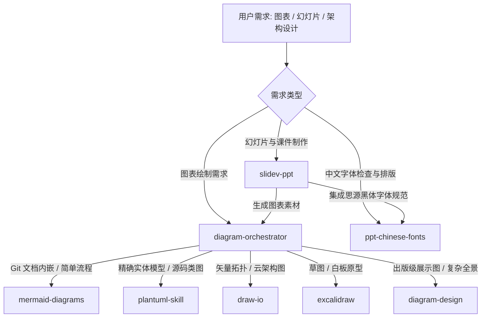

# OpenCode Skills 目录索引

本目录包含了为本项目定制的 OpenCode 专家技能（Skills），涵盖**架构图表绘制、UML 建模、演示文稿排版与交互式 Slidev 课件生成**等全套技术支撑能力。

---

## 技能概览一览表

| 技能名称 (Directory) | 主要定位与职责 | 支持格式 / 产物 | 推荐使用场景 |
| :--- | :--- | :--- | :--- |
| [**`diagram-orchestrator`**](./diagram-orchestrator) | **图表总调度器** 根据图表需求智能路由到最适合的专用绘图技能 | 路由分发 / 格式转换 | 处理任何不确定具体绘图工具的图表请求时的统一入口 |
| [**`mermaid-diagrams`**](./mermaid-diagrams) | **Markdown 原生图表** 适合 Git 版本控制的轻量级流程图与结构图 | Mermaid (`.mmd` / fenced block) | 课程文档、Git 变更流、标准 UML 类图、时序图、C4 架构视图 |
| [**`plantuml-skill`**](./plantuml-skill) | **严谨工业级 UML 建模** 精准描述类继承、复杂时序与系统组件 | `.puml` 源码、SVG、PNG | 从 C++ 源码逆向建模、复杂设计模式类图、接口与时序交互 |
| [**`draw-io`**](./draw-io) | **交互式矢量图绘制** 支持精确布局与 AWS/系统云架构图标 | `.drawio` (XML)、PNG | 需手动微调版面、云原生架构拓扑、商业汇报架构图 |
| [**`excalidraw`**](./excalidraw) | **手绘与白板风格绘图** 轻松自由的原型与头脑风暴草图 | `.excalidraw` (JSON) | 早期架构头脑风暴、算法白板草图、非正式技术讨论草案 |
| [**`diagram-design`**](./diagram-design) | **品牌级 / 出版级图表系统** 支持 45 种高阶图表类型与定制风格 | 独立 HTML (内联 SVG)、PNG | 技术博客插图、演进差量图（Delta）、数据流、雷达图、桑基图 |
| [**`ppt-chinese-fonts`**](./ppt-chinese-fonts) | **演示文稿中文字体规范** 建立统一跨平台的思源黑体字体栈 | 字体规范、字体检测脚本 | PPT / Slidev 中文排版、解决跨平台文字替换与字形缺失 |
| [**`slidev-ppt`**](./slidev-ppt) | **C++ 系列课程交互式幻灯片** 自动将课程大纲转为 Slidev 课件 | Slidev Markdown (`slides.md`) | 制作现代 C++ 课件、带代码高亮与动态图表的互动演示 |

---

## 核心工作流与推荐路由策略

在进行架构设计与课程课件制作时，推荐遵循以下分工模式：

---

## 详细技能介绍

### 1. `diagram-orchestrator`（绘图调度中心）
- **功能**：作为项目内所有图表任务的唯一入口（Single Entry Point）。负责评估输入需求，在 Mermaid、PlantUML、draw.io、Excalidraw 和 Diagram Design 之间做最优决策。
- **调用规则**：若用户未指定绘图工具且用于 Markdown 文档，优先推荐 `mermaid-diagrams`；若涉及复杂面向对象架构建模，推荐 `plantuml-skill`。

### 2. `mermaid-diagrams`（Mermaid 图表系统）
- **功能**：提供高质量 Mermaid 代码块，涵盖 Flowchart、Sequence、Class Diagram、State Diagram、Entity Relationship（ERD）、Architecture Diagram 与 C4 架构模型。
- **规范**：遵循简洁命名、清晰流向、严格转义的工程规范。

### 3. `plantuml-skill`（PlantUML 专业建模）
- **功能**：生成可维护的 `.puml` 纯文本模型定义，并支持本地渲染为 PNG/SVG。
- **特性**：内置 C++ 设计模式标准模板、安全渲染建议与排版样式指南，不依赖不可信外部公共服务。

### 4. `draw-io`（draw.io 矢量图设计）
- **功能**：直接编辑 `.drawio` XML 源文件，支持 AWS 架构图标库和中英文字体样式注入。
- **规范**：仅维护 `.drawio` 源文件，配合构建脚本或预提交钩子生成 `.drawio.png`。

### 5. `excalidraw`（Excalidraw 虚拟白板）
- **功能**：生成和更新 `.excalidraw` 结构化 JSON 数据。
- **特点**：对于大体积 JSON 文件，支持隔离委托以保护主上下文窗口。

### 6. `diagram-design`（出版级 HTML/SVG 编辑设计系统）
- **功能**：包含 45 种专业视觉类型，生成自包含样式和内联 SVG 的独立 HTML 页面，色彩系统遵循品牌标准规范。
- **适用**：复杂系统架构全景、生命周期演进图、技术雷达图、数据湖全景等高阶演示材料。

### 7. `ppt-chinese-fonts`（PPT 中文字体系统）
- **功能**：建立以**思源黑体（Noto Sans CJK / Source Han Sans）**为基准的中文字体标准栈。
- **覆盖**：区分简体中文（SC）、繁体中文（TC / HK）、日文（JP）与韩文（KR），提供等宽代码字体建议与检测工具。

### 8. `slidev-ppt`（Slidev 交互课件生成器）
- **功能**：将 C++ 教学大纲转化为可直接通过 `npm run dev` 运行的交互式 Slidev 幻灯片。
- **技术栈**：深度整合暗色工程主题、Vue3 自定义组件（Callout、Quote 等）、演讲者备注（Notes）以及代码块逐步运行高亮。

---

## 目录维护规范

1. **版本控制**：所有 skill 目录内的文档、配置、资源模板及代码示例均受 Git 追踪管理。
2. **依赖隔离**：`.opencode/node_modules/` 与构建缓存受 `.gitignore` 规则忽略，不提交二进制依赖。
3. **独立分发**：每个技能目录内均包含自包含的 `SKILL.md`，可作为 OpenCode 标准插件独立安装或迁移。
