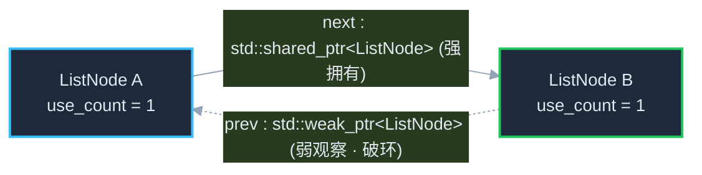

# Slidev Dark Blueprint Presets for C++ Presentations

When `slidev-ppt` or `diagram-orchestrator` selects `mermaid-diagrams` for a slide in `slides/lesson-0X.md`, always follow these rules and templates so the diagram matches the Slidev Dark Blueprint theme (`--pc-*`).

## 1. Standard Slidev Dark Init Block

Copy this header into every Mermaid block in `slides/*.md`:

````markdown
```mermaid
%%{init: {
  'theme': 'base',
  'themeVariables': {
    'background': 'transparent',
    'primaryColor': '#1e293b',
    'primaryTextColor': '#e2e8f0',
    'primaryBorderColor': '#38bdf8',
    'lineColor': '#94a3b8',
    'secondaryColor': '#0f172a',
    'tertiaryColor': '#1e293b',
    'fontFamily': 'Noto Sans CJK SC, JetBrains Mono, sans-serif',
    'fontSize': '14px'
  }
}}%%
flowchart LR
  classDef good fill:#1e293b,stroke:#22c55e,stroke-width:2px,color:#e2e8f0
  classDef bad fill:#1e293b,stroke:#ef4444,stroke-width:2px,color:#e2e8f0
  classDef info fill:#1e293b,stroke:#38bdf8,stroke-width:2px,color:#e2e8f0
  classDef violet fill:#1e293b,stroke:#a78bfa,stroke-width:2px,stroke-dasharray: 5 5,color:#e2e8f0
```
````

## 2. C++ Syntax Escaping in Slidev Markdown

- **Angle brackets (`<T>`)**: Slidev compiles Markdown with Vue MDC (`mdc: true`). Raw `<Widget>` or `<T>` inside a Mermaid block can be misinterpreted as a Vue component tag. Always quote node labels and escape `<` and `>` as `&lt;` and `&gt;`:
  - ❌ `A[std::unique_ptr<Widget>]`
  - ✅ `A["std::unique_ptr&lt;Widget&gt;"]`
- **Namespace colons (`::`)**: Inside `flowchart`, always wrap labels containing `std::` in double quotes `"..."`.

## 3. C++ Course Diagram Templates

### A. `shared_ptr` + `weak_ptr` Breaking Circular Dependency (`ListNode`)

````markdown

````

### B. `#include` Physical Dependency vs Compilation Firewall (Pimpl / Bridge)

````markdown

````
