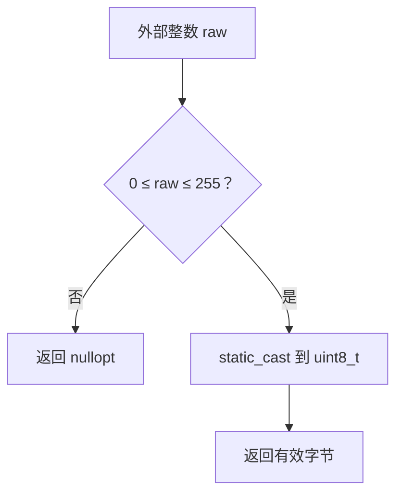

# Day 02 · 变量、统一初始化与安全类型转换

<!-- cpp-standards:start -->
## 本课涉及的 C++ 标准

以下按正文与配套 `.cpp` 示例中出现的特性标注首次标准化版本，不代表整份程序的最低编译版本。仓库主 Lab 统一使用 C++23。

| 特性 | 首次标准化 | 版本边界 |
| --- | --- | --- |
| 列表初始化 | **C++11** | 包括直接列表初始化；窄化检查及 initializer_list 优先规则须单独注意。 |
| `auto` 类型推导 | **C++11** | C++14 才支持普通函数返回类型推导；C++20 才支持 `auto` 形参的简写函数模板。 |
| `<cstdint>` 固定宽度整数 | **C++11** | 精确宽度类型仅在实现提供对应整数类型时存在。 |
| `std::optional` / `std::nullopt` | **C++17** | 可选值；不自带错误原因。 |

版本差异、旧机制与工具链检查见 [C++ 标准来源速查](../docs/cpp-feature-standards.md)。
<!-- cpp-standards:end -->

## ① 今日阅读范围 · 5 分钟

### 新手起步：先知道今天在解决什么

变量的类型决定能保存什么。先区分“创建时给值”和“后来赋值”，再看有符号数、无符号数的范围，最后才做类型转换。

**前置检查：** 先能解释 [Day 1](day-001-from-c-to-modern-cpp.md) 的核心例子；不必先掌握整本教材。

**本课最低完成目标：** 能按下面的步骤说明示例如何得到结果，并独立完成一项小修改；高级模式与平台性能分析可第二遍再读。新增导读和拓展练习不计入原有约 60 分钟安排，可分两次完成。

Chapter 1 中变量初始化、基本类型、auto 与显式转换。

## ② 昨日复习 · 5 分钟

命名空间解决什么问题？固定容量容器如何遍历？main 的成功退出码是多少？

## ③ 核心概念 · 12 分钟

### 先用白话建立概念

- **初始化**：对象创建时获得初始值。
- **窄化**：转换可能丢失信息。

### 跟着本课实验走一遍

1. 读取 `ToByte` 的输入整数。
2. 先检查下界 0 和上界 255。
3. 合法时转换，非法时返回空的 `optional`。

先尝试口头预测，再到第⑥节运行。下面原有概念、图示与接口对照用于解释这些步骤，短代码片段不一定能单独编译；完整程序以本课 `main.cpp` 为准。

局部标量必须初始化。花括号初始化会拒绝多种窄化转换，例如 `int count{3.5};` 编译失败。`auto` 推导变量类型，不等于动态类型；`auto value = 3.5` 是 double。`static_cast` 明确转换意图，但不会替你验证范围或协议语义。边界数据必须先检查再转换，尤其是负数转无符号数、宽整数转窄整数。



## ④ C 写法 vs Modern C++ · 8 分钟

C 风格 `(unsigned char)raw` 容易隐藏截断；现代 C++ 用返回 `std::optional<std::uint8_t>` 的边界函数，把失败和有效字节区别开。

## ⑤ 今日编码规范 · 8 分钟

变量声明时初始化；边界转换必须检查上下界；内部计算尽量保持同一类型，最后再转换成协议类型。

## ⑥ 可编译实验 · 15 分钟

### 第一次做：先运行，再只改一件事

1. 在仓库根目录打开 [`examples/day-002/main.cpp`](../examples/day-002/main.cpp)，先读 `main()`，圈出输入、调用与结果检查。
2. 运行原版，把实际输出和退出状态记下来，再与本节预期对照。无输出也可能成功，必须结合退出码与断言判断。
3. 修改前先写预期；若失败，先读第一条编译错误或失败断言，再回到对应概念，不同时重写多个函数。

**本课小改动：** 列出 -1、0、255、256 四种输入，对照已有断言判断成功或失败；再增加 127，预期成功且数值不变。

<details>
<summary>练习提示：卡住时再展开</summary>

把上面的执行步骤当作检查点；保留原版作为对照。若练习故意让编译或断言失败，请只在实验副本操作，解释失败后还原，不把负例混入日常通过用例。不要执行越界、悬空解引用或重复释放来“观察效果”。

</details>

实现整数到字节的受检转换。覆盖 -1、0、255、256，确认失败值不会写入设备。

完整源码：[main.cpp](../examples/day-002/main.cpp)。

```cpp
#include <cassert>
#include <cstdint>
#include <iostream>
#include <limits>
#include <optional>
std::optional<std::uint8_t> ToByte(int raw) {
  if (raw < 0 || raw > std::numeric_limits<std::uint8_t>::max()) {
    return std::nullopt;
  }
  return static_cast<std::uint8_t>(raw);
}
int main() {
  assert(!ToByte(-1));
  assert(ToByte(0).value() == 0);
  assert(ToByte(255).value() == 255);
  assert(!ToByte(256));
  std::cout << "255 accepted; out-of-range rejected\n";
}
```

在仓库根目录运行：

```bash
g++ -std=c++23 -Wall -Wextra -Wconversion -Wpedantic examples/day-002/main.cpp -o /tmp/day-002
/tmp/day-002
```

预期输出：`255 accepted; out-of-range rejected`。实验中的断言用于验证用例，不代替生产代码的错误处理。请勿使用 `-DNDEBUG` 运行这些自测。

## ⑦ 常见坑 · 3 分钟

以为 static_cast 会自动检查范围；先把 -1 转换为无符号数再做检查；误以为花括号阻止窄化就能保证运行时数值安全。

## ⑧ 自测 · 4 分钟

### 分层自测：从解释到判断

1. **理解：** 不看代码，用三句话复述本课示例的输入、关键步骤和结果。
2. **应用：** 说明第⑥节小改动的预期，以及实际结果是否符合预期。
3. **辨析：** 写了 `static_cast` 就能省略范围检查吗？

<details>
<summary>辨析题参考答案与通过依据</summary>

不能；转换只表达转换意图，不替你证明值在目标类型范围内。

能运行只是第一步。只有能解释本课具体步骤、完成小改动，并说清一个不适用条件，才算完成本次自测；不清楚时回看第③节，不以阅读次数当作掌握证据。

</details>

### 原课检查题

static_cast 到 uint8_t 前应检查什么？auto port = 80 的类型是什么？

<details>
<summary>参考答案（先独立回答）</summary>

检查 0 到 uint8_t 的最大值范围；80 是 int 字面量，因此 port 为 int。

</details>

### 对照现有资料库

- [实验环境与工具链边界](<../docs/lab-environments.md>)。
- [类型、借用与错误处理规范](<../guidelines/embedded-cpp-guideline-notes.md>)。

先完成本课小实验，再查对照资料；专题中的线程、网络、板端或模式不是本课默认前置。以上为本项目已有讲解和工程对照，不冒充标准条文，也不表示所有示例已在目标板验证。

## 下一步

继续 Day 3；若实验或自测仍不确定，先回到对应概念再复盘。
