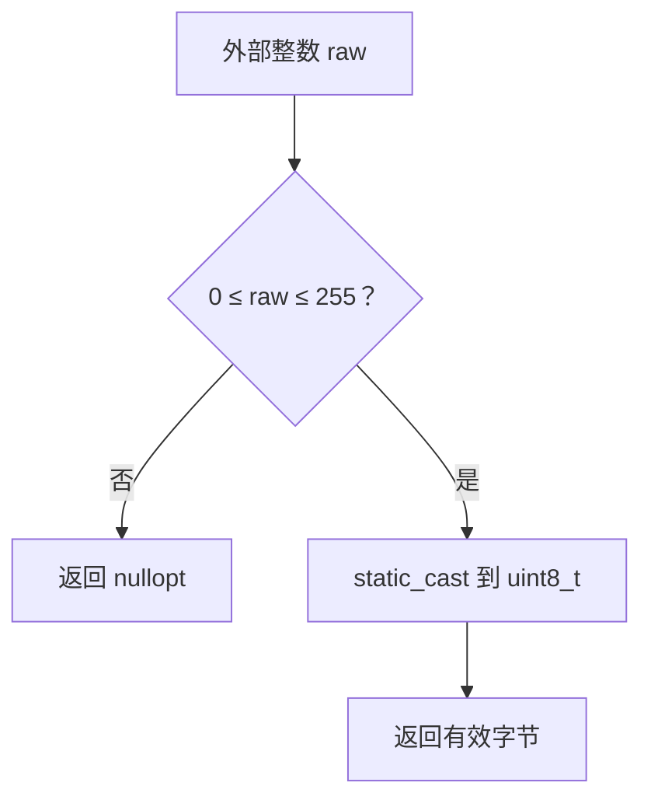

# Day 02 · 变量、统一初始化与安全类型转换

## ① 今日阅读范围 · 5 分钟

Chapter 1 中变量初始化、基本类型、auto 与显式转换。

阅读目标：能解释本课规则的适用条件，并在下面的实验中验证它。

## ② 昨日复习 · 5 分钟

命名空间解决什么问题？固定容量容器如何遍历？main 的成功退出码是多少？

先合上资料口头回答；不确定的部分记录到复习队列。

## ③ 核心概念 · 12 分钟

局部标量必须初始化。花括号初始化会拒绝多种窄化转换，例如 `int count{3.5};` 编译失败。`auto` 推导变量类型，不等于动态类型；`auto value = 3.5` 是 double。`static_cast` 明确转换意图，但不会替你验证范围或协议语义。边界数据必须先检查再转换，尤其是负数转无符号数、宽整数转窄整数。



图表描述本课学习路径或关键决策，具体行为以代码与接口契约为准。

## ④ C 写法 vs Modern C++ · 8 分钟

C 风格 `(unsigned char)raw` 容易隐藏截断；现代 C++ 用返回 `std::optional<std::uint8_t>` 的边界函数，把失败和有效字节区别开。

改写时分别检查：类型是否表达意图、失败是否可见、所有权是否清楚。

## ⑤ 今日编码规范 · 8 分钟

变量声明时初始化；边界转换必须检查上下界；内部计算尽量保持同一类型，最后再转换成协议类型。

Code Review 时说明规则如何帮助当前场景，不将风格约定当成运行时安全证明。

## ⑥ 可编译实验 · 15 分钟

实现整数到字节的受检转换。覆盖 -1、0、255、256，确认失败值不会写入设备。

完整源码：[main.cpp](../examples/day-002/main.cpp)。

```cpp
#include <cassert>
#include <cstdint>
#include <iostream>
#include <limits>
#include <optional>
std::optional<std::uint8_t> ToByte(int raw) {
  if (raw < 0 || raw > std::numeric_limits<std::uint8_t>::max()) {
    return std::nullopt;
  }
  return static_cast<std::uint8_t>(raw);
}
int main() {
  assert(!ToByte(-1));
  assert(ToByte(0).value() == 0);
  assert(ToByte(255).value() == 255);
  assert(!ToByte(256));
  std::cout << "255 accepted; out-of-range rejected\n";
}
```

在仓库根目录运行：

```bash
g++ -std=c++23 -Wall -Wextra -Wconversion -Wpedantic examples/day-002/main.cpp -o /tmp/day-002
/tmp/day-002
```

预期输出：`255 accepted; out-of-range rejected`。实验中的断言用于验证用例，不代替生产代码的错误处理。请勿使用 `-DNDEBUG` 运行这些自测。

## ⑦ 常见坑 · 3 分钟

以为 static_cast 自动做范围检查；将 -1 转换成 unsigned 后再检查；把花括号能阻止窄化理解为能证明所有运行时数值安全。

检查实验是否覆盖了失败分支；只有正常输入通过不足以证明边界行为正确。

## ⑧ 自测 · 4 分钟

static_cast 到 uint8_t 前应检查什么？auto port = 80 的类型是什么？

<details>
<summary>参考答案（先独立回答）</summary>

检查 0 到 uint8_t 的最大值范围；80 是 int 字面量，因此 port 为 int。

</details>

## 下一步

继续 Day 3；若实验或自测仍不确定，先回到对应概念再复盘。
