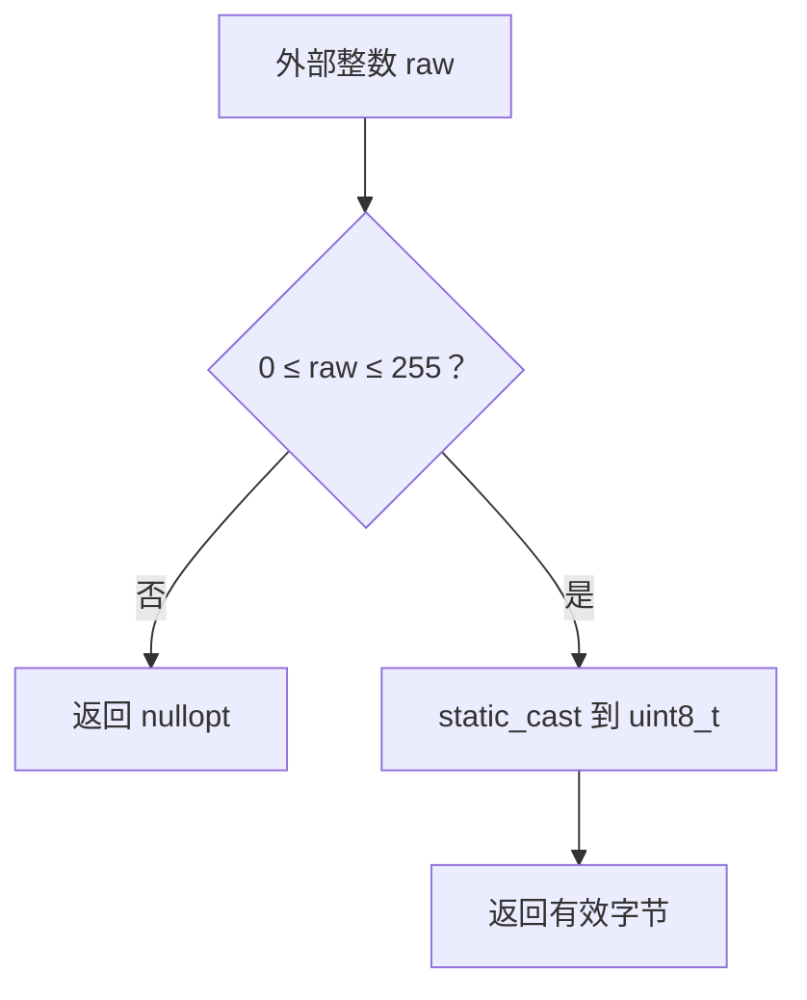

# Day 02 · 变量、统一初始化与安全类型转换

<!-- cpp-standards:start -->

## 本课涉及的 C++ 标准

以下按正文与配套 `.cpp` 示例中出现的特性标注首次标准化版本，不代表整份程序的最低编译版本。仓库主 Lab 统一使用 C++23。

| 特性                             | 首次标准化 | 版本边界                                                                   |
| -------------------------------- | ---------- | -------------------------------------------------------------------------- |
| 列表初始化                       | **C++11**  | 包括直接列表初始化；窄化检查及 initializer_list 优先规则须单独注意。       |
| `auto` 类型推导                  | **C++11**  | C++14 才支持普通函数返回类型推导；C++20 才支持 `auto` 形参的简写函数模板。 |
| `<cstdint>` 固定宽度整数         | **C++11**  | 精确宽度类型仅在实现提供对应整数类型时存在。                               |
| `std::optional` / `std::nullopt` | **C++17**  | 可选值；不自带错误原因。                                                   |

版本差异、旧机制与工具链检查见 [C++ 标准来源速查](../docs/cpp-feature-standards.md)。

<!-- cpp-standards:end -->

## ① 今日阅读范围 · 5 分钟

### 新手起步：先知道今天在解决什么

变量的类型决定能保存什么。先区分“创建时给值”和“后来赋值”，再看有符号数、无符号数的范围，最后才做类型转换。

**1. 变量类型决定存储与操作**

C++ 是一门**强类型语言**。变量的类型直接决定了：

- **内存空间大小**：例如 `short` 通常占 2 字节，`int` 占 4 字节，`long long` 占 8 字节。
- **存储与解读方式**：同样的二进制位，在 `int` 中解读为补码整数，在 `float` 中解读为 IEEE 754 浮点数，在 `char` 中解读为字符1。
- **合法操作集**：类型限制了对该变量能执行哪些运算符（如不能对 `double` 执行 `%` 取模操作）.

**2. 区分“创建时给值”（初始化）与“后来赋值”（赋值）**

这两者在 C++ 底层有着本质的区别78：

- **初始化（Initialization）**：在变量**分配内存声明创建**的同时赋予初始值79。
  - 如果声明变量时不给予初始值（未初始化变量），栈上的局部变量会保留内存中的**随机垃圾值**，是引发严重 Bug 的主要根源7more_horiz。
  - 现代 C++ 推荐使用**统一初始化（Uniform Initialization** **{}****）**，如 `int x { 3 };。它的核心优势是可以阻止**窄化转换（Narrowing Conversion）**，例如 `int x { 3.14 };` 会直接触发编译错误。
  - 诸如 **const** **常量**、**引用（****reference****）** 以及**没有默认构造函数的类成员**，必须在创建时初始化，无法在后续进行“赋值”。
- **赋值（Assignment）**：对**已经存在且已具备合法状态**的变量覆盖其当前的值（使用 `operator=`）对于自定义类或复杂资源，拷贝构造函数（用于初始化）与赋值运算符（用于赋值）的实现逻辑完全不同，后者还需要妥善处理旧资源的释放与异常安全性（如采用 copy-and-swap 模式）

**3. 有符号数（Signed）与无符号数（Unsigned）的范围**

在理解了基本类型和初始化后，需要掌握整数精度的数值边界3：

- **signed**：最高位为符号位，可表示正数、负数与 0。例如 4 字节 `int` 范围为 -2,147,483,648 到 2,147,483,647。
- **unsigned**：无符号数，仅能表示非负数（$\ge 0$），同字节下正数最大值扩大一倍。例如 4 字节 `unsigned int` 范围为 0到 4,294,967,295。
- **边界与混合运算风险**：当有符号数与无符号数混合比较或计算时（例如 `-1 > 0u`），C++ 会隐式将有符号数转换为无符号数（使 `-1` 变成极大的无符号整数，结果返回 `true`）现代 C++ 推荐使用 `<utility>` 库中的安全比较函数（如 `std::cmp_greater(-1, 0u)`）来规避此风险。

**4. 类型转换（Type Casting / Conversions）**

只有在完全明确了类型存储与数值范围后，才能安全地进行类型转换：

- **隐式转换（Implicit Conversion）**：编译器在运算或赋值时自动进行（如将 `short` 提升为 `long`）。但隐式窄化转换（如 `float` 赋值给 `int` 截断小数部分）容易造成数据丢失。
- **显式转换（Explicit Casts）**：应严格避免 C 风格强转 `(int)x`，全面采用现代 C++ 具名强转：
  1. **static_cast<T>()**：用于语言支持的合法转换（如浮点转整型、`void*` 恢复为具体指针类型、继承体系中的向上/向下转换）。
  2. **const_cast<T>()**：专门用于添加或移除变量的 `const` 属性。
  3. **reinterpret_cast<T>()**：无类型检查的底层位模式重解释（如不相关指针类型强转），需谨慎使用。
  4. **dynamic_cast<T>()**：用于带虚函数表的多态类继承体系，在运行时安全地向下转换（转换失败指针返回 `nullptr`，引用抛出 `bad_cast` 异常）。
  5. **std::bit_cast<T>()**（C++20）：在两个大小相同且均为可平凡拷贝（Trivially Copyable）的类型间直接按位拷贝转换。

**前置检查：** 先能解释 [Day 1](day-001-from-c-to-modern-cpp.md) 的核心例子；不必先掌握整本教材。

**本课最低完成目标：** 能按下面的步骤说明示例如何得到结果，并独立完成一项小修改；高级模式与平台性能分析可第二遍再读。新增导读和拓展练习不计入原有约 60 分钟安排，可分两次完成。

Chapter 1 中变量初始化、基本类型、auto 与显式转换。

## ② 昨日复习 · 5 分钟

**命名空间解决什么问题？**

- 解决的核心问题：命名空间主要用于解决不同代码块或第三方库之间的**名称冲突（Naming Conflicts / Name Clashes）**问题。
- 实现机制：命名空间为标识符（如变量、函数、类等）定义了具体的声明上下文（Context）。例如，当编写的代码中包含函数 `foo()`，而引入的第三方库中也恰好有同名的 `foo()` 函数时，编译器将无法识别具体的调用对象。通过将代码包裹在独立的命名空间中（如 `mycode::foo()`），可以将自定义函数与第三方库的标识符互相隔离，从而避免重名引发的编译错误。

**固定容量容器如何遍历？**

在 Modern C++ 中，标准的固定容量容器是 std::array。遍历 `std::array` 等固定容量容器常用的方式有以下几种：

- 基于范围的 for 循环（Range-based for loop，推荐） 最简洁且不容易出错的遍历方式，支持按值或按引用（只读/可修改）访问元素：

```
std::array<int, 3> arr{9, 8, 7};
for (const auto& elem : arr) {
    // 读取 elem
}
```

- 使用迭代器（Iterators） 使用 `begin()`/`end()` 或只读的 `cbegin()`/`cend()` 进行标准迭代器遍历：

```
for (auto iter = std::cbegin(arr); iter != std::cend(arr); ++iter) {
    // 使用 *iter 访问元素
}
```

- 基于索引/下标遍历（Index-based loop） 通过成员函数 `size()` 或 `std::size()` 获取容器固有大小，结合 `operator[]` 或 `.at()` 索引访问：

```
for (std::size_t i = 0; i < arr.size(); ++i) {
    // 使用 arr[i] 访问元素
}
```

- C++23 格式化打印/范围（Ranges） 在 C++23 中，如果仅需打印显示，可以直接结合 `std::println` 对容器整体进行格式化输出：

```
std::println("{:n}", arr); // 输出形如: 9, 8, 7
```

**main 的成功退出码是多少？**

`main` 函数的成功退出码

- 成功的退出码：0（或头文件中定义的标准宏 EXIT_SUCCESS）。
- 含义与机制：`main()` 函数的返回值类型为 `int`，当其返回 `0` 时，通常向操作系统传达程序已顺利执行且未发生错误的信号；非零值则代表发生了异常或错误。
- 隐式返回：在 `main()` 函数中，`return` 语句是可选的。如果程序员未显式编写 `return` 语句，编译器会自动隐式添加 `return 0;`


## ③ 核心概念 · 12 分钟

### 先用白话建立概念

- **初始化**：对象创建时获得初始值。
- **窄化**：转换可能丢失信息。

### 跟着本课实验走一遍

1. 读取 `ToByte` 的输入整数。
2. 先检查下界 0 和上界 255。
3. 合法时转换，非法时返回空的 `optional`。

先尝试口头预测，再到第⑥节运行。下面原有概念、图示与接口对照用于解释这些步骤，短代码片段不一定能单独编译；完整程序以本课 `main.cpp` 为准。

局部标量必须初始化。花括号初始化会拒绝多种窄化转换，例如 `int count{3.5};` 编译失败。`auto` 推导变量类型，不等于动态类型；`auto value = 3.5` 是 double。`static_cast` 明确转换意图，但不会替你验证范围或协议语义。边界数据必须先检查再转换，尤其是负数转无符号数、宽整数转窄整数。



## ④ C 写法 vs Modern C++ · 8 分钟

C 风格 `(unsigned char)raw` 容易隐藏截断；现代 C++ 用返回 `std::optional<std::uint8_t>` 的边界函数，把失败和有效字节区别开。

在 C++ 中，建议始终使用 C++ 风格的五种类型转换来替代容易出错的旧式 C 风格转换。以下是每种类型转换在典型场景下的具体代码与用法说明：

**1. `static_cast()`：语言直接支持的合法显式转换**
`static_cast()` 遵循 C++ 类型规则，用于执行基础类型转换、`void*` 指针还原以及继承体系中的转换。

- **基础类型转换（如浮点转整型、整型转浮点避免整数除法）：**

```c++
float myFloat { 3.14f };
int i3 { static_cast<int>(myFloat) }; // 截断小数部分，结果为 3

int i { 3 }, j { 4 };
double result { static_cast<double>(i) / j }; // 将 i 转为 double 以执行浮点数除法
```

- **`void*` 恢复为具体类型指针：**
  任何指针都可以隐式转换为 `void*`，而将 `void*` 还原回原本的具体指针类型只需使用 `static_cast()`。

```c++
class X {};
X x;
X* xp { &x };
void* p { xp };              // 隐式转换为 void*，无需显式转换
xp = static_cast<X*>(p);     // 使用 static_cast 从 void* 还原为 X*
```

- **继承体系中的向上/向下转换：**
  向上转换（Upcasting）可以隐式完成，而向下转换（Downcasting）可以使用 `static_cast()` 显式完成（适用于指针和引用，但不对直属对象本身生效）。注意它**不执行运行时类型检查**，若基类指针实际并未指向派生类对象，转换后访问会导致内存越界等严重后果。

```c++

class Base { public: virtual ~Base() = default; };
class Derived : public Base { public: virtual ~Derived() = default; };

Base* b { nullptr };
Derived* d { new Derived {} };
b = d;                             // 向上转换无需显式转换
d = static_cast<Derived*>(b);      // 向下转换需使用显式转换

Derived derived;
Base& br { derived };
Derived& dr { static_cast<Derived&>(br) }; // 引用的向下转换
```

**2. `const_cast()`：添加或移除变量的 `const` 属性**
`const_cast()` 是五种转换中唯一允许移除 `const` 属性的转换。若只需添加 `const` 属性，更推荐使用 `<utility>` 中的 `std::as_const()` 辅助函数。

- **场景一：兼容未标记 `const` 的第三方库函数**
  当你确定某个接收非 `const` 参数的第三方函数内部绝不会修改传入的数据时，可用它移除 `const` 属性以通过编译：

```c++
void thirdPartyLibraryFunction(char* str);

void f(const char* str) {
    thirdPartyLibraryFunction(const_cast<char*>(str));
}
```

- **场景二：Scott Meyers 的 `const_cast` 模式（避免重载函数的代码重复）**
  在类中同时提供 `const` 和非 `const` 版本的成员函数（如 `getCellAt()`）时，可以让非 `const` 版本调用 `const` 版本，从而复用校验与读取逻辑：

```c++
const SpreadsheetCell& Spreadsheet::getCellAt(size_t x, size_t y) const {
    verifyCoordinate(x, y);
    return m_cells[x][y];
}

SpreadsheetCell& Spreadsheet::getCellAt(size_t x, size_t y) {
    // 先用 as_const 将 *this 转为 const 引用以调用上面的 const 重载，再用 const_cast 移除返回值的 const
    return const_cast<SpreadsheetCell&>(std::as_const(*this).getCellAt(x, y));
}
```

**3. `reinterpret_cast()`：无类型检查的底层重解释**
`reinterpret_cast()` 比 `static_cast()` 更底层且更危险，它不执行任何类型检查，允许在不相关的指针类型、不相关的引用类型之间强转，或将指针转换为足够大的整型（如将 64 位指针转为 32 位整型会导致编译错误）。

```c++
class X {};
class Y {};

int main() {
    X x;
    Y y;
    X* xp { &x };
    Y* yp { &y };

    // 将不相关类的指针 Y* 强转为 X*（此时用 static_cast 会编译报错）
    xp = reinterpret_cast<X*>(yp);

    // 将不相关类的引用强转
    X& xr { x };
    Y& yr { reinterpret_cast<Y&>(x) };
}
```

**4. `dynamic_cast()`：多态继承体系下的运行时安全转换**
`dynamic_cast()` 利用存储在虚函数表（vtable）中的运行时类型信息（RTTI）对继承体系内的转换进行安全检查。因此，被转换的类**必须至少拥有一个虚函数**，否则会导致编译错误。

- **指针的安全向下转换（失败返回 `nullptr`）：**

```c++
class Base { public: virtual ~Base() = default; };
class Derived : public Base { public: virtual ~Derived() = default; };

void lessPresumptuous(Base* base) {
    Derived* myDerived { dynamic_cast<Derived*>(base) };
    if (myDerived != nullptr) {
        // 转换成功，安全访问 Derived 的成员函数
    }
}
```

- **引用的安全向下转换（失败抛出 `std::bad_cast` 异常）：**
  因为不存在“空引用”，当对引用转换失败时会直接抛出异常：

```c++
Base base;
Base& br { base }; // br 实际引用的是基类对象而非派生类对象
try {
    Derived& dr { dynamic_cast<Derived&>(br) };
} catch (const std::bad_cast&) {
    println("Bad cast!");
}
```

**5. `std::bit_cast()`（C++20）：按位拷贝转换**
`std::bit_cast()` 定义在 `<bit>` 头文件中，是唯一属于标准库而非语言内置关键字的转换。它会创建一个目标类型的新对象，并将源对象的底层位（bits）直接拷贝过去，常用于平凡可拷贝类型的二进制 I/O 解析。它要求源类型和目标类型**大小完全相同**，且均为可平凡拷贝（Trivially Copyable）类型。

```C++
#include <bit>

float asFloat { 1.23f };
// 将 float 的底层位模式原样拷贝到一个新的 unsigned int 对象中
auto asUint { std::bit_cast<unsigned int>(asFloat) };

if (std::bit_cast<float>(asUint) == asFloat) {
    println("Roundtrip success.");
}
```

## ⑤ 今日编码规范 · 8 分钟

变量声明时初始化；边界转换必须检查上下界；内部计算尽量保持同一类型，最后再转换成协议类型。

## ⑥ 可编译实验 · 15 分钟

### 第一次做：先运行，再只改一件事

1. 在仓库根目录打开 [`examples/day-002/main.cpp`](../examples/day-002/main.cpp)，先读 `main()`，圈出输入、调用与结果检查。
2. 运行原版，把实际输出和退出状态记下来，再与本节预期对照。无输出也可能成功，必须结合退出码与断言判断。
3. 修改前先写预期；若失败，先读第一条编译错误或失败断言，再回到对应概念，不同时重写多个函数。

**本课小改动：** 列出 -1、0、255、256 四种输入，对照已有断言判断成功或失败；再增加 127，预期成功且数值不变。

<details>
<summary>练习提示：卡住时再展开</summary>

把上面的执行步骤当作检查点；保留原版作为对照。若练习故意让编译或断言失败，请只在实验副本操作，解释失败后还原，不把负例混入日常通过用例。不要执行越界、悬空解引用或重复释放来“观察效果”。

</details>

实现整数到字节的受检转换。覆盖 -1、0、255、256，确认失败值不会写入设备。

完整源码：[main.cpp](../examples/day-002/main.cpp)。

```cpp
#include <cassert>
#include <cstdint>
#include <iostream>
#include <limits>
#include <optional>
std::optional<std::uint8_t> ToByte(int raw) {
  if (raw < 0 || raw > std::numeric_limits<std::uint8_t>::max()) {
    return std::nullopt;
  }
  return static_cast<std::uint8_t>(raw);
}
int main() {
  assert(!ToByte(-1));
  assert(ToByte(0).value() == 0);
  assert(ToByte(255).value() == 255);
  assert(!ToByte(256));
  std::cout << "255 accepted; out-of-range rejected\n";
}
```

在仓库根目录运行：

```bash
g++ -std=c++23 -Wall -Wextra -Wconversion -Wpedantic examples/day-002/main.cpp -o /tmp/day-002
/tmp/day-002
```

预期输出：`255 accepted; out-of-range rejected`。实验中的断言用于验证用例，不代替生产代码的错误处理。请勿使用 `-DNDEBUG` 运行这些自测。

## ⑦ 常见坑 · 3 分钟

以为 static_cast 会自动检查范围；先把 -1 转换为无符号数再做检查；误以为花括号阻止窄化就能保证运行时数值安全。

## ⑧ 自测 · 4 分钟

### 分层自测：从解释到判断

1. **理解：** 不看代码，用三句话复述本课示例的输入、关键步骤和结果。
2. **应用：** 说明第⑥节小改动的预期，以及实际结果是否符合预期。
3. **辨析：** 写了 `static_cast` 就能省略范围检查吗？

<details>
<summary>辨析题参考答案与通过依据</summary>

不能；转换只表达转换意图，不替你证明值在目标类型范围内。

能运行只是第一步。只有能解释本课具体步骤、完成小改动，并说清一个不适用条件，才算完成本次自测；不清楚时回看第③节，不以阅读次数当作掌握证据。

</details>

### 原课检查题

static_cast 到 uint8_t 前应检查什么？auto port = 80 的类型是什么？

<details>
<summary>参考答案（先独立回答）</summary>

检查 0 到 uint8_t 的最大值范围；80 是 int 字面量，因此 port 为 int。

</details>

### 对照现有资料库

- [实验环境与工具链边界](<../docs/lab-environments.md>)。
- [类型、借用与错误处理规范](<../guidelines/embedded-cpp-guideline-notes.md>)。

先完成本课小实验，再查对照资料；专题中的线程、网络、板端或模式不是本课默认前置。以上为本项目已有讲解和工程对照，不冒充标准条文，也不表示所有示例已在目标板验证。

## 下一步

继续 Day 3；若实验或自测仍不确定，先回到对应概念再复盘。
