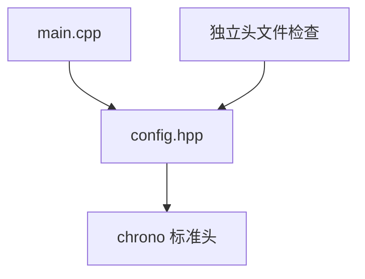

# Day 14 · 头文件、自包含与依赖边界

## ① 今日阅读范围 · 5 分钟

Chapter 3 中源文件组织、声明与定义，配合 include guard 和 Include What You Use。

阅读目标：能解释本课规则的适用条件，并在下面的实验中验证它。

## ② 昨日复习 · 5 分钟

命名怎样说明函数职责？const 引用是否延长任意被引用对象的生命周期？公共接口中应暴露哪些类型？

先合上资料口头回答；不确定的部分记录到复习队列。

## ③ 核心概念 · 12 分钟

自包含头文件应能在空翻译单元中独立包含。声明中使用 `std::chrono::milliseconds` 就要包含 `<chrono>`。include guard 防止同一翻译单元重复定义，不会解决跨翻译单元的 ODR 问题；头文件内普通函数定义需要 inline 或放到源文件。前置声明适合指针或引用声明；按值成员和需要类型布局的表达式通常要求完整定义。



图表展示关键步骤与判断；请结合下面的代码检查失败分支。

## ④ C 写法 vs Modern C++ · 8 分钟

不要依靠先包含 board.h 再包含 modem.h 的隐含顺序。让 modem.h 自己包含所需标准头，把具体芯片头留在实现文件。

改写时分别检查：类型是否表达意图、失败是否可见、所有权是否清楚。

## ⑤ 今日编码规范 · 8 分钟

本模块头文件放在实现文件的第一条 include；不要在公共头文件暴露不需要的硬件依赖；独立编译检查头文件。

Code Review 时说明规则如何帮助当前场景，不将风格约定当成运行时安全证明。

## ⑥ 可编译实验 · 15 分钟

创建自包含 config.hpp，独立包含两次并编译。主程序验证超时配置，随后删除 chrono 头文件，观察独立检查失败。

完整源码：[main.cpp](../examples/day-014/main.cpp)。

源码依赖同目录的 [config.hpp](../examples/day-014/config.hpp)，请在本地编译这个多文件实验。

```cpp
#include "config.hpp"
#include "config.hpp"
#include <cassert>
#include <iostream>
int main() {
  const modem::Config config{};
  assert(config.timeout.count() == 100);
  std::cout << "header is self-contained\n";
}
```

在仓库根目录运行：

```bash
g++ -std=c++23 -Wall -Wextra -Wconversion -Wpedantic examples/day-014/main.cpp -o /tmp/day-014
/tmp/day-014
```

预期输出：`header is self-contained`。实验中的断言用于验证用例，不代替生产代码的错误处理。请勿使用 `-DNDEBUG` 运行这些自测。

## ⑦ 常见坑 · 3 分钟

用 include guard 修复链接重复定义；靠间接 include 编译成功；按值成员只有前置声明却没有完整类型。

检查实验是否覆盖了失败分支；只有正常输入通过不足以证明边界行为正确。

## ⑧ 自测 · 4 分钟

为什么先包含自身头文件？前置声明可以支撑按值成员吗？

<details>
<summary>参考答案（先独立回答）</summary>

尽早发现头文件依赖不完整。按值成员需要已知大小和布局，通常必须包含完整类型定义。

</details>

## 下一步

继续 Day 15；若实验或自测仍不确定，先回到对应概念再复盘。
