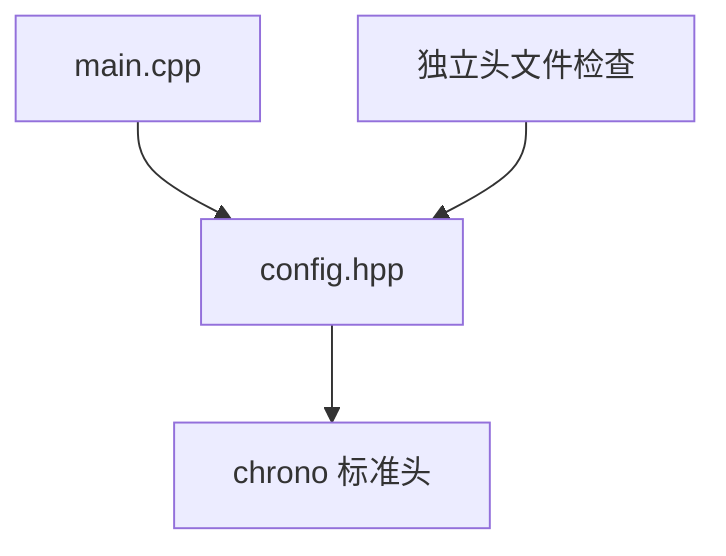

# Day 14 · 头文件、自包含与依赖边界

<!-- cpp-standards:start -->
## 本课涉及的 C++ 标准

以下按正文与配套 `.cpp` 示例中出现的特性标注首次标准化版本，不代表整份程序的最低编译版本。仓库主 Lab 统一使用 C++23。

| 特性 | 首次标准化 | 版本边界 |
| --- | --- | --- |
| `std::chrono` | **C++11** | 如 duration、time_point、steady_clock；不是所有 chrono 后增 API 都属于 C++11。 |

版本差异、旧机制与工具链检查见 [C++ 标准来源速查](../docs/cpp-feature-standards.md)。
<!-- cpp-standards:end -->

## ① 今日阅读范围 · 5 分钟

### 新手起步：先知道今天在解决什么

先区分编译与链接。头文件提供跨源文件共享的声明，自包含意味着它不依赖“调用者刚好先包含了另一个头”。

**前置检查：** 先能解释 [Day 1](day-001-from-c-to-modern-cpp.md)、[Day 4](day-004-references-parameter-passing.md)、[Day 13](day-013-coding-with-style-foundations.md) 的核心例子；不必先掌握整本教材。

**本课最低完成目标：** 能按下面的步骤说明示例如何得到结果，并独立完成一项小修改；高级模式与平台性能分析可第二遍再读。新增导读和拓展练习不计入原有约 60 分钟安排，可分两次完成。

Chapter 3 中源文件组织、声明与定义，配合 include guard 和 Include What You Use。

## ② 昨日复习 · 5 分钟

命名怎样说明函数职责？const 引用是否延长任意被引用对象的生命周期？公共接口中应暴露哪些类型？

## ③ 核心概念 · 12 分钟

### 先用白话建立概念

- **声明**：告诉编译器名字和类型。
- **定义**：提供实体或实现。

### 跟着本课实验走一遍

1. 找到配置头文件使用的标准类型。
2. 核对直接包含的标准头。
3. 单独包含该头，再链接运行实验。

先尝试口头预测，再到第⑥节运行。下面原有概念、图示与接口对照用于解释这些步骤，短代码片段不一定能单独编译；完整程序以本课 `main.cpp` 为准。

自包含头文件应能在空翻译单元中独立包含。声明中使用 `std::chrono::milliseconds` 就要包含 `<chrono>`。include guard 防止同一翻译单元重复定义，不会解决跨翻译单元的 ODR 问题；头文件内普通函数定义需要 inline 或放到源文件。前置声明适合指针或引用声明；按值成员和需要类型布局的表达式通常要求完整定义。



## ④ C 写法 vs Modern C++ · 8 分钟

不要依靠先包含 board.h 再包含 modem.h 的隐含顺序。让 modem.h 自己包含所需标准头，把具体芯片头留在实现文件。

## ⑤ 今日编码规范 · 8 分钟

本模块头文件放在实现文件的第一条 include；不要在公共头文件暴露不需要的硬件依赖；独立编译检查头文件。

## ⑥ 可编译实验 · 15 分钟

### 第一次做：先运行，再只改一件事

1. 在仓库根目录打开 [`examples/day-014/main.cpp`](../examples/day-014/main.cpp)，先读 `main()`，圈出输入、调用与结果检查。
2. 运行原版，把实际输出和退出状态记下来，再与本节预期对照。无输出也可能成功，必须结合退出码与断言判断。
3. 修改前先写预期；若失败，先读第一条编译错误或失败断言，再回到对应概念，不同时重写多个函数。

**本课小改动：** 在临时源文件中只包含本课头文件两次并做语法检查，预期既不缺声明也不发生重复定义。

<details>
<summary>练习提示：卡住时再展开</summary>

把上面的执行步骤当作检查点；保留原版作为对照。若练习故意让编译或断言失败，请只在实验副本操作，解释失败后还原，不把负例混入日常通过用例。不要执行越界、悬空解引用或重复释放来“观察效果”。

</details>

创建自包含 config.hpp，独立包含两次并编译。主程序验证超时配置，随后删除 chrono 头文件，观察独立检查失败。

完整源码：[main.cpp](../examples/day-014/main.cpp)。

源码依赖同目录的 [config.hpp](../examples/day-014/config.hpp)。网页实验室会自动展开本地头文件，可直接运行；本地仍保留多文件结构，便于练习头文件自包含检查。

```cpp
#include <cassert>
#include <iostream>

#include "config.hpp"
#include "config.hpp"  // Verify that the include guard permits repeated inclusion.
int main() {
  const modem::Config config{};
  assert(config.timeout.count() == 100);
  std::cout << "header is self-contained\n";
}
```

在仓库根目录运行：

```bash
g++ -std=c++23 -Wall -Wextra -Wconversion -Wpedantic examples/day-014/main.cpp -o /tmp/day-014
/tmp/day-014
```

预期输出：`header is self-contained`。实验中的断言用于验证用例，不代替生产代码的错误处理。请勿使用 `-DNDEBUG` 运行这些自测。

## ⑦ 常见坑 · 3 分钟

误用 include guard 解决链接阶段的符号重复定义；依赖间接包含侥幸通过编译；按值成员仅有前置声明而缺少完整类型定义。

## ⑧ 自测 · 4 分钟

### 分层自测：从解释到判断

1. **理解：** 不看代码，用三句话复述本课示例的输入、关键步骤和结果。
2. **应用：** 说明第⑥节小改动的预期，以及实际结果是否符合预期。
3. **辨析：** include guard 能解决所有重复定义吗？

<details>
<summary>辨析题参考答案与通过依据</summary>

不能；它主要防止同一翻译单元重复展开，跨翻译单元的定义还须遵守 ODR。

能运行只是第一步。只有能解释本课具体步骤、完成小改动，并说清一个不适用条件，才算完成本次自测；不清楚时回看第③节，不以阅读次数当作掌握证据。

</details>

### 原课检查题

为什么先包含自身头文件？前置声明可以支撑按值成员吗？

<details>
<summary>参考答案（先独立回答）</summary>

尽早发现头文件依赖不完整。按值成员需要已知大小和布局，通常必须包含完整类型定义。

</details>

### 对照现有资料库

- [编码规范与错误处理](<../guidelines/embedded-cpp-guideline-notes.md>)。
- [代码评审依据](<../guidelines/review-rubric.md>)。

先完成本课小实验，再查对照资料；专题中的线程、网络、板端或模式不是本课默认前置。以上为本项目已有讲解和工程对照，不冒充标准条文，也不表示所有示例已在目标板验证。

## 下一步

继续 Day 15；若实验或自测仍不确定，先回到对应概念再复盘。
