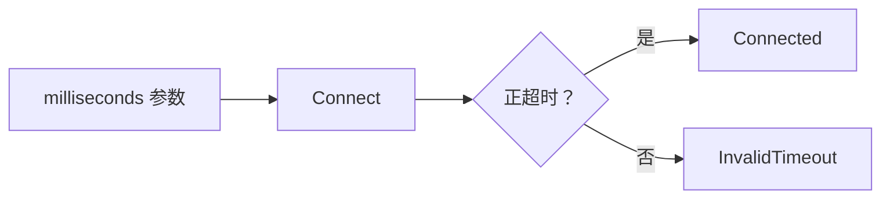

# Day 15 · 命名与接口意图

## ① 今日阅读范围 · 5 分钟

### 新手起步：先知道今天在解决什么

看调用点能否不查实现就理解含义。用 `milliseconds` 表达时长，比要求调用者牢记某个整数是毫秒更明确。

**前置检查：** 先能解释 [Day 6](day-006-enum-class-state-machine.md)、[Day 13](day-013-coding-with-style-foundations.md)、[Day 14](day-014-headers-iwyu-dependencies.md) 的核心例子；不必先掌握整本教材。

**本课最低完成目标：** 能按下面的步骤说明示例如何得到结果，并独立完成一项小修改；高级模式与平台性能分析可第二遍再读。新增导读和拓展练习不计入原有约 60 分钟安排，可分两次完成。

Chapter 3 中命名、常量与接口可读性；关注单位、动作和返回值。

## ② 昨日复习 · 5 分钟

自包含头文件如何检查？头文件暴露硬件定义的代价是什么？include guard 和 ODR 分别约束什么？

## ③ 核心概念 · 12 分钟

### 先用白话建立概念

- **单位类型**：把计量单位写进类型。
- **结果枚举**：具名的成功或失败分类。

### 跟着本课实验走一遍

1. 对照 100ms 和 0ms 两次调用。
2. 找到超时合法性检查。
3. 确认失败返回到调用者而非悄悄继续。

先尝试口头预测，再到第⑥节运行。下面原有概念、图示与接口对照用于解释这些步骤，短代码片段不一定能单独编译；完整程序以本课 `main.cpp` 为准。

名字应表达业务含义和单位：`timeout_ms` 比 `t` 明确，`std::chrono::milliseconds` 又比裸整数可靠。`enum class` 将“连接、断开”的动作与任意整数分开；bool 参数若会形成 `Set(true, false)`，应考虑具名配置或强类型选项。函数名应说明副作用，读取状态与发起连接不应混用。



## ④ C 写法 vs Modern C++ · 8 分钟

将 `Set(1, 100)` 改成 `Connect(std::chrono::milliseconds{100})`；返回具名枚举结果，调用点无需记忆整数编码。

## ⑤ 今日编码规范 · 8 分钟

保持仓库 PascalCase 函数与类型约定；变量用 snake_case；单位进类型或名字；禁止用缩写掩盖业务职责。

## ⑥ 可编译实验 · 15 分钟

### 第一次做：先运行，再只改一件事

1. 在仓库根目录打开 [`examples/day-015/main.cpp`](../examples/day-015/main.cpp)，先读 `main()`，圈出输入、调用与结果检查。
2. 运行原版，把实际输出和退出状态记下来，再与本节预期对照。无输出也可能成功，必须结合退出码与断言判断。
3. 修改前先写预期；若失败，先读第一条编译错误或失败断言，再回到对应概念，不同时重写多个函数。

**本课小改动：** 补一个负时长输入，预期与非正超时的约定一致；不要用隐式单位换算掩盖无效输入。

<details>
<summary>练习提示：卡住时再展开</summary>

把上面的执行步骤当作检查点；保留原版作为对照。若练习故意让编译或断言失败，请只在实验副本操作，解释失败后还原，不把负例混入日常通过用例。不要执行越界、悬空解引用或重复释放来“观察效果”。

</details>

实现 Connect，拒绝非正超时。增加错误分支时，确认每个返回值的名字能说明原因。

完整源码：[main.cpp](../examples/day-015/main.cpp)。

```cpp
#include <cassert>
#include <chrono>
#include <iostream>
enum class ConnectResult { Connected, InvalidTimeout };
ConnectResult Connect(std::chrono::milliseconds timeout) {
  if (timeout.count() <= 0) {
    return ConnectResult::InvalidTimeout;
  }
  return ConnectResult::Connected;
}
int main() {
  assert(Connect(std::chrono::milliseconds{100}) == ConnectResult::Connected);
  assert(Connect(std::chrono::milliseconds{0}) == ConnectResult::InvalidTimeout);
  std::cout << "timeout unit and result are explicit\n";
}
```

在仓库根目录运行：

```bash
g++ -std=c++23 -Wall -Wextra -Wconversion -Wpedantic examples/day-015/main.cpp -o /tmp/day-015
/tmp/day-015
```

预期输出：`timeout unit and result are explicit`。实验中的断言用于验证用例，不代替生产代码的错误处理。请勿使用 `-DNDEBUG` 运行这些自测。

## ⑦ 常见坑 · 3 分钟

只把短名字换成长名字而保留模糊职责；多个 bool 参数无法区分含义；名字带 ms 却传入秒。

## ⑧ 自测 · 4 分钟

### 分层自测：从解释到判断

1. **理解：** 不看代码，用三句话复述本课示例的输入、关键步骤和结果。
2. **应用：** 说明第⑥节小改动的预期，以及实际结果是否符合预期。
3. **辨析：** 参数名带 `_ms` 与强类型时长完全等价吗？

<details>
<summary>辨析题参考答案与通过依据</summary>

不等价；名称帮助人阅读，强类型还能参与编译期检查，两者各有作用。

能运行只是第一步。只有能解释本课具体步骤、完成小改动，并说清一个不适用条件，才算完成本次自测；不清楚时回看第③节，不以阅读次数当作掌握证据。

</details>

### 原课检查题

名字带单位与 chrono 类型各提供什么保证？返回 bool 何时不够？

<details>
<summary>参考答案（先独立回答）</summary>

名字帮助阅读，chrono 类型约束单位转换；有多个失败原因且调用者需要区别处理时，bool 不够。

</details>

### 对照现有资料库

- [编码规范与错误处理](<../guidelines/embedded-cpp-guideline-notes.md>)。
- [代码评审依据](<../guidelines/review-rubric.md>)。

先完成本课小实验，再查对照资料；专题中的线程、网络、板端或模式不是本课默认前置。以上为本项目已有讲解和工程对照，不冒充标准条文，也不表示所有示例已在目标板验证。

## 下一步

继续 Day 16；若实验或自测仍不确定，先回到对应概念再复盘。
