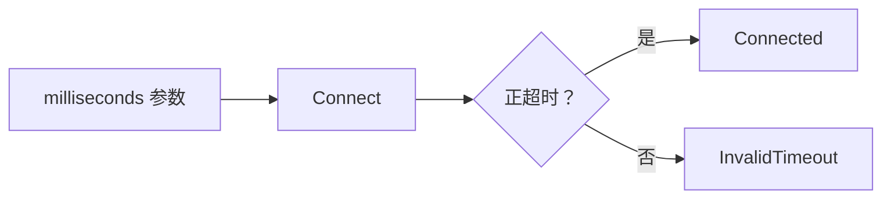

# Day 15 · 命名与接口意图

## ① 今日阅读范围 · 5 分钟

Chapter 3 中命名、常量与接口可读性；关注单位、动作和返回值。

阅读目标：能解释本课规则的适用条件，并在下面的实验中验证它。

## ② 昨日复习 · 5 分钟

自包含头文件如何检查？头文件暴露硬件定义的代价是什么？include guard 和 ODR 分别约束什么？

先合上资料口头回答；不确定的部分记录到复习队列。

## ③ 核心概念 · 12 分钟

名字应表达业务含义和单位：`timeout_ms` 比 `t` 明确，`std::chrono::milliseconds` 又比裸整数可靠。`enum class` 将“连接、断开”的动作与任意整数分开；bool 参数若会形成 `Set(true, false)`，应考虑具名配置或强类型选项。函数名应说明副作用，读取状态与发起连接不应混用。



图表展示关键步骤与判断；请结合下面的代码检查失败分支。

## ④ C 写法 vs Modern C++ · 8 分钟

将 `Set(1, 100)` 改成 `Connect(std::chrono::milliseconds{100})`；返回具名枚举结果，调用点无需记忆整数编码。

改写时分别检查：类型是否表达意图、失败是否可见、所有权是否清楚。

## ⑤ 今日编码规范 · 8 分钟

保持仓库 PascalCase 函数与类型约定；变量用 snake_case；单位进类型或名字；禁止用缩写掩盖业务职责。

Code Review 时说明规则如何帮助当前场景，不将风格约定当成运行时安全证明。

## ⑥ 可编译实验 · 15 分钟

实现 Connect，拒绝非正超时。增加错误分支时，确认每个返回值的名字能说明原因。

完整源码：[main.cpp](../examples/day-015/main.cpp)。

```cpp
#include <cassert>
#include <chrono>
#include <iostream>
enum class ConnectResult { Connected, InvalidTimeout };
ConnectResult Connect(std::chrono::milliseconds timeout) {
  if (timeout.count() <= 0) {
    return ConnectResult::InvalidTimeout;
  }
  return ConnectResult::Connected;
}
int main() {
  assert(Connect(std::chrono::milliseconds{100}) == ConnectResult::Connected);
  assert(Connect(std::chrono::milliseconds{0}) == ConnectResult::InvalidTimeout);
  std::cout << "timeout unit and result are explicit\n";
}
```

在仓库根目录运行：

```bash
g++ -std=c++23 -Wall -Wextra -Wconversion -Wpedantic examples/day-015/main.cpp -o /tmp/day-015
/tmp/day-015
```

预期输出：`timeout unit and result are explicit`。实验中的断言用于验证用例，不代替生产代码的错误处理。请勿使用 `-DNDEBUG` 运行这些自测。

## ⑦ 常见坑 · 3 分钟

只把短名字换成长名字而保留模糊职责；多个 bool 参数无法区分含义；名字带 ms 却传入秒。

检查实验是否覆盖了失败分支；只有正常输入通过不足以证明边界行为正确。

## ⑧ 自测 · 4 分钟

名字带单位与 chrono 类型各提供什么保证？返回 bool 何时不够？

<details>
<summary>参考答案（先独立回答）</summary>

名字帮助阅读，chrono 类型约束单位转换；有多个失败原因且调用者需要区别处理时，bool 不够。

</details>

## 下一步

继续 Day 16；若实验或自测仍不确定，先回到对应概念再复盘。
