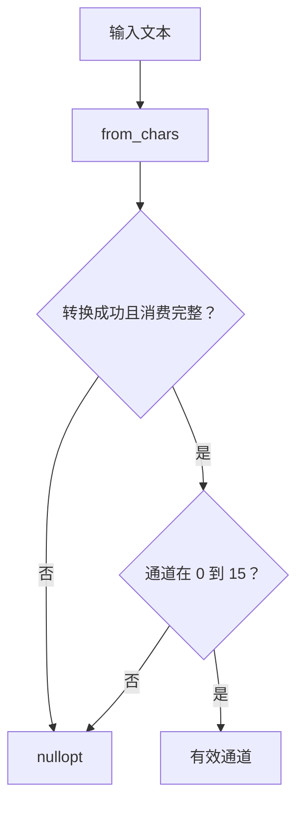

# Day 18 · 函数边界与可维护控制流

## ① 今日阅读范围 · 5 分钟

Chapter 3 中函数职责和可读性，并复习错误处理与断言的区别。

阅读目标：能解释本课规则的适用条件，并在下面的实验中验证它。

## ② 昨日复习 · 5 分钟

哪些失败属于外部输入？assert 在发布构建中可靠地处理错误吗？返回错误后还应写入设备吗？

先合上资料口头回答；不确定的部分记录到复习队列。

## ③ 核心概念 · 12 分钟

按单一业务动作划分函数：解析输入、验证范围、提交动作。纯解析函数不写设备，因此可以用少量边界输入测试。守卫分支提前退出，避免深层嵌套；但资源清理应依靠 RAII，不能因提前返回遗漏。标准库 from_chars 不分配、不依赖 locale，必须同时检查 error code 与是否消费完整输入。



图表展示关键步骤与判断；请结合下面的代码检查失败分支。

## ④ C 写法 vs Modern C++ · 8 分钟

将 atoi 后立即发命令改成 ParseChannel 成功后才执行。使用 optional 区分无效值，避免用合法通道 0 代表失败。

改写时分别检查：类型是否表达意图、失败是否可见、所有权是否清楚。

## ⑤ 今日编码规范 · 8 分钟

函数边界表达业务职责；处理外部输入用返回结果而非仅 assert；拒绝尾随垃圾和超出范围的整数。

Code Review 时说明规则如何帮助当前场景，不将风格约定当成运行时安全证明。

## ⑥ 可编译实验 · 15 分钟

实现通道解析并测试空串、字母、尾随字母、边界值与溢出。将解析器复用到配置读取，而不引入设备依赖。

完整源码：[main.cpp](../examples/day-018/main.cpp)。

```cpp
#include <cassert>
#include <charconv>
#include <iostream>
#include <optional>
#include <string_view>
#include <system_error>
std::optional<int> ParseChannel(std::string_view text) {
  int channel{};
  const auto [end, error] = std::from_chars(text.data(), text.data() + text.size(), channel);
  if (error != std::errc{} || end != text.data() + text.size() || channel < 0 || channel > 15) {
    return std::nullopt;
  }
  return channel;
}
int main() {
  assert(ParseChannel("0").value() == 0);
  assert(ParseChannel("15").value() == 15);
  assert(!ParseChannel(""));
  assert(!ParseChannel("3x"));
  assert(!ParseChannel("-1"));
  assert(!ParseChannel("16"));
  assert(!ParseChannel("99999999999999999"));
  std::cout << "strict channel parser passed\n";
}
```

在仓库根目录运行：

```bash
g++ -std=c++23 -Wall -Wextra -Wconversion -Wpedantic examples/day-018/main.cpp -o /tmp/day-018
/tmp/day-018
```

预期输出：`strict channel parser passed`。实验中的断言用于验证用例，不代替生产代码的错误处理。请勿使用 `-DNDEBUG` 运行这些自测。

## ⑦ 常见坑 · 3 分钟

from_chars 返回成功但未检查尾随内容；用 atoi 的 0 区分失败；把解析和硬件操作合并而无法隔离测试。

检查实验是否覆盖了失败分支；只有正常输入通过不足以证明边界行为正确。

## ⑧ 自测 · 4 分钟

为什么需要检查 ptr 等于 end？纯函数怎样降低测试成本？

<details>
<summary>参考答案（先独立回答）</summary>

否则 3x 可能被当作 3。纯函数没有设备副作用，输入与输出可以直接比较，不需要真实串口。

</details>

## 下一步

继续 Day 19；若实验或自测仍不确定，先回到对应概念再复盘。
