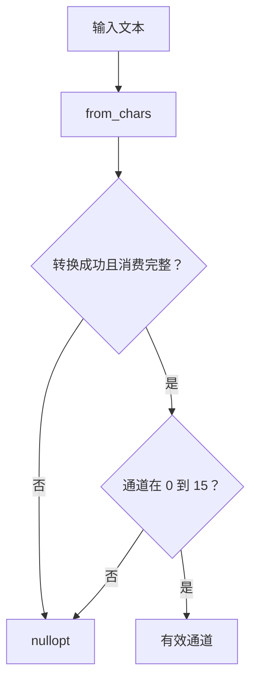

# Day 18 · 函数边界与可维护控制流

<!-- cpp-standards:start -->
## 本课涉及的 C++ 标准

以下按正文与配套 `.cpp` 示例中出现的特性标注首次标准化版本，不代表整份程序的最低编译版本。仓库主 Lab 统一使用 C++23。

| 特性 | 首次标准化 | 版本边界 |
| --- | --- | --- |
| 列表初始化 | **C++11** | 包括直接列表初始化；窄化检查及 initializer_list 优先规则须单独注意。 |
| 结构化绑定 | **C++17** | 如 `auto [a, b] = value;`。 |
| `std::string_view` | **C++17** | 非拥有视图；其 `starts_with` / `ends_with` 是 C++20 新增。 |
| `std::optional` / `std::nullopt` | **C++17** | 可选值；不自带错误原因。 |
| `std::from_chars` / `std::to_chars` | **C++17** | 整数及浮点重载均在 C++17 标准化；旧标准库的浮点支持可能滞后。 |

版本差异、旧机制与工具链检查见 [C++ 标准来源速查](../docs/cpp-feature-standards.md)。
<!-- cpp-standards:end -->

## ① 今日阅读范围 · 5 分钟

### 新手起步：先知道今天在解决什么

把解析拆成输入存在、格式正确、范围合法三层。每层失败立刻给出结果，正常路径就不必埋在多重嵌套中。

**前置检查：** 先能解释 [Day 2](day-002-variables-initialization-casts.md)、[Day 9](day-009-string-operations.md)、[Day 17](day-017-errors-assert-control-flow.md) 的核心例子；不必先掌握整本教材。

**本课最低完成目标：** 能按下面的步骤说明示例如何得到结果，并独立完成一项小修改；高级模式与平台性能分析可第二遍再读。新增导读和拓展练习不计入原有约 60 分钟安排，可分两次完成。

Chapter 3 中函数职责和可读性，并复习错误处理与断言的区别。

## ② 昨日复习 · 5 分钟

哪些失败属于外部输入？assert 在发布构建中可靠地处理错误吗？返回错误后还应写入设备吗？

## ③ 核心概念 · 12 分钟

### 先用白话建立概念

- **单一职责函数**：完成一个清晰任务的函数。
- **提前返回**：失败时尽早结束当前路径。

### 跟着本课实验走一遍

1. 空串先失败。
2. 数值解析必须完整。
3. 再检查 0 到 15 的业务范围。
4. 成功才返回 channel。

先尝试口头预测，再到第⑥节运行。下面原有概念、图示与接口对照用于解释这些步骤，短代码片段不一定能单独编译；完整程序以本课 `main.cpp` 为准。

按单一业务动作划分函数：解析输入、验证范围、提交动作。纯解析函数不写设备，因此可以用少量边界输入测试。守卫分支提前退出，避免深层嵌套；但资源清理应依靠 RAII，不能因提前返回遗漏。标准库 from_chars 不分配、不依赖 locale，必须同时检查 error code 与是否消费完整输入。



## ④ C 写法 vs Modern C++ · 8 分钟

将 atoi 后立即发命令改成 ParseChannel 成功后才执行。使用 optional 区分无效值，避免用合法通道 0 代表失败。

## ⑤ 今日编码规范 · 8 分钟

函数边界表达业务职责；处理外部输入用返回结果而非仅 assert；拒绝尾随垃圾和超出范围的整数。

## ⑥ 可编译实验 · 15 分钟

### 第一次做：先运行，再只改一件事

1. 在仓库根目录打开 [`examples/day-018/main.cpp`](../examples/day-018/main.cpp)，先读 `main()`，圈出输入、调用与结果检查。
2. 运行原版，把实际输出和退出状态记下来，再与本节预期对照。无输出也可能成功，必须结合退出码与断言判断。
3. 修改前先写预期；若失败，先读第一条编译错误或失败断言，再回到对应概念，不同时重写多个函数。

**本课小改动：** 补 `15x` 用例，预期失败；说明它与合法的 `15` 在哪一步分开。

<details>
<summary>练习提示：卡住时再展开</summary>

把上面的执行步骤当作检查点；保留原版作为对照。若练习故意让编译或断言失败，请只在实验副本操作，解释失败后还原，不把负例混入日常通过用例。不要执行越界、悬空解引用或重复释放来“观察效果”。

</details>

实现通道解析并测试空串、字母、尾随字母、边界值与溢出。将解析器复用到配置读取，而不引入设备依赖。

完整源码：[main.cpp](../examples/day-018/main.cpp)。

```cpp
#include <cassert>
#include <charconv>
#include <iostream>
#include <optional>
#include <string_view>
#include <system_error>
std::optional<int> ParseChannel(std::string_view text) {
  int channel{};
  const auto [end, error] = std::from_chars(text.data(), text.data() + text.size(), channel);
  if (error != std::errc{} || end != text.data() + text.size() || channel < 0 || channel > 15) {
    return std::nullopt;
  }
  return channel;
}
int main() {
  assert(ParseChannel("0").value() == 0);
  assert(ParseChannel("15").value() == 15);
  assert(!ParseChannel(""));
  assert(!ParseChannel("3x"));
  assert(!ParseChannel("-1"));
  assert(!ParseChannel("16"));
  assert(!ParseChannel("99999999999999999"));
  std::cout << "strict channel parser passed\n";
}
```

在仓库根目录运行：

```bash
g++ -std=c++23 -Wall -Wextra -Wconversion -Wpedantic examples/day-018/main.cpp -o /tmp/day-018
/tmp/day-018
```

预期输出：`strict channel parser passed`。实验中的断言用于验证用例，不代替生产代码的错误处理。请勿使用 `-DNDEBUG` 运行这些自测。

## ⑦ 常见坑 · 3 分钟

from_chars 返回成功但未检查尾随内容；用 atoi 的 0 区分失败；把解析和硬件操作合并而无法隔离测试。

## ⑧ 自测 · 4 分钟

### 分层自测：从解释到判断

1. **理解：** 不看代码，用三句话复述本课示例的输入、关键步骤和结果。
2. **应用：** 说明第⑥节小改动的预期，以及实际结果是否符合预期。
3. **辨析：** 函数短就一定可维护吗？

<details>
<summary>辨析题参考答案与通过依据</summary>

不一定；若隐藏单位、错误语义或依赖，即使只有一行也可能难以正确使用。

能运行只是第一步。只有能解释本课具体步骤、完成小改动，并说清一个不适用条件，才算完成本次自测；不清楚时回看第③节，不以阅读次数当作掌握证据。

</details>

### 原课检查题

为什么需要检查 ptr 等于 end？纯函数怎样降低测试成本？

<details>
<summary>参考答案（先独立回答）</summary>

否则 3x 可能被当作 3。纯函数没有设备副作用，输入与输出可以直接比较，不需要真实串口。

</details>

### 对照现有资料库

- [编码规范与错误处理](<../guidelines/embedded-cpp-guideline-notes.md>)。
- [代码评审依据](<../guidelines/review-rubric.md>)。

先完成本课小实验，再查对照资料；专题中的线程、网络、板端或模式不是本课默认前置。以上为本项目已有讲解和工程对照，不冒充标准条文，也不表示所有示例已在目标板验证。

## 下一步

继续 Day 19；若实验或自测仍不确定，先回到对应概念再复盘。
