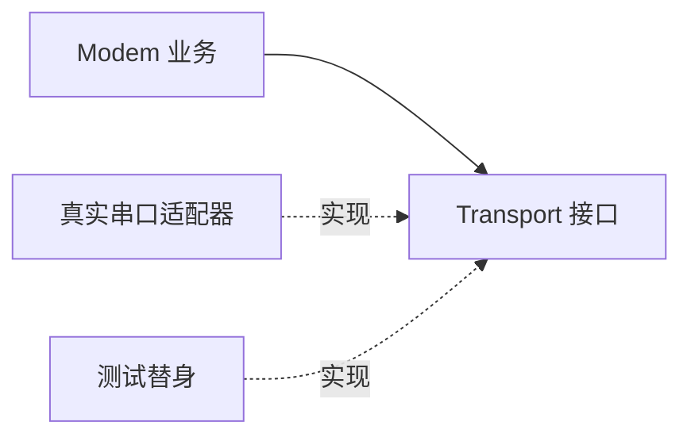

# Day 21 · 周复盘：可测试 Modem 架构

## ① 今日阅读范围 · 5 分钟

复习 Day 14–20 的头文件边界、错误处理、需求用例与架构决策。

阅读目标：能解释本课规则的适用条件，并在下面的实验中验证它。

## ② 昨日复习 · 5 分钟

哪些输入需要验证？业务层为何不应直接依赖串口寄存器？接口契约应记录哪些失败？

先合上资料口头回答；不确定的部分记录到复习队列。

## ③ 核心概念 · 12 分钟

把发送操作抽象成最小 Transport 接口，Modem 负责命令语义，具体驱动负责字节传输。测试替身实现同一接口，记录发送次数和模拟失败。required borrow 用引用表示非空依赖，但被借用的 Transport 必须比 Modem 活得更久。测试替身用于验证业务契约，不证明真实串口满足时序和吞吐要求。



图表描述本课学习路径或关键决策，具体行为以代码与接口契约为准。

## ④ C 写法 vs Modern C++ · 8 分钟

将直接调用 UartWrite 的业务函数改为注入 Transport&。避免全局设备实例，让不同测试可使用独立替身。

改写时分别检查：类型是否表达意图、失败是否可见、所有权是否清楚。

## ⑤ 今日编码规范 · 8 分钟

接口只暴露业务需要的动作；虚析构保障经基类销毁安全；明确借用生命周期；测试成功和失败传播。

Code Review 时说明规则如何帮助当前场景，不将风格约定当成运行时安全证明。

## ⑥ 可编译实验 · 15 分钟

运行 FakeTransport 验证 AT 命令、发送次数和失败分支。再添加一次“空命令不能发送”的需求，先定义预期行为再修改实现。

完整源码：[main.cpp](../examples/day-021/main.cpp)。

```cpp
#include <cassert>
#include <iostream>
#include <string_view>
struct Transport {
  virtual ~Transport() = default;
  virtual bool Write(std::string_view command) = 0;
};
struct FakeTransport final : Transport {
  bool succeed{true};
  int writes{0};
  bool Write(std::string_view command) override {
    assert(command == "AT\r\n");
    ++writes;
    return succeed;
  }
};
class Modem {
public:
  explicit Modem(Transport& transport) : transport_{transport} {}
  bool Ping() {
    return transport_.Write("AT\r\n");
  }

private:
  Transport& transport_;
};
int main() {
  FakeTransport transport;
  Modem modem{transport};
  assert(modem.Ping());
  transport.succeed = false;
  assert(!modem.Ping());
  assert(transport.writes == 2);
  std::cout << "modem contract passed\n";
}
```

在仓库根目录运行：

```bash
g++ -std=c++23 -Wall -Wextra -Wconversion -Wpedantic examples/day-021/main.cpp -o /tmp/day-021
/tmp/day-021
```

预期输出：`modem contract passed`。实验中的断言用于验证用例，不代替生产代码的错误处理。请勿使用 `-DNDEBUG` 运行这些自测。

## ⑦ 常见坑 · 3 分钟

测试只有成功路径；把引用注入误认为管理了生命周期；让抽象层承担串口、日志、重试与业务全部职责。

检查实验是否覆盖了失败分支；只有正常输入通过不足以证明边界行为正确。

## ⑧ 自测 · 4 分钟

FakeTransport 的测试能证明真实设备正常吗？Transport 引用何时会悬空？

<details>
<summary>参考答案（先独立回答）</summary>

不能，真实驱动还需集成测试。Transport 先销毁而 Modem 继续调用时引用悬空。

</details>

## 下一步

继续 Day 22；若实验或自测仍不确定，先回到对应概念再复盘。
