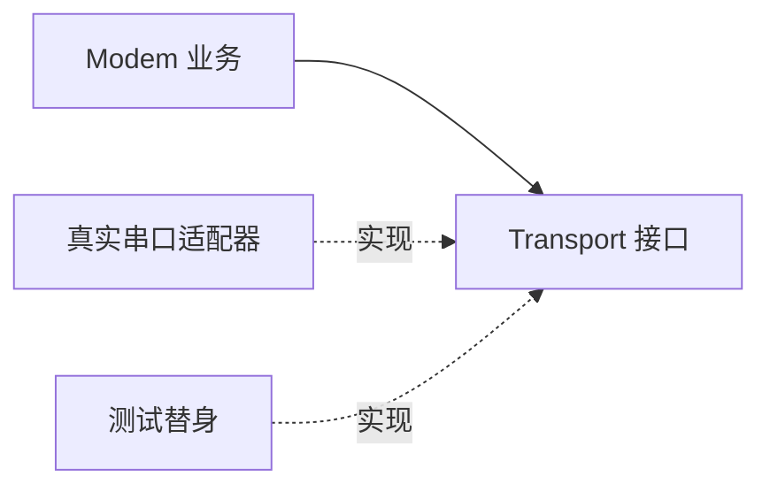

# Day 21 · 周复盘：可测试 Modem 架构

<!-- cpp-standards:start -->
## 本课涉及的 C++ 标准

以下按正文与配套 `.cpp` 示例中出现的特性标注首次标准化版本，不代表整份程序的最低编译版本。仓库主 Lab 统一使用 C++23。

| 特性 | 首次标准化 | 版本边界 |
| --- | --- | --- |
| 列表初始化 | **C++11** | 包括直接列表初始化；窄化检查及 initializer_list 优先规则须单独注意。 |
| `= default` / `= delete` | **C++11** | 显式默认化与删除函数。 |
| `override` / `final` | **C++11** | 用于虚函数覆盖检查、限制覆盖或继承。 |
| `std::string_view` | **C++17** | 非拥有视图；其 `starts_with` / `ends_with` 是 C++20 新增。 |

版本差异、旧机制与工具链检查见 [C++ 标准来源速查](../docs/cpp-feature-standards.md)。
<!-- cpp-standards:end -->

## ① 今日阅读范围 · 5 分钟

### 新手起步：先知道今天在解决什么

复盘时先脱离硬件，检查业务是否能独立运行。fake 不需要模拟所有 UART 细节，只需遵守被测接口的语义。

**前置检查：** 先能解释 [Day 7](day-007-week1-review-modem-control.md)、[Day 19](day-019-requirements-architecture-boundaries.md)、[Day 20](day-020-requirements-use-cases-decisions.md) 的核心例子；不必先掌握整本教材。

**本课最低完成目标：** 能按下面的步骤说明示例如何得到结果，并独立完成一项小修改；高级模式与平台性能分析可第二遍再读。新增导读和拓展练习不计入原有约 60 分钟安排，可分两次完成。

复习 Day 14–20 的头文件边界、错误处理、需求用例与架构决策。

## ② 昨日复习 · 5 分钟

哪些输入需要验证？业务层为何不应直接依赖串口寄存器？接口契约应记录哪些失败？

## ③ 核心概念 · 12 分钟

### 先用白话建立概念

- **依赖注入**：从外部提供协作对象。
- **可测试性**：控制输入并观察结果的能力。

### 跟着本课实验走一遍

1. 找到 fake 保存的返回值。
2. 第一次 Ping 检查成功。
3. 切换到失败结果。
4. 核对写入次数为两次。

先尝试口头预测，再到第⑥节运行。下面原有概念、图示与接口对照用于解释这些步骤，短代码片段不一定能单独编译；完整程序以本课 `main.cpp` 为准。

把发送操作抽象成最小 Transport 接口，Modem 负责命令语义，具体驱动负责字节传输。测试替身实现同一接口，记录发送次数和模拟失败。required borrow 用引用表示非空依赖，但被借用的 Transport 必须比 Modem 活得更久。测试替身用于验证业务契约，不证明真实串口满足时序和吞吐要求。



## ④ C 写法 vs Modern C++ · 8 分钟

将直接调用 UartWrite 的业务函数改为注入 Transport&。避免全局设备实例，让不同测试可使用独立替身。

## ⑤ 今日编码规范 · 8 分钟

接口只暴露业务需要的动作；虚析构保障经基类销毁安全；明确借用生命周期；测试成功和失败传播。

## ⑥ 可编译实验 · 15 分钟

### 第一次做：先运行，再只改一件事

1. 在仓库根目录打开 [`examples/day-021/main.cpp`](../examples/day-021/main.cpp)，先读 `main()`，圈出输入、调用与结果检查。
2. 运行原版，把实际输出和退出状态记下来，再与本节预期对照。无输出也可能成功，必须结合退出码与断言判断。
3. 修改前先写预期；若失败，先读第一条编译错误或失败断言，再回到对应概念，不同时重写多个函数。

**本课小改动：** 增加连续三次 Ping，分别配置结果并记录预期次数；避免把调用次数误认为成功次数。

<details>
<summary>练习提示：卡住时再展开</summary>

把上面的执行步骤当作检查点；保留原版作为对照。若练习故意让编译或断言失败，请只在实验副本操作，解释失败后还原，不把负例混入日常通过用例。不要执行越界、悬空解引用或重复释放来“观察效果”。

</details>

运行 FakeTransport 验证 AT 命令、发送次数和失败分支。再添加一次“空命令不能发送”的需求，先定义预期行为再修改实现。

完整源码：[main.cpp](../examples/day-021/main.cpp)。

```cpp
#include <cassert>
#include <iostream>
#include <string_view>
struct Transport {
  virtual ~Transport() = default;
  virtual bool Write(std::string_view command) = 0;
};
struct FakeTransport final : Transport {
  bool succeed{true};
  int writes{0};
  bool Write(std::string_view command) override {
    assert(command == "AT\r\n");
    ++writes;
    return succeed;
  }
};
class Modem {
public:
  explicit Modem(Transport& transport) : transport_{transport} {}
  bool Ping() {
    return transport_.Write("AT\r\n");
  }

private:
  Transport& transport_;
};
int main() {
  FakeTransport transport;
  Modem modem{transport};
  assert(modem.Ping());
  transport.succeed = false;
  assert(!modem.Ping());
  assert(transport.writes == 2);
  std::cout << "modem contract passed\n";
}
```

在仓库根目录运行：

```bash
g++ -std=c++23 -Wall -Wextra -Wconversion -Wpedantic examples/day-021/main.cpp -o /tmp/day-021
/tmp/day-021
```

预期输出：`modem contract passed`。实验中的断言用于验证用例，不代替生产代码的错误处理。请勿使用 `-DNDEBUG` 运行这些自测。

## ⑦ 常见坑 · 3 分钟

测试只有成功路径；把引用注入误认为管理了生命周期；让抽象层承担串口、日志、重试与业务全部职责。

## ⑧ 自测 · 4 分钟

### 分层自测：从解释到判断

1. **理解：** 不看代码，用三句话复述本课示例的输入、关键步骤和结果。
2. **应用：** 说明第⑥节小改动的预期，以及实际结果是否符合预期。
3. **辨析：** fake 返回成功是否足以覆盖业务？

<details>
<summary>辨析题参考答案与通过依据</summary>

不够，还要测试失败、边界和重复调用，才能检验业务是否正确处理不同结果。

能运行只是第一步。只有能解释本课具体步骤、完成小改动，并说清一个不适用条件，才算完成本次自测；不清楚时回看第③节，不以阅读次数当作掌握证据。

</details>

### 原课检查题

FakeTransport 的测试能证明真实设备正常吗？Transport 引用何时会悬空？

<details>
<summary>参考答案（先独立回答）</summary>

不能，真实驱动还需集成测试。Transport 先销毁而 Modem 继续调用时引用悬空。

</details>

### 对照现有资料库

- [需求与约束贯穿实验](<../docs/engineering-learning-path.md>)。
- [系统架构资料：进阶对照](<../references/system-design-notes/content/33. Cpp System Architecture/index.zh.md>)。

先完成本课小实验，再查对照资料；专题中的线程、网络、板端或模式不是本课默认前置。以上为本项目已有讲解和工程对照，不冒充标准条文，也不表示所有示例已在目标板验证。

## 下一步

继续 Day 22；若实验或自测仍不确定，先回到对应概念再复盘。
