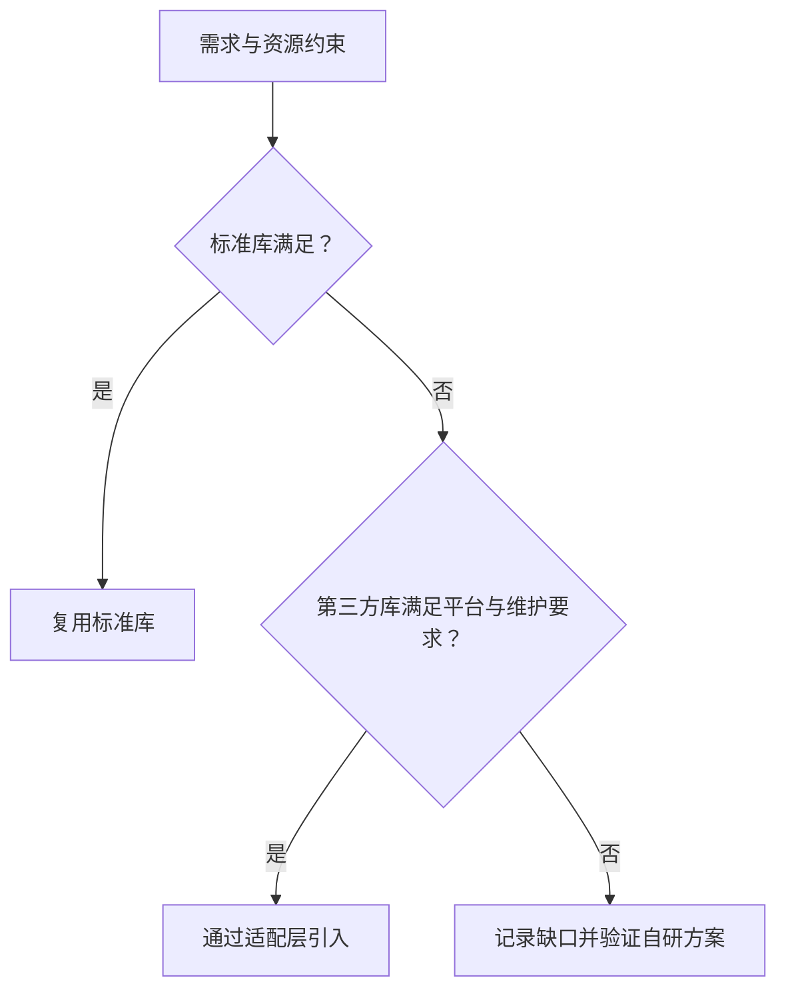

# Day 23 · 复用：标准库、第三方库或自研

## ① 今日阅读范围 · 5 分钟

Chapter 4 中代码复用与库选择，关注约束匹配和维护成本。

阅读目标：能解释本课规则的适用条件，并在下面的实验中验证它。

## ② 昨日复习 · 5 分钟

抽象应该隐藏什么？业务契约与库接口的差别是什么？测试替身能验证哪些行为？

先合上资料口头回答；不确定的部分记录到复习队列。

## ③ 核心概念 · 12 分钟

先判断标准库是否满足语义与资源约束，再评估第三方库的许可证、维护、平台支持、分配和线程模型。自研应有明确缺口和测试证据，不能只因 API 外观不顺手。适配层把外部接口转换为业务接口，使替换库时调用者不变。固定容量不是绝对优于动态分配，必须由实时性和容量需求决定。



图表展示关键步骤与判断；请结合下面的代码检查失败分支。

## ④ C 写法 vs Modern C++ · 8 分钟

将手工维护两个平行数组改成 std::array<Record, N>，让键和值作为一条记录一起移动。协议专用逻辑仍由业务层实现。

改写时分别检查：类型是否表达意图、失败是否可见、所有权是否清楚。

## ⑤ 今日编码规范 · 8 分钟

记录库选择依据；不要复制已有可靠算法；外部依赖集中在适配层；容量溢出必须有明确定义。

Code Review 时说明规则如何帮助当前场景，不将风格约定当成运行时安全证明。

## ⑥ 可编译实验 · 15 分钟

使用 std::array 与 find_if 查询命令编号。测试存在和不存在的名字，扩展一条记录后检查无需改算法。

完整源码：[main.cpp](../examples/day-023/main.cpp)。

```cpp
#include <algorithm>
#include <array>
#include <cassert>
#include <iostream>
#include <optional>
#include <string_view>
struct Command { std::string_view name; int id; };
constexpr std::array<Command, 2> kCommands{{{"ping", 1}, {"reset", 2}}};
std::optional<int> FindCommand(std::string_view name) {
  const auto it = std::find_if(kCommands.begin(), kCommands.end(),
      [name](const Command& command) { return command.name == name; });
  if (it == kCommands.end()) { return std::nullopt; }
  return it->id;
}
int main() {
  assert(FindCommand("ping").value() == 1);
  assert(!FindCommand("unknown"));
  std::cout << "lookup found and missing cases passed\n";
}
```

在仓库根目录运行：

```bash
g++ -std=c++23 -Wall -Wextra -Wconversion -Wpedantic examples/day-023/main.cpp -o /tmp/day-023
/tmp/day-023
```

预期输出：`lookup found and missing cases passed`。实验中的断言用于验证用例，不代替生产代码的错误处理。请勿使用 `-DNDEBUG` 运行这些自测。

## ⑦ 常见坑 · 3 分钟

盲目认为第三方库必然优于自研；在业务层到处使用外部库细节；忽略容量、分配与异常约束。

检查实验是否覆盖了失败分支；只有正常输入通过不足以证明边界行为正确。

## ⑧ 自测 · 4 分钟

库功能满足需求就可以直接引入吗？适配层如何降低替换成本？

<details>
<summary>参考答案（先独立回答）</summary>

还需检查平台、许可证、生命周期与资源约束。适配层集中映射外部 API，业务调用者依赖稳定接口。

</details>

## 下一步

继续 Day 24；若实验或自测仍不确定，先回到对应概念再复盘。
