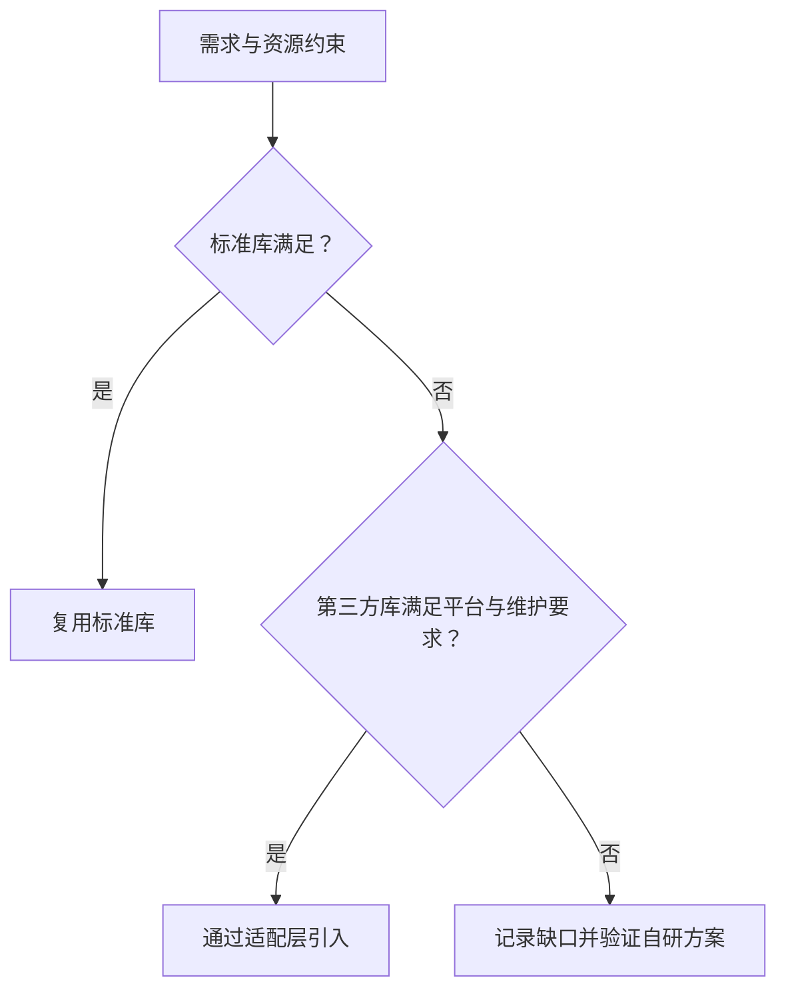

# Day 23 · 复用：标准库、第三方库或自研

<!-- cpp-standards:start -->
## 本课涉及的 C++ 标准

以下按正文与配套 `.cpp` 示例中出现的特性标注首次标准化版本，不代表整份程序的最低编译版本。仓库主 Lab 统一使用 C++23。

| 特性 | 首次标准化 | 版本边界 |
| --- | --- | --- |
| lambda 表达式 | **C++11** | 泛型 lambda（auto 形参）、初始化捕获从 C++14 起可用；显式模板形参列表从 C++20 起可用。 |
| `constexpr` | **C++11** | C++14 放宽函数体限制；C++20 继续扩展可用于常量求值的操作。声明不保证每次调用都在编译期执行。 |
| `auto` 类型推导 | **C++11** | C++14 才支持普通函数返回类型推导；C++20 才支持 `auto` 形参的简写函数模板。 |
| `std::array` | **C++11** | 固定大小容器。 |
| `std::string_view` | **C++17** | 非拥有视图；其 `starts_with` / `ends_with` 是 C++20 新增。 |
| `std::optional` / `std::nullopt` | **C++17** | 可选值；不自带错误原因。 |

版本差异、旧机制与工具链检查见 [C++ 标准来源速查](../docs/cpp-feature-standards.md)。
<!-- cpp-standards:end -->

## ① 今日阅读范围 · 5 分钟

### 新手起步：先知道今天在解决什么

先写需求清单，再比较标准库、第三方和自研。标准库也有适用边界；“自研更快”必须有测量，不能凭感觉。

**前置检查：** 先能解释 [Day 9](day-009-string-operations.md)、[Day 14](day-014-headers-iwyu-dependencies.md)、[Day 22](day-022-abstraction-stable-interface.md) 的核心例子；不必先掌握整本教材。

**本课最低完成目标：** 能按下面的步骤说明示例如何得到结果，并独立完成一项小修改；高级模式与平台性能分析可第二遍再读。新增导读和拓展练习不计入原有约 60 分钟安排，可分两次完成。

Chapter 4 中代码复用与库选择，关注约束匹配和维护成本。

## ② 昨日复习 · 5 分钟

抽象应该隐藏什么？业务契约与库接口的差别是什么？测试替身能验证哪些行为？

## ③ 核心概念 · 12 分钟

### 先用白话建立概念

- **复用**：使用已有且满足需求的能力。
- **评估标准**：功能、成本与维护证据。

### 跟着本课实验走一遍

1. 找到命令表。
2. 逐项匹配名称。
3. 命中返回值。
4. 未知名称返回空结果。

先尝试口头预测，再到第⑥节运行。下面原有概念、图示与接口对照用于解释这些步骤，短代码片段不一定能单独编译；完整程序以本课 `main.cpp` 为准。

先判断标准库是否满足语义与资源约束，再评估第三方库的许可证、维护、平台支持、分配和线程模型。自研应有明确缺口和测试证据，不能只因 API 外观不顺手。适配层把外部接口转换为业务接口，使替换库时调用者不变。固定容量不是绝对优于动态分配，必须由实时性和容量需求决定。



## ④ C 写法 vs Modern C++ · 8 分钟

将手工维护两个平行数组改成 std::array<Record, N>，让键和值作为一条记录一起移动。协议专用逻辑仍由业务层实现。

## ⑤ 今日编码规范 · 8 分钟

记录库选择依据；不要复制已有可靠算法；外部依赖集中在适配层；容量溢出必须有明确定义。

## ⑥ 可编译实验 · 15 分钟

### 第一次做：先运行，再只改一件事

1. 在仓库根目录打开 [`examples/day-023/main.cpp`](../examples/day-023/main.cpp)，先读 `main()`，圈出输入、调用与结果检查。
2. 运行原版，把实际输出和退出状态记下来，再与本节预期对照。无输出也可能成功，必须结合退出码与断言判断。
3. 修改前先写预期；若失败，先读第一条编译错误或失败断言，再回到对应概念，不同时重写多个函数。

**本课小改动：** 给表增加一条命令并补命中测试，同时保留 unknown 测试；解释数据修改为何不应改写查找算法。

<details>
<summary>练习提示：卡住时再展开</summary>

把上面的执行步骤当作检查点；保留原版作为对照。若练习故意让编译或断言失败，请只在实验副本操作，解释失败后还原，不把负例混入日常通过用例。不要执行越界、悬空解引用或重复释放来“观察效果”。

</details>

使用 std::array 与 find_if 查询命令编号。测试存在和不存在的名字，扩展一条记录后检查无需改算法。

完整源码：[main.cpp](../examples/day-023/main.cpp)。

```cpp
#include <algorithm>
#include <array>
#include <cassert>
#include <iostream>
#include <optional>
#include <string_view>
struct Command {
  std::string_view name;
  int id;
};
constexpr std::array<Command, 2> kCommands{{{"ping", 1}, {"reset", 2}}};
std::optional<int> FindCommand(std::string_view name) {
  const auto it = std::find_if(kCommands.begin(), kCommands.end(),
                               [name](const Command& command) { return command.name == name; });
  if (it == kCommands.end()) {
    return std::nullopt;
  }
  return it->id;
}
int main() {
  assert(FindCommand("ping").value() == 1);
  assert(!FindCommand("unknown"));
  std::cout << "lookup found and missing cases passed\n";
}
```

在仓库根目录运行：

```bash
g++ -std=c++23 -Wall -Wextra -Wconversion -Wpedantic examples/day-023/main.cpp -o /tmp/day-023
/tmp/day-023
```

预期输出：`lookup found and missing cases passed`。实验中的断言用于验证用例，不代替生产代码的错误处理。请勿使用 `-DNDEBUG` 运行这些自测。

## ⑦ 常见坑 · 3 分钟

盲目认为第三方库必然优于自研；在业务层到处使用外部库细节；忽略容量、分配与异常约束。

## ⑧ 自测 · 4 分钟

### 分层自测：从解释到判断

1. **理解：** 不看代码，用三句话复述本课示例的输入、关键步骤和结果。
2. **应用：** 说明第⑥节小改动的预期，以及实际结果是否符合预期。
3. **辨析：** 选择标准库之前还要检查什么？

<details>
<summary>辨析题参考答案与通过依据</summary>

目标工具链、错误模型、分配行为、容量、许可及维护条件；能编译只是其中一项。

能运行只是第一步。只有能解释本课具体步骤、完成小改动，并说清一个不适用条件，才算完成本次自测；不清楚时回看第③节，不以阅读次数当作掌握证据。

</details>

### 原课检查题

库功能满足需求就可以直接引入吗？适配层如何降低替换成本？

<details>
<summary>参考答案（先独立回答）</summary>

还需检查平台、许可证、生命周期与资源约束。适配层集中映射外部 API，业务调用者依赖稳定接口。

</details>

### 对照现有资料库

- [需求与约束贯穿实验](<../docs/engineering-learning-path.md>)。
- [系统架构资料：进阶对照](<../references/system-design-notes/content/33. Cpp System Architecture/index.zh.md>)。

先完成本课小实验，再查对照资料；专题中的线程、网络、板端或模式不是本课默认前置。以上为本项目已有讲解和工程对照，不冒充标准条文，也不表示所有示例已在目标板验证。

## 下一步

继续 Day 24；若实验或自测仍不确定，先回到对应概念再复盘。
