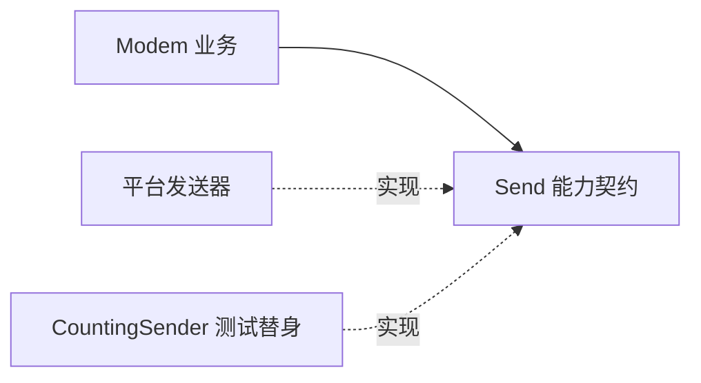

# Day 24 · 耦合、内聚与依赖管理

## ① 今日阅读范围 · 5 分钟

Chapter 4 中模块边界、内聚和依赖方向。

阅读目标：能解释本课规则的适用条件，并在下面的实验中验证它。

## ② 昨日复习 · 5 分钟

库选择需要哪些约束证据？适配层隐藏什么？固定容量在什么场景合适？

先合上资料口头回答；不确定的部分记录到复习队列。

## ③ 核心概念 · 12 分钟

高内聚意味着一个模块中的操作围绕同一职责。低耦合意味着变化不应沿无关依赖传播。业务策略可以依赖一个小的发送能力，而不用依赖芯片初始化和日志系统。依赖注入能用动态接口，也能用模板参数；模板避免虚调用但会增加编译期耦合和实例化体积，必须结合需求选择。



图表展示关键步骤与判断；请结合下面的代码检查失败分支。

## ④ C 写法 vs Modern C++ · 8 分钟

将业务对象内创建具体驱动，改为构造时借用发送能力。以下模板示例只要求 Send，替换测试发送器无需修改业务动作。

改写时分别检查：类型是否表达意图、失败是否可见、所有权是否清楚。

## ⑤ 今日编码规范 · 8 分钟

借用依赖先创建后销毁；避免初始化函数隐式修改全局对象；接口拆分必须围绕真实调用者需求，不能为拆分而拆分。

Code Review 时说明规则如何帮助当前场景，不将风格约定当成运行时安全证明。

## ⑥ 可编译实验 · 15 分钟

注入 CountingSender 验证业务操作只发送一次。增加第二个发送器实现，确认业务类无需知道平台名称。

完整源码：[main.cpp](../examples/day-024/main.cpp)。

```cpp
#include <cassert>
#include <iostream>
#include <string_view>
struct CountingSender {
  int calls{0};
  bool Send(std::string_view command) {
    assert(command == "AT");
    ++calls;
    return true;
  }
};
template <class Sender>
class Modem {
public:
  explicit Modem(Sender& sender) : sender_{sender} {}
  bool Ping() {
    return sender_.Send("AT");
  }

private:
  Sender& sender_;
};
int main() {
  CountingSender sender;
  Modem<CountingSender> modem{sender};
  assert(modem.Ping());
  assert(sender.calls == 1);
  std::cout << "business uses only sending capability\n";
}
```

在仓库根目录运行：

```bash
g++ -std=c++23 -Wall -Wextra -Wconversion -Wpedantic examples/day-024/main.cpp -o /tmp/day-024
/tmp/day-024
```

预期输出：`business uses only sending capability`。实验中的断言用于验证用例，不代替生产代码的错误处理。请勿使用 `-DNDEBUG` 运行这些自测。

## ⑦ 常见坑 · 3 分钟

依赖注入后依然暴露所有硬件方法；只数类数量来判断设计质量；模板接口没有明确需求文档。

检查实验是否覆盖了失败分支；只有正常输入通过不足以证明边界行为正确。

## ⑧ 自测 · 4 分钟

模板注入与虚接口各承担什么成本？高内聚等于一个类放很多函数吗？

<details>
<summary>参考答案（先独立回答）</summary>

模板增加编译依赖和实例化，虚接口引入运行时间接调用；高内聚取决于职责相关性而非函数数量。

</details>

## 下一步

继续 Day 25；若实验或自测仍不确定，先回到对应概念再复盘。
