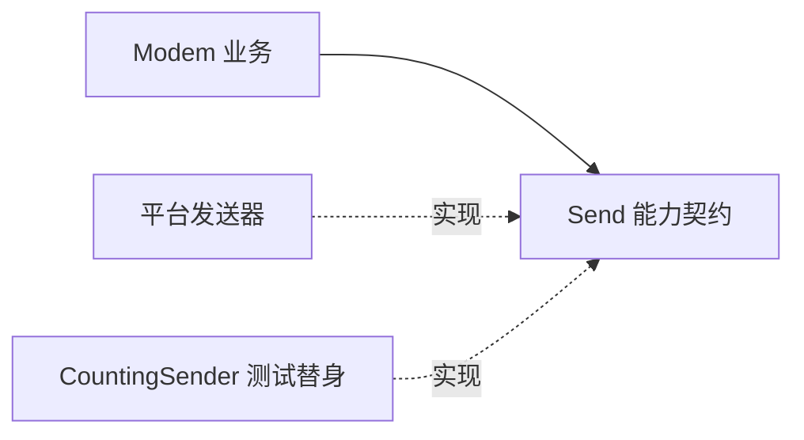

# Day 24 · 耦合、内聚与依赖管理

<!-- cpp-standards:start -->
## 本课涉及的 C++ 标准

以下按正文与配套 `.cpp` 示例中出现的特性标注首次标准化版本，不代表整份程序的最低编译版本。仓库主 Lab 统一使用 C++23。

| 特性 | 首次标准化 | 版本边界 |
| --- | --- | --- |
| 列表初始化 | **C++11** | 包括直接列表初始化；窄化检查及 initializer_list 优先规则须单独注意。 |
| `std::string_view` | **C++17** | 非拥有视图；其 `starts_with` / `ends_with` 是 C++20 新增。 |

版本差异、旧机制与工具链检查见 [C++ 标准来源速查](../docs/cpp-feature-standards.md)。
<!-- cpp-standards:end -->

## ① 今日阅读范围 · 5 分钟

### 新手起步：先知道今天在解决什么

在设计时，尝试列出每个模块可能发生变更的原因。如果通讯协议变更与串口寄存器修改总是需要调整同一个文件，通常意味着该模块混杂了不相关的职责。

**前置检查：** 先能解释 [Day 19](day-019-requirements-architecture-boundaries.md)、[Day 22](day-022-abstraction-stable-interface.md)、[Day 23](day-023-reuse-stdlib-third-party-own.md) 的核心例子；不必先掌握整本教材。

**本课最低完成目标：** 能按下面的步骤说明示例如何得到结果，并独立完成一项小修改；高级模式与平台性能分析可第二遍再读。新增导读和拓展练习不计入原有约 60 分钟安排，可分两次完成。

Chapter 4 中模块边界、内聚和依赖方向。

## ② 昨日复习 · 5 分钟

库选择需要哪些约束证据？适配层隐藏什么？固定容量在什么场景合适？

## ③ 核心概念 · 12 分钟

### 先用白话建立概念

- **内聚**：一个模块的职责关联程度。
- **耦合**：模块间相互依赖的程度。

### 跟着本课实验走一遍

1. 定位 Modem 保存的 sender 引用。
2. 追踪 Ping 到 Send。
3. 检查 fake 的调用计数和命令。

先尝试口头预测，再到第⑥节运行。下面原有概念、图示与接口对照用于解释这些步骤，短代码片段不一定能单独编译；完整程序以本课 `main.cpp` 为准。

高内聚意味着一个模块中的操作围绕同一职责。低耦合意味着变化不应沿无关依赖传播。业务策略可以依赖一个小的发送能力，而不用依赖芯片初始化和日志系统。依赖注入能用动态接口，也能用模板参数；模板避免虚调用但会增加编译期耦合和实例化体积，必须结合需求选择。



## ④ C 写法 vs Modern C++ · 8 分钟

将业务对象内创建具体驱动，改为构造时借用发送能力。以下模板示例只要求 Send，替换测试发送器无需修改业务动作。

## ⑤ 今日编码规范 · 8 分钟

借用依赖先创建后销毁；避免初始化函数隐式修改全局对象；接口拆分必须围绕真实调用者需求，不能为拆分而拆分。

## ⑥ 可编译实验 · 15 分钟

### 第一次做：先运行，再只改一件事

1. 在仓库根目录打开 [`examples/day-024/main.cpp`](../examples/day-024/main.cpp)，先读 `main()`，圈出输入、调用与结果检查。
2. 运行原版，把实际输出和退出状态记下来，再与本节预期对照。无输出也可能成功，必须结合退出码与断言判断。
3. 修改前先写预期；若失败，先读第一条编译错误或失败断言，再回到对应概念，不同时重写多个函数。

**本课小改动：** 更换 sender 的实现而不改 Ping 的命令逻辑；预期业务结果不变，只更换边缘实现。

<details>
<summary>练习提示：卡住时再展开</summary>

把上面的执行步骤当作检查点；保留原版作为对照。若练习故意让编译或断言失败，请只在实验副本操作，解释失败后还原，不把负例混入日常通过用例。不要执行越界、悬空解引用或重复释放来“观察效果”。

</details>

注入 CountingSender 验证业务操作只发送一次。增加第二个发送器实现，确认业务类无需知道平台名称。

完整源码：[main.cpp](../examples/day-024/main.cpp)。

```cpp
#include <cassert>
#include <iostream>
#include <string_view>
struct CountingSender {
  int calls{0};
  bool Send(std::string_view command) {
    assert(command == "AT");
    ++calls;
    return true;
  }
};
template <class Sender>
class Modem {
public:
  explicit Modem(Sender& sender) : sender_{sender} {}
  bool Ping() {
    return sender_.Send("AT");
  }

private:
  Sender& sender_;
};
int main() {
  CountingSender sender;
  Modem<CountingSender> modem{sender};
  assert(modem.Ping());
  assert(sender.calls == 1);
  std::cout << "business uses only sending capability\n";
}
```

在仓库根目录运行：

```bash
g++ -std=c++23 -Wall -Wextra -Wconversion -Wpedantic examples/day-024/main.cpp -o /tmp/day-024
/tmp/day-024
```

预期输出：`business uses only sending capability`。实验中的断言用于验证用例，不代替生产代码的错误处理。请勿使用 `-DNDEBUG` 运行这些自测。

## ⑦ 常见坑 · 3 分钟

依赖注入后依然暴露所有硬件方法；只数类数量来判断设计质量；模板接口没有明确需求文档。

## ⑧ 自测 · 4 分钟

### 分层自测：从解释到判断

1. **理解：** 不看代码，用三句话复述本课示例的输入、关键步骤和结果。
2. **应用：** 说明第⑥节小改动的预期，以及实际结果是否符合预期。
3. **辨析：** 参数越少耦合就越低吗？

<details>
<summary>辨析题参考答案与通过依据</summary>

不一定；无参数函数可能依赖大量全局状态，显式依赖往往更容易审查。

能运行只是第一步。只有能解释本课具体步骤、完成小改动，并说清一个不适用条件，才算完成本次自测；不清楚时回看第③节，不以阅读次数当作掌握证据。

</details>

### 原课检查题

模板注入与虚接口各承担什么成本？高内聚等于一个类放很多函数吗？

<details>
<summary>参考答案（先独立回答）</summary>

模板增加编译依赖和实例化，虚接口引入运行时间接调用；高内聚取决于职责相关性而非函数数量。

</details>

### 对照现有资料库

- [需求与约束贯穿实验](<../docs/engineering-learning-path.md>)。
- [系统架构资料：进阶对照](<../references/system-design-notes/content/33. Cpp System Architecture/index.zh.md>)。

先完成本课小实验，再查对照资料；专题中的线程、网络、板端或模式不是本课默认前置。以上为本项目已有讲解和工程对照，不冒充标准条文，也不表示所有示例已在目标板验证。

## 下一步

继续 Day 25；若实验或自测仍不确定，先回到对应概念再复盘。
