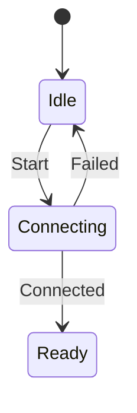

# Day 27 · Chapter 4 收束：稳定设计与变更验证

## ① 今日阅读范围 · 5 分钟

### 新手起步：先知道今天在解决什么

章节复盘应从一个可观察变化开始，例如增加一种连接失败。先确认原状态机的合法路径，再加入新需求。

**前置检查：** 先能解释 [Day 6](day-006-enum-class-state-machine.md)、[Day 20](day-020-requirements-use-cases-decisions.md)、[Day 26](day-026-tradeoffs-change-stable-boundaries.md) 的核心例子；不必先掌握整本教材。

**本课最低完成目标：** 能按下面的步骤说明示例如何得到结果，并独立完成一项小修改；高级模式与平台性能分析可第二遍再读。新增导读和拓展练习不计入原有约 60 分钟安排，可分两次完成。

回顾 Chapter 4 与 Day 19–26：需求、抽象、复用、耦合、契约及取舍。

## ② 昨日复习 · 5 分钟

稳定边界怎样识别？错误契约应该写在哪里？原型的性能结果能否推广到真实系统？

## ③ 核心概念 · 12 分钟

### 先用白话建立概念

- **转移表**：状态与事件到结果的映射。
- **回归测试**：修改后重验已有行为。

### 跟着本课实验走一遍

1. 初态 Idle 拒绝 Connected。
2. Start 后进入等待状态。
3. 分别走失败回 Idle 与成功连接路径。

先尝试口头预测，再到第⑥节运行。下面原有概念、图示与接口对照用于解释这些步骤，短代码片段不一定能单独编译；完整程序以本课 `main.cpp` 为准。

用变更验证设计：新增失败原因、替换传输实现、改变超时策略，观察修改扩散到哪里。稳定不等于永远不改，而是把有意义的变化限制在对应职责。状态迁移应基于事件和契约，非法迁移返回错误且保留原状态。先用小原型验证假设，再决定是否引入框架或层级。



## ④ C 写法 vs Modern C++ · 8 分钟

将分散的 ready 标志、busy 标志和整数码改为 enum class 状态与具名事件，避免表达多个互相矛盾的状态组合。

## ⑤ 今日编码规范 · 8 分钟

写出合法迁移表；非法操作不悄悄改状态；记录设计决策的前提、替代方案和验证证据。

## ⑥ 可编译实验 · 15 分钟

### 第一次做：先运行，再只改一件事

1. 在仓库根目录打开 [`examples/day-027/main.cpp`](../examples/day-027/main.cpp)，先读 `main()`，圈出输入、调用与结果检查。
2. 运行原版，把实际输出和退出状态记下来，再与本节预期对照。无输出也可能成功，必须结合退出码与断言判断。
3. 修改前先写预期；若失败，先读第一条编译错误或失败断言，再回到对应概念，不同时重写多个函数。

**本课小改动：** 列出每个状态的所有事件组合；给一个未覆盖的非法转移补测试，失败后状态应符合既定约定。

<details>
<summary>练习提示：卡住时再展开</summary>

把上面的执行步骤当作检查点；保留原版作为对照。若练习故意让编译或断言失败，请只在实验副本操作，解释失败后还原，不把负例混入日常通过用例。不要执行越界、悬空解引用或重复释放来“观察效果”。

</details>

实现 Idle→Connecting→Ready 路径，验证 Idle 不能直接接受 Connected，失败会回到 Idle。再讨论超时事件应由哪一层产生。

完整源码：[main.cpp](../examples/day-027/main.cpp)。

```cpp
#include <cassert>
#include <iostream>
enum class State { Idle, Connecting, Ready };
enum class Event { Start, Connected, Failed };
bool Apply(State& state, Event event) {
  if (state == State::Idle && event == Event::Start) {
    state = State::Connecting;
    return true;
  }
  if (state == State::Connecting && event == Event::Connected) {
    state = State::Ready;
    return true;
  }
  if (state == State::Connecting && event == Event::Failed) {
    state = State::Idle;
    return true;
  }
  return false;
}
int main() {
  State state{State::Idle};
  assert(!Apply(state, Event::Connected));
  assert(state == State::Idle);
  assert(Apply(state, Event::Start));
  assert(Apply(state, Event::Failed));
  assert(state == State::Idle);
  assert(Apply(state, Event::Start));
  assert(Apply(state, Event::Connected));
  assert(state == State::Ready);
  std::cout << "state transitions and rejection passed\n";
}
```

在仓库根目录运行：

```bash
g++ -std=c++23 -Wall -Wextra -Wconversion -Wpedantic examples/day-027/main.cpp -o /tmp/day-027
/tmp/day-027
```

预期输出：`state transitions and rejection passed`。实验中的断言用于验证用例，不代替生产代码的错误处理。请勿使用 `-DNDEBUG` 运行这些自测。

## ⑦ 常见坑 · 3 分钟

把原型当成完成的生产系统；添加接口却不记录契约；非法事件返回失败但仍改变对象状态。

## ⑧ 自测 · 4 分钟

### 分层自测：从解释到判断

1. **理解：** 不看代码，用三句话复述本课示例的输入、关键步骤和结果。
2. **应用：** 说明第⑥节小改动的预期，以及实际结果是否符合预期。
3. **辨析：** 新增功能通过就能删除旧测试吗？

<details>
<summary>辨析题参考答案与通过依据</summary>

不能；旧测试保护原契约，新增功能也必须不破坏原来合法和失败路径。

能运行只是第一步。只有能解释本课具体步骤、完成小改动，并说清一个不适用条件，才算完成本次自测；不清楚时回看第③节，不以阅读次数当作掌握证据。

</details>

### 原课检查题

为什么非法迁移要保留原状态？设计取舍文档何时应重新评估？

<details>
<summary>参考答案（先独立回答）</summary>

使失败行为可预测并便于恢复。约束、平台或需求发生变化，或验证证据推翻假设时重新评估。

</details>

### 对照现有资料库

- [需求与约束贯穿实验](<../docs/engineering-learning-path.md>)。
- [系统架构资料：进阶对照](<../references/system-design-notes/content/33. Cpp System Architecture/index.zh.md>)。

先完成本课小实验，再查对照资料；专题中的线程、网络、板端或模式不是本课默认前置。以上为本项目已有讲解和工程对照，不冒充标准条文，也不表示所有示例已在目标板验证。

## 下一步

继续 Day 28；若实验或自测仍不确定，先回到对应概念再复盘。
