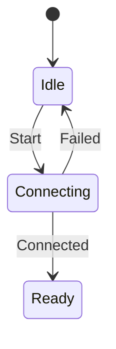

# Day 27 · Chapter 4 收束：稳定设计与变更验证

## ① 今日阅读范围 · 5 分钟

回顾 Chapter 4 与 Day 19–26：需求、抽象、复用、耦合、契约及取舍。

阅读目标：能解释本课规则的适用条件，并在下面的实验中验证它。

## ② 昨日复习 · 5 分钟

稳定边界怎样识别？错误契约应该写在哪里？原型的性能结果能否推广到真实系统？

先合上资料口头回答；不确定的部分记录到复习队列。

## ③ 核心概念 · 12 分钟

用变更验证设计：新增失败原因、替换传输实现、改变超时策略，观察修改扩散到哪里。稳定不等于永远不改，而是把有意义的变化限制在对应职责。状态迁移应基于事件和契约，非法迁移返回错误且保留原状态。先用小原型验证假设，再决定是否引入框架或层级。



图表描述本课学习路径或关键决策，具体行为以代码与接口契约为准。

## ④ C 写法 vs Modern C++ · 8 分钟

将分散的 ready 标志、busy 标志和整数码改为 enum class 状态与具名事件，避免表达多个互相矛盾的状态组合。

改写时分别检查：类型是否表达意图、失败是否可见、所有权是否清楚。

## ⑤ 今日编码规范 · 8 分钟

写出合法迁移表；非法操作不悄悄改状态；记录设计决策的前提、替代方案和验证证据。

Code Review 时说明规则如何帮助当前场景，不将风格约定当成运行时安全证明。

## ⑥ 可编译实验 · 15 分钟

实现 Idle→Connecting→Ready 路径，验证 Idle 不能直接接受 Connected，失败会回到 Idle。再讨论超时事件应由哪一层产生。

完整源码：[main.cpp](../examples/day-027/main.cpp)。

```cpp
#include <cassert>
#include <iostream>
enum class State { Idle, Connecting, Ready };
enum class Event { Start, Connected, Failed };
bool Apply(State& state, Event event) {
  if (state == State::Idle && event == Event::Start) { state = State::Connecting; return true; }
  if (state == State::Connecting && event == Event::Connected) { state = State::Ready; return true; }
  if (state == State::Connecting && event == Event::Failed) { state = State::Idle; return true; }
  return false;
}
int main() {
  State state{State::Idle};
  assert(!Apply(state, Event::Connected));
  assert(state == State::Idle);
  assert(Apply(state, Event::Start));
  assert(Apply(state, Event::Failed));
  assert(state == State::Idle);
  assert(Apply(state, Event::Start));
  assert(Apply(state, Event::Connected));
  assert(state == State::Ready);
  std::cout << "state transitions and rejection passed\n";
}
```

在仓库根目录运行：

```bash
g++ -std=c++23 -Wall -Wextra -Wconversion -Wpedantic examples/day-027/main.cpp -o /tmp/day-027
/tmp/day-027
```

预期输出：`state transitions and rejection passed`。实验中的断言用于验证用例，不代替生产代码的错误处理。请勿使用 `-DNDEBUG` 运行这些自测。

## ⑦ 常见坑 · 3 分钟

把原型当成完成的生产系统；添加接口却不记录契约；非法事件返回失败但仍改变对象状态。

检查实验是否覆盖了失败分支；只有正常输入通过不足以证明边界行为正确。

## ⑧ 自测 · 4 分钟

为什么非法迁移要保留原状态？设计取舍文档何时应重新评估？

<details>
<summary>参考答案（先独立回答）</summary>

使失败行为可预测并便于恢复。约束、平台或需求发生变化，或验证证据推翻假设时重新评估。

</details>

## 下一步

继续 Day 28；若实验或自测仍不确定，先回到对应概念再复盘。
