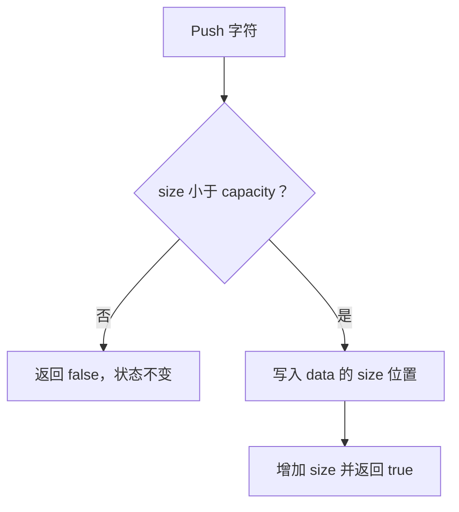

# Day 28 · 类的不变量与最小公共接口

<!-- cpp-standards:start -->
## 本课涉及的 C++ 标准

以下按正文与配套 `.cpp` 示例中出现的特性标注首次标准化版本，不代表整份程序的最低编译版本。仓库主 Lab 统一使用 C++23。

| 特性 | 首次标准化 | 版本边界 |
| --- | --- | --- |
| 列表初始化 | **C++11** | 包括直接列表初始化；窄化检查及 initializer_list 优先规则须单独注意。 |
| `std::array` | **C++11** | 固定大小容器。 |

版本差异、旧机制与工具链检查见 [C++ 标准来源速查](../docs/cpp-feature-standards.md)。
<!-- cpp-standards:end -->

## ① 今日阅读范围 · 5 分钟

### 新手起步：先知道今天在解决什么

从容量为 2 的缓冲区开始理解类。成员私有不是终点，重要的是所有公开操作都不允许有效长度超过容量。

**前置检查：** 先能解释 [Day 4](day-004-references-parameter-passing.md)、[Day 17](day-017-errors-assert-control-flow.md)、[Day 25](day-025-design-doc-contract-prototype.md) 的核心例子；不必先掌握整本教材。

**本课最低完成目标：** 能按下面的步骤说明示例如何得到结果，并独立完成一项小修改；高级模式与平台性能分析可第二遍再读。新增导读和拓展练习不计入原有约 60 分钟安排，可分两次完成。

Chapter 5 中类设计、封装与不变量；先定义合法状态再设计成员函数。

## ② 昨日复习 · 5 分钟

非法状态迁移应怎样处理？稳定边界为什么需要契约？错误返回值能否取代内部状态约束？

## ③ 核心概念 · 12 分钟

### 先用白话建立概念

- **封装**：通过受控操作维护对象状态。
- **不变量**：必须持续成立的约束。

### 跟着本课实验走一遍

1. 构造时长度 0。
2. Push 两次变为 1、2。
3. 第三次因已满失败。
4. 长度仍为 2。

先尝试口头预测，再到第⑥节运行。下面原有概念、图示与接口对照用于解释这些步骤，短代码片段不一定能单独编译；完整程序以本课 `main.cpp` 为准。

不变量是在构造完成和公开操作结束时必须成立的条件。固定容量缓冲区保证 0 <= size <= capacity；公开 Push 和 Size，而不暴露可任意写入的 size 字段。封装不只是 private 语法，还要避免返回允许破坏不变量的可变别名。容量满是可预期失败，返回 false 并保持原状态。



## ④ C 写法 vs Modern C++ · 8 分钟

将公开 data 和 length 的 C 结构改成拥有自身数组的类。外部调用者不能直接修改长度，只能通过受检动作改变状态。

## ⑤ 今日编码规范 · 8 分钟

公共接口尽量小；失败操作不破坏不变量；长度与容量用同一种无符号类型；每个对象独立拥有状态。

## ⑥ 可编译实验 · 15 分钟

### 第一次做：先运行，再只改一件事

1. 在仓库根目录打开 [`examples/day-028/main.cpp`](../examples/day-028/main.cpp)，先读 `main()`，圈出输入、调用与结果检查。
2. 运行原版，把实际输出和退出状态记下来，再与本节预期对照。无输出也可能成功，必须结合退出码与断言判断。
3. 修改前先写预期；若失败，先读第一条编译错误或失败断言，再回到对应概念，不同时重写多个函数。

**本课小改动：** 新增一个满容量后再次 Push 的检查，预期失败且之前两个元素不变。

<details>
<summary>练习提示：卡住时再展开</summary>

把上面的执行步骤当作检查点；保留原版作为对照。若练习故意让编译或断言失败，请只在实验副本操作，解释失败后还原，不把负例混入日常通过用例。不要执行越界、悬空解引用或重复释放来“观察效果”。

</details>

实现容量为 2 的缓冲区，验证两次成功、第三次失败，失败后大小仍为 2。新增 Clear 后检查不变量。

完整源码：[main.cpp](../examples/day-028/main.cpp)。

```cpp
#include <array>
#include <cassert>
#include <cstddef>
#include <iostream>
class Buffer {
public:
  bool Push(char value) {
    if (size_ == data_.size()) {
      return false;
    }
    data_[size_] = value;
    ++size_;
    return true;
  }
  std::size_t Size() const {
    return size_;
  }

private:
  std::array<char, 2> data_{};
  std::size_t size_{0};
};
int main() {
  Buffer buffer;
  assert(buffer.Size() == 0);
  assert(buffer.Push('A'));
  assert(buffer.Push('T'));
  assert(!buffer.Push('!'));
  assert(buffer.Size() == 2);
  std::cout << "buffer invariant preserved\n";
}
```

在仓库根目录运行：

```bash
g++ -std=c++23 -Wall -Wextra -Wconversion -Wpedantic examples/day-028/main.cpp -o /tmp/day-028
/tmp/day-028
```

预期输出：`buffer invariant preserved`。实验中的断言用于验证用例，不代替生产代码的错误处理。请勿使用 `-DNDEBUG` 运行这些自测。

## ⑦ 常见坑 · 3 分钟

private 数据仍通过可变引用暴露；只在调试 assert 中检查外部输入；失败分支增加 size 导致越界。

## ⑧ 自测 · 4 分钟

### 分层自测：从解释到判断

1. **理解：** 不看代码，用三句话复述本课示例的输入、关键步骤和结果。
2. **应用：** 说明第⑥节小改动的预期，以及实际结果是否符合预期。
3. **辨析：** 把成员设为 private 就自动安全了吗？

<details>
<summary>辨析题参考答案与通过依据</summary>

没有；公开方法仍可能破坏状态，需在每个修改入口维护并测试不变量。

能运行只是第一步。只有能解释本课具体步骤、完成小改动，并说清一个不适用条件，才算完成本次自测；不清楚时回看第③节，不以阅读次数当作掌握证据。

</details>

### 原课检查题

不变量应该何时成立？容量满后为何不能先增 size 再报错？

<details>
<summary>参考答案（先独立回答）</summary>

构造完成和每次公共操作返回时成立。先增 size 会留下无效状态，后续调用可能越界。

</details>

### 对照现有资料库

- [拥有、借用与对象协作](<../patterns/ownership-and-smart-pointers.md>)。
- [模式选型：先看无模式基线](<../patterns/engineering-workshop.md>)。

先完成本课小实验，再查对照资料；专题中的线程、网络、板端或模式不是本课默认前置。以上为本项目已有讲解和工程对照，不冒充标准条文，也不表示所有示例已在目标板验证。

## 下一步

继续 Day 29；若实验或自测仍不确定，先回到对应概念再复盘。
