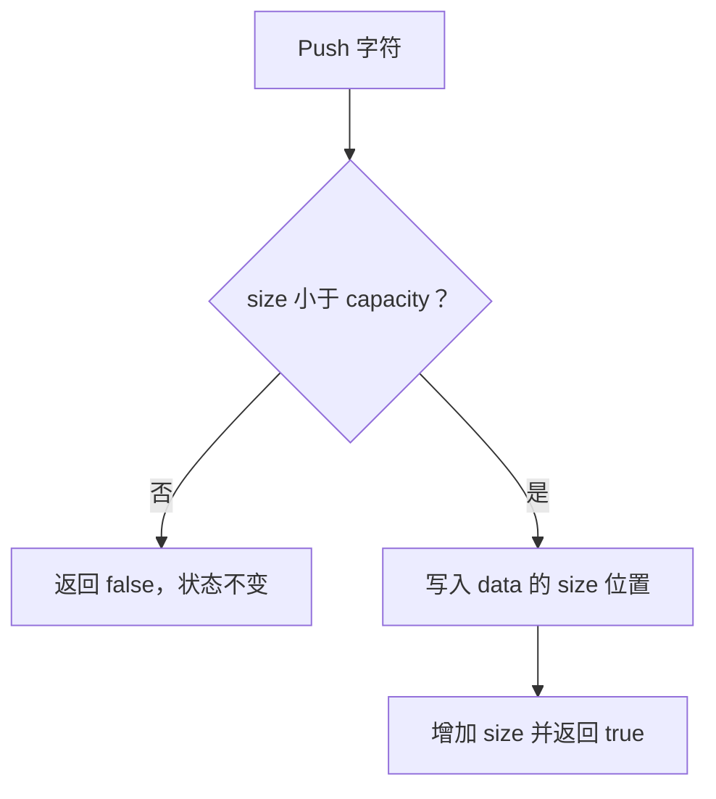

# Day 28 · 类的不变量与最小公共接口

## ① 今日阅读范围 · 5 分钟

Chapter 5 中类设计、封装与不变量；先定义合法状态再设计成员函数。

阅读目标：能解释本课规则的适用条件，并在下面的实验中验证它。

## ② 昨日复习 · 5 分钟

非法状态迁移应怎样处理？稳定边界为什么需要契约？错误返回值能否取代内部状态约束？

先合上资料口头回答；不确定的部分记录到复习队列。

## ③ 核心概念 · 12 分钟

不变量是在构造完成和公开操作结束时必须成立的条件。固定容量缓冲区保证 0 <= size <= capacity；公开 Push 和 Size，而不暴露可任意写入的 size 字段。封装不只是 private 语法，还要避免返回允许破坏不变量的可变别名。容量满是可预期失败，返回 false 并保持原状态。



图表展示关键步骤与判断；请结合下面的代码检查失败分支。

## ④ C 写法 vs Modern C++ · 8 分钟

将公开 data 和 length 的 C 结构改成拥有自身数组的类。外部调用者不能直接修改长度，只能通过受检动作改变状态。

改写时分别检查：类型是否表达意图、失败是否可见、所有权是否清楚。

## ⑤ 今日编码规范 · 8 分钟

公共接口尽量小；失败操作不破坏不变量；长度与容量用同一种无符号类型；每个对象独立拥有状态。

Code Review 时说明规则如何帮助当前场景，不将风格约定当成运行时安全证明。

## ⑥ 可编译实验 · 15 分钟

实现容量为 2 的缓冲区，验证两次成功、第三次失败，失败后大小仍为 2。新增 Clear 后检查不变量。

完整源码：[main.cpp](../examples/day-028/main.cpp)。

```cpp
#include <array>
#include <cassert>
#include <cstddef>
#include <iostream>
class Buffer {
 public:
  bool Push(char value) {
    if (size_ == data_.size()) { return false; }
    data_[size_] = value;
    ++size_;
    return true;
  }
  std::size_t Size() const { return size_; }
 private:
  std::array<char, 2> data_{};
  std::size_t size_{0};
};
int main() {
  Buffer buffer;
  assert(buffer.Size() == 0);
  assert(buffer.Push('A'));
  assert(buffer.Push('T'));
  assert(!buffer.Push('!'));
  assert(buffer.Size() == 2);
  std::cout << "buffer invariant preserved\n";
}
```

在仓库根目录运行：

```bash
g++ -std=c++23 -Wall -Wextra -Wconversion -Wpedantic examples/day-028/main.cpp -o /tmp/day-028
/tmp/day-028
```

预期输出：`buffer invariant preserved`。实验中的断言用于验证用例，不代替生产代码的错误处理。请勿使用 `-DNDEBUG` 运行这些自测。

## ⑦ 常见坑 · 3 分钟

private 数据仍通过可变引用暴露；只在调试 assert 中检查外部输入；失败分支增加 size 导致越界。

检查实验是否覆盖了失败分支；只有正常输入通过不足以证明边界行为正确。

## ⑧ 自测 · 4 分钟

不变量应该何时成立？容量满后为何不能先增 size 再报错？

<details>
<summary>参考答案（先独立回答）</summary>

构造完成和每次公共操作返回时成立。先增 size 会留下无效状态，后续调用可能越界。

</details>

## 下一步

继续 Day 29；若实验或自测仍不确定，先回到对应概念再复盘。
