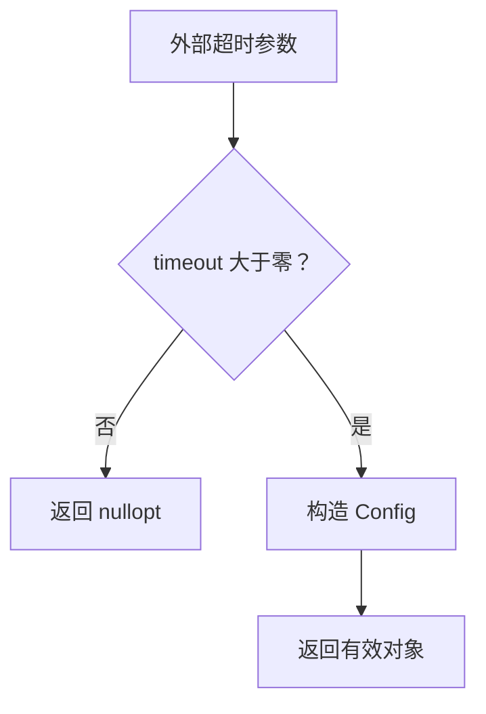

# Day 29 · 构造、初始化与有效状态

<!-- cpp-standards:start -->
## 本课涉及的 C++ 标准

以下按正文与配套 `.cpp` 示例中出现的特性标注首次标准化版本，不代表整份程序的最低编译版本。仓库主 Lab 统一使用 C++23。

| 特性 | 首次标准化 | 版本边界 |
| --- | --- | --- |
| `auto` 类型推导 | **C++11** | C++14 才支持普通函数返回类型推导；C++20 才支持 `auto` 形参的简写函数模板。 |
| `std::chrono` | **C++11** | 如 duration、time_point、steady_clock；不是所有 chrono 后增 API 都属于 C++11。 |
| chrono 时长字面量 | **C++14** | 如 `100ms`；需要相应头文件与 `std::chrono_literals`。 |
| `std::optional` / `std::nullopt` | **C++17** | 可选值；不自带错误原因。 |

版本差异、旧机制与工具链检查见 [C++ 标准来源速查](../docs/cpp-feature-standards.md)。
<!-- cpp-standards:end -->

## ① 今日阅读范围 · 5 分钟

### 新手起步：先知道今天在解决什么

先定义什么叫有效配置，再考虑怎么创建。非正超时不能靠“先建一个无效对象，以后记得修好”来维持安全。

**前置检查：** 先能解释 [Day 2](day-002-variables-initialization-casts.md)、[Day 17](day-017-errors-assert-control-flow.md)、[Day 28](day-028-class-invariants-minimal-interface.md) 的核心例子；不必先掌握整本教材。

**本课最低完成目标：** 能按下面的步骤说明示例如何得到结果，并独立完成一项小修改；高级模式与平台性能分析可第二遍再读。新增导读和拓展练习不计入原有约 60 分钟安排，可分两次完成。

Chapter 5 中构造函数、成员初始化列表和 explicit，复习类的不变量。

## ② 昨日复习 · 5 分钟

Buffer 的不变量是什么？失败操作应保留什么？公共接口为什么不暴露长度字段？

## ③ 核心概念 · 12 分钟

### 先用白话建立概念

- **构造**：开始对象生命周期并初始化成员。
- **工厂**：能表达创建失败的创建入口。

### 跟着本课实验走一遍

1. 工厂收到 0 或负超时。
2. 返回失败。
3. 收到 100ms。
4. 构造有效对象。
5. 只读访问确认值。

先尝试口头预测，再到第⑥节运行。下面原有概念、图示与接口对照用于解释这些步骤，短代码片段不一定能单独编译；完整程序以本课 `main.cpp` 为准。

成员按声明顺序初始化，而非初始化列表中的书写顺序。引用和 const 成员必须在初始化列表中绑定。对象在构造完成后即进入有效状态，可避免因“漏调用 Init()”导致的半初始化问题。explicit 防止单参数构造函数触发意料之外的隐式转换。输入无法通过校验时，可通过返回 std::optional 的工厂函数表达构造失败；工厂函数并不意味着必须进行堆分配。



## ④ C 写法 vs Modern C++ · 8 分钟

将默认构造后 SetTimeout 的流程改为 Create(milliseconds)。校验失败不产生对象，成功返回一个满足正超时约束的值对象。

## ⑤ 今日编码规范 · 8 分钟

使用成员初始化列表；初始化列表顺序与声明顺序一致；外部输入先验证再建立对象；不要把 this 在构造中泄漏到回调。

## ⑥ 可编译实验 · 15 分钟

### 第一次做：先运行，再只改一件事

1. 在仓库根目录打开 [`examples/day-029/main.cpp`](../examples/day-029/main.cpp)，先读 `main()`，圈出输入、调用与结果检查。
2. 运行原版，把实际输出和退出状态记下来，再与本节预期对照。无输出也可能成功，必须结合退出码与断言判断。
3. 修改前先写预期；若失败，先读第一条编译错误或失败断言，再回到对应概念，不同时重写多个函数。

**本课小改动：** 新增一个有效的大于零超时，预期成功；不要让测试把所有正数都错误限制为 100。

<details>
<summary>练习提示：卡住时再展开</summary>

把上面的执行步骤当作检查点；保留原版作为对照。若练习故意让编译或断言失败，请只在实验副本操作，解释失败后还原，不把负例混入日常通过用例。不要执行越界、悬空解引用或重复释放来“观察效果”。

</details>

创建超时配置工厂，验证零和负值失败、正值成功。加入第二个必填字段时，检查是否仍能构造出半初始化对象。

完整源码：[main.cpp](../examples/day-029/main.cpp)。

```cpp
#include <cassert>
#include <chrono>
#include <iostream>
#include <optional>
class Config {
public:
  static std::optional<Config> Create(std::chrono::milliseconds timeout) {
    if (timeout.count() <= 0) {
      return std::nullopt;
    }
    return Config{timeout};
  }
  std::chrono::milliseconds Timeout() const {
    return timeout_;
  }

private:
  explicit Config(std::chrono::milliseconds timeout) : timeout_{timeout} {}
  std::chrono::milliseconds timeout_;
};
int main() {
  assert(!Config::Create(std::chrono::milliseconds{0}));
  assert(!Config::Create(std::chrono::milliseconds{-1}));
  const auto config = Config::Create(std::chrono::milliseconds{100});
  assert(config.has_value());
  assert(config->Timeout().count() == 100);
  std::cout << "construction establishes valid timeout\n";
}
```

在仓库根目录运行：

```bash
g++ -std=c++23 -Wall -Wextra -Wconversion -Wpedantic examples/day-029/main.cpp -o /tmp/day-029
/tmp/day-029
```

预期输出：`construction establishes valid timeout`。实验中的断言用于验证用例，不代替生产代码的错误处理。请勿使用 `-DNDEBUG` 运行这些自测。

## ⑦ 常见坑 · 3 分钟

误认为初始化列表决定执行顺序；工厂返回 optional 就一定有 heap；explicit 等于验证了输入范围。

## ⑧ 自测 · 4 分钟

### 分层自测：从解释到判断

1. **理解：** 不看代码，用三句话复述本课示例的输入、关键步骤和结果。
2. **应用：** 说明第⑥节小改动的预期，以及实际结果是否符合预期。
3. **辨析：** 构造函数是否应该悄悄做硬件连接？

<details>
<summary>辨析题参考答案与通过依据</summary>

不宜隐藏可能失败、阻塞的启动动作；对象不变量和运行期启动状态应明确区分。

能运行只是第一步。只有能解释本课具体步骤、完成小改动，并说清一个不适用条件，才算完成本次自测；不清楚时回看第③节，不以阅读次数当作掌握证据。

</details>

### 原课检查题

explicit 是否拒绝负超时？optional 工厂如何避免两阶段初始化？

<details>
<summary>参考答案（先独立回答）</summary>

explicit 只限制隐式转换，不验证数值。工厂只在检查通过后返回对象，调用者拿不到半初始化状态。

</details>

### 对照现有资料库

- [拥有、借用与对象协作](<../patterns/ownership-and-smart-pointers.md>)。
- [模式选型：先看无模式基线](<../patterns/engineering-workshop.md>)。

先完成本课小实验，再查对照资料；专题中的线程、网络、板端或模式不是本课默认前置。以上为本项目已有讲解和工程对照，不冒充标准条文，也不表示所有示例已在目标板验证。

## 下一步

继续 Day 30；若实验或自测仍不确定，先回到对应概念再复盘。
