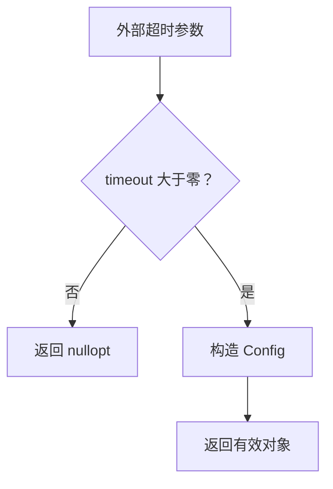

# Day 29 · 构造、初始化与有效状态

## ① 今日阅读范围 · 5 分钟

Chapter 5 中构造函数、成员初始化列表和 explicit，复习类的不变量。

阅读目标：能解释本课规则的适用条件，并在下面的实验中验证它。

## ② 昨日复习 · 5 分钟

Buffer 的不变量是什么？失败操作应保留什么？公共接口为什么不暴露长度字段？

先合上资料口头回答；不确定的部分记录到复习队列。

## ③ 核心概念 · 12 分钟

成员按声明顺序初始化，不按初始化列表顺序。引用和 const 成员必须在初始化时绑定。构造完成即有效可避免“忘记调用 Init”的半初始化状态。explicit 防止单参数构造函数被用于无意的隐式转换。无法构造的外部配置可用返回 optional 的工厂表达；工厂不一定意味着堆分配。



图表描述本课学习路径或关键决策，具体行为以代码与接口契约为准。

## ④ C 写法 vs Modern C++ · 8 分钟

将默认构造后 SetTimeout 的流程改为 Create(milliseconds)。校验失败不产生对象，成功返回一个满足正超时约束的值对象。

改写时分别检查：类型是否表达意图、失败是否可见、所有权是否清楚。

## ⑤ 今日编码规范 · 8 分钟

使用成员初始化列表；初始化列表顺序与声明顺序一致；外部输入先验证再建立对象；不要把 this 在构造中泄漏到回调。

Code Review 时说明规则如何帮助当前场景，不将风格约定当成运行时安全证明。

## ⑥ 可编译实验 · 15 分钟

创建超时配置工厂，验证零和负值失败、正值成功。加入第二个必填字段时，检查是否仍能构造出半初始化对象。

完整源码：[main.cpp](../examples/day-029/main.cpp)。

```cpp
#include <cassert>
#include <chrono>
#include <iostream>
#include <optional>
class Config {
 public:
  static std::optional<Config> Create(std::chrono::milliseconds timeout) {
    if (timeout.count() <= 0) { return std::nullopt; }
    return Config{timeout};
  }
  std::chrono::milliseconds Timeout() const { return timeout_; }
 private:
  explicit Config(std::chrono::milliseconds timeout) : timeout_{timeout} {}
  std::chrono::milliseconds timeout_;
};
int main() {
  assert(!Config::Create(std::chrono::milliseconds{0}));
  assert(!Config::Create(std::chrono::milliseconds{-1}));
  const auto config = Config::Create(std::chrono::milliseconds{100});
  assert(config.has_value());
  assert(config->Timeout().count() == 100);
  std::cout << "construction establishes valid timeout\n";
}
```

在仓库根目录运行：

```bash
g++ -std=c++23 -Wall -Wextra -Wconversion -Wpedantic examples/day-029/main.cpp -o /tmp/day-029
/tmp/day-029
```

预期输出：`construction establishes valid timeout`。实验中的断言用于验证用例，不代替生产代码的错误处理。请勿使用 `-DNDEBUG` 运行这些自测。

## ⑦ 常见坑 · 3 分钟

误认为初始化列表决定执行顺序；工厂返回 optional 就一定有 heap；explicit 等于验证了输入范围。

检查实验是否覆盖了失败分支；只有正常输入通过不足以证明边界行为正确。

## ⑧ 自测 · 4 分钟

explicit 是否拒绝负超时？optional 工厂如何避免两阶段初始化？

<details>
<summary>参考答案（先独立回答）</summary>

explicit 只限制隐式转换，不验证数值。工厂只在检查通过后返回对象，调用者拿不到半初始化状态。

</details>

## 下一步

继续 Day 30；若实验或自测仍不确定，先回到对应概念再复盘。
