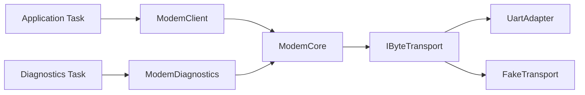

# Day 49 · Consider the Audience and Purpose

> 主线：**先确定谁在用接口、为什么用，再决定接口应该暴露什么。**
>
> 设计模式辅线：**Adapter + 显式依赖注入 + 小接口**。模式不是目标；如果一个直接的小接口已经足够，就不要再堆一层抽象。

## ① 今日章节与建议阅读范围（5 分钟）

### 新手起步：先知道今天在解决什么

先区分应用、诊断和驱动维护者的任务。上层能访问硬件寄存器不意味着它应该访问；接口应按目标而不是底层能力大全组织。

**前置检查：** 先能解释 [Day 22](day-022-abstraction-stable-interface.md)、[Day 24](day-024-coupling-cohesion-dependencies.md)、[Day 42](day-042-use-abstraction-for-reuse.md)、[Day 48](day-048-design-usable-interfaces.md) 的核心例子；不必先掌握整本教材。

**本课最低完成目标：** 能按下面的步骤说明示例如何得到结果，并独立完成一项小修改；高级模式与平台性能分析可第二遍再读。新增导读和拓展练习不计入原有约 60 分钟安排，可分两次完成。

继续 Chapter 6 · **Designing for Reuse**，沿 `Design Usable Interfaces` 继续进入：

- **Consider the Audience**
- **Consider the Purpose**

上一课解决“接口如何容易正确使用”；今天进一步追问：

1. 这个接口的**真实调用者是谁**？
2. 调用者完成任务时真正需要哪些能力？
3. 哪些 HAL / RTOS / Linux / transport 细节只是实现机制，不应该成为调用者知识？
4. 是否正在用一个“万能接口”同时服务业务、诊断、制造测试和底层驱动？

核心判断：

```text
Audience 决定可见能力
Purpose 决定最小 contract
Implementation 决定隐藏细节
```

---

## ② 昨日复习 3 问（5 分钟）

1. 为什么 `std::chrono::milliseconds` 比无单位整数更适合 reusable API？
2. 为什么把 `UART_HandleTypeDef*` 暴露给业务层会造成 abstraction leakage？
3. required dependency 为什么优先使用引用，而不是允许 `nullptr` 的裸指针？

---

## ③ 核心概念与场景对照（23 分钟，含进阶选读）

### 先用白话建立概念

- **受众**：使用某个接口的角色。
- **最小能力**：完成目标实际需要的功能集合。

### 跟着本课实验走一遍

1. 找出实验中的业务调用方。
2. 列出它使用的方法。
3. 标出不应泄漏的硬件信息。
4. 检查替身需要实现的能力。

先尝试口头预测，再到第⑥节运行。下面原有概念、图示与接口对照用于解释这些步骤，短代码片段不一定能单独编译；完整程序以本课 `main.cpp` 为准。

### 1. 不同 audience 不一定应该看到同一套 API

假设一个 modem 模块同时服务：

- application：发送 telemetry；
- diagnostics：读取 RSSI、执行 probe；
- manufacturing：执行产测命令；
- driver layer：操作 UART / USB。

如果把所有能力塞进一个接口：

```cpp
class Modem {
public:
  Status SendTelemetry(...);
  Status SendAtCommand(...);
  Status ResetGpio(...);
  int ReadRssi();
  void* GetHalHandle();
  Status RunFactoryTest(...);
};
```

这不是“通用”，而是把多个 audience 的知识耦合在一起。

更好的方向是按 purpose 暴露小接口或小 view：

```text
Application
   ↓
ModemClient
   ↓
 ModemCore
   ↑
Diagnostics
```

### 2. Purpose 决定 contract，而不是底层能做什么

底层 UART 可能支持：

- DMA；
- polling；
- zero-copy；
- half-duplex；
- raw register access。

但 application 的目的可能只是：

> “在 500 ms 内发送一段 telemetry。”

那么 application API 应表达这一目的，而不是复制 UART 的全部能力。

### 3. 一个 reusable interface 不等于“所有人都能用的最大接口”

可复用的关键是：

- 边界稳定；
- 调用者依赖最少；
- 概念清楚；
- 可替换实现不扩散；
- 测试能在边界替换依赖。

这与接口隔离思想一致：调用者不应依赖自己不需要的能力。

---

### 进阶选读：模式映射

### 变化轴

今天真正的变化不是“Modem 类怎么写”，而是：

```text
底层 transport / platform 会变化
不同调用 audience 的需求也会变化
```

### 稳定边界

```text
业务意图
  ↓
Audience-facing interface
  ↓
Core abstraction
  ↓
Transport boundary
  ↓
UART / USB / Fake / TCP
```

### Pattern 1：Adapter

Adapter 适合隔离：

- vendor BSP；
- C HAL；
- POSIX fd；
- RTOS queue；
- USB/UART API。

例如：

```cpp
class IByteTransport {
public:
  virtual ~IByteTransport() = default;

  virtual Status Write(std::span<const std::byte> payload, std::chrono::milliseconds timeout) = 0;
};
```

`UartAdapter`、`UsbAdapter`、`FakeTransport` 都只存在于这条变化轴上。

### Pattern 2：Dependency Injection

`ModemCore` 借用一个 transport：

```cpp
explicit ModemCore(IByteTransport& transport) : transport_(transport) {}
```

这里：

- `ModemCore` **不拥有** transport；
- transport 必须活得比 `ModemCore` 久；
- required dependency 不允许为空；
- 无需 `shared_ptr`。

### 今天不强行使用的 Pattern

不要因为 audience 不同就自动创建复杂 Factory、Observer 或多层 inheritance。

如果只有一个业务调用者和一个简单 transport：

```text
直接 composition + 小接口
```

通常已经足够。

### Pattern 滥用检查

如果你发现：

```text
IApplicationModem
IAdminModem
IDiagnosticModem
IModemFacade
IModemFactory
IModemProvider
IModemServiceLocator
```

但系统只有一个固定 UART modem，那么很可能已经 overengineering。

---

### 进阶选读：嵌入式与系统场景

以 RTOS Modem 为例：



Embedded 额外检查：

- application API 不泄漏 RTOS queue handle；
- diagnostics 不获得任意寄存器写权限；
- transport timeout 必须显式；
- runtime path 不做无界动态分配；
- borrower 的 teardown 顺序明确；
- 若 diagnostics 与 application 跨线程访问同一个 core，必须另行定义同步策略，不能因为“接口拆小了”就假设线程安全。

---

## ④ C 写法 vs Modern C++（7 分钟）

### 传统 C：一个入口暴露所有细节

```c
int modem_send(void* uart,
               const unsigned char* data,
               unsigned len,
               unsigned timeout_ms,
               int diagnostic_mode);
```

调用者被迫知道：

- transport handle；
- timeout 单位；
- diagnostic flag；
- buffer + length；
- 返回码约定。

### Modern C++：按 purpose 建立调用边界

```cpp
class ModemClient final {
public:
  explicit ModemClient(ModemCore& modem) : modem_(modem) {}

  Status SendTelemetry(std::span<const std::byte> payload);

private:
  ModemCore& modem_;
};
```

diagnostics 可以有独立 view：

```cpp
class ModemDiagnostics final {
public:
  explicit ModemDiagnostics(ModemCore& modem) : modem_(modem) {}

  [[nodiscard]] std::uint32_t ReadSignalDbm() const;

private:
  ModemCore& modem_;
};
```

两者都不需要看到 UART handle。

---

## ⑤ 今日编码规范（7 分钟）

### MUST：公开接口按调用者目的表达，不暴露无关平台能力

错误：

```cpp
Status SendTelemetry(UART_HandleTypeDef* uart, const std::byte* data, std::size_t size);
```

推荐：

```cpp
Status SendTelemetry(std::span<const std::byte> payload);
```

### SHOULD：不同 audience 需要不同能力时，优先小接口 / 小 view

错误：

```cpp
class ModemApi {
public:
  Status Send();
  Status FactoryReset();
  Status WriteRegister();
  Status RunProductionTest();
  Status GetDiagnostics();
};
```

推荐：按真实 purpose 拆分可见能力，而不是制造一个万能入口。

### MUST：required non-owning dependency 用引用表达

错误：

```cpp
explicit ModemCore(IByteTransport* transport);
```

如果 `nullptr` 没有业务意义，这制造了虚假状态。

推荐：

```cpp
explicit ModemCore(IByteTransport& transport);
```

这些规则与课程使用的 Embedded C++ Guideline 中“小接口、避免全局状态、明确空值、required borrow、RAII、实时路径有界”保持一致。

---

## ⑥ 可编译 Lab / 练习（8 分钟）

### 第一次做：先运行，再只改一件事

1. 在仓库根目录打开 [`examples/day-049/main.cpp`](../examples/day-049/main.cpp)，先读 `main()`，圈出输入、调用与结果检查。
2. 运行原版，把实际输出和退出状态记下来，再与本节预期对照。无输出也可能成功，必须结合退出码与断言判断。
3. 修改前先写预期；若失败，先读第一条编译错误或失败断言，再回到对应概念，不同时重写多个函数。

**本课小改动：** 分别为“发送遥测”和“诊断信号”写最小方法清单，说明哪些方法不应该出现在对方接口。

<details>
<summary>练习提示：卡住时再展开</summary>

把上面的执行步骤当作检查点；保留原版作为对照。若练习故意让编译或断言失败，请只在实验副本操作，解释失败后还原，不把负例混入日常通过用例。不要执行越界、悬空解引用或重复释放来“观察效果”。

</details>

实验：

```text
examples/day-049/main.cpp
```

目标：

1. `IByteTransport` 建立平台变化边界；
2. `ModemCore` 通过引用借用 transport；
3. `ModemClient` 只暴露 application 需要的发送能力；
4. `ModemDiagnostics` 只暴露 diagnostics 需要的 signal/probe 能力；
5. 不使用 heap allocation；
6. timeout 使用 `std::chrono::milliseconds`；
7. payload 使用 `std::span<const std::byte>`。

编译：

```bash
g++ -std=c++23 -Wall -Wextra -Wconversion -Wpedantic \
  examples/day-049/main.cpp -o day049
./day049
```

### 修复违规代码

```cpp
class ModemManager {
public:
  ModemManager() {
    uart_ = GlobalServiceLocator::GetUart();
  }

  bool Do(int mode, void* data, int size, int timeout) {
    if (mode == 7) {
      return uart_->Write(data, size, timeout) == 0;
    }
    return false;
  }

private:
  UartDriver* uart_{};
};
```

至少修复：

- service locator 隐藏依赖；
- ownership / lifetime 不清；
- `void*` 丢失类型；
- `mode == 7` 是 magic number；
- `size` 使用有符号整数；
- timeout 单位不清；
- `bool` 丢失失败原因；
- API 没有表达 audience/purpose；
- transport concrete type 泄漏到业务层。

---

## ⑦ 3 个常见坑（3 分钟）

1. **把“通用”理解为“大接口”**：真正 reusable 的接口通常更小、更稳定，而不是暴露所有能力。
2. **拆接口但仍共享隐藏全局状态**：表面 ISP，实际依赖仍通过 singleton/service locator 耦合。
3. **按角色拆出大量抽象层**：只有在真实 audience/purpose 不同时才拆；固定小系统不要为未来假想需求建立多层 interface/factory。

---

## ⑧ 检查题（2 分钟）

### 分层自测：从解释到判断

1. **理解：** 不看代码，用三句话复述本课示例的输入、关键步骤和结果。
2. **应用：** 说明第⑥节小改动的预期，以及实际结果是否符合预期。
3. **辨析：** 同一个底层对象能为不同受众提供不同接口吗？

<details>
<summary>辨析题参考答案与通过依据</summary>

可以；能力边界和对象实体不是一回事，关键是依赖、权限与生命周期都明确。

能运行只是第一步。只有能解释本课具体步骤、完成小改动，并说清一个不适用条件，才算完成本次自测；不清楚时回看第③节，不以阅读次数当作掌握证据。

</details>

### 原课检查题

### Q1

为什么 application 层通常不应该直接接收 `UART_HandleTypeDef*`？

### Q2

如果一个 dependency 是 required、non-owning、且不能为 `nullptr`，为什么引用通常比裸指针表达得更准确？

### Q3 · 设计题

一个设备只有一个固定 SPI temperature sensor，业务层仅需：

```text
ReadTemperature()
```

未来“可能”更换 I2C sensor。

你会选择：

1. 直接使用 concrete class；
2. composition + 小 transport/sensor boundary；
3. Strategy；
4. Abstract Factory + service locator；
5. 多层 virtual hierarchy。

要求说明：

- 当前变化轴；
- 稳定边界；
- ownership/lifetime；
- 是否需要 runtime replacement；
- MCU flash/RAM/WCET 成本；
- 哪种设计属于 overengineering。

### 答案要点

Q1：HAL handle 是平台实现机制，会把业务层绑定具体 SDK、测试方式和生命周期规则。

Q2：引用直接表达“必须存在且只借用”，减少虚假 `nullptr` 状态；但仍要保证被借用对象生命周期覆盖 borrower。

Q3：优先从 **2** 或更简单的 **1** 开始；只有真实出现运行时替换需求时再升级抽象。不要因为“未来可能”直接引入 Factory/service locator。

---

### 对照现有资料库

- [模式选型工作坊](<../patterns/engineering-workshop.md>)。
- [复用契约章末评审](<../docs/chapter-06-review.md>)。

先完成本课小实验，再查对照资料；专题中的线程、网络、板端或模式不是本课默认前置。以上为本项目已有讲解和工程对照，不冒充标准条文，也不表示所有示例已在目标板验证。

### 今日 Code Review 快检
- [ ] 这个接口的 audience 是谁？
- [ ] 这个 audience 的 purpose 是什么？
- [ ] 是否暴露了调用者不需要的能力？
- [ ] 是否泄漏 HAL / RTOS / POSIX 实现细节？
- [ ] 变化轴是否真实存在？
- [ ] Adapter 是否只隔离真正的平台不兼容点？
- [ ] required dependency 是否显式注入？
- [ ] owner / borrow / lifetime 是否清楚？
- [ ] 是否为了 Pattern 而 Pattern？
- [ ] runtime path 的 allocation / blocking / WCET 是否有界？

### Week 7
Day 49 是第 7 周收束日。完成本课后继续：

- [Week 07 Review](../weekly/week-07-review.md)

下一课 Day 50 继续 Chapter 6，沿教材顺序推进 `Design Interfaces That Are Easy to Use` 的后续内容。
