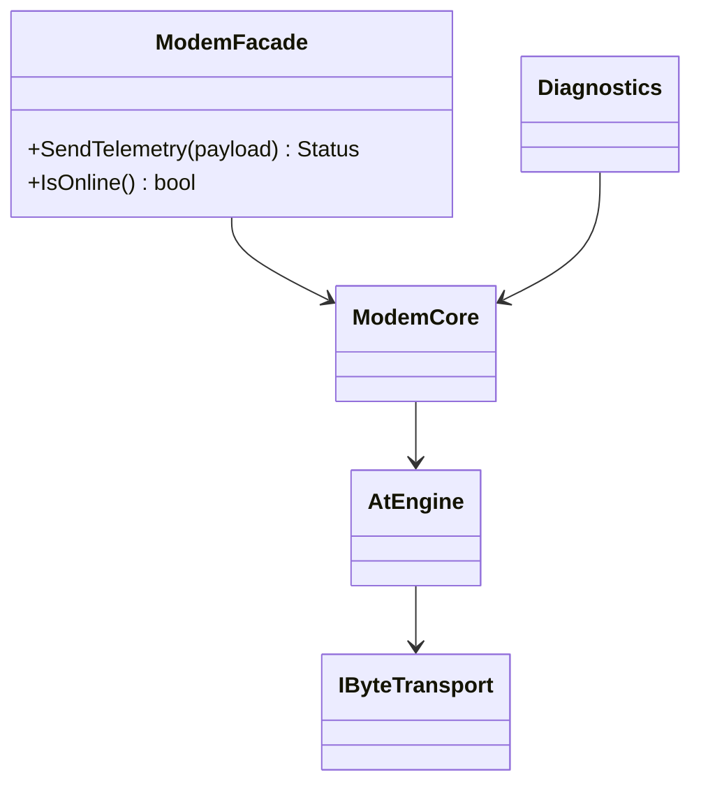

# Day 50 · Design Interfaces That Are Easy to Use

> 主教材主线：Chapter 6 · **Designing for Reuse → Design Usable Interfaces → Design Interfaces That Are Easy to Use**。
>
> 今天把“谁来用、为什么用”进一步落实成 API 形状：**熟悉、直观、常用路径短、错误路径清楚、底层复杂性留在边界后面。**

## ① 今日章节与建议阅读范围（5 分钟）

建议阅读 Chapter 6 中 **Design Interfaces That Are Easy to Use**，重点关注四类问题：

1. **Follow Familiar Ways of Doing Things**：遵循 C++ 使用者熟悉的构造、析构、容器、迭代、错误表达习惯。
2. **Don't Omit Required Functionality**：不能为了“小接口”把调用者真正需要的操作删掉，逼迫其绕过抽象。
3. **Present Uncluttered Interfaces**：不要把高级/底层能力与最常用能力混成 fat interface。
4. **Provide Documentation**：类型系统能表达的 contract 用类型表达；无法表达的时序、线程、复杂度、lifetime 仍必须文档化。

今天的目标不是“函数越少越好”，而是：

```text
常用任务 → 最短、最熟悉的路径
高级任务 → 仍然可达，但不污染常用路径
危险操作 → 不应成为默认入口
```

---

## ② 昨日复习 3 问（5 分钟）

1. 为什么 audience / purpose 应该先于接口成员列表确定？
2. Adapter 隔离的是哪一类变化？为什么不应该把 Adapter 当成所有模块的默认层？
3. `ModemCore(IByteTransport&)` 中谁拥有 transport？如果 transport 先销毁会发生什么？

---

## ③ 核心概念（10 分钟）

### 1. 熟悉的 C++ 习惯本身就是 API 资产

如果对象必须这样使用：

```cpp
Device device;
device.Initialize();
// ...
device.Cleanup();
```

调用者必须记住额外状态机：`Initialize()` 是否调用、失败后是否能 `Cleanup()`、重复调用怎么办。

如果资源天然具有作用域生命周期，更自然的是 RAII：

```cpp
Device device{driver};
device.Send(payload);
// 离开作用域自动释放资源
```

这不是“语法糖”，而是把正确生命周期放进语言机制。

### 2. Easy to use 不等于删掉高级能力

假设 modem transport 同时支持：

- 普通发送；
- 指定 timeout；
- priority；
- retry policy；
- raw AT；
- trace hook。

如果所有参数都塞进一个函数，常用路径会被高级能力污染：

```cpp
Send(payload, 500ms, Priority::kNormal, Retry::kNone, nullptr, false, false);
```

更好的接口让常用路径有安全默认值：

```cpp
Send(payload);
Send(payload, SendOptions{.timeout = 2s});
```

### 3. Uncluttered interface 是认知负担控制

fat interface 的问题不仅是函数多，而是：

- 调用者不知道哪些是正常路径；
- 低层危险操作和高层业务操作混在一起；
- 测试替身必须实现无关方法；
- ABI/API 演化范围变大。

### 4. 文档不能替代类型系统，类型系统也不能替代文档

应该由类型表达：

- 单位；
- buffer 边界；
- enum 状态；
- required/optional dependency；
- ownership transfer。

仍需文档表达：

- 是否线程安全；
- callback 在哪个线程执行；
- timeout 是否包含排队时间；
- worst-case complexity / WCET；
- borrower 生命周期约束。

---

## ④ C 写法 vs Modern C++（7 分钟）

### C / 旧式接口：调用者维护隐式生命周期

```c
modem_t modem;
if (modem_init(&modem, uart) != 0) {
    return ERROR;
}

int rc = modem_send(&modem, data, size, 1000);
modem_deinit(&modem);
```

任何 early return 都可能遗漏 cleanup。

### Modern C++：RAII + 类型化调用点

```cpp
Modem modem{transport};
const Status status = modem.Send(payload, 1s);
```

资源生命周期由对象负责；payload、timeout、错误语义都进入 contract。

但不要误解：如果底层资源初始化本身可能失败，而项目默认禁异常，就需要显式 factory/result：

```cpp
const auto result = Modem::Create(transport);
if (!result) {
  return result.error();
}
```

这比“构造成功但对象内部 invalid”更清楚。

---

## ⑤ 设计模式映射（8 分钟）

### 变化轴

今天主要有两个变化轴：

```text
A. 底层子系统能力很多、复杂度会增长
B. 上层最常用任务应长期保持简单
```

### 稳定边界

```text
Application
    ↓
Simple Modem API     ← 稳定、常用路径
    ↓
Facade / Core
    ↓
Transport / Retry / Diagnostics / Vendor HAL
```

### Facade：什么时候合适？

当底层已经是一个真实复杂子系统，而调用者只需要一小组高频操作时，Facade 很合适：



Facade 的价值是**降低入口复杂度**，不是复制底层每一个方法。

### Ownership / lifetime

本课实验采用借用：

```text
FakeTransport owner: main()
ModemCore borrows FakeTransport&
ModemFacade borrows ModemCore&
```

销毁顺序必须是：

```text
ModemFacade → ModemCore → FakeTransport
```

因为 borrower 必须先于被借用对象销毁。

### 为什么今天不需要 Factory / Observer / shared_ptr？

- 对象数量和实现都在启动期明确，不需要 Factory 隔离复杂创建。
- 没有事件广播需求，不需要 Observer。
- 没有共享 ownership，不需要 `shared_ptr`。

### static polymorphism 是否更合适？

如果 transport 在固件构建时固定，且不需要 host runtime fake replacement，可使用 template/concept 形成编译期边界，消除 virtual dispatch。但本课保留 runtime interface，是为了展示 host fake 与平台替换的清晰测试边界；Embedded 项目应根据真实变化时机选择。

### Pattern 滥用

只有一个简单 `UartTransport`，业务也只调用一个 `Send()` 时，再加：

```text
ModemFacade → ModemService → ModemManager → ModemFactory → UartAdapter
```

通常不是“架构”，而是认知负担。

---

## ⑥ Embedded / System Design 场景（5 分钟）

RTOS 中一个常见反模式是把 modem task 的所有内部能力直接暴露：

```cpp
class ModemTask {
public:
  QueueHandle_t GetQueue();
  UartHandle* GetUart();
  Status SendAt(...);
  Status ResetPowerRail();
  Status SendTelemetry(...);
  Status RegisterUrc(...);
  Status DumpTrace(...);
};
```

业务 task 因而知道 queue、UART、AT、power rail、URC registration。

更合适的结构：

```text
Application Task
      ↓
ModemFacade::SendTelemetry()
      ↓
ModemCore
      ↓
AT Engine → Transport Adapter → RTOS/UART

Diagnostics Task → 专用 diagnostics interface
```

实时约束：

- facade 不能隐藏无限阻塞；timeout 仍必须明确或具有可审计默认值；
- 不在 `Send()` 热路径创建 heap object；
- retry 次数有上界；
- 如果调用跨 task，文档明确排队时间是否计入 timeout；
- facade 不应让同步外观看起来像“零延迟”。

---

## ⑦ 今日编码规范（7 分钟）

### MUST：遵循熟悉的 C++ 生命周期习惯，资源优先 RAII

错误：

```cpp
Driver driver;
driver.Initialize();
Use(driver);
driver.Cleanup();
```

推荐：

```cpp
Driver driver{config};
Use(driver);
```

如果初始化可能失败且禁异常，使用显式 `Create()` + result/status，而不是半初始化对象。

### SHOULD：让 common case 短且安全，高级配置进入 Options

错误：

```cpp
Send(payload, 500, 0, false, nullptr, 3);
```

推荐：

```cpp
Send(payload);
Send(payload, SendOptions{.timeout = 2s, .priority = Priority::kHigh});
```

### SHOULD：fat subsystem 前可提供 Facade，但不要让 Facade 变成另一个 fat interface

错误：

```cpp
class ModemFacade {
  // 复制所有 HAL、AT、diagnostics、power API
};
```

推荐：Facade 只表达目标 audience 的高频 use cases，高级能力通过独立接口访问。

---

## ⑧ 可编译 Lab / 练习（8 分钟）

实验文件：

```text
examples/day-050/main.cpp
```

实验展示：

- `IByteTransport`：平台变化边界；
- `ModemCore`：底层 mechanism；
- `ModemFacade`：application 的简单入口；
- `SendOptions`：高级能力不污染 common path；
- required borrow 全部用引用；
- 无运行时 heap allocation；
- timeout 使用 `std::chrono`。

编译：

```bash
g++ -std=c++23 -Wall -Wextra -Wconversion -Wpedantic \
  examples/day-050/main.cpp -o day050
./day050
```

### 修复违规代码

```cpp
class NetworkModem {
public:
  NetworkModem() = default;

  bool Initialize();
  void Cleanup();

  bool Send(const void* data, int length, int timeout, int priority, bool retry, bool trace);

  void* GetUart();
  void* GetQueue();
};
```

至少指出并修复：

1. 手工 `Initialize/Cleanup` 生命周期；
2. `void*` 与 `int length`；
3. timeout 无单位；
4. 多个 primitive 参数造成 parameter blindness；
5. `bool` 丢失错误原因；
6. common path 被高级选项污染；
7. HAL / queue handle 泄漏；
8. retry 是否有上界未知；
9. ownership/lifetime 未表达。

---

## ⑨ 3 个常见坑（3 分钟）

1. **“简单”变成“隐藏成本”**：Facade 把 blocking、retry、allocation 都藏起来，却不提供 timeout/WCET contract。
2. **RAII 只做表面包装**：对象内部仍依赖全局 singleton，销毁顺序和 ownership 仍不清楚。
3. **Facade Everywhere**：每个两三个函数的类都再包一层 Facade，增加跳转和 mock 层数，却没有隔离真实复杂度。

---

## ⑩ 检查题（2 分钟）

### Q1

为什么 `Initialize()/Cleanup()` 通常不如构造/析构 + RAII 符合 C++ 使用习惯？

### Q2

什么时候 `Send(payload)` + `Send(payload, options)` 比一个拥有 6 个参数的 `Send()` 更容易正确使用？

### Q3 · 设计题

一个 RTOS storage subsystem 有 20 个底层操作，但业务 task 只需要：

```text
SaveConfig()
LoadConfig()
```

制造测试还需要 raw erase/read/write。

请判断应选择：

- 一个 20+ 方法的公共 interface；
- 两个 audience-specific 小接口；
- Facade；
- Adapter；
- Factory；
- 直接 concrete class。

要求说明：

1. 变化轴是什么；
2. 哪个边界应该稳定；
3. 谁拥有 flash driver / storage core；
4. business API 是否应该看到 raw erase；
5. 是否需要 runtime polymorphism；
6. 如何保证 erase 的 blocking/WCET 不被 Facade 隐藏；
7. 哪些模式属于 overengineering。

### 答案要点

- RAII 把资源生命周期绑定到作用域，减少遗漏 cleanup 和半初始化状态。
- common case 应有安全默认值；高级参数通过强类型 Options 暴露。
- storage 场景通常适合 audience-specific interface；如果底层子系统复杂，业务侧可加小 Facade。Adapter 只在 vendor API 与内部 contract 不兼容时需要；Factory 只有创建策略真的变化时才值得引入。

---

## 今日 Code Review 快检

- [ ] API 是否符合常见 C++ idiom？
- [ ] 是否存在必须手工记忆的 Initialize/Cleanup？
- [ ] common case 是否一眼可见？
- [ ] 高级配置是否污染常用路径？
- [ ] 是否存在 fat interface？
- [ ] Facade 是否真的隐藏了复杂子系统，而不是无意义转发？
- [ ] timeout / allocation / retry / WCET 是否仍然可见、可审计？
- [ ] owner / borrow / teardown 顺序是否清楚？
- [ ] 文档是否说明线程、callback、blocking 和复杂度 contract？

## 下一步

Day 51 继续 Chapter 6，进入 **Design General-Purpose Interfaces**，讨论“通用性”与“可定制性”如何不破坏易用性。