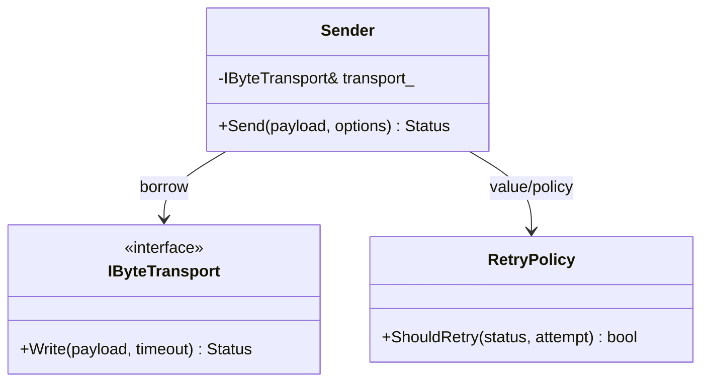

# Day 51 · Design General-Purpose Interfaces

> 主教材主线：Chapter 6 · **Designing for Reuse → Design Usable Interfaces → Design General-Purpose Interfaces**。
>
> 今日目标：让接口可以服务一类真实场景，而不是只服务一个调用点；同时避免把“通用”误解为“无限配置”。

## ① 今日章节与建议阅读范围（5 分钟）

阅读 Chapter 6 的 **Design General-Purpose Interfaces**。重点思考：

- 哪些需求是稳定 mechanism？
- 哪些差异应成为 customization point？
- 哪些差异只是一次性需求，不值得进入公共 API？
- general-purpose 与 easy-to-use 如何同时成立？

```text
具体需求集合 → 找共同语义 → 固定 mechanism → 暴露有限 variation → 保持 common path 简单
```

## ② 昨日复习 3 问（5 分钟）

1. 为什么 RAII 通常比手工 `Initialize()/Cleanup()` 更容易正确使用？
2. Facade 的价值是什么？什么情况下再包一层 Facade 属于 overengineering？
3. `ModemFacade` 借用 `ModemCore&` 时，销毁顺序为什么属于接口 contract？

## ③ 核心概念（10 分钟）

### General-purpose 不等于万能 API

错误方向是不断添加开关：

```cpp
Send(data, size, timeout, retry, priority, trace, async, raw_mode);
```

这会把所有变化压到一个入口，产生 parameter blindness、非法组合和难以界定的 WCET。

更好的设计先区分 **mechanism** 与 **policy**：

```text
mechanism: 怎样可靠地发送 bytes
policy: timeout / retry / priority 如何选择
```

公共 API 应覆盖一类稳定语义；只有真实变化才成为 customization point。

### 通用性的三个层级

1. **值级变化**：timeout、payload、channel → 参数/Options。
2. **行为级变化**：retry/backoff 算法 → Strategy/policy。
3. **平台级变化**：UART/USB/POSIX → Adapter/interface。

不要用同一种机制处理所有变化。

### Embedded 成本

通用性不是免费的：

- runtime virtual：间接调用、vtable、生命周期；
- templates：实例化导致 flash 增长；
- `std::function`：可能引入 type erasure / allocation；
- runtime registry：容量、查找和 teardown 必须有界。

所以 Embedded 的 general-purpose API 必须同时有**功能边界与资源边界**。

## ④ C 写法 vs Modern C++（7 分钟）

### C：flags + callback 组合

```c
int transport_send(transport_t* transport,
                   const uint8_t* data,
                   size_t size,
                   uint32_t timeout_ms,
                   int retry_count,
                   int flags);
```

### Modern C++：类型化 common path + 有限 policy

```cpp
struct SendOptions {
  std::chrono::milliseconds timeout{500};
  std::uint8_t max_attempts{1};
};

Status Send(std::span<const std::byte> payload,
            SendOptions options = {});
```

如果 retry 行为真的有多个长期实现，再把它提升成 policy，而不是预先加入十几个 flags。

## ⑤ 设计模式映射（8 分钟）

### 变化轴

今天的主要变化轴：**发送 mechanism 稳定，但 retry policy 可能因产品/链路而变化。**

### 稳定边界



### Strategy：什么时候值得用？

当 retry/backoff 存在多个真实、独立、可替换算法时，Strategy 是合理边界。

但 Embedded 固件若 policy 在编译时固定，优先考虑 template policy：

```cpp
template <typename RetryPolicy>
class Sender;
```

这避免 runtime ownership 与 virtual dispatch，但要审计 template 实例化数量和 flash。

### 为什么今天不需要 Factory / Observer？

- 没有复杂创建族，不需要 Factory。
- 没有事件广播，不需要 Observer。
- policy 可以 value-owned，不需要 `shared_ptr`。

### Ownership / lifetime

实验采用：

```text
main owns FakeTransport
Sender borrows IByteTransport&
Sender owns RetryPolicy by value
```

先设计 lifetime，再决定 pointer；这里没有共享 ownership，因此 `shared_ptr` 是错误信号。

## ⑥ Embedded / System Design 场景（5 分钟）

Modem middleware 的发送路径：

```text
Protocol
  ↓
BoundedSender
  ↓
IByteTransport
  ↓
UART / USB Adapter
```

产品 A：弱链路允许 3 次 retry；产品 B：实时控制只允许 1 次。

共同 mechanism 是发送；变化的是 retry policy。实时要求：

- `max_attempts` 必须有上限；
- timeout 必须显式；
- retry 总 WCET 可计算；
- 发送路径不动态分配；
- ISR 不直接执行 blocking retry；
- 如果跨 task，排队时间是否计入 deadline 必须定义。

## ⑦ 今日编码规范（7 分钟）

### MUST：通用接口的 customization point 必须对应真实变化轴

错误：

```cpp
Status Send(Buffer data, int mode, int flags, void* extension);
```

推荐：

```cpp
Status Send(std::span<const std::byte> payload,
            SendOptions options = {});
```

### MUST：实时路径的“可配置”必须有资源上界

错误：

```cpp
options.max_attempts = user_value;  // 无上限
```

推荐：验证并限制 attempts，使总 timeout/WCET 可审计。

### SHOULD：编译期固定 policy 优先 value/template；不要默认 runtime virtual + shared_ptr

错误：

```cpp
std::shared_ptr<IRetryStrategy> retry_;
```

推荐：若生命周期与变化时机允许，使用 value policy 或 template policy。

这些规则延续规范中的“读者优先、显式意图、优先静态检查、实时路径有界”。

## ⑧ 可编译 Lab / 练习（8 分钟）

实验：`examples/day-051/main.cpp`。

目标：

- transport 是 runtime platform boundary；
- retry 是 value-owned policy；
- common path 只有 `Send(payload)`；
- 最大尝试次数编译期有界；
- 无 heap allocation；
- 明确 timeout 与 Status。

```bash
g++ -std=c++23 -Wall -Wextra -Wconversion -Wpedantic \
  examples/day-051/main.cpp -o day051
./day051
```

### 修复违规代码

```cpp
class UniversalDevice {
 public:
  bool Execute(void* data, int len, int mode, int retries,
               bool async, bool trace, void* user_context);
};
```

至少修复：`void*`、有符号 length、magic mode、bool flags、无界 retries、错误原因丢失、purpose 不清、lifetime 不清。然后判断：哪些变化只是 Options，哪些真的值得 Strategy/Adapter。

## ⑨ 3 个常见坑（3 分钟）

1. **为通用而通用**：把未来所有假想变化都变成参数/virtual interface。
2. **runtime polymorphism 默认化**：本来编译期固定的 policy 被做成 heap-owned Strategy，增加 lifetime 与 WCET 成本。
3. **隐藏无界成本**：接口看起来通用，实际 retry、callback、registry 或 allocation 没有上限。

## ⑩ 检查题（2 分钟）

### Q1

为什么 timeout 属于值级变化，而 retry 算法可能属于行为级变化？

### Q2

固定固件构建中，template policy 相比 virtual Strategy 的主要收益和主要风险分别是什么？

### Q3 · 设计题

一个 BSP sensor reader 要支持两个产品：A 使用固定 SPI sensor；B 使用 I2C sensor，host test 还需要 fake。采样周期 1 ms，禁止运行时 heap。

判断应采用 concrete class、Adapter、runtime Strategy/interface、template policy 还是 Factory，并解释：

- 变化轴；
- 稳定边界；
- compile-time vs runtime replacement；
- owner / borrow / teardown；
- flash/RAM/WCET；
- 哪些设计属于 overengineering。

## 今日结论

> **General-purpose 的本质不是提供最多选项，而是用最小、稳定的 contract 覆盖一类真实需求，并让 variation 有边界、有成本模型。**

下一课 Day 52 继续 Chapter 6，沿教材顺序讨论 generality 与 ease-of-use 的平衡。