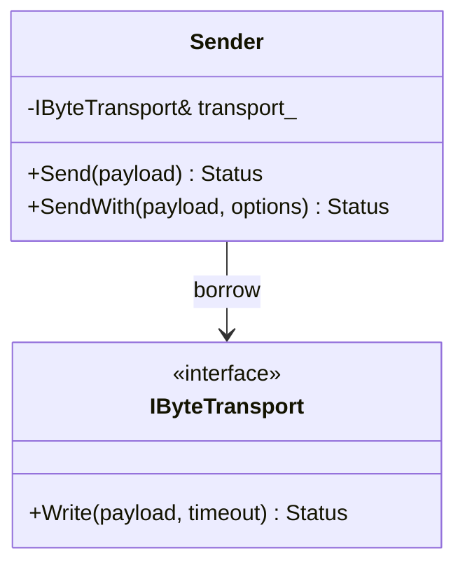

# Day 52 · Reconciling Generality and Ease of Use

<!-- cpp-standards:start -->
## 本课涉及的 C++ 标准

以下按正文与配套 `.cpp` 示例中出现的特性标注首次标准化版本，不代表整份程序的最低编译版本。仓库主 Lab 统一使用 C++23。

| 特性 | 首次标准化 | 版本边界 |
| --- | --- | --- |
| 列表初始化 | **C++11** | 包括直接列表初始化；窄化检查及 initializer_list 优先规则须单独注意。 |
| `= default` / `= delete` | **C++11** | 显式默认化与删除函数。 |
| `constexpr` | **C++11** | C++14 放宽函数体限制；C++20 继续扩展可用于常量求值的操作。声明不保证每次调用都在编译期执行。 |
| `enum class` | **C++11** | 有作用域枚举。 |
| `override` / `final` | **C++11** | 用于虚函数覆盖检查、限制覆盖或继承。 |
| `[[nodiscard]]` | **C++17** | 带说明字符串的形式从 C++20 起可用。 |
| `<cstdint>` 固定宽度整数 | **C++11** | 精确宽度类型仅在实现提供对应整数类型时存在。 |
| `std::array` | **C++11** | 固定大小容器。 |
| `std::chrono` | **C++11** | 如 duration、time_point、steady_clock；不是所有 chrono 后增 API 都属于 C++11。 |
| chrono 时长字面量 | **C++14** | 如 `100ms`；需要相应头文件与 `std::chrono_literals`。 |
| `std::byte` | **C++17** | 字节枚举类型，不是整数算术类型。 |
| `std::span` | **C++20** | 连续序列的非拥有视图；不自动延长底层对象生命周期。 |

版本差异、旧机制与工具链检查见 [C++ 标准来源速查](../docs/cpp-feature-standards.md)。
<!-- cpp-standards:end -->

> 主教材主线：Chapter 6 · **Designing for Reuse → Reconciling Generality and Ease of Use**。
>
> 今日目标：理解 reusable API 的核心张力——既要覆盖多种真实用途，又不能把复杂度全部转嫁给调用者。

## ① 今日章节与建议阅读范围（5 分钟）

### 新手起步：先知道今天在解决什么

先看大多数用户需要什么，再看少数用户需要控制什么。两个入口应复用同一验证与发送逻辑，不能各维护一套错误规则。

**前置检查：** 先能解释 [Day 48](day-048-design-usable-interfaces.md)、[Day 50](day-050-easy-to-use-interfaces.md)、[Day 51](day-051-general-purpose-interfaces.md) 的核心例子；不必先掌握整本教材。

**本课最低完成目标：** 能按下面的步骤说明示例如何得到结果，并独立完成一项小修改；高级模式与平台性能分析可第二遍再读。新增导读和拓展练习不计入原有约 60 分钟安排，可分两次完成。

阅读 Chapter 6 的 **Reconciling Generality and Ease of Use**。

重点观察两个方向：

- **Supply Multiple Interfaces**：为 common case 和 advanced case 提供不同层次的入口；
- **Make Common Functionality Easy to Use**：最常见、最安全的路径应最短。

不要把它理解成“同一个功能写很多重复 API”。真正目标是：

```text
稳定 mechanism
   ↓
高级、完整、显式的底层接口
   ↓
安全默认值 + 受限配置
   ↓
简单、面向常见任务的入口
```

## ② 昨日复习 3 问（5 分钟）

1. Day 51 为什么把 variation 分为值级、行为级和平台级？
2. 固定 firmware 中，为什么 template/value policy 有时比 runtime Strategy 更合适？
3. 一个“通用 API”如果允许无界 retry，会给 WCET 分析带来什么问题？

## ③ 核心概念与场景对照（23 分钟，含进阶选读）

### 先用白话建立概念

- **分层 API**：简单入口与高级入口共享核心。
- **默认委托**：简单入口采用明确默认配置。

### 跟着本课实验走一遍

1. 从简单入口进入默认选项。
2. 跟踪到共同实现。
3. 从高级入口进入同一实现。
4. 比较相同配置的结果。

先尝试口头预测，再到第⑥节运行。下面原有概念、图示与接口对照用于解释这些步骤，短代码片段不一定能单独编译；完整程序以本课 `main.cpp` 为准。

### Generality 和 ease-of-use 的冲突

越通用的接口，往往越需要调用者理解更多选项；越简单的接口，又容易只适配单一场景。

错误的折中是把所有能力压进一个函数：

```cpp
Status Send(std::span<const std::byte> payload, int channel, int timeout, int retries, bool trace,
            bool urgent, bool raw_mode);
```

这既不真正通用，也不容易使用：调用点必须理解所有 policy，而且大量参数可以组成无意义状态。

### 分层 API

更好的设计通常有两个层次：

```cpp
Status Send(std::span<const std::byte> payload);
Status SendAdvanced(std::span<const std::byte> payload, SendOptions options);
```

common path 使用安全默认值；advanced path 才暴露必要 customization。

### 一份 mechanism，不要复制两套实现

两个入口应该汇聚到同一实现核心：

```text
Send(payload) ───────┐
                     ├─> SendWith(options) -> transport
SendWith(options) ───┘
```

否则“易用 API”和“高级 API”很快产生语义漂移。

### Embedded 中的额外要求

默认值不只是 UX 问题，也是资源 contract：

- 默认 timeout 必须有限；
- 默认 retry 必须有限；
- advanced options 也必须验证上界；
- easy API 不能偷偷做 heap allocation；
- 两个入口必须具有一致的线程安全和错误语义。

### 进阶选读：模式映射

### 变化轴

今天不是 transport 算法本身变化，而是**调用者能力层级不同**：

- 大多数调用者只需要安全默认发送；
- 少数 middleware/diagnostics 需要显式 timeout、attempts、priority。

### 稳定边界



### Facade：什么时候有价值？

如果底层 subsystem 已经包含 transport、protocol framing、deadline、retry 等真实复杂度，那么面向 application 的简单入口具有 **Facade** 味道：它隐藏复杂协作，但不隐藏成本边界。

如果底层只有一个 `Write()`，再额外创建 `FacadeManagerService` 没有价值。

### Adapter 与 Dependency Injection

平台变化仍由 Adapter 隔离；`Sender` 显式借用 `IByteTransport&`，避免 service locator。

### 为什么今天不需要 Strategy？

实验只需要有限的 attempts 数值变化，没有多个长期独立 retry 算法。此时 `SendOptions` 足够。只有 retry/backoff 真正成为独立行为变化轴时才升级为 Strategy/policy。

### Ownership / lifetime

```text
main owns FakeTransport
Sender borrows IByteTransport&
SendOptions is a value
```

没有共享所有权，因此不需要 `shared_ptr`。销毁顺序必须保证 transport 晚于 Sender 销毁。

### 进阶选读：嵌入式与系统场景

Modem middleware 可以给 application 两层入口：

```text
Telemetry Task
   │ Send(payload)
   ▼
BoundedSender
   │
   ├── safe default: 200 ms / 1 attempt
   │
Diagnostics Task
   │ SendWith(payload, options)
   ▼
Validated advanced path
   │
IByteTransport
   ▼
UART Adapter
```

必须明确：

- advanced API 不能突破系统 deadline；
- attempts 有编译期/运行期最大值；
- ISR 不调用 blocking send；
- 如果跨 task，queue delay 是否计入 deadline 必须定义；
- tracing 不能改变实时路径的正确性。

## ④ C 写法 vs Modern C++（7 分钟）

### C：flags 驱动的万能入口

```c
int modem_send(modem_t* modem,
               const uint8_t* data,
               size_t len,
               uint32_t timeout_ms,
               unsigned retries,
               unsigned flags);
```

调用者需要知道 flag 位、单位、组合合法性和默认策略。

### Modern C++：common case + typed advanced options

```cpp
struct SendOptions {
  std::chrono::milliseconds timeout{500};
  std::uint8_t max_attempts{1};
  Priority priority{Priority::kNormal};
};

Status Send(std::span<const std::byte> payload);
Status SendWith(std::span<const std::byte> payload, SendOptions options);
```

类型系统承担单位和状态表达；common case 不要求调用者理解全部高级配置。

## ⑤ 今日编码规范（7 分钟）

### MUST：common case 使用安全、有界默认值

错误：

```cpp
Status Send(Buffer payload, int timeout = -1);  // -1 = forever
```

推荐：

```cpp
Status Send(std::span<const std::byte> payload);
```

内部使用明确、有限的默认 deadline。

### SHOULD：高级能力使用强类型 Options，而不是 bool/primitive 参数堆积

错误：

```cpp
Send(data, 500, 3, true, false, 2);
```

推荐：

```cpp
SendOptions options{
    .timeout = 500ms,
    .max_attempts = 3,
    .priority = Priority::kHigh,
};
SendWith(data, options);
```

### MUST：easy 与 advanced API 汇聚到同一受验证 mechanism

不要维护两套发送、错误处理或 retry 实现；否则 contract 会漂移。

这些规则延续规范的“读者优先、显式表达意图、避免惊讶、可静态检查就不要运行期猜测”。

## ⑥ 可编译 Lab / 练习（8 分钟）

### 第一次做：先运行，再只改一件事

1. 在仓库根目录打开 [`examples/day-052/main.cpp`](../examples/day-052/main.cpp)，先读 `main()`，圈出输入、调用与结果检查。
2. 运行原版，把实际输出和退出状态记下来，再与本节预期对照。无输出也可能成功，必须结合退出码与断言判断。
3. 修改前先写预期；若失败，先读第一条编译错误或失败断言，再回到对应概念，不同时重写多个函数。

**本课小改动：** 对简单调用和显式默认配置调用做等价测试；不应出现相同空输入在两个入口得到不同处理。

<details>
<summary>练习提示：卡住时再展开</summary>

把上面的执行步骤当作检查点；保留原版作为对照。若练习故意让编译或断言失败，请只在实验副本操作，解释失败后还原，不把负例混入日常通过用例。不要执行越界、悬空解引用或重复释放来“观察效果”。

</details>

实验：`examples/day-052/main.cpp`。

目标：

- `Send()` 提供 bounded common path；
- `SendWith()` 提供有限高级配置；
- 两者汇聚到一个实现；
- `SendOptions` 使用 chrono + enum class；
- attempts 有上界；
- transport 为 required borrow；
- 无 heap allocation。

```bash
g++ -std=c++23 -Wall -Wextra -Wconversion -Wpedantic \
  examples/day-052/main.cpp -o day052
./day052
```

### 修复违规代码

```cpp
bool Send(void* transport, void* data, int length, int timeout, int retries, bool urgent,
          bool trace);
```

至少修复：

- `void*` 类型丢失；
- ownership/lifetime 不清；
- length 有符号；
- timeout 无单位且可能无界；
- retries 无上界；
- bool 参数 blindness；
- `bool` 丢失错误原因；
- common case 被迫理解全部高级选项。

然后回答：这里需要 Strategy 吗？如果 retry 只是次数配置，答案通常是“不需要”。

## ⑦ 3 个常见坑（3 分钟）

1. **两个接口，两套实现**：common/advanced path 行为逐渐不一致。
2. **安全默认值是假象**：简单 API 内部使用无限 timeout、heap 或不可预测 retry。
3. **为了 Pattern 分层**：只有一个简单 operation，却引入 Facade + Factory + Strategy + Manager，增加 lifetime 与测试成本。

## ⑧ 检查题（2 分钟）

### 分层自测：从解释到判断

1. **理解：** 不看代码，用三句话复述本课示例的输入、关键步骤和结果。
2. **应用：** 说明第⑥节小改动的预期，以及实际结果是否符合预期。
3. **辨析：** 两个入口名字不同，可以有相反的默认行为而不说明吗？

<details>
<summary>辨析题参考答案与通过依据</summary>

不可以；差异必须明确且有使用场景支持，否则调用者难以预测结果。

能运行只是第一步。只有能解释本课具体步骤、完成小改动，并说清一个不适用条件，才算完成本次自测；不清楚时回看第③节，不以阅读次数当作掌握证据。

</details>

### 原课检查题

### Q1

为什么“提供多个接口”不等于复制多套实现？

### Q2

为什么 Embedded 的默认参数必须同时考虑 API 易用性和 WCET/resource contract？

### Q3 · 设计题

一个 firmware logging subsystem 有两类调用者：

- 90% 代码只需 `Log(message)`；
- diagnostics 需要 severity、deadline、sink selection；
- ISR 只能写固定容量 ring buffer；
- runtime 禁止 heap。

判断应采用：单一万能函数、overload/Options、Facade、Strategy、Adapter 或 compile-time policy。说明：

- 变化轴与稳定边界；
- common vs advanced API；
- owner / borrow / teardown；
- ISR/thread context；
- buffer capacity 与 overflow policy；
- 哪些 Pattern 属于 overengineering。

### 对照现有资料库

- [模式选型工作坊](<../patterns/engineering-workshop.md>)。
- [复用契约章末评审](<../docs/chapter-06-review.md>)。

先完成本课小实验，再查对照资料；专题中的线程、网络、板端或模式不是本课默认前置。以上为本项目已有讲解和工程对照，不冒充标准条文，也不表示所有示例已在目标板验证。

### 今日结论
> **通用性与易用性不是二选一：让 common case 最短，让 advanced case 显式且有界，并让两者共享同一个稳定 mechanism。**

下一课 Day 53 继续 Chapter 6，沿教材顺序进入 **Designing a Successful Abstraction**。
