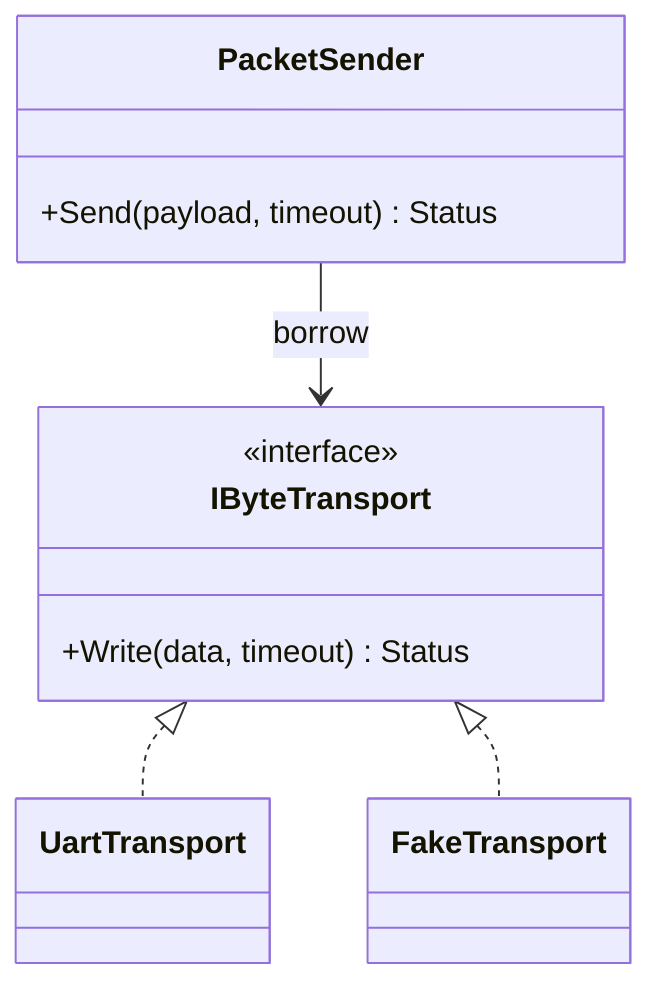

# Day 53 · Designing a Successful Abstraction

> **主教材主线**：Chapter 6 · Designing for Reuse → **Designing a Successful Abstraction**。  
> **辅线**：设计模式只用于解释边界；今天重点不是“套 Pattern”，而是判断什么值得成为 abstraction。

## ① 今日章节与建议阅读范围（5 分钟）

阅读 Chapter 6 中 **Designing a Successful Abstraction**。关注：abstraction 应隐藏哪些实现细节、公开哪些稳定语义，以及如何避免把平台机制直接暴露给调用者。

今天的判断链：需求变化 → 找到稳定概念 → 定义最小 contract → 明确 invariant/resource bound → 再决定是否需要 runtime interface。

## ② 昨日复习 3 问（5 分钟）

1. 为什么 common API 与 advanced API 应汇聚到同一个 mechanism？
2. `SendOptions` 什么时候足够，什么时候 retry 才值得升级成 Strategy？
3. 为什么 Embedded 的安全默认值同时也是 WCET/resource contract？

## ③ 核心概念（10 分钟）

成功 abstraction 不是“加一层 class”，而是把调用者真正需要依赖的概念稳定下来。

一个好的 abstraction 通常具有：

- **小而完整的 contract**：调用者只看到业务语义；
- **明确 invariant**：例如 payload 不能为空且最大 64 bytes；
- **隐藏 mechanism**：UART handle、DMA channel、Linux fd 不泄漏；
- **可替换实现**：测试 fake 与硬件实现遵循同一语义；
- **成本可解释**：timeout、容量、allocation、线程上下文不是“实现秘密”。

不要把所有实现细节都隐藏。对实时系统，blocking、deadline、容量与 callback context 会影响正确性，必须成为 contract 的一部分。

## ④ C 写法 vs Modern C++（7 分钟）

传统 C API 常把实现句柄与协议语义混在一起：

```c
int modem_send(void* uart_handle,
               const uint8_t* data,
               size_t len,
               uint32_t timeout_ms);
```

Modern C++ 可以让调用者依赖稳定语义：

```cpp
Status Send(std::span<const std::byte> payload, std::chrono::milliseconds timeout);
```

底层 UART、SPI 或测试 Fake 由 transport boundary 隔离。收益是类型安全、可测试和平台替换；代价是必须认真设计 interface lifetime 与 dispatch 成本。

## ⑤ 设计模式映射（8 分钟）

### 变化轴

平台 transport 可能变化，但“发送一个有界 packet”这一业务 contract 相对稳定。

### 稳定边界



这里 **Adapter + Dependency Injection** 有真实价值：Adapter 吸收 UART/Linux API 差异，`PacketSender` 显式借用 transport。

今天不需要 Factory/Facade/Strategy：对象组装简单、没有复杂 subsystem，也没有独立算法变化轴。强行增加 Manager/Factory 只会扩大 lifetime 与测试面。

如果 firmware 在编译期已经固定 transport，template/concept 可能比 virtual interface 更合适：减少 runtime dispatch，但要检查实例化数量和 flash size。

### Ownership / lifetime

`main`/composition root 拥有 transport；`PacketSender` 只借用 `IByteTransport&`。borrower 不得活得比 owner 久。没有共享所有权，不使用 `shared_ptr`。

## ⑥ Embedded / System Design 场景（5 分钟）

Modem middleware 的 abstraction 可以定义为“有界 packet sender”，而不是“UART wrapper”。

- application 不知道 UART fd/handle；
- transport adapter 负责平台调用；
- sender 验证 payload 上界；
- timeout 使用 `std::chrono`；
- ISR 不调用 blocking `Send()`；
- 如果跨 RTOS task，queue wait 是否计入 deadline 必须写入 contract；
- production transport 与 FakeTransport 可替换，便于 host test。

## ⑦ 今日编码规范（7 分钟）

### MUST：abstraction 不泄漏无关平台句柄

错误：

```cpp
Status Send(void* uart_handle, const std::byte* data, int length);
```

推荐：

```cpp
Status Send(std::span<const std::byte> payload, std::chrono::milliseconds timeout);
```

### MUST：required non-owning dependency 使用明确 borrow

错误：`IByteTransport* transport_` 却没有定义 `nullptr` 语义。  
推荐：构造函数注入 `IByteTransport&`。

### SHOULD：资源上界属于 abstraction contract

payload 最大长度、timeout、队列容量与失败原因不能藏在 magic number 或底层 driver 中。

## ⑧ 可编译 Lab / 练习（8 分钟）

### 主 Lab

文件：`examples/day-053/main.cpp`

```bash
g++ -std=c++23 -Wall -Wextra -Wconversion -Wpedantic \
  examples/day-053/main.cpp -o day053
./day053
```

它展示：小 `PacketSender` contract、`IByteTransport&` borrow、Fake 实现、强类型 timeout、payload 上界和可观察输出。

### Exercise 01 · 找出失败的 abstraction

文件：`examples/day-053/exercise-01.cpp`

```bash
g++ -std=c++23 -Wall -Wextra -Wconversion -Wpedantic \
  examples/day-053/exercise-01.cpp -o day053-ex01
./day053-ex01
```

Starter **可以直接编译运行**，但 `TelemetryBuffer` 内部使用可无界增长的 `std::vector`。任务：在保持 `Push()` 业务语义与可观察输出的前提下，把它重构为固定容量、显式 overflow error 的 abstraction，并回答：容量应该是 compile-time contract、构造参数，还是 runtime Strategy？为什么？

不要为了练习 Pattern 而引入 Factory/Strategy；如果容量只是资源参数，value/config 往往更合适。

## ⑨ 3 个常见坑（3 分钟）

1. **抽象 = virtual class**：没有 runtime variation 仍机械增加动态多态。
2. **隐藏过度**：把 timeout、容量、blocking 等影响实时正确性的成本也藏起来。
3. **lifetime 模糊**：interface 是 borrow，却用裸 nullable pointer 或 `shared_ptr` 掩盖真正 owner。

## ⑩ 检查题（2 分钟）

### Q1
为什么“隐藏实现”不意味着隐藏 timeout、容量和线程上下文？

### Q2
如果 transport 在固件构建时已经固定，virtual interface 与 template/concept 各有什么 flash、testability、WCET 取舍？

### Q3 · 设计题
一个 RTOS sensor service 需要支持 I2C 与 SPI 两种硬件，但 application 只关心 `ReadSample(timeout)`。判断应该保持简单、使用 composition/Adapter，还是再增加 Factory/Strategy。说明变化轴、稳定边界、owner/borrow/teardown、timeout、ISR/task context 和内存上界。

## 今日结论

> **成功 abstraction 的价值不是多一层类型，而是让调用者依赖稳定语义，同时把 ownership、resource bound 与实时成本保持清晰。**

下一课继续 Chapter 6，进入 **The SOLID Principles**。