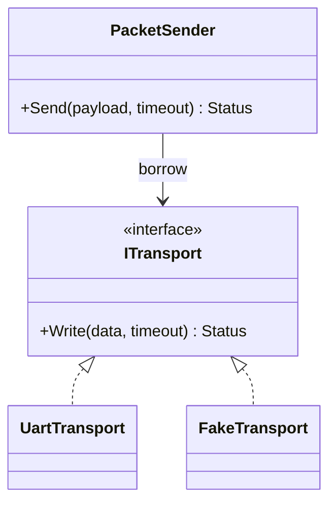

# Day 54 · The SOLID Principles

> **主教材主线**：Chapter 6 · Designing for Reuse → **The SOLID Principles**。  
> **辅线说明**：SOLID 是设计判断工具；Adapter / Dependency Injection 仅用于说明真实变化轴，不把 Pattern 当目标。

## ① 今日章节与建议阅读范围（5 分钟）

阅读 Chapter 6 中 **The SOLID Principles**。重点理解 SRP、OCP、LSP、ISP、DIP 如何帮助建立可复用、可替换且可测试的边界，而不是背诵五个缩写。

建议带着一个问题阅读：**当 Modem middleware 发生需求变化时，哪一种变化应该被哪个边界吸收？**

## ② 昨日复习 3 问（5 分钟）

1. 成功 abstraction 应隐藏 mechanism，但为什么不能隐藏 timeout、capacity、thread context？
2. required non-owning dependency 为什么优先用引用表达？
3. 固件编译期已经固定 transport 时，template/concept 为什么可能比 virtual interface 更合适？

## ③ 核心概念（12 分钟）

SOLID 可以统一理解为：**让不同原因导致的变化，不要穿透同一个不稳定边界。**

- **SRP**：一个模块应围绕一个内聚职责/变化原因。不要把 transport、协议、日志、诊断、存储塞进万能 `Manager`。
- **OCP**：真实扩展点应允许增加实现而少改稳定调用方；不是提前为所有假想需求做插件系统。
- **LSP**：替换实现必须保持 contract。`FakeTransport` 若永不模拟 timeout，就可能让测试误判真实行为。
- **ISP**：调用者只依赖它真正需要的小 contract。application sender 不应被迫依赖 reset/diagnostics。
- **DIP**：高层业务依赖稳定抽象，不直接依赖 UART/POSIX/RTOS mechanism；依赖在 composition root 显式注入。

### 编译期与运行期成本

SOLID 不等于 virtual。运行期替换需要 virtual interface 时，要审计 vtable/间接调用、lifetime 与 teardown；固件配置固定时，template/concept 或普通 composition 可能更简单，但需检查模板实例化导致的 flash 增长。

## ④ C 写法 vs Modern C++（7 分钟）

传统写法容易把平台依赖直接传播到业务层：

```c
int modem_send(void* uart, const uint8_t* data, size_t len, uint32_t timeout_ms);
```

Modern C++ 可以让高层依赖业务 contract：

```cpp
class ITransport {
public:
    virtual ~ITransport() = default;
    virtual Status Write(std::span<const std::byte> data,
                         std::chrono::milliseconds timeout) = 0;
};
```

这不是为了“面向对象”，而是因为 transport 确实是运行期/测试期变化轴。若没有这个变化需求，直接 composition 可能更好。

## ⑤ 设计模式映射（8 分钟）

### 变化轴

硬件/OS transport 会变化；packet validation 与业务发送语义相对稳定。

### 稳定边界



这里 **Adapter + Dependency Injection** 支撑 DIP：UART/POSIX 差异由 Adapter 吸收，`PacketSender` 只借用 `ITransport&`。

ISP 则提醒我们不要创建一个 `IModemEverything`，把 Send、Reset、Diagnostics、Storage、Metrics 全塞进去。

今天不需要 Factory：composition root 中对象组装简单，直接构造最清楚。也不需要 Strategy：packet validation 暂无独立算法变化轴。

### Ownership / lifetime

composition root 拥有具体 transport；`PacketSender` 只 borrow。owner 必须晚于 borrower 销毁。不要为了 DIP 使用 `shared_ptr`；依赖倒置与共享所有权是两个问题。

## ⑥ Embedded / System Design 场景（6 分钟）

以 RTOS Modem middleware 为例：

- ISR 只采集/投递最小事件，不调用 blocking sender；
- transport API 必须显式 timeout；
- protocol/parser 与 UART driver 分离，避免一个变化牵动全部代码；
- diagnostics 可以依赖独立 `IDiagnostics`，application 不需要看到它；
- runtime registration 若存在，必须有固定容量与注册阶段；
- Fake 必须保持 production contract，包括 timeout/error semantics。

SOLID 在 Embedded 中的目标不是层数更多，而是让内存、WCET、线程上下文、ownership 和替换成本更可审计。

## ⑦ 今日编码规范（7 分钟）

### MUST：required dependency 显式注入，不用隐藏全局/service locator

错误：

```cpp
Status Send(Packet packet) {
    return GlobalServices::GetTransport().Write(packet);
}
```

推荐：

```cpp
explicit PacketSender(ITransport& transport) : transport_(transport) {}
```

### SHOULD：接口按 caller purpose 拆小

错误：application 被迫依赖包含 reset/diagnostics/storage 的巨大 `IModemService`。  
推荐：按真实 caller 需求建立小 contract；不要为了 ISP 把每个函数都拆成一个 interface。

### MAY：固定固件配置优先评估 static polymorphism

若实现只在编译期变化，可评估 template/concept；但必须检查 flash size、编译时间和 WCET，不假设模板天然零成本。

## ⑧ 可编译 Lab / 练习（8 分钟）

### 主 Lab：DIP + 小接口 + 显式 borrow

文件：`examples/day-054/main.cpp`

```bash
g++ -std=c++23 -Wall -Wextra -Wconversion -Wpedantic \
  examples/day-054/main.cpp -o day054
./day054
```

预期可观察输出包含发送字节数、timeout 和最终 status。Lab 展示 `PacketSender` 不依赖具体 UART，实现由 composition root 注入。

### Exercise 01：拆解万能 ModemService

文件：`examples/day-054/exercise-01.cpp`

```bash
g++ -std=c++23 -Wall -Wextra -Wconversion -Wpedantic \
  examples/day-054/exercise-01.cpp -o day054-ex01
./day054-ex01
```

Starter **可直接编译运行**，但 `ModemService` 同时承担发送、信号读取、硬件 reset、diagnostics。任务：

1. 先运行并记录行为；
2. 识别哪些 caller 真正需要哪些能力；
3. 用 composition 和小 contract 重构，优先解决 SRP/ISP；
4. 只有 transport 确实需要替换时才引入 runtime interface；
5. 明确 owner、borrow、teardown 与 timeout；
6. 重构后保持相同可观察业务结果。

不要把五条 SOLID 各造一个 class；目标是减少变化传播，而不是增加类型数量。

## ⑨ 3 个常见坑（3 分钟）

1. **SOLID = virtual everywhere**：把编译期固定关系也做成动态多态，增加 flash、间接调用与 lifetime 复杂度。
2. **DIP = shared_ptr/interface**：依赖抽象并不意味着共享 ownership；borrow 仍应清晰。
3. **ISP 过度拆分**：每个方法一个 interface，导致组装和导航成本超过变化隔离收益。

## ⑩ 检查题（4 分钟）

### Q1
为什么 LSP 在 Embedded Fake/Mock 中同样重要？如果 Fake 永不 timeout，会造成什么测试风险？

### Q2
一个只在编译期选择 SPI/UART 的固件，DIP 是否必须通过 virtual interface 实现？比较 composition、template/concept 与 runtime polymorphism。

### Q3 · 设计题
一个 RTOS Modem 模块同时提供 send、signal query、reset、diagnostics，并有 application、factory test、diagnostics task 三类 caller。判断应保持简单、使用 composition，还是引入 Adapter/Facade/Strategy 等 Pattern。说明变化轴、稳定边界、SRP/ISP/DIP、owner/borrow/teardown、timeout、ISR/task context 与内存/WCET 上界。

## 今日结论

> **SOLID 的价值不是增加抽象层，而是让真实变化停在正确边界；在 Embedded 中，这个边界还必须同时守住 lifetime、memory 与 WCET。**

下一课继续 Chapter 6 后续内容，严格按教材顺序推进。