# C++ 特性深度拆解：从语义检查到二进制

阅读方式：先看每节图中的关系与执行顺序，再看字节偏移、代码与实测指令，最后检查边界。图表示逻辑关系，不按内存大小比例绘制；精确数值只适用于声明的实验环境。宽图可在图表区域横向滚动，也可展开 Mermaid 源码。

## 1. 拆解契约与可复用提示词

必须分开四类结论：**ISO 语义**、**目标 ABI**、**教学模型**、**当前工具链实测**。64 位不足以确定布局：还需要架构、ABI、编译器版本、标准库、编译选项和完整类定义。

**总图：先定位工作发生在哪一层。** override 的合法性在前端判断，虚派发代码经优化和链接后才成为实际执行路径。

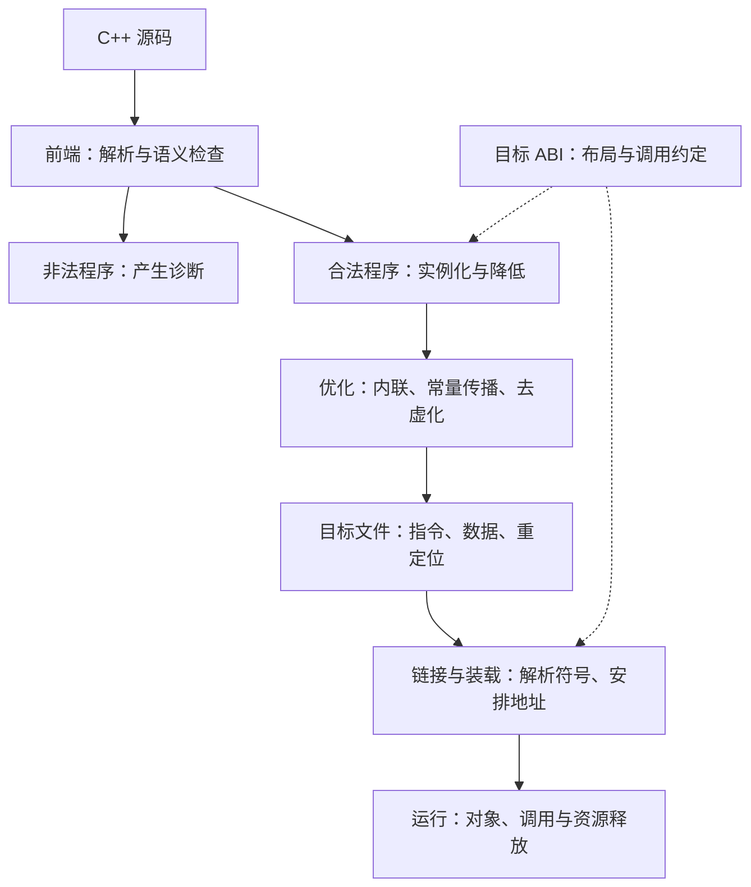

GCC 不必把 C++ 先转换成 C 源码。Cfront 的历史实现、C++ Insights 的教育转换和 GCC 的 tree/GIMPLE/RTL 是不同层次。下文 C 模型只解释责任与调用过程，不声称逐字恢复 GCC 中间表示。

可复制模板：

```text
请从 GCC / 目标 ABI / 二进制角度拆解 [特性]。
先声明架构、ABI、编译器/标准库版本、语言标准和优化选项。
按五个维度展开：
1. 痛点与阶段：前端检查、常量求值、库实现、运行时分别做什么？
2. 布局：画对象和关联数据，区分保证、常见实现与测量值。
3. 降低：给教学 C 伪代码；若不能保留全部语义，明确丢失什么。
4. 指令：给可复现源码和命令，逐步解释取址、传参与调用。
5. 边界：分析生命周期、多继承、动态库、优化和空间/时间成本。
请提供固定版本源码入口或 ABI 条款，不能只列术语。
没有实际编译时必须标注示意，不虚构精确尺寸、节名或指令。
用至少一个失败案例和一个优化对照检验解释。
```

本页实测：GCC 14.2.0（Debian 14.2.0-19），`x86_64-linux-gnu`，C++20，Linux System V AMD64 调用约定与 Itanium C++ ABI 家族。观察日期 2026-10-30。尺寸结果不是跨平台断言。

## 2. virtual 与 override：检查和派发是两件事

### ① 痛点与阶段

virtual 支持通过基类接口调用最终覆盖函数。override（C++11）要求声明确实覆盖基类虚函数，解决参数或 cv/ref 限定不符时意外隐藏的问题。

前端进行名称、参数、限定符等语义检查，并另行检查返回类型（允许符合条件的协变）、异常说明、final 等要求；不是查字符串或单纯寻找一个同名槽位。错误属于语义分析，不能笼统说全在语法解析完成。

漏写 override 不妨碍正确覆盖。签名不符且未写 virtual 的新函数，不会因此自动成为新的虚函数；显式写 virtual 的另一个函数才可能增加相应槽位。合法覆盖添加 override 不引入额外派发步骤，但不能承诺调试信息或整个二进制逐字相同。

GCC 14.2 的源码链可直接核对：`check_methods` 遍历类成员并调用 `check_for_override`；后者利用名字标记避免不必要搜索，调用 `look_for_overrides`，识别覆盖后设置 `DECL_VINDEX`，否则在存在 `DECL_OVERRIDE_P` 时诊断。此时 `DECL_VINDEX` 还可用作内部状态标记，不应当成已确定的最终数字槽位。布局与最终表构造是后续相关工作。

**检查图：override 验证已有覆盖关系，不是创建运行时匹配器。**

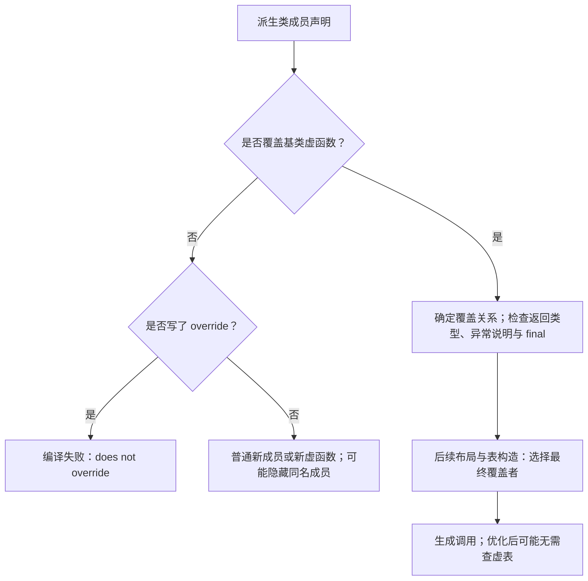

### ② 实测布局与虚表地址点

实验源 `booklets/labs/object-model.cpp` 的核心类型：

```cpp
struct Base {
  int base_data = 1;
  virtual int Speak() const { return base_data; }
  virtual int Walk() const { return 7; }
};
struct Derived : Base {
  int derived_data = 2;
  int Speak() const override { return base_data + derived_data; }
};
```

特意不设置虚析构以便观察两个槽位；示例不通过 Base* 删除对象。可多态删除的真实接口应另行设计析构，虚析构会影响表项。

| Derived 实例偏移 | 字节数 | 本次实测内容 |
| --- | --- | --- |
| 0–7 | 8 | vptr，指向虚表地址点 |
| 8–11 | 4 | base_data = 1 |
| 12–15 | 4 | derived_data = 2 |

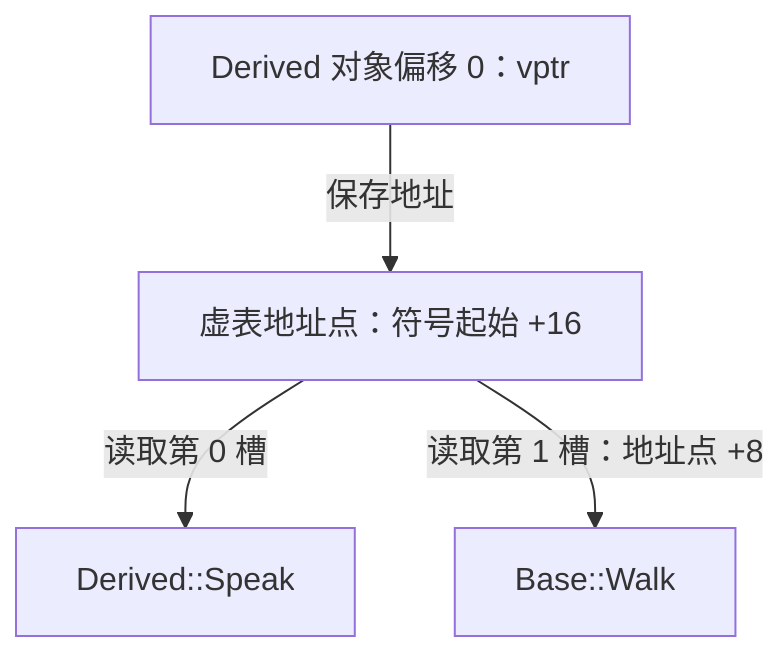

| 虚表相对符号起始偏移 | 表项 |
| --- | --- |
| +0 | offset-to-top = 0 |
| +8 | typeinfo 指针 |
| +16 | 地址点、第 0 槽：Derived::Speak |
| +24 | 第 1 槽：Base::Walk |

图中连线只表示寻址关系；表项顺序与偏移以表格为准。vptr 不指向表起始的 offset-to-top。


独立 Base 大小为 16，其中偏移 12..15 是尾部填充；这里 Derived 将其复用于成员，大小仍为 16。把 `struct Base` 原样嵌入一个 C struct 通常会把后续成员放到偏移 16，**因此普通 C 嵌套结构不精确复现此继承布局**。

vptr 指向 ABI 的 **address point**，不是总指向 `_ZTV` 符号起始。此例地址点之前有 offset-to-top 和 typeinfo；更复杂的虚继承还有其他信息。每类只存在一张简单函数指针数组不是完整模型。

`-O0 -fPIC` 的本次 .o 中，表位于 `.data.rel.ro._ZTV7Derived`，另有重定位节；不是统一放进 `.rodata`。链接后的 RELRO 布局和装载时保护还取决于链接配置，函数地址也可能在重定位时才确定。

### ③ 教学 C 模型：只解释调用，不伪装 ABI

```c
/* 教学模型，不是上述类的 ABI 兼容替身。 */
struct ModelBase;
struct ModelOps {
  int (*speak)(const struct ModelBase*);
  int (*walk)(const struct ModelBase*);
};
struct ModelBase {
  const struct ModelOps* ops;
  int base_data;
};
int DispatchModel(const struct ModelBase* p) {
  return p->ops->speak(p);
}
```

为每个模型类型提供同签名的包装函数，再选择对应 ops。不要把任意签名函数强转成统一函数指针后调用，那在 C 中也可能产生未定义行为。该模型省略 RTTI、尾部填充复用、构造表、析构与异常。

### ④ 实测指令

输入 `int Dispatch(const Base* p) { return p->Speak(); }`；为隔离普通间接派发，使用 `-O2 -fno-devirtualize -fno-devirtualize-speculatively -S -masm=intel`。去掉汇编元数据后：

```asm
mov rax, QWORD PTR [rdi]
jmp [QWORD PTR [rax]]
```

SysV 下 rdi 已携带 p，即此处的 this。第一条加载 vptr；第二条从地址点的第 0 槽加载目标地址并尾跳转。Speak 的返回值沿原调用链返回。若访问本例 Walk，槽偏移是 8。

两次数据读取加间接控制转移，不需要运行时字符串匹配；“三级指针跳转”容易把对象、表、代码三个概念误当成三次数据解引用。尾调用不适用时可能出现 call 与额外返回/栈指令，不保证所有编译都只有这两条。

**寻址时序：此图对应上面的未去虚化尾调用实测，时间方向从上到下。**

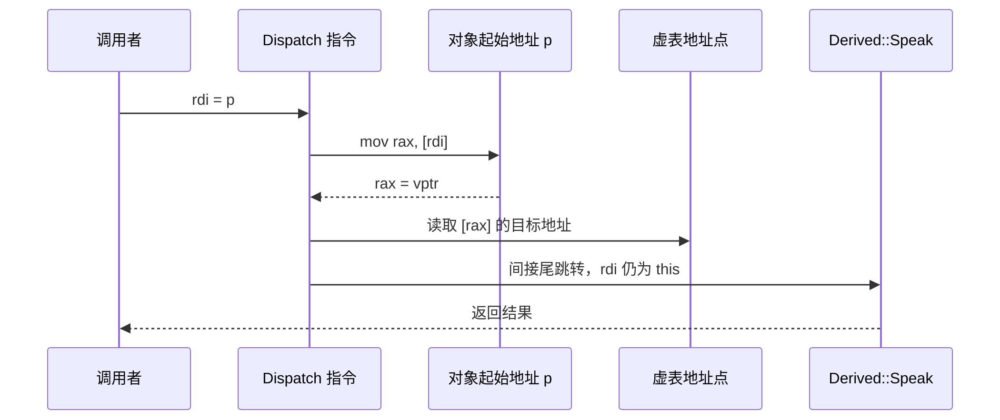

### ⑤ 成本与跨模块边界

通常成本包括对象中的指针、共享虚表及 RTTI、数据读取、间接分支预测与可能失去的内联机会；不能凭两条指令估算固定周期数。缓存和优化条件影响很大。

共享库边界需保持布局、虚表顺序、符号可见性及运行库契约；新增虚函数不应默认视作 ABI 安全。实际指针地址经装载重定位，不能持久化 vptr 或复制进程间使用。

## 3. 多继承、构造与去虚化：把简化模型推到边界

**痛点与阶段：** 转为第二个基类指针后，传入地址通常不是完整对象起点。前端确定基类关系，ABI 和代码生成负责指针调整及最终覆盖者调用。

**实测布局：** 实验的 Left 和 Right 各含一个 int 与一个虚函数，Both 继承两者并覆盖 Right::ReadRight。

| Both 内偏移 | 内容 |
| --- | --- |
| 0–7 | Left 子对象 vptr |
| 8–11 | left |
| 12–15 | 填充 |
| 16–23 | Right 子对象 vptr |
| 24–27 | right |
| 28–31 | extra，复用 Right 尾部填充 |

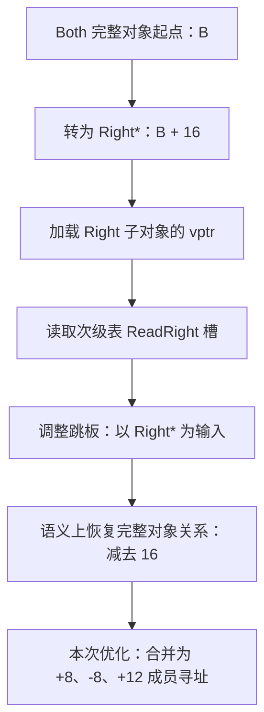


Right 次级虚表的 offset-to-top 为 -16，其函数槽可指向调整跳板。教学伪代码为 `complete = right_address - 16; Both_ReadRight(complete)`，只能用于解释当前布局，不是可移植的指针算术方案。

**指令观察：** 本次 GCC -O2 生成了名为 `_ZThn16_NK4Both9ReadRightEv` 的 thunk。它没有保留显式 `sub rdi,16; jmp ...`，而是直接生成：

```asm
mov eax, DWORD PTR 8[rdi]    ; right，完整对象偏移24
add eax, DWORD PTR -8[rdi]   ; left，完整对象偏移8
add eax, DWORD PTR 12[rdi]   ; extra，完整对象偏移28
ret
```

调整已合并进成员寻址。只找 `sub this` 指令会漏掉这种实现。协变返回还可能需要返回值调整；虚继承引入更复杂的偏移表与构造期表，不能照抄 -16。

**构造/析构：** 当前构造或析构阶段的虚调用按语言规则落到相应类的最终覆盖者，不进入尚未构造或已经析构的更派生部分。典型 ABI 在阶段切换时安装不同 vptr；但编译器可直接调用已知目标，不能把所有行为都解释成必须执行一次改表。实验验证基类构造记录 1，构造完成后的派生调用返回 2。基类构造中经虚派发调用纯虚函数是另一类危险情形，不是等待派生实现补位。

**生命周期图：构造中的派发边界取决于当前阶段。** 这是语义时序，不要求机器码必须按图逐次写入 vptr。

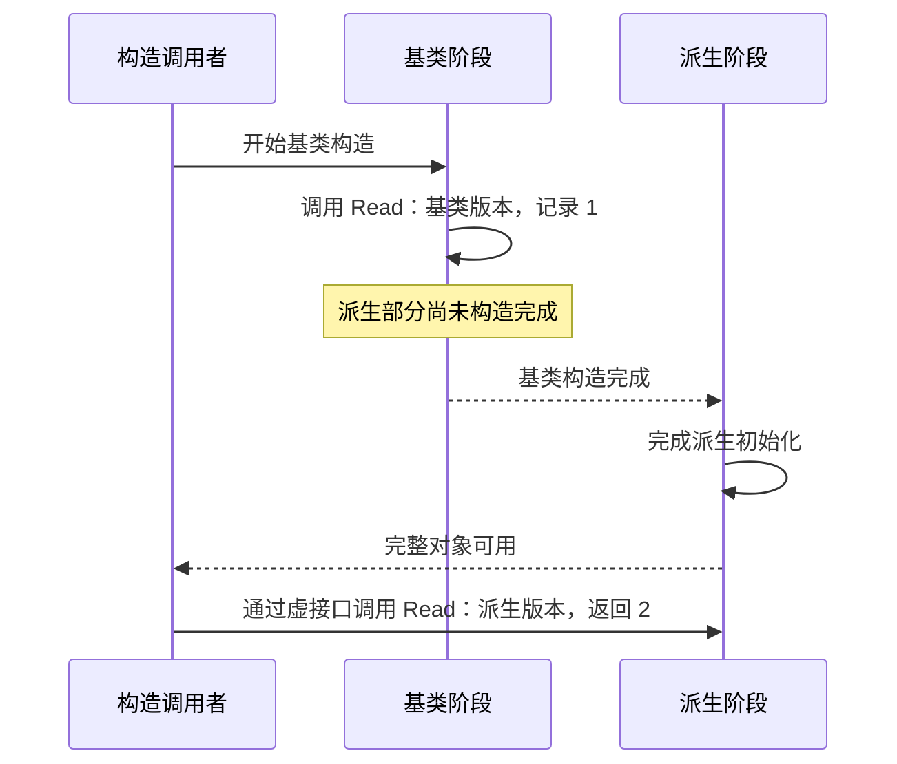

**去虚化：** 对象动态类型已知时，可直接调用或内联；实验 `KnownDerived()` 只剩 `mov eax,3; ret`。final 提供不能继续覆盖/派生的信息，不保证所有调用自动去虚化。LTO、可见性、符号插入和动态库边界影响可证明范围；有时使用“类型/目标检查 + 快路径 + 间接回退”，也不是所有虚调用都没有运行时检查。

**dynamic_cast 的补充：** 与普通虚调用不同，运行时向下/交叉转换可能需要检查动态类型。Itanium ABI 的 typeinfo 与基类描述参与运行库搜索；某些转换调用 `__dynamic_cast`，已知的向上转换可以直接调整指针，`dynamic_cast<void*>` 可利用 offset-to-top 找完整对象。指针转换失败返回空，引用转换失败抛出 bad_cast；需要运行时检查的相关转换要求多态源类型。并非所有 dynamic_cast 都是同一段查表汇编，禁用 RTTI 的构建也不能照搬这些用法。

**优化决策图：同一种源码调用，可能得到不同机器码。**

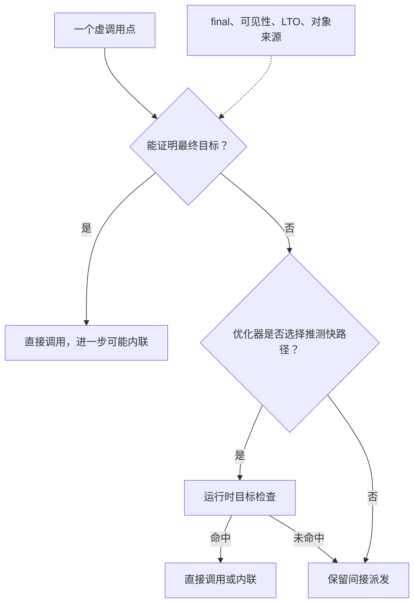

## 4. lambda：闭包对象与函数调用分开看

**① 痛点与阶段：** 局部函数需要携带环境。C++11 lambda 由前端形成唯一闭包类型；C++14 泛型 lambda 的调用运算符是模板，初始化捕获可构造或移动状态。

**闭包图：语义上有状态，不代表优化后的机器码必须保留对象。**

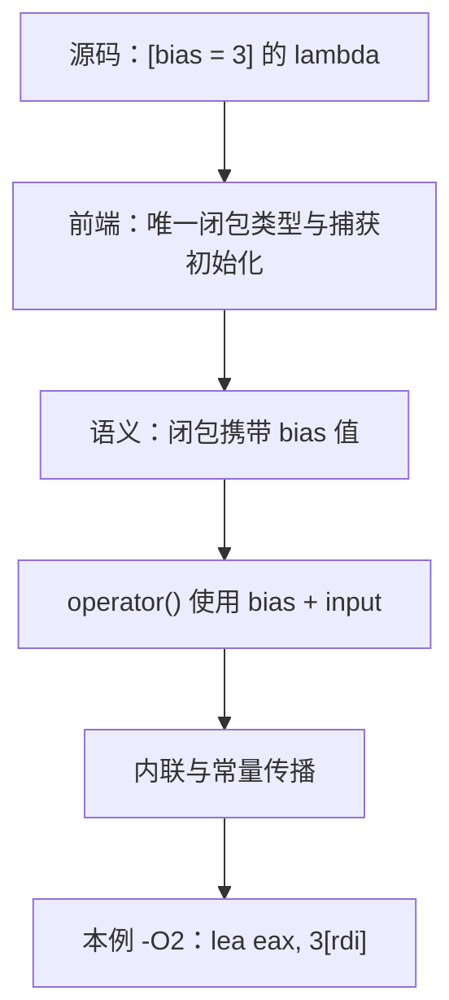

**② 布局：** `[bias=3]` 至少要表现出按值捕获的语义，常见实现为一个 int 成员；标准不规定全部捕获成员排列、引用捕获的存储形式或通用 sizeof。按值捕获 this 是复制指针，C++17 `[*this]` 才复制对象。

**③ 教学降低：**

```c
struct AddClosure { int bias; };
int AddInvoke(const struct AddClosure* closure, int input) {
  return input + closure->bias;
}
```

在 GCC 14.2 的 `lambda.cc`，`build_lambda_object` 遍历 `LAMBDA_EXPR_CAPTURE_LIST`，取各捕获的字段和初始化值构造闭包初始化表达式；模板处理中可先保留 lambda 节点，待实例化继续处理。这给出了“捕获变成对象状态”的具体源码落点。

有状态回调在 C 接口中通常需要“函数指针 + context”，不能把捕获 lambda 当成一个普通函数地址。无捕获 lambda 在满足语言要求时可转成函数指针；泛型情形还涉及目标签名推导。

**④ 实测：** `CapturedLambda(int input)` 内构造 `[bias=3]` 并立即调用，-O2 结果是 `lea eax,3[rdi]; ret`。闭包状态被常量传播消除；未优化时可观察闭包及 operator() 调用，但不是语言要求的固定序列。

**⑤ 代价与边界：** lambda 本身不要求堆分配；存进 std::function 或协程等外层设施可能改变分配成本。引用捕获逃逸可悬空，按值捕获一个 view 仍只是借用。mutable 改变调用运算符的可修改性，不让共享访问自动线程安全。

## 5. move / forward：值类别不是搬运指令

**① 阶段：** C++11 前端实现右值引用、引用折叠及重载决议；库里的 move/forward 表达转换。被选中的构造/赋值实现才执行资源处理。

**移动图：转换、函数选择和资源操作分三个阶段。**

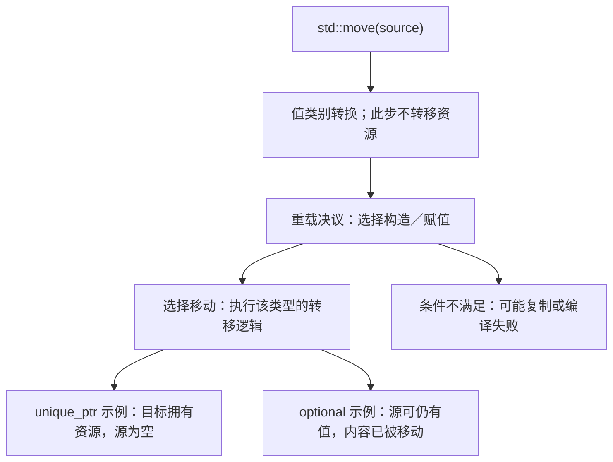

**② 布局：** 转换不向对象加“已移动”隐藏位。unique_ptr 常存指针和删除器，string 可能有小字符串缓冲，array 内嵌所有元素；移动成本随类型不同。

**③ 教学降低：** 独占句柄的移动可理解为 `destination.handle = source.handle; source.handle = empty;`，还需处理删除器、旧目标释放、自移动和异常契约。这个模型不适合推广到所有类型。

**④ 指令与验证：** 指针转移可生成加载、存储与清零，也可因优化完全消失。实验断言 unique_ptr 转移后源为空、目标仍能读取值；不把它推广成所有移动对象都为空。用 O0/O2 比较时应观察选中函数及可观察效果，而不是寻找名为 move 的 CPU 指令。

**⑤ 边界：** const 对象可能无法匹配非 const 移动构造而退回复制。容器分配器条件可使移动执行逐元素操作；forward 仅在相应转发场景保持值类别，误用可提前消耗仍需要的对象。

## 6. constexpr、if constexpr 与 Concepts：三种不同的编译期工作

**① 痛点与阶段：** constexpr（C++11 起）提供可用于常量表达式的函数/对象语义；if constexpr（C++17）控制模板分支实例化；Concepts（C++20）表达候选的约束。前者求值，后两者涉及实例化和候选筛选，不应统一称为“编译期执行一遍”。

**编译期分工图：求值、实例化、约束筛选不是同一件事。**

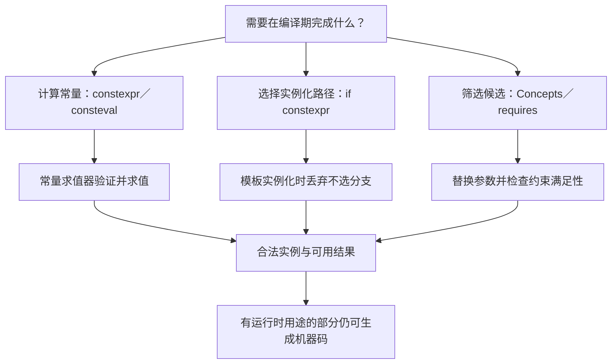

**② 隐藏数据：** 类型与约束主要存在于编译器内部 tree、模板参数与求值状态，不要求每个运行时对象带标签。constexpr 对象若需要实际地址仍可存在存储；模板实例化也可能产生多个机器码函数。

**③ 教学降低：** `CompileTimeBranch<int>` 的 if constexpr 只保留整数路径，类容器实例化则可保留 size 路径。这是实例化后的示意，不是用 C 的普通 if 隐藏非法代码；语法与某些非依赖语义仍须检查。

**④ 验证：** 用 static_assert 检查常量表达式与类型；用负例验证不满足约束的调用被拒绝。现有 `mechanisms.cpp` 对照普通 `square(6)` 与 static_assert：优化器折叠普通调用，不等于该调用在语义上被强制常量求值。查看 AST/转储比只看汇编更能解释筛选过程。

**⑤ 边界：** constexpr 可有运行时调用；consteval（C++20）立即调用要求常量求值；constinit（C++20）检查静态初始化，不使对象不可修改。概念能检查表达式是否成立，不能自动证明严格弱序等语义公理。编译期工作同样消耗时间与内存，模板数量、递归及求值步数都需预算。

## 7. std::function 与 optional：库实现不是新 CPU 能力

**① 痛点与阶段：** std::function（C++11）把不同可调用类型放入统一接口，optional（C++17）表示按需存在的 T。库模板生成管理逻辑，前端负责类型与生命周期规则，后端优化这些逻辑。

**② 布局观察：** 本机 libstdc++ 测得 `sizeof(std::function<int(int)>)=32`，`sizeof(std::optional<int>)=8`。这只是当前配置结果。常见 function 由存储区、调用器和管理器组成；optional 由对齐的 T 存储与有效标志组成，不要求 flag 恰好处于某个固定偏移。

**类型擦除图：统一的是外部接口，内部仍需知道如何操作真实目标。**

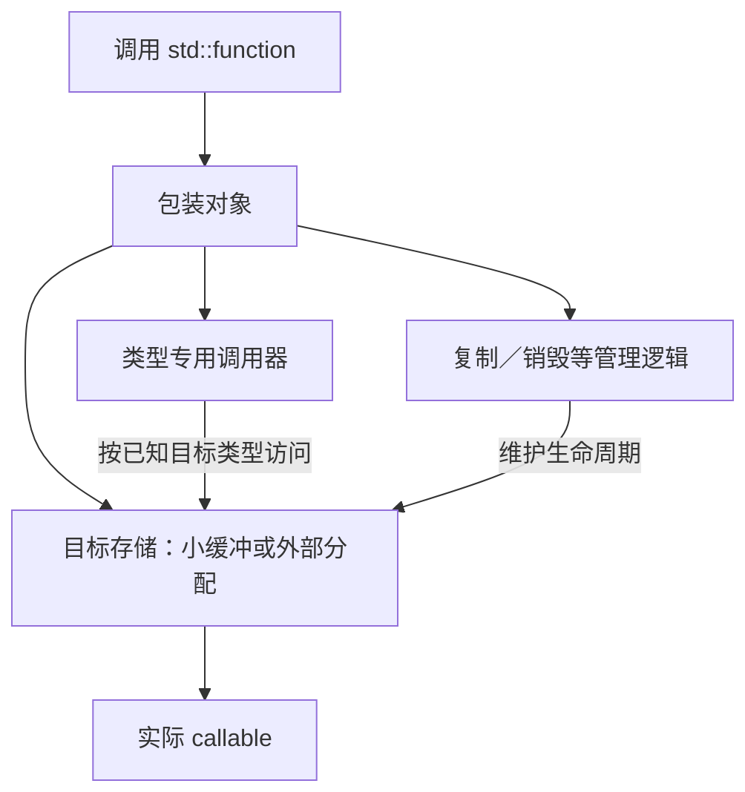

**③ 教学 C 模型：**

```c
/* 示意：省略复制、异常、对齐及小缓冲策略，不可直接替代 std::function。 */
struct ErasedCall {
  void* context;
  int (*invoke)(void*, int);
  void (*destroy)(void*);
};
```

invoke 负责把 context 恢复为正确目标，destroy 处理其寿命；真实 std::function 还支持复制及空状态。optional 可以用“原地存储 + 状态”理解，不能简单用 `T value; bool valid;` 模拟，因为后者会始终构造 T。

**④ 寻址过程：** 擦除调用通常是取调用器地址、准备状态地址与实参、间接调用；可能被内联去间接化。optional 通常先读有效标志再访问存储，但 unchecked 解引用的接口不承诺帮你检查；不能凭伪代码宣称每次访问都带安全分支。

**⑤ 成本与边界：** function 可能使用小缓冲或分配，不能只看 callable 尺寸就断言一定原地存放。optional 的 T 不需要单独分配，但 T 自己可能分配。移动 optional 后源通常仍 engaged，destroy/reset 与释放外部存储必须分开；实验 `mechanisms.cpp` 验证对象数和销毁时机。

**生命周期图：移动源 optional 不自动变为空。**

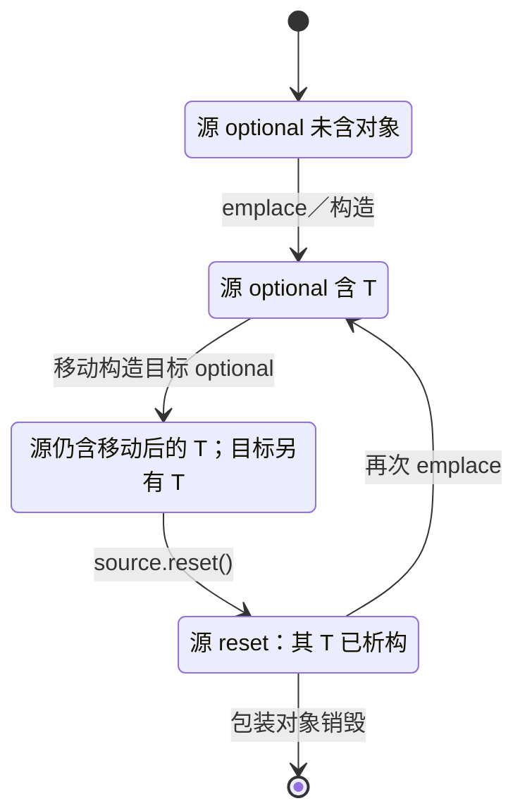

目标 optional 的析构独立进行；这里没有把两个对象合并成一个生命周期。

## 8. 协程：挂起改变了局部对象的存活位置

**① 痛点与阶段：** C++20 协程支持保存执行状态并恢复。前端处理 promise 与 await 协议，降低过程安排帧和恢复/销毁路径，库决定调度。不是编译器自动创建线程。

**② 帧模型（示意，不给假精确偏移）：**

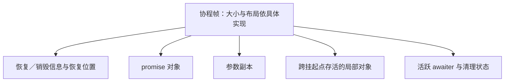


帧可能分配在堆上，也可能在满足条件时消除分配；不能将 “64 位”直接换成统一的 32/64 字节帧。C++ handle 和 promise 接口也不公开一套通用帧内存格式。

**③ 教学降低：**

```text
resume(frame):
  根据恢复位置进入相应代码
  计算 awaiter
  若 await_ready() 为 false：
    保存需要跨挂起点存活的状态
    执行 await_suspend(handle)，按返回类型决定控制转移
  恢复后执行 await_resume()，继续后续代码

destroy(frame):
  只销毁当前状态下已构造且仍存活的对象
  清理 promise 与帧存储（按协议）
```

真实顺序还涉及 initial_suspend、final_suspend、异常及对称转移；这不是可以机械改成一个 switch 就得到等价程序的配方。await_suspend 调用期间句柄可能已被其他执行上下文恢复，库实现必须遵守协议。

**控制流图：这是 await 协议的简图。** await_suspend 可能与恢复交错，不能把连线理解为统一的单线程调度器；异常与提前销毁需另查具体库契约。

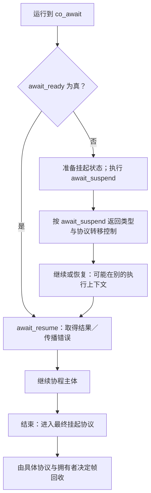

**④ 指令观察方法：** 对具体 task/generator 类型产生 GCC 转储和汇编，定位恢复/销毁函数、状态加载、间接转移与分配调用。本页没有指定一个完整协程库，也没有声称已实测固定协程汇编；请先固定 promise/awaiter，再讨论产物。

**⑤ 边界与代价：** 帧大小、分配、间接恢复与调度都有成本；对象或引用在恢复前已失效会悬空。取消请求不等于帧可立即销毁；最终挂起与外部拥有关系必须清楚，句柄本身不是自动拥有帧的智能指针。

## 9. 复现实验与失败验证

从仓库根目录执行；产物放入临时目录，不覆盖项目源码：

```bash
g++ --version
g++ -dumpmachine
lab_dir=$(mktemp -d)
g++ -std=c++20 -Wall -Wextra -Wconversion -Wpedantic -Werror booklets/labs/object-model.cpp -o "$lab_dir/probe"
"$lab_dir/probe"
g++ -std=c++20 -O0 -fPIC -fdump-lang-class -c booklets/labs/object-model.cpp -o "$lab_dir/probe.o"
readelf -SW "$lab_dir/probe.o"
readelf -rW "$lab_dir/probe.o"
nm -C "$lab_dir/probe.o"
g++ -std=c++20 -O2 -fno-devirtualize -fno-devirtualize-speculatively -S -masm=intel booklets/labs/object-model.cpp -o "$lab_dir/probe.s"
```

去掉两个去虚化限制选项再比较，观察优化而非强制期待某个固定序列。Intel 汇编和 ELF 工具针对本页目标，ARM/MSVC 需更换命令与 ABI。

失败案例：将 Derived 的 `Speak() const override` 改成 `Speak() override`，编译应拒绝；去掉 override 则可能合法但不覆盖。再用 `-Woverloaded-virtual` 检查诊断。只在临时副本操作，别把失败案例混入正常构建。

`npm run check:booklets` 自动编译运行 labs 下的正例，验证虚派发、构造阶段行为、lambda、模板分支与 unique_ptr 移动。它不固定尺寸、不将汇编快照当语义测试，也不验证所有 ABI 或协程库。

## 10. 固定版本源码与规范入口

以下 GCC 链接固定到 **releases/gcc-14.2.0**，按函数/语义搜索，避免依赖浮动行号：

| 机制 | 源码入口 | 观察问题 |
| --- | --- | --- |
| 覆盖检查与虚表 | [gcc/cp/class.cc](https://github.com/gcc-mirror/gcc/blob/releases/gcc-14.2.0/gcc/cp/class.cc) | check_for_override、类完成与虚表构造如何分工 |
| lambda | [gcc/cp/lambda.cc](https://github.com/gcc-mirror/gcc/blob/releases/gcc-14.2.0/gcc/cp/lambda.cc) | 捕获字段、闭包构造及调用运算符怎样表示 |
| 常量求值 | [gcc/cp/constexpr.cc](https://github.com/gcc-mirror/gcc/blob/releases/gcc-14.2.0/gcc/cp/constexpr.cc) | 怎样解释表达式与检查常量表达式限制 |
| Concepts | [gcc/cp/constraint.cc](https://github.com/gcc-mirror/gcc/blob/releases/gcc-14.2.0/gcc/cp/constraint.cc) | 约束规范化、满足性与缓存 |
| 协程 | [gcc/cp/coroutines.cc](https://github.com/gcc-mirror/gcc/blob/releases/gcc-14.2.0/gcc/cp/coroutines.cc) | promise、帧与恢复/销毁函数的降低 |
| 类型擦除 | [libstdc++ std_function.h](https://github.com/gcc-mirror/gcc/blob/releases/gcc-14.2.0/libstdc%2B%2B-v3/include/bits/std_function.h) | 本地缓冲适用条件与管理器/调用器 |

布局与派发对照 [Itanium C++ ABI §2.4–2.6](https://itanium-cxx-abi.github.io/cxx-abi/abi.html#vtable)，语言规则对照 [C++ 工作草案 class.virtual](https://eel.is/c++draft/class.virtual)。当前工作草案可能含晚于 C++20 的变化；涉及版本差异需回到相应发布标准。

继续阅读：[四阶段底层书单](../references/reading-paths/cpp-compiler-abi.md)、[Google 风格与嵌入式规范](../guidelines/google-cpp-style-guide.md)。先提出可验证的问题，再沿源码追踪；不要把函数名列表当成已经解释了实现。
