# C++ FAQ 知识库小模型（RAG 增强版）详细需求与设计文档

> 文档编号：FAQ-RAG-DESIGN-001  
> 版本：v1.0（评审稿）  
> 日期：2026-11-06  
> 上游文档：《C++ FAQ 知识库小模型（RAG 增强版）技术路线》2026-11-05  
> 适用仓库：`professional-cpp-learning`  
> 状态：待评审；评审通过后冻结为 v1.1 执行版  
> 目标读者：项目负责人、数据/算法、Android、评测、课程维护者

---

## 0. 结论摘要

### 0.1 一句话结论

路线方向正确：用 0.5B 小模型做“资料阅读器”，用 RAG 保证事实与出处，用 GGUF + llama.cpp 保证 Android 离线，这是当前约束下合理的选择。

但按原文直接执行有 8 个 P0 问题，主要集中在**语料版本、切块与 BGE 上下文、端侧体积/内存、T4 训练方式、端侧关键路径、数据配比、评测基线、教材版权**。当前 4 周计划真正紧张的并不是训练，而是数据工程、评测集和 Android 集成。

建议先做“**1 周基线 + 1 次 Go/No-Go**”：先用基础模型 + RAG 跑通桌面与手机纯模型，再决定 SFT 的投入。4 周只能交付“MVP 演示”，6 周才能交付“可验收产品”。

### 0.2 必须修正的 P0 问题

| 编号 | 问题 | 原文表现 | 影响 | 处理 |
|---|---|---|---|---|
| P0-1 | 语料规模未冻结 | 写死“71 篇”，实际 `lessons.meta.json` 已有 73 篇 | 语料、索引、评测基数全部偏差 | 从 `daily/lessons.meta.json` 动态读取 `status=published`，禁止写死 |
| P0-2 | 切块上限与 BGE 上下文冲突 | 按 `##/###` 切，≤800 字；BGE-small 最大 512 tokens | 长 chunk 被截断，召回下降且出处不完整 | 以 300–420 中文字符为目标，硬上限 480 BGE tokens |
| P0-3 | 端侧体积/内存数字错误 | Q8_0 写 124MB；峰值 <1.2GB | 下载、存储、内存预算全部失真 | Qwen2.5-0.5B Q8_0 官方 GGUF 约 676MB；Q4_K_M 约 491MB；按设备分档 |
| P0-4 | T4 全参 SFT 不可行/不稳 | “0.5B 全参约 8GB，T4 舒服区” | OOM、fp16 溢出、训练中断 | T4 默认 LoRA；全参只在 A100/40GB 上做消融 |
| P0-5 | 端侧集成排在最后 | 第 4 周才做 RAG App | 关键路径倒置，第 4 周大概率无法交付 | 第 1 周做 Android spike；APK 与 Termux 双路线 |
| P0-6 | 数据配比自相矛盾 | 50/30/20 与 65/15/15/5 并存；65% 多跳 | 训练目标漂移；0.5B 学不会多跳推理 | 统一为 55/15/10/15/5；CoT 只做小比例 A/B |
| P0-7 | 评测集与基线缺失 | 只有 100 题，未定义 gold chunk、基线、拒答指标 | 无法判断 SFT 是否真的有效 | 120 题分层测试集；先跑 prompt-only 基线；检索/生成分开评 |
| P0-8 | 编译器教材版权与域偏移 | 将《Engineering a Compiler》13 章纳入语料 | 版权风险；与 C++ FAQ 域不一致，稀释检索 | MVP 排除；作为 P2 独立“编译原理包”，先做版权确认 |

### 0.3 关键数字修订

| 项目 | 原文 | 复核结果（2026-11-06） | 说明 |
|---|---|---|---|
| 已发布讲义 | 71 篇 | **73 篇** | `daily/lessons.meta.json` 共 73 条；`daily/day-*.md` 同 |
| 讲义总字符 | 未给 | 约 **535k** 字符 | 不含 `daily/README.md` |
| shared-ptr-internals | 1 篇 | 约 **33.6k** 字符 | `topics/stdlib/shared-ptr-internals/README.md` |
| FAQ | 未计 | 约 **17.8k** 字符，目前仅 Q1 | `docs/faq.md` |
| chunk 数 | 1,397 | 原型切块 **1,828**；规范切块后约 **1,850–1,950** | 原型含 daily + shared-ptr-internals + faq；代码块再切会略增 |
| 向量索引 | 3,660 × 512 × float32 ≈ 7.5MB | 核心语料约 2,000 × 512 × 4B ≈ **4.1MB** | 代码块切分后略有浮动 |
| BGE 最大输入 | 800 字 | **512 tokens**，约 400–480 中文字符 | `sentence_bert_config.json` |
| Qwen2.5-0.5B fp16 | 未给 | 约 **0.99GB** safetensors | Hugging Face 权重 |
| Q8_0 GGUF | 124MB | 官方 **676MB** | `Qwen/Qwen2.5-0.5B-Instruct-GGUF` |
| Q4_K_M GGUF | 未给 | 官方 **491MB** | 同上 |
| Q5_K_M GGUF | 未给 | 官方 **522MB** | 折中档 |
| BGE ONNX int8 | 约 25MB | 约 **24–25MB** | 24M 参数，int8 动态量化 |
| 全参 SFT 显存 | 约 8GB | 优化器状态+主权重约 8GB，加激活通常 >12GB | T4 16GB 可试但不算“舒服区” |

> 说明：GGUF 体积是官方仓库实测文件名对应大小；不同量化工具版本会有几 MB 浮动。

### 0.4 推荐交付节奏

| 方案 | 周期 | 交付范围 | 适用 |
|---|---:|---|---|
| 4 周 MVP | 4 周 | 2,000 chunk、LoRA、GGUF、Termux/最小 APK、80 题评测 | 课程演示、时间硬约束 |
| 6 周产品 | 6 周 | 完整 APK、端侧 BGE、120 题评测、2 台设备 | 推荐 |
| 8 周稳妥 | 8 周 | 内容更新流程、模型卡、完整复现、答辩材料 | 兼职/多人协作 |

4 周 MVP 的裁剪项：编译器教材、长 CoT、Q8_0 低端机、双设备矩阵、Play 分发。保留项：真实端侧 RAG、出处、拒答、离线、可复现评测。

### 0.5 需要确认的决策

| 编号 | 决策 | 推荐 | 备选 |
|---|---|---|---|
| D1 | 是否把《Engineering a Compiler》纳入 MVP | **不纳入**，P2 独立包 | 确认授权后纳入 |
| D2 | 最低设备档位 | **Android 10+，arm64，6GB RAM** | 4GB 用 Q4_K_M 降级 |
| D3 | 交付形态 | **APK 侧载 + 模型/索引单独下载** | Termux 演示兜底 |
| D4 | 训练方式 | **LoRA r=32** | A100 上做全参消融 |
| D5 | 是否默认输出长 CoT | **不默认**；10–15% 样本做短证据核对 | 全量 CoT（不推荐） |
| D6 | 教师模型 | **通用 14B（散文）+ Coder 14B（代码）** | 只用 DeepSeek API |
| D7 | 验收正确率 | **≥70%，且比基线高 5pp** | 冲刺 80% |

---

## 1. 背景、目标与范围

### 1.1 现状

仓库已具备做 RAG 的良好基础：

- `daily/` 已有 73 篇固定十段式讲义，结构稳定，标题即天然语义边界。
- `topics/stdlib/shared-ptr-internals/` 是高质量源码专题，适合做“深挖型”问答。
- `docs/faq.md` 已有 FAQ 形态，但目前只有 Q1，不能作为主要语料。
- `scripts/build-content.py` 已产出 `manifest.json` 与 `contentVersion`，可作为索引版本源。
- 学习平台已有 `?view=lesson&day=NN` 路由，出处可直接回链。
- 仓库已有 C++ 示例与 CI 编译检查，可用于校验“代码型回答”的可编译性。

当前缺口不是“有没有内容”，而是：

1. 没有面向检索的 chunk 规范与索引产物；
2. 没有“问题—证据—答案—出处”的训练/评测数据；
3. 没有端侧 RAG 的最小可行架构；
4. 没有一条能判断“SFT 是否值得”的基线。

### 1.2 产品定位

**一句话定位**：一个离线、可引用课程讲义的 C++ 学习答疑助手，而不是通用 C++ 聊天机器人。

它应做到：

- 回答“这门课讲过什么”，并给出 Day/小节出处；
- 对没讲过的问题明确拒答，而不是编造；
- 在飞行模式下可用；
- 回答短、可读、带代码时能编译；
- 内容更新后可重建索引，不需要重新训练模型。

它不追求：

- 替代编译器、IDE、调试器；
- 回答任意 C++ 标准细节（超出讲义范围时拒答）；
- 多轮复杂代理任务；
- 云端同步、账号体系、在线搜索。

### 1.3 用户故事

| 编号 | 用户 | 场景 | 期望 |
|---|---|---|---|
| US-1 | 学习者 | 通勤地铁无网络，想问“`shared_ptr` 线程安全吗” | 10 秒内给出结论 + Day 31 出处 |
| US-2 | 面试复习者 | 想问“`string_view` 为什么不能返回局部字符串” | 解释生命周期 + 代码反例 + Day 10 出处 |
| US-3 | 初学者 | 问“C++26 反射怎么写” | 明确说超出当前讲义范围，并给出可问的相近问题 |
| US-4 | 课程维护者 | 新增 Day 74 后更新知识库 | 重建索引、更新版本号，App 提示更新，不重训模型 |
| US-5 | 答辩评委 | 飞行模式现场提问 | 可复现、可引用、响应稳定 |

### 1.4 目标与非目标

**目标**

- G1：离线回答课程覆盖范围内的 C++ 问题，答案带出处。
- G2：资料不足或超纲时拒答，拒答可解释。
- G3：端侧峰值内存可控，主流 6GB 手机可运行。
- G4：评测可复现，能区分“检索错”和“生成错”。
- G5：内容更新只需重建索引，模型可继续使用。

**非目标**

- N1：不做通用 C++ 标准委员会级问答。
- N2：不做代码执行、编译、调试。
- N3：不做多轮工具调用/Agent。
- N4：不做云端推理与用户数据上传。
- N5：MVP 不做《Engineering a Compiler》问答。
- N6：MVP 不做 Web 端在线助手（可作为 P2 复用同一索引）。

### 1.5 成功指标

| 维度 | 指标 | 目标 |
|---|---|---|
| 检索 | Recall@3 | ≥ 0.85 |
| 检索 | Recall@5 | ≥ 0.92 |
| 检索 | MRR@10 | ≥ 0.75 |
| 生成 | 答案正确率（0–2 分制 ≥1.4） | ≥ 70%，且比基线 +5pp |
| 生成 | 忠实度（不超出资料） | ≥ 85% |
| 引用 | 引用准确率 | ≥ 90% |
| 拒答 | 超纲召回率 | ≥ 90% |
| 拒答 | 误拒率 | ≤ 10% |
| 端侧 | 首 token 延迟（中端机） | ≤ 4s |
| 端侧 | 完整回答 p50 / p95 | ≤ 12s / ≤ 20s |
| 端侧 | 检索耗时 | ≤ 150ms |
| 端侧 | 峰值内存（6GB 机） | ≤ 1.2GB |
| 稳定性 | 崩溃-free | ≥ 99% |

---

## 2. 技术路线审查

### 2.1 审查方法

按“数据 → 检索 → 训练 → 导出 → 端侧 → 评测 → 合规”逐层检查，每条判断尽量落到：

1. 仓库可验证事实（讲义数、字符数、构建产物）；
2. 模型/工具官方事实（最大长度、GGUF 体积、许可证）；
3. 端侧工程约束（内存、ABI、下载、首启）；
4. 课程项目约束（4 周、单人/小团队、答辩）。

### 2.2 分层审查结论

| 层级 | 原决策 | 结论 | 必须动作 |
|---|---|---|---|
| 训练框架 | LLaMA-Factory 0.9+ | **合理**。当前 PyPI 0.9.5，支持 Qwen2.5/Qwen3、LoRA、合并导出 | 锁定 0.9.5；GGUF 由 llama.cpp 转换，不称“原生导出” |
| 基座 | Qwen2.5-0.5B-Instruct | **合理但接近能力下限** | 保留；P1 评估 Qwen3-0.6B / Qwen2.5-1.5B |
| 分词器 | Qwen 151k | **事实正确**，但词表占模型参数约 27% | 接受；这解释了 GGUF 体积偏大 |
| 教师 | Qwen2.5-Coder-14B + vLLM | **部分合理**。Coder 偏代码，FAQ 大量概念/设计题 | 散文用通用 14B，代码用 Coder；或统一用通用 14B |
| 向量模型 | BGE-small-zh-v1.5 | **合理**，512 维、24M、MIT | 必须按 512 tokens 切块；CLS pooling；query instruction |
| 切块 | 按 `##/###`，≤800 字 | **有硬冲突** | 改 300–420 字目标，480 tokens 硬上限 |
| 检索 | 暴力余弦 top-k=3~5 | **合理**，2,000 块毫秒级 | 加阈值、MMR、同节去重；P1 混合检索 |
| 推理格式 | GGUF Q8_0 / Q4_K_M | **合理**，但体积数字错误 | 默认 Q5_K_M；低端 Q4_K_M；8GB+ Q8_0 |
| 推理引擎 | llama.cpp | **合理**，Android 生态成熟 | 复用 `examples/llama.android`，第 1 周 spike |
| 纯模型端 | PocketPal AI | **合理**，MIT，可导入 GGUF | 只用于闭卷验收，不支持 RAG |
| RAG 端 | 定制 App / llama.rn | **方向合理，排期不合理** | 第 1 周做最小 APK；Termux 兜底 |
| 编排 | Antigravity + Colab CLI | **可用但不稳** | 锁定 Colab 运行时；备份 AutoDL/RunPod/本地 GPU |
| 数据配比 | 50/30/20 与 65/15/15/5 | **自相矛盾** | 统一 55/15/10/15/5 |
| 反事实/CoT | 65% 多跳 + 四步 think | **过度设计** | 小比例 A/B；不默认长 CoT |
| 评测 | 100 题，正确率/拒答/召回 | **不足** | 120 题分层；gold chunk；基线；设备实测 |
| 成本 | 15–80 元 | **偏乐观** | 按 100–300 元做预算，含 Colab/API/存储 |

### 2.3 P0 阻断项详述

#### P0-1 语料版本与规模未冻结

原文写“71 篇讲义”，但仓库 `daily/lessons.meta.json` 已是 73 条，且会继续增长。写死数字会导致：

- 索引少 2 篇；
- 评测抽样偏差；
- 文档与实现不一致；
- 内容更新后无法判断索引是否过期。

**修正**：以 `lessons.meta.json` 为唯一事实源，过滤 `status=published`；索引清单记录 `contentVersion`、`lessonCount`、`chunkCount`、`builtAt`。文档中的数字只作为示例，不作为契约。

#### P0-2 切块上限与 BGE 上下文冲突

BGE-small-zh-v1.5 的 `max_seq_length=512`。中文 BERT 分词大致 1 字 ≈ 1 token，800 字 chunk 会超过 512，被静默截断：

- 后半段内容检索不到；
- 出处指向的段落不完整；
- 训练数据里的“证据”和索引里的“证据”不一致。

**修正**：

- 目标长度 300–420 中文字符；
- 硬上限 480 BGE tokens（留 32 token 给 query instruction/特殊符）；
- 代码块、表格单独处理，不按字符粗暴截断；
- 建索引时用 BGE tokenizer 实测，超限即失败，不允许“先截断再说”。

#### P0-3 端侧体积/内存数字错误

官方 GGUF 实测：

| 量化 | 体积 | 适用 |
|---|---:|---|
| Q8_0 | 676MB | 8GB+，追求质量 |
| Q5_K_M | 522MB | 6GB 默认 |
| Q4_K_M | 491MB | 4–6GB 保守 |
| fp16 | 1,266MB | 仅桌面/调试 |

加上 BGE int8（约 25MB）、索引（约 5MB）、KV cache（2k context 约 24MB）、运行时/应用开销，Q8_0 峰值约 950MB–1.1GB，低端 4GB 机有被 LMK 杀的风险。

**修正**：按设备分档；默认 Q5_K_M；4GB 机 Q4_K_M；8GB+ 可选 Q8_0。App 首启检查 `memoryClass` 与可用存储。

#### P0-4 T4 全参 SFT 不可行/不稳

0.5B 全参训练，AdamW 状态（fp32 主权重 + 动量 + 方差）约 6GB，加 fp16 权重/梯度约 2GB，再加激活与临时缓冲，通常 >12GB。T4 16GB 在 `cutoff_len=2048`、batch=1 时“可能跑”，但不属于舒服区；且 T4 不支持 bf16，只能 fp16，Qwen 权重本身是 bf16，存在溢出/损失缩放问题。

**修正**：

- T4 默认 LoRA：r=32、alpha=64、dropout=0.1、target=all；
- `fp16: true`，不要写 `bf16: true`；
- `gradient_checkpointing: true`；
- 全参只在 A100 40GB 上做对照实验，不作为交付路径；
- 训练前先跑 100 step 冒烟，确认无 NaN/OOM。

#### P0-5 端侧集成排在最后，关键路径倒置

原文第 4 周才做“BGE 检索 + 拼 Prompt + llama.cpp 生成”的端侧闭环。实际风险：

- Android JNI/NDK 编译、ABI、模型加载、内存、后台限制，任何一项都可能吃掉 2–3 天；
- BGE ONNX + 分词器 + CLS pooling + 归一化，是独立的一条工程链；
- 若第 4 周才发现模型跑不动，已没有时间回退。

**修正**：

- 第 1 周做 Android spike：只做“加载 GGUF + 固定 prompt 生成”；
- 第 2 周并联做“ONNX BGE + 索引读取 + 暴力检索”；
- 第 3 周做 RAG 编排与 UI；
- 保留 Termux + `llama-server` + Python RAG 的演示兜底。

#### P0-6 数据配比自相矛盾，且 0.5B 多跳/CoT 过度

第 4 节写“开卷 50%+、闭卷 30%、拒答 15–20%”，第 6 节写“65% 多跳 RAG、15% 反事实、15% 拒答、≤5% 闭卷”。两者不是同一套目标，无法同时执行。

更关键的是：0.5B 模型的容量有限。把 65% 数据做成多跳推理，大概率学到的是“长答案格式”，而不是稳定推理；四步 `think` 还会显著增加端侧延迟。

**修正**：

- 以真实查询分布为准：大多数是单跳概念/用法题；
- 统一配比 55% 单跳开卷、15% 多跳、10% 反事实/干扰、15% 拒答、5% 闭卷；
- CoT 只做 10–15% 的短证据核对，且做 A/B，不默认输出；
- 不用“彻底堵死背诵”这类不可验证的表述，以评测为准。

#### P0-7 评测集与基线缺失

100 题只说了“正确率/拒答率/检索召回率”，但没有：

- gold chunk（无法区分检索错还是生成错）；
- prompt-only 基线（无法判断 SFT 增益）；
- 拒答的 precision/recall 定义；
- 测试集与训练集的去泄漏规则；
- 设备实测口径。

**修正**：先建 120 题分层测试集与 30 题 dev；先跑基础模型 + RAG 基线；再训练；评测分“检索、生成、端侧”三层。详见第 6 节。

#### P0-8 编译器教材版权与域偏移

《Engineering a Compiler》是受版权保护的教材。把 13 章切块后随 App 下发，存在复制/分发风险；即使只放索引，也可能涉及衍生内容。另一方面，编译原理与 C++ FAQ 的检索空间差异很大，2,200 个编译器 chunk 会稀释 top-k，降低 C++ 问题召回。

**修正**：MVP 排除；如确需，做 P2 独立“编译原理包”，先确认授权/仅本地自用，不随仓库/安装包分发；索引独立命名空间，不混入默认 top-k。

### 2.4 P1 重要修正

| 编号 | 问题 | 修正 |
|---|---|---|
| P1-1 | `.npz` 作为端侧索引格式 | 改为 `vectors.f32` + `chunks.jsonl` + `index.json`；`.npz` 是 Python zip 容器，Android 解析/mmap 都多余 |
| P1-2 | 让模型自由生成出处 | 模型只输出 `[S1]` 标记；App 用 chunk 元数据渲染出处卡片；后处理校验，非法引用丢弃并回退 top-1 |
| P1-3 | 单一余弦阈值拒答 | 用 dev 集校准 `tau_low/tau_high`；结合 top1 分数、top1-top2 margin、模型拒答三层 |
| P1-4 | 无去重/无 MMR | 索引期 exact/near dedup；查询期 MMR λ=0.7，同节最多 2 块 |
| P1-5 | 教师模型选型偏代码 | 散文用通用 14B，代码用 Coder；或统一通用 14B + 代码样例人工抽检 |
| P1-6 | “LLaMA-Factory 原生 GGUF 导出” | 实际是 merge 成 HF，再用 `llama.cpp/convert_hf_to_gguf.py` + `llama-quantize` |
| P1-7 | 成本 15–80 元 | 含 Colab Pro、A100 时长、API、存储，按 100–300 元预算；免费 Colab 只适合冒烟 |
| P1-8 | Colab/A100 可用性 | 锁定运行时；备份 AutoDL/RunPod/本地 GPU；训练 checkpoint 存 Drive |
| P1-9 | 只做 dense 检索 | 对 `std::string_view`、`unique_ptr` 等 API 名，P1 加字符 bigram BM25 + RRF |
| P1-10 | Qwen2.5 能力上限 | P1 评估 Qwen3-0.6B（Q8 约 639MB）与 Qwen2.5-1.5B（Q4 约 1GB），按设备档位选择 |

### 2.5 P2 可选增强

- Query rewrite：用规则/小模型改写口语问题（如“这俩有啥区别” → 补全主语）。
- Reranker：桌面/云端可用 `bge-reranker-base`，端侧不默认。
- 多轮：仅保留最近 2 轮，简单拼接，不做复杂指代消解。
- Web 端助手：复用同一索引，用 WASM/ONNX 或服务端，不作为 MVP。
- 反馈闭环：本地 thumbs + 原因，导出 JSONL 进入下一轮评测。
- 内容更新自动化：CI 检测 `contentVersion` 变化，自动重建索引并发布。

### 2.6 路线评分

| 维度 | 评分 | 理由 |
|---|---:|---|
| 数据工程 | 5/10 | 有语料，但切块/版本/去重/评测数据未定义 |
| 检索 | 6/10 | BGE + 暴力检索合理，但长度冲突、无混合/重排 |
| 训练 | 7/10 | LLaMA-Factory + LoRA 成熟，但配比与 T4 方案需改 |
| 端侧 | 4/10 | llama.cpp 可行，但排期、内存、BGE 集成被低估 |
| 评测 | 4/10 | 指标方向对，但缺 gold chunk、基线、设备口径 |
| 合规 | 4/10 | 教材版权、libc++ 片段归属需处理 |
| **总体** | **6/10** | **可行，但必须先收敛范围与验收口径** |

### 2.7 修订后的技术选型（唯一真源）

| 层级 | 最终选择 | 备注 |
|---|---|---|
| 基座 | Qwen2.5-0.5B-Instruct | 保留；P1 评估 Qwen3-0.6B/1.5B |
| 训练 | LLaMA-Factory 0.9.5 + LoRA r=32 | T4 默认；全参仅 A100 |
| 切块 | 标题感知 + 300–420 字 + 480 BGE tokens 硬上限 | 代码/表格特殊处理 |
| 向量 | BGE-small-zh-v1.5，512 维，CLS，L2 normalize | query 加指令，document 不加 |
| 索引 | `vectors.f32` + `chunks.jsonl` + `index.json` | 不用 `.npz` |
| 检索 | dense top-5 + 阈值 + MMR，取 3 块 | P1 加 BM25/RRF |
| 生成 | llama.cpp + GGUF | Q5_K_M 默认；Q4_K_M 低端；Q8_0 8GB+ |
| 端侧 | Kotlin + llama.cpp JNI + ONNX Runtime Mobile | 复用 `examples/llama.android` |
| 评测 | 120 题分层 + gold chunk + 基线 + 设备实测 | 详见第 6 节 |
| 数据 | 55/15/10/15/5 | 单跳/多跳/反事实/拒答/闭卷 |
| CoT | 不默认；10–15% 短证据核对 A/B | 不用四步长 think 作为卖点 |

---

## 3. 总体架构

### 3.1 逻辑架构

```mermaid
flowchart TB
  subgraph Build["离线构建（可复现）"]
    A["内容源<br/>daily / shared-ptr-internals / faq"] --> B["清洗与标题感知切块"]
    B --> C["chunks.jsonl"]
    B --> D["种子问题抽取<br/>检查题 / 常见坑 / FAQ"]
    C --> E["BGE-small ONNX"]
    E --> F["vectors.f32 + index.json"]
    D --> G["教师模型合成"]
    C --> G
    G --> H["SFT / 评测数据"]
    H --> I["LLaMA-Factory LoRA"]
    I --> J["HF merge"]
    J --> K["llama.cpp convert + quantize"]
    K --> L["GGUF"]
    F --> M["端侧资源包"]
    L --> M
  end

  subgraph Runtime["端侧运行（离线）"]
    Q["用户问题"] --> R["BGE 编码"]
    R --> S["Top-k + 阈值 + MMR"]
    S -->|低置信| W["超纲/资料不足拒答"]
    S -->|通过| T["Prompt 组装"]
    T --> U["llama.cpp 流式生成"]
    U --> V["答案 + 出处卡片"]
    S --> V
  end
```



### 3.2 两条流水线

**构建流水线（离线、可复现）**

1. 读取 `daily/lessons.meta.json` + `daily/day-*.md` + `topics/stdlib/shared-ptr-internals/README.md` + `docs/faq.md`。
2. 清洗、切块、生成 `chunks.jsonl`。
3. BGE 编码，生成 `vectors.f32` 与 `index.json`。
4. 抽取种子问题，教师模型合成 SFT 数据。
5. LoRA 训练、合并、GGUF 转换/量化。
6. 评测、打包、发布。

**运行流水线（端侧、低延迟）**

1. 问题 → BGE tokenizer → ONNX int8 → 512 维向量。
2. 与本地索引做余弦 top-k。
3. 阈值 + MMR + 同节去重，选 3 块。
4. 拼 prompt（资料 + 问题），llama.cpp 流式生成。
5. 解析 `[S1]`，渲染答案与出处卡片。
6. 低置信/超纲直接拒答，不调用生成模型。

### 3.3 版本与兼容矩阵

| 产物 | 版本字段 | 示例 | 兼容规则 |
|---|---|---|---|
| 内容 | `contentVersion` | `506122a4` | 来自 `public/content/manifest.json` |
| 索引 | `indexVersion` | `faq-index-v1` | 格式变化才升 major |
| 切块器 | `chunkerVersion` | `1.0.0` | 切块规则变化必须重建索引 |
| 向量模型 | `embeddingModel` | `BAAI/bge-small-zh-v1.5` | App 与索引必须一致 |
| 生成模型 | `modelVersion` | `qwen2.5-0.5b-faq-v1` | 模型卡记录训练数据 hash |
| Prompt | `promptVersion` | `rag-v1` | 改 prompt 必须回归评测 |
| App | `appVersion` | `0.1.0` | 读取 `minAppVersion`，不兼容则提示升级 |

**规则**

- 索引与 App 的 `embeddingModel`、`dim`、`dtype` 必须匹配，否则拒绝加载。
- 内容更新只重建索引，不强制重训模型；但需跑 30 题回归。
- 模型更新必须附带模型卡与评测报告；不兼容索引格式时同时发新索引。

### 3.4 部署形态

| 形态 | 用途 | 说明 |
|---|---|---|
| PocketPal + GGUF | 纯模型闭卷验收 | 第 2 周即可验证；不支持 RAG |
| 定制 Android App | 产品形态 | llama.cpp + ONNX BGE + 索引；侧载分发 |
| Termux + llama-server + Python RAG | 演示兜底 | 第 4 周若 APK 延期，保证有端侧 RAG 演示 |
| 桌面 llama.cpp + Python | 训练/评测基线 | 与端侧同 prompt、同索引 |

### 3.5 建议目录结构

```text
ml/
  README.md
  pyproject.toml
  requirements.txt
  configs/
    corpus.yaml
    chunk.yaml
    index.yaml
    sft_lora.yaml
    merge.yaml
    eval.yaml
  src/faq_ml/
    corpus.py
    chunk.py
    index.py
    retrieve.py
    generate.py
    export.py
    eval.py
  prompts/
    grounded_qa.md
    refusal.md
    counterfactual.md
    multihop.md
  tests/
    test_chunk.py
    test_index.py
    test_citation.py
  data/          # gitignored：chunks、sft、eval
  outputs/       # gitignored：模型、GGUF、报告

android/
  app/
    src/main/java/.../MainActivity.kt
    src/main/java/.../rag/...
    src/main/cpp/...
    src/main/assets/...

docs/design/faq-rag-small-model.md
```

> 不把模型、索引、SFT 数据提交进 Git；用 Releases 或对象存储分发，仓库只保留配置、脚本、评测集与文档。

### 3.6 技术栈锁定

| 组件 | 版本/来源 | 备注 |
|---|---|---|
| Python | 3.11 | LLaMA-Factory 0.9.5 要求 |
| LLaMA-Factory | 0.9.5 | PyPI |
| PyTorch | 与 CUDA 匹配 | T4 fp16；A100 bf16 |
| transformers | 锁定版本 | 与 LLaMA-Factory 兼容 |
| llama.cpp | 固定 commit | 记录在 `ml/versions.json` |
| ONNX Runtime | Mobile 1.20+ | Android |
| BGE | `BAAI/bge-small-zh-v1.5` | 固定 revision |
| Qwen | `Qwen/Qwen2.5-0.5B-Instruct` | 固定 revision |
| Android | minSdk 26，target 35，arm64-v8a | 只发 arm64 |

---

## 4. 数据层需求与设计

### 4.1 语料范围

| 来源 | 是否纳入 MVP | 字符量（约） | 预计 chunk | 理由 |
|---|---|---:|---:|---|
| `daily/day-*.md`（73 篇） | 是 | 535k | 1,680 | 主课程，结构稳定 |
| `topics/stdlib/shared-ptr-internals/README.md` | 是 | 33.6k | 100 | 深挖型问答，衔接 Day 31 |
| `docs/faq.md` | 是 | 17.8k | 50 | FAQ 形态，当前仅 Q1 |
| `patterns/` 选篇（ownership、smart pointers、RAII、engineering workshop） | P1 | 约 30k | 100 | 设计题补充，需去重 |
| `booklets/cpp.md` 选段 | P1 | 约 40k | 130 | 速查，易与 daily 重复 |
| `weekly/` | 否 | 20k | — | 与 daily 复盘重复 |
| `references/system-design-notes` | 否 | 大 | — | 域偏移，嵌入式系统为主 |
| 《Engineering a Compiler》13 章 | P2 | 约 1.8M | 2,200 | 版权 + 域偏移；独立包 |

**核心语料规模**：约 1,850–1,950 chunk；索引约 4.1MB（float32）。这比原文 3,660 小，原因是排除了编译器教材和重复的 weekly/patterns。

### 4.2 清洗规则

| 规则 | 处理 |
|---|---|
| Frontmatter | 删除；`summary` 存入 doc 元数据 |
| HTML 注释 | 删除 |
| 重复的 `cpp-standards` 区块 | 从每篇删除；改用 `docs/cpp-feature-standards.md` 作为独立来源，避免每篇重复表抢占检索 |
| 目录/TOC | 删除；用标题结构代替 |
| 图片 | 删除图片标签，保留 alt 文本（若有信息量） |
| 链接 | 保留链接文字；`source_url` 单独生成，不把 URL 塞进正文 |
| “下一步/对照资料库” | 可保留一句；不进入检索主文本，避免导航噪声 |
| 代码块 | 保留语言标记与代码；去掉提示符、输出中的无关日志 |
| 表格 | 保留 Markdown；超长按行切分并重复表头 |
| 空白 | 去行尾空格；连续空行压成一个 |
| 编码 | UTF-8；统一全角/半角标点只在不影响代码时处理 |
| 状态 | 只索引 `status=published` 的 lesson |

### 4.3 切块规范

#### 4.3.1 算法

```text
for doc in corpus:
    parse frontmatter, title, day, chapter, source_path
    walk H2/H3 headings outside code fences
    for each section:
        blocks = split section by blank lines outside code fences
        merge blocks until target_chars or hard_token_cap
        if block is code fence:
            keep whole if <= cap
            else split at blank lines / function boundaries; keep fence; mark part
        if block is table:
            keep header + rows; split rows if > cap; repeat header
        if chunk < min_chars and has sibling: merge with sibling
        chunk_id = f"{doc_id}#c{index:03d}"
        embed_text = breadcrumb + "\n" + display_text
        emit chunk
```

#### 4.3.2 参数

| 参数 | 值 | 说明 |
|---|---:|---|
| 目标长度 | 300–420 中文字符 | 兼顾语义完整与 BGE 512 |
| 硬上限 | 480 BGE tokens | 用 tokenizer 实测；超限失败 |
| 最小长度 | 80 字符 | 小于则与相邻块合并 |
| 重叠 | 40 字符 | 仅长散文切分时；标题边界不重叠 |
| 代码块 | ≤480 tokens 保持完整 | 超过按空行/函数边界切，标记 `part` |
| 表格 | ≤480 tokens | 超长重复表头 |
| 每篇 chunk 上限 | 不设硬上限 | 但单篇 >150 块需人工检查 |

> 不要用“800 字”作为硬指标。中文 800 字大概率超过 512 tokens；以 tokenizer 为准。

#### 4.3.3 特殊块处理

- **代码块**：不插入额外注释改变语义；切分时保留 ``` 围栏和语言；chunk 元数据记录 `part_index/part_total`。
- **表格**：切分后重复表头，避免模型看到无列名的行。
- **列表**：不把一个列表项拆成两半；列表项内部可切。
- **检查题/答案**：问题和答案尽量同块；若答案在 `<details>` 中，保留结构。
- **长代码**：优先按空行/函数签名切；单函数超过 480 tokens 时，按语句块切并加 `// continued` 注释（仅用于展示，不改变原代码文件）。

#### 4.3.4 去重

- 精确去重：`content_hash`（规范化后 SHA256）。
- 近似去重：MinHash/SimHash，Jaccard ≥0.9 视为重复，保留 canonical（优先级：daily > topic > patterns > booklets > weekly）。
- 同节多块：检索期同 `doc_id + section_path` 最多 2 块。
- 训练集去重：问题规范化后 hash + 13-gram 重叠。

### 4.4 Chunk 元数据 Schema

```json
{
  "chunk_id": "daily/day-031#c012",
  "doc_id": "daily/day-031",
  "source_path": "daily/day-031-ownership-lifetime-resource-boundaries.md",
  "title": "Day 31 · 对象所有权、生命周期与资源边界",
  "day": 31,
  "week": 5,
  "chapter": "5",
  "section_path": ["③ 核心概念", "所有权"],
  "section_anchor": "section-core-ownership",
  "chunk_type": "prose",
  "display_text": "所有权（Ownership）……",
  "embed_text": "Day 31 · 对象所有权、生命周期与资源边界 > ③ 核心概念 > 所有权\n所有权（Ownership）……",
  "char_count": 312,
  "token_count": 268,
  "has_code": false,
  "content_hash": "sha256:...",
  "source_url": "https://github.com/luckyJimLu/professional-cpp-learning/blob/main/daily/day-031-ownership-lifetime-resource-boundaries.md",
  "site_url": "https://luckyjimlu.github.io/professional-cpp-learning/?view=lesson&day=31",
  "prev_chunk_id": "daily/day-031#c011",
  "next_chunk_id": "daily/day-031#c013",
  "part_index": 1,
  "part_total": 1
}
```

**必填字段**：`chunk_id`、`doc_id`、`source_path`、`title`、`section_path`、`chunk_type`、`display_text`、`embed_text`、`char_count`、`token_count`、`content_hash`。

**`chunk_type` 枚举**：`prose`、`code`、`table`、`qa`、`standards`、`mixed`。

### 4.5 规模估算

| 来源 | 字符 | 估算 chunk | 说明 |
|---|---:|---:|---|
| daily 73 篇 | 535k | 1,680 | 原型 1,828 含 topic/faq |
| shared-ptr-internals | 33.6k | 100 | 长代码多，按函数切 |
| docs/faq | 17.8k | 50 | 当前仅 Q1 |
| **核心合计** | **586k** | **约 1,830** | 原型实测 1,828 |
| patterns/booklets 选篇 | 70k | 230 | P1 |
| 编译器教材 | 1.8M | 2,200 | P2，独立包 |

索引大小：

- float32：`1,830 × 512 × 4B ≈ 3.75MB`；
- 加 `chunks.jsonl`（约 1.5–2MB）与 manifest，总约 **5–6MB**；
- 若用 float16：向量约 1.9MB，召回损失通常可忽略，但 MVP 不必省这 2MB。

### 4.6 Embedding 规范

| 项 | 规范 |
|---|---|
| 模型 | `BAAI/bge-small-zh-v1.5` |
| 维度 | 512 |
| 最大输入 | 512 tokens |
| Pooling | **CLS**（`pooling_mode_cls_token=true`） |
| 归一化 | L2 normalize；索引与查询都做 |
| Query 指令 | `为这个句子生成表示以用于检索相关文章：` |
| Document 指令 | 不加 |
| 构建精度 | fp32（CPU/GPU 均可） |
| 端侧精度 | ONNX int8 动态量化，约 24–25MB |
| 输入 | `input_ids`、`attention_mask`、`token_type_ids` |
| 输出 | `last_hidden_state` → 取 `[CLS]` → normalize |

**验收**：

- 同一文本两次编码余弦 ≥0.999；
- 查询加指令后，dev 集 Recall@3 不低于不加指令；
- 端侧 ONNX 与桌面 PyTorch 的余弦 ≥0.99（同一文本）。

**ONNX 导出示意**：

```bash
optimum-cli export onnx \
  --model BAAI/bge-small-zh-v1.5 \
  --task feature-extraction \
  ml/outputs/bge-onnx

python -m onnxruntime.quantization.preprocess \
  --input ml/outputs/bge-onnx/model.onnx \
  --output ml/outputs/bge-onnx/model-pre.onnx
```

> 量化脚本与输入名以实际导出为准；必须用 20 条中文/中英混合文本做一致性回归。

### 4.7 索引格式

不使用 `.npz`。端侧格式：

```text
index/
  index.json        # manifest：格式、维度、数量、校验和
  vectors.f32       # 小端 float32，count × dim，行主序
  chunks.jsonl      # 每行一个 chunk 元数据，顺序与 vectors 行一致
```

`index.json` 示例：

```json
{
  "format": "faq-index-v1",
  "indexVersion": "1.0.0",
  "contentVersion": "506122a4",
  "chunkerVersion": "1.0.0",
  "embeddingModel": "BAAI/bge-small-zh-v1.5",
  "dim": 512,
  "dtype": "float32",
  "normalized": true,
  "queryInstruction": "为这个句子生成表示以用于检索相关文章：",
  "count": 1830,
  "vectorsFile": "vectors.f32",
  "chunksFile": "chunks.jsonl",
  "vectorsSha256": "...",
  "chunksSha256": "...",
  "builtAt": "2026-11-06T00:00:00Z",
  "minAppVersion": "0.1.0"
}
```

**加载校验**：

1. `vectors.f32` 文件大小 == `count × dim × 4`；
2. `chunks.jsonl` 行数 == `count`；
3. SHA256 匹配；
4. `embeddingModel`、`dim`、`dtype` 与 App 配置一致；
5. 任一项失败 → 拒绝加载并提示重新导入。

### 4.8 检索与重排

| 参数 | 初始值 | 说明 |
|---|---:|---|
| `retrieve_k` | 5 | 先取 5 |
| `context_k` | 3 | 最终送给模型 3 块 |
| `tau_low` | 0.42 | 低于直接拒答；dev 校准 |
| `tau_high` | 0.55 | 高于正常回答；dev 校准 |
| `mmr_lambda` | 0.7 | 相关性/多样性折中 |
| `max_context_chars` | 1,200 | 约 800–900 Qwen tokens |
| `max_per_section` | 2 | 同节最多 2 块 |
| `max_per_doc` | 3 | 同篇最多 3 块 |

**流程**

1. 查询规范化：去首尾空白、压缩空行、限制 200 字符；超长取前 200 字。
2. 加 query instruction，BGE 编码，normalize。
3. 与 `vectors.f32` 做点积（等价余弦），取 top 20。
4. 按 `tau_low/tau_high` 分级：
   - `top1 < tau_low`：直接拒答，不调用 LLM；
   - `tau_low ≤ top1 < tau_high`：低置信，允许生成但 prompt 要求谨慎，UI 标注“匹配度较低”；
   - `top1 ≥ tau_high`：正常回答。
5. MMR 选 3 块；同节/同篇限额；去重。
6. 拼接资料，标注 `[S1]..[S3]`。

**阈值校准**

- 40 条可回答问题 + 40 条超纲问题构成校准集；
- 扫 `tau` 0.30–0.70，步长 0.01；
- 目标：拒答 F1 最大，同时误拒率 ≤10%；
- 结果写入 `ml/configs/thresholds.yaml`，不硬编码在 App。

**P1 混合检索**

- 字符 bigram BM25（中文无需分词），索引约 1–2MB；
- dense top 20 + BM25 top 20，RRF（k=60）融合，再 MMR；
- 触发条件：dev Recall@3 < 0.85，或 API 名类问题错误率 >15%。

### 4.9 引用与出处

**原则：出处由元数据渲染，不由模型自由生成。**

- Prompt 中资料块编号 `[S1]`、`[S2]`、`[S3]`。
- 模型只允许输出 `[S1]` 形式；不允许输出 URL、Day 号（可输出，但以卡片为准）。
- 后处理：
  1. 正则提取 `\[S(\d)\]`；
  2. 校验编号存在；
  3. 非法引用删除；
  4. 若答案没有任何有效引用且不是拒答，追加 top-1 出处并标记“系统补引”。
- UI 卡片字段：`Day`、标题、小节、摘录（前 80 字）、`查看原文`。
- 离线时“查看原文”打开 App 内置的 chunk 阅读器；在线时才提供 GitHub/学习平台链接。

**引用准确率评测**：人工判断“引用块是否真的支持该结论”，支持=1，不支持=0。

### 4.10 数据质量门禁

| 检查 | 阈值 | 失败动作 |
|---|---|---|
| 必填字段完整率 | 100% | 阻断 |
| 超过 480 BGE tokens 的 chunk | 0（代码切分后） | 阻断 |
| 空 chunk / <80 字符 | <1% | 修复 |
| 精确重复率 | <1% | 去重 |
| 近似重复率（Jaccard≥0.9） | <3% | 去重 |
| 50 块人工抽检：边界合理 | ≥90% | 调整切块 |
| 50 块人工抽检：内容完整 | ≥95% | 调整切块 |
| dev 检索 Recall@3 | ≥0.80 | 不进入训练 |

---

## 5. 训练数据与 SFT

### 5.1 种子数据

种子问题来源（优先顺序）：

1. 每课“检查题”与“答案要点”（约 150–220 条）；
2. 每课“常见坑”（约 200 条）；
3. `docs/faq.md` 的 Q&A；
4. 标题改写（H2/H3 → 问题）；
5. 示例代码的“这段为什么这样写”。

种子只用于“生成问题”，不直接把答案当训练答案；答案必须由教师模型基于 chunk 重新生成，避免把“检查题答案”背成唯一解。

### 5.2 教师合成流水线

**教师选择**

| 任务 | 教师 | 理由 |
|---|---|---|
| 概念/机制/设计题 | Qwen2.5-14B-Instruct 或 DeepSeek-V3 | 通用表达更好 |
| 代码题/代码解释 | Qwen2.5-Coder-14B-Instruct | 代码更稳 |
| 拒答样本 | 通用 14B + 规则模板 | 统一口吻 |

如果只用一个教师：选通用 14B；代码样本人工抽检比例提高。

**生成约束**

- 只允许使用给定 chunk 的事实；不得引入外部标准条款。
- 答案长度 80–180 中文字符；代码 ≤20 行。
- 每个关键结论带 `[S1]`。
- 资料不足时输出固定拒答模板，不硬答。
- 输出 JSON，schema 校验失败重试 2 次。
- 同一 chunk 生成 2–3 个不同问法，避免单一措辞。

**规模**

| 类型 | 目标条数 | 说明 |
|---|---:|---|
| 单跳开卷 | 4,400 | 55% |
| 多跳 | 1,200 | 15% |
| 反事实/干扰 | 800 | 10% |
| 拒答 | 1,200 | 15% |
| 闭卷 | 400 | 5% |
| **合计** | **8,000** | 可按 6,000 缩减 |

### 5.3 数据配比（唯一真源）

| 类型 | 占比 | 8,000 条时 | 格式 | 作用 |
|---|---:|---:|---|---|
| 单跳开卷 RAG QA | 55% | 4,400 | 1 个证据块 + 问题 → 答案 + `[S1]` | 主力：学会依据资料回答 |
| 多跳 RAG QA | 15% | 1,200 | 2–3 个证据块 → 跨块结论 | 处理对比/组合问题 |
| 反事实/干扰 | 10% | 800 | 证据被抽走/替换，或加干扰块 | 防止背答案、学会核对证据 |
| 拒答 | 15% | 1,200 | 超纲/资料不足 → 固定拒答 | 降低幻觉 |
| 闭卷 QA | 5% | 400 | 纯问题 → 答案 | 保留基础表达能力 |

**与原文的差异**

- 原文第 4 节 50/30/20 是“V1 保守版”；第 6 节 65/15/15/5 是“V2 抗背书版”。本设计把两者合并为上述单一配比，避免训练目标漂移。
- 多跳从 65% 降到 15%，因为真实 FAQ 查询以单跳为主，0.5B 容量有限。
- 闭卷从 30% 降到 5%，因为产品是 RAG 助手，不是闭卷考试模型。

### 5.4 样本 Schema

```json
{
  "id": "sft-000001",
  "messages": [
    {
      "role": "system",
      "content": "你是《Professional C++》课程知识库的离线答疑助手。只依据【资料】回答……"
    },
    {
      "role": "user",
      "content": "【资料】\n[S1] 来源：Day 31 · 对象所有权……\n……\n\n【问题】\nshared_ptr 是线程安全的吗？"
    },
    {
      "role": "assistant",
      "content": "结论：引用计数操作是线程安全的，但所指向对象的读写不是自动线程安全的。[S1]\n\n解释：……"
    }
  ],
  "metadata": {
    "task": "grounded_qa",
    "chunk_ids": ["daily/day-031#c012"],
    "answerable": true,
    "requires_multi_hop": false,
    "counterfactual": false,
    "teacher": "qwen2.5-14b-instruct",
    "split": "train",
    "seed": 42
  }
}
```

**字段约束**

- `task`：`grounded_qa`、`multihop_qa`、`refusal`、`closed_book`、`counterfactual`。
- `answerable=false` 时，`assistant` 必须是固定拒答模板之一。
- `chunk_ids` 必须能在索引中找到。
- `split`：`train`、`dev`、`test`；测试集问题不得进入训练。

### 5.5 同题异境与反事实

对同一问题构造 3–5 种上下文：

| 变体 | 上下文 | 期望输出 | 目的 |
|---|---|---|---|
| A 有证据 | 正确 chunk | 正常答案 + 引用 | 学会读资料 |
| B 抽走证据 | 只留无关 chunk | 拒答/资料不足 | 学会不硬答 |
| C 跨块 | 两个相关 chunk | 组合答案 + 两个引用 | 学会多跳 |
| D 干扰块 | 正确 + 相似但无关 | 忽略干扰，引用正确 | 学会筛选 |
| E 证据冲突 | 两个矛盾 chunk | 指出冲突并请用户确认 | 学会边界（小比例） |

**限制**

- E 类不超过 3%；不要教模型把错误事实当真理。
- 反事实样本必须人工抽检；不能为了“抗背书”制造错误知识。
- 训练时随机打乱 chunk 顺序，避免模型记住 `[S1]` 永远是正确证据。

### 5.6 质量校验

| 检查 | 方法 | 阈值 |
|---|---|---|
| JSON schema | 程序校验 | 100% |
| 引用合法 | `[S1]` 必须在给定资料中 | 100% |
| 答案长度 | 80–180 字（代码另计） | ≥95% |
| 事实一致 | 教师自检 + 人工 200 条 | ≥90% |
| 拒答一致 | 拒答样本人工抽检 | ≥95% |
| 代码可编译 | 抽取 10% 代码，`g++ -std=c++23 -fsyntax-only` | ≥90% |
| 去重 | 问题 hash + 13-gram | 重复 <2% |
| 去泄漏 | 测试问题 13-gram 重叠 | <0.3 |
| 分布 | 按 Day/题型统计 | 不出现单日 >10% |

### 5.7 训练配置

`ml/configs/sft_lora.yaml`：

```yaml
model_name_or_path: Qwen/Qwen2.5-0.5B-Instruct
stage: sft
do_train: true
finetuning_type: lora
lora_rank: 32
lora_alpha: 64
lora_dropout: 0.1
lora_target: all
dataset: cpp_faq_sft
template: qwen
cutoff_len: 2048
train_on_prompt: false
overwrite_cache: true
preprocessing_num_workers: 4
per_device_train_batch_size: 2
gradient_accumulation_steps: 8
learning_rate: 1.0e-4
num_train_epochs: 2.0
lr_scheduler_type: cosine
warmup_ratio: 0.1
fp16: true
gradient_checkpointing: true
logging_steps: 10
save_steps: 200
eval_steps: 200
output_dir: ml/outputs/qwen25-05b-faq-lora
```

**说明**

- T4 用 `fp16: true`，不要用 `bf16`。
- 有效 batch = 2 × 8 = 16；显存不足时降 `cutoff_len` 到 1536、batch 到 1、accum 到 16。
- LoRA 学习率 1e-4；全参（A100）用 2e-5。
- `lora_target: all` 覆盖 q/k/v/o/gate/up/down；若显存紧张可只做 q/v。
- 训练集/验证集按 90/10 切；验证集按 Day 分层，避免全是简单题。

**全参对照（仅 A100）**

| 项 | 值 |
|---|---|
| 精度 | bf16 |
| batch | 4 × 4 |
| 学习率 | 2e-5 |
| cutoff | 2048 |
| 显存 | 40GB 起 |
| 目的 | 验证 LoRA 是否损失质量，不作为交付 |

### 5.8 训练监控与失败处理

| 现象 | 可能原因 | 处理 |
|---|---|---|
| loss 不降 | 学习率过低/数据格式错 | 检查 template、labels、train_on_prompt |
| loss 变 NaN | fp16 溢出/学习率过高 | 降 lr、开梯度裁剪、换 A100 bf16 |
| eval loss 上升 | 过拟合 | 减 epoch、加 dropout、增数据、早停 |
| 输出格式崩 | 数据模板不一致 | 统一 system/user/assistant 模板；抽样生成 |
| 只会拒答 | 拒答比例过高 | 降到 15%，检查拒答模板是否覆盖正常问题 |
| 只会背答案 | 闭卷/单跳过多 | 增加干扰/抽证据样本；检查数据泄漏 |
| OOM | cutoff/batch 太大 | 降 cutoff、batch、开 checkpointing |

**每 200 step 生成 5 条样本人工看**：格式、引用、拒答、长度。

### 5.9 关于 `think`/CoT 的决策

**MVP 决策：不默认输出长 CoT。**

理由：

- 0.5B 生成长推理链容易“看起来合理但结论错”；
- 端侧每多 100 token 约多 2–5 秒；
- 用户要的是答案 + 出处，不是推理表演；
- 原文“四步状态机彻底堵死背诵”不可验证。

**可选实验**

- 10–15% 样本加入 2 行 `<evidence_check>`：`证据是否足够`、`关键结论对应 [S1]`；
- 推理时可关闭输出，仅训练时作为辅助目标；
- A/B 比较：正确率、忠实度、首 token/完整延迟；
- 若没有显著增益，删除。

### 5.10 导出与量化

```bash
# 1. 合并 LoRA 为 HF
llamafactory-cli merge ml/configs/merge.yaml

# 2. 转 GGUF（llama.cpp 固定 commit）
python llama.cpp/convert_hf_to_gguf.py \
  ml/outputs/qwen25-05b-faq-merged \
  --outfile ml/outputs/faq-f16.gguf \
  --outtype f16

# 3. 量化
llama-quantize ml/outputs/faq-f16.gguf ml/outputs/faq-q5_k_m.gguf Q5_K_M
llama-quantize ml/outputs/faq-f16.gguf ml/outputs/faq-q4_k_m.gguf Q4_K_M
llama-quantize ml/outputs/faq-f16.gguf ml/outputs/faq-q8_0.gguf Q8_0
```

**导出验收**

- `llama-cli` 加载成功，固定 10 问输出不崩；
- 与 HF/fp16 输出对比，Q5/Q8 的答案一致率 ≥90%（Q4 ≥85%）；
- 记录 SHA256、文件大小、量化命令、llama.cpp commit；
- 模型卡写明：基座、训练数据版本、配比、评测结果、许可证。

---

## 6. 评测需求

### 6.1 测试集设计

**规模：120 题**（原文 100 题偏少，且缺 gold chunk）。

| 类型 | 数量 | 示例 | 主要指标 |
|---|---:|---|---|
| 单跳概念/机制 | 35 | `shared_ptr` 线程安全吗 | 正确率、忠实度 |
| 单跳代码/用法 | 20 | `string_view` 能返回局部字符串吗 | 正确率、代码可编译 |
| 多跳/对比 | 15 | `unique_ptr` 与 `shared_ptr` 如何选 | 正确率、引用覆盖 |
| 超纲/无答案 | 20 | C++26 反射怎么写 | 拒答召回 |
| 对抗/错误前提 | 10 | “`shared_ptr` 一定不会泄漏，对吗？” | 纠错/拒答 |
| 引用/格式 | 10 | 给出结论并标注出处 | 引用准确率 |
| 代码阅读 | 10 | 这段代码的所有权问题 | 正确率 |
| **合计** | **120** | | |

**划分**

- dev：30 题（调阈值、调 prompt、早停）；
- test：90 题（最终只跑 1–2 次，避免过拟合）；
- 其中 60 题来自“训练时未见过 chunk 的 Day 61–73”，测试真正的 RAG 阅读能力；
- 30 题来自训练覆盖的 Day 1–60，测覆盖度；
- 30 题为超纲/对抗，测拒答。

**gold 标注**

- `gold_chunk_ids`：1–3 个；
- `gold_answer`：参考答案，不是唯一措辞；
- `gold_citations`：必须能支持结论的 chunk；
- `difficulty`：easy/medium/hard；
- `source`：题目来源（人工/检查题改写/FAQ）。

**去泄漏**

- 测试问题不得出现在 SFT 数据；13-gram 重叠 <0.3；
- 测试题对应的 chunk 可以出现在索引（RAG 本就应该读未见资料），但不得出现在 SFT 数据；
- 教师生成数据时按 `split` 过滤，测试 Day 的 chunk 不进入训练。

### 6.2 指标定义与目标

| 指标 | 定义 | 目标 | 测量 |
|---|---|---:|---|
| Recall@3 | top-3 是否包含任一 gold chunk | ≥0.85 | 离线脚本 |
| Recall@5 | top-5 是否包含任一 gold chunk | ≥0.92 | 离线脚本 |
| MRR@10 | 第一个 gold chunk 的倒数排名 | ≥0.75 | 离线脚本 |
| 答案正确率 | 0–2 分，≥1.4 视为正确 | ≥70% | LLM judge + 人工校准 |
| 忠实度 | 结论是否都能在资料中找到依据 | ≥85% | 人工/LLM judge |
| 引用准确率 | 引用块是否支持结论 | ≥90% | 人工抽检 50% |
| 拒答召回 | 超纲题中正确拒答比例 | ≥90% | 规则 + 人工 |
| 误拒率 | 可答题中被拒比例 | ≤10% | 规则 + 人工 |
| 格式通过率 | 有结论、有引用、代码围栏正确 | ≥95% | 规则 |
| 首 token 延迟 | 提问到首 token | ≤4s | 设备实测 |
| 完整回答 p50/p95 | 提问到结束 | ≤12s / ≤20s | 设备实测 |
| 检索耗时 | 编码 + top-k | ≤150ms | 设备实测 |
| 峰值内存 | `dumpsys meminfo` / 运行时 | ≤1.2GB | 设备实测 |
| 崩溃-free | 会话无崩溃 | ≥99% | 设备测试 |

> 0.5B 模型不要承诺 90% 正确率；70% + 高忠实度 + 可拒答，比“看起来什么都会”更有价值。

### 6.3 评测流程

1. **检索单独评**：用 120 题跑 top-k，不看生成；先保证 Recall。
2. **prompt-only 基线**：基础 Qwen2.5-0.5B-Instruct + RAG prompt + llama.cpp，记录指标。
3. **SFT 后评测**：同一 prompt、同一索引、同一解码参数。
4. **消融**：LoRA vs 全参（A100）；CoT vs 无 CoT；Q4/Q5/Q8；top-3 vs top-5。
5. **端侧实测**：至少 2 台设备（6GB 中端、4GB 低端），飞行模式。
6. **人工校准**：抽 30 题，人工与 LLM judge 对比，Cohen's kappa ≥0.6。

**LLM judge 约定**

- judge 不使用教师模型，避免自评偏差；可用 Qwen2.5-72B/DeepSeek。
- 输入：问题、gold answer、gold chunks、模型答案、引用。
- 输出 JSON：`correctness`（0/1/2）、`faithfulness`（0/1）、`citation_ok`（0/1）、`reason`。
- temperature=0；固定 prompt 版本。

### 6.4 错题闭环

| 错误类型 | 判断 | 修复动作 |
|---|---|---|
| 检索未命中 | gold chunk 不在 top-5 | 改切块/加混合检索/改 query 指令 |
| 检索命中但排序低 | gold 在 6–20 | 加 MMR/重排/关键词 boost |
| 上下文被截断 | gold 在但答案缺关键句 | 减 chunk 长度/减 top-k/加摘要 |
| 模型忽略证据 | 资料有，答案编造 | 加忠实度样本/降温度/强化 prompt |
| 引用错 | 引用块不支持 | 后处理/训练引用样本/只信元数据 |
| 误拒 | 可答题被拒 | 降阈值/加可答样本/改拒答模板 |
| 该拒不拒 | 超纲题硬答 | 加拒答/干扰样本/提高阈值 |
| 格式错 | 无结论/代码坏 | 加格式样本/约束解码/模板 |

**迭代上限**：2 轮。每轮只改一类问题，跑回归；避免“越改越差”。

### 6.5 验收口径

- 90 题 test 上，答案正确率 ≥70%，且比 prompt-only 基线高 ≥5pp；
- 忠实度 ≥85%，引用准确率 ≥90%；
- 超纲拒答 ≥90%，误拒 ≤10%；
- 端侧 2 台设备跑通，峰值内存 ≤1.2GB；
- 评测脚本一键复现，报告含配置、版本、原始输出。

---

## 7. 端侧应用需求

### 7.1 用户流程

1. **首次启动**：检查模型/索引；缺失则引导下载或 `adb push`；校验 SHA256；显示所需空间；支持 Wi-Fi/断点续传。
2. **提问**：输入框 + 推荐问题（来自 FAQ 高频）；长度限制 200 字。
3. **检索**：显示“正在查找讲义…”；低置信直接拒答，不生成。
4. **生成**：流式显示；可停止；显示首 token 延迟（调试模式）。
5. **答案**：结论 → 解释 → 代码 → 出处卡片；可复制/分享。
6. **反馈**：有帮助/没帮助 + 原因（可选）；本地保存。
7. **历史**：本地最多 100 条；可删除单条/全部。
8. **设置**：模型档位、top-k、温度、最大 token、清缓存、版本信息。
9. **离线**：飞行模式可用；除下载外不发网络请求。

### 7.2 功能需求 FR

| 编号 | 优先级 | 需求 | 验收 |
|---|---|---|---|
| FR-01 | P0 | 从 `lessons.meta.json` 构建语料清单 | 73 篇全在，`contentVersion` 记录 |
| FR-02 | P0 | 标题感知切块，480 BGE tokens 硬上限 | 超限 chunk 为 0 |
| FR-03 | P0 | 生成 `vectors.f32` + `chunks.jsonl` + `index.json` | 大小/行数/校验和一致 |
| FR-04 | P0 | 端侧 BGE 编码 + 余弦 top-k | dev Recall@3 ≥0.80 |
| FR-05 | P0 | 阈值 + MMR + 同节去重 | 超纲直接拒答；重复块 ≤1 |
| FR-06 | P0 | 拼 prompt + llama.cpp 流式生成 | 首 token ≤4s（中端机） |
| FR-07 | P0 | 答案带 `[S1]` 引用并渲染出处卡片 | 引用准确率 ≥90% |
| FR-08 | P0 | 超纲/资料不足拒答 | 拒答召回 ≥90% |
| FR-09 | P0 | 飞行模式离线运行 | 断网后完整跑通 |
| FR-10 | P0 | 模型/索引导入与校验 | 损坏文件拒绝加载 |
| FR-11 | P1 | 本地历史与反馈 | 重启保留；可删除 |
| FR-12 | P1 | 设置 top-k/温度/最大 token | 修改后生效并有默认值 |
| FR-13 | P1 | 版本/诊断页 | 显示 content/index/model/app 版本 |
| FR-14 | P1 | 内容更新提示 | contentVersion 变化时提示重建/下载 |
| FR-15 | P1 | 离线原文阅读器 | 点击出处显示 chunk 原文 |
| FR-16 | P2 | 多轮追问 | 最近 2 轮，简单拼接 |
| FR-17 | P2 | Web 端助手 | 复用索引，非 MVP |
| FR-18 | P2 | 编译器教材包 | 独立命名空间，授权后 |
| FR-19 | P0 | 离线评测 CLI 与 JSON 报告 | 120 题可一键跑；报告含版本/配置/原始输出 |

### 7.3 非功能需求 NFR

| 编号 | 需求 | 目标 |
|---|---|---|
| NFR-01 | 离线 | 除首次下载外无网络请求；飞行模式可用 |
| NFR-02 | 延迟 | 首 token ≤4s；完整 p50 ≤12s / p95 ≤20s（6GB 中端机） |
| NFR-03 | 内存 | 峰值 ≤1.2GB（6GB 机）；4GB 机用 Q4_K_M ≤900MB |
| NFR-04 | 存储 | 模型 + 索引 + App ≤800MB（Q5）；安装前检查 1.5GB |
| NFR-05 | 兼容 | Android 10+，arm64-v8a；minSdk 26 |
| NFR-06 | 稳定性 | 崩溃-free ≥99%；低内存可恢复 |
| NFR-07 | 隐私 | 问题/回答不上传；反馈仅本地 |
| NFR-08 | 可访问性 | 字号可调；对比度达标；TalkBack 可读 |
| NFR-09 | 可复现 | 构建脚本/版本/校验和齐全 |
| NFR-10 | 合规 | 模型/库许可证齐全；教材不侵权 |

### 7.4 技术方案

| 模块 | 方案 |
|---|---|
| UI | Kotlin；MVP 复用 `llama.android` 的 XML/ViewBinding，或 Compose |
| 推理 | llama.cpp JNI；`n_ctx=2048`、`n_batch=256`、`n_threads=4`、`use_mmap=true`、`use_mlock=false` |
| 采样 | temperature=0.2、top_p=0.9、repeat_penalty=1.1、max_new_tokens=256、stop=`<|im_end|>` |
| 向量 | ONNX Runtime Mobile；BGE int8；输入 ids/mask/type_ids；CLS + normalize |
| 分词 | Kotlin WordPiece：`vocab.txt`，`do_lower_case=true`，`[CLS]/[SEP]`，max 512 |
| 索引 | 读 `index.json` + `vectors.f32` + `chunks.jsonl`；FloatArray 常驻（约 3.8MB） |
| 检索 | 点积 + 小顶堆 top-k；MMR；O(N×512) 约 1M 次乘加，<10ms |
| 存储 | 模型 `filesDir/models`；索引 `filesDir/index`；Room 存历史/反馈；DataStore 存设置 |
| 下载 | WorkManager；Wi-Fi 优先；断点续传；SHA256；剩余空间检查 |
| 生命周期 | 模型单例；`onTrimMemory` 释放；生成放前台服务/协程 |
| 日志 | 本地环形日志；可导出；不含问题原文（默认） |

**llama.cpp Android 复用**

- 参考 `examples/llama.android` 的 CMake/JNI 结构；
- 只保留 arm64-v8a，减小包体；
- 先跑通“加载 GGUF + 固定 prompt”，再接 RAG；
- 模型加载失败要区分：文件不存在、格式不支持、内存不足、ABI 不匹配。

**BGE 分词器注意**

- BGE-zh 使用 BERT WordPiece，`do_lower_case=true`；
- 中文按字切，英文按 WordPiece；未知词 `[UNK]`；
- 必须加 `[CLS]` 和 `[SEP]`；
- `token_type_ids` 全 0；
- 截断到 512，保留 `[SEP]`；
- 用 20 条文本对比桌面 `transformers` 的 token ids，误差 0。

### 7.5 Prompt 模板

`prompts/grounded_qa.md`：

```text
<|im_start|>system
你是《Professional C++》课程知识库的离线答疑助手。
规则：
1. 只依据【资料】回答，不使用资料之外的事实。
2. 资料不足时只回答“根据现有讲义无法确定”，并说明缺少什么信息。
3. 先给结论，再给 2–4 句解释；代码用 ```cpp 代码块。
4. 每个关键结论后标注 [S1] 这样的引用；不要编造编号。
5. 不要输出网址、不要输出“作为 AI”。
<|im_end|>
<|im_start|>user
【资料】
[S1] 来源：Day 31 · 对象所有权、生命周期与资源边界 > ③ 核心概念 > 所有权
……

【问题】
shared_ptr 是线程安全的吗？
<|im_end|>
<|im_start|>assistant
```

**拒答模板**：

```text
根据现有讲义无法确定。当前知识库覆盖 Day 1–73 与专题 001；
这个问题涉及的内容不在其中。你可以改为询问：……（给出 2 个相近问题）
```

**Token 预算**

| 部分 | 预算 |
|---|---:|
| system | 150 |
| 资料（3 块） | 800–900 |
| 问题 | 60 |
| 输出 | ≤256 |
| 合计 | ≤1,400 |

`n_ctx=2048` 足够；不要开到 4096，KV cache 和 prefill 都会变慢。

### 7.6 模型与索引打包

| 方案 | 说明 | 推荐 |
|---|---|---|
| APK 内置 | 包体 >700MB，Play 不允许；侧载也笨重 | 否 |
| APK + 首启下载 | App 20–30MB，模型/索引从 Releases 下载 | **是** |
| APK + `adb push` | 课程演示最快；无网络依赖 | 答辩备用 |
| Play Asset Delivery | 合规但配置复杂 | 不必要 |

**下载清单**

```text
model/qwen25-05b-faq-q5_k_m.gguf   约 522MB
index/faq-index-v1/                 约 5MB
bge/bge-small-zh-int8.onnx         约 25MB
bge/vocab.txt                      约 0.2MB
```

总约 552MB；Q8 约 706MB；Q4 约 521MB。首启检查剩余空间 ≥1.5GB。

### 7.7 错误处理

| 场景 | 行为 |
|---|---|
| 模型缺失 | 引导下载/导入；不进入问答 |
| 索引缺失/损坏 | 提示重新导入；显示校验和错误 |
| 索引与模型版本不兼容 | 拒绝加载；提示下载匹配版本 |
| 内存不足 | 降级 Q4/释放缓存；提示关闭其他应用 |
| 生成超时 | 停止并展示已生成内容 + 重试 |
| 检索无结果 | 直接拒答 + 推荐问题 |
| 引用解析失败 | 展示 top-1 出处，标注“系统补引” |
| 下载中断 | 断点续传；校验失败重下 |
| 低电量/高温 | 提示；降低线程数/最大 token |

### 7.8 隐私与安全

- 默认无账号、无云端、无埋点；问题与回答只在本机。
- 首次下载需要网络权限；下载完成后可关闭网络运行。
- 不记录问题原文到日志（调试模式需用户显式开启）。
- 用户输入做长度限制与控制 token 过滤，避免破坏 chat template。
- 检索资料视为可信；若未来支持用户导入文档，需加注入防护与来源标记。
- 出处外链仅在用户点击且联网时打开；离线打开本地阅读器。

### 7.9 Termux 演示兜底

若 APK 延期，用 Termux 保证“端侧 RAG”演示：

```bash
pkg install python clang cmake
# 编译/安装 llama.cpp（或使用预编译）
llama-server -m qwen25-05b-faq-q5_k_m.gguf -c 2048 -t 4 --port 8080

# Python RAG
python rag_demo.py \
  --index index/ \
  --bge bge-small-zh-int8.onnx \
  --server http://127.0.0.1:8080
```

限制：不是产品形态，不纳入最终验收；只作为答辩兜底。

---

## 8. 工程与运维要求

### 8.1 可复现性

- 固定：LLaMA-Factory 0.9.5、transformers、torch、llama.cpp commit、BGE/Qwen revision、ONNX Runtime 版本。
- 记录：`ml/versions.json`、训练配置、随机种子、数据 hash、索引 hash、GGUF hash。
- 产物：`manifest.json`（内容版本）、`index.json`（索引版本）、`model-card.md`、`eval-report.json`。
- 任何人按 README 能重建索引；训练至少能复现评测。

### 8.2 CI/测试

| 测试 | 触发 | 内容 |
|---|---|---|
| `test_chunk.py` | push | 标题边界、480 token、代码块不截断、表格表头 |
| `test_index.py` | push | 文件大小、行数、校验和、归一化 |
| `test_citation.py` | push | `[S1]` 解析、非法引用回退 |
| `test_tokenizer.py` | push | Kotlin/桌面 token ids 一致（20 条） |
| Android build | push | `assembleDebug`，arm64 |
| 端侧 smoke | 手动/ nightly | 10 问，离线，内存/延迟 |
| 全量评测 | 发布前 | 120 题，生成报告 |

不在 CI 跑 120 题全量生成（太慢/需模型）；用 nightly 或本地。

### 8.3 发布流程

1. 内容更新 → `npm run build:content` → 记录 `contentVersion`。
2. 重建索引 → 跑 30 题回归 → 发布 `faq-index-v1`。
3. 模型更新 → 训练 → 合并 → GGUF → 跑 120 题 → 模型卡。
4. App 更新 → 版本兼容检查 → 签名 APK → 发布说明。
5. 发布包：APK、模型、索引、BGE、SHA256、README、模型卡、评测报告。

### 8.4 许可与合规

| 资产 | 许可证 | 动作 |
|---|---|---|
| Qwen2.5-0.5B-Instruct | Apache-2.0 | 保留 NOTICE |
| BGE-small-zh-v1.5 | MIT | 保留 NOTICE |
| llama.cpp | MIT | 保留 NOTICE |
| PocketPal AI | MIT | 仅验收使用，不修改分发 |
| llama.rn | MIT | 若使用，保留 NOTICE |
| 课程讲义 | 仓库自有 | 出处回链 |
| libc++ 源码片段 | Apache-2.0 with LLVM Exceptions | 保留版权/许可说明 |
| 《Engineering a Compiler》 | 版权教材 | **不纳入 MVP**；P2 需授权 |

### 8.5 成本

| 项目 | 估算 | 说明 |
|---|---:|---|
| Colab Pro | ¥70–100/月 | T4 训练/索引 |
| A100 40GB | ¥10–20/小时 × 2–4h | 教师合成/全参对照 |
| DeepSeek API | ¥25–50 | 8k 样本，输入+输出 |
| 存储/流量 | ¥10–30 | 模型/索引分发 |
| **合计** | **¥100–300** | 含缓冲；不是原文 15–80 |

免费 Colab 可用于冒烟，但不保证时长/A100；训练必须能断点续跑。

---

## 9. 任务拆分（WBS）

### 9.1 工作流与角色

| 工作流 | 角色 | 主要产出 |
|---|---|---|
| A 项目/合规 | 负责人 | 范围、决策、门禁、报告 |
| B 数据/索引 | 数据工程 | chunks、index、质量报告 |
| C 基线 RAG | 算法 | 桌面 baseline、阈值、报告 |
| D SFT 数据 | 数据/算法 | 8k 样本、数据卡 |
| E 训练/导出 | 算法 | LoRA、GGUF、模型卡 |
| F Android | 客户端 | APK、端侧 RAG、性能 |
| G 评测/交付 | 评测 | 120 题、报告、演示 |

### 9.2 任务清单

> 人日为“1 人全职”估算；AI 辅助可压缩 20–30%，但端侧联调不可压缩。

| ID | 任务 | 产出 | 依赖 | 人日 | 验收 |
|---|---|---|---:|---:|---|
| A01 | 确认范围/设备/合规 | 决策记录 D1–D7 | — | 0.5 | 签字/记录 |
| A02 | 锁定版本与目录骨架 | `ml/` 骨架、`versions.json` | A01 | 0.5 | 能跑空管线 |
| A03 | 评测集 v0（30 题 dev） | `eval-dev.jsonl` | A01 | 1.5 | gold chunk 完整 |
| A04 | 周会/门禁/看板 | 周报、风险表 | A01 | 0.5 | 每周更新 |
| B01 | 语料清单与清洗 | `corpus.jsonl` | A02 | 1.0 | 73 篇 + topic + faq |
| B02 | 切块器实现 | `chunk.py` | B01 | 2.0 | 单测通过 |
| B03 | 50 chunk 人工抽检 | 抽检报告 | B02 | 0.5 | 边界 ≥90% |
| B04 | BGE ONNX 导出/量化 | ONNX + 一致性报告 | A02 | 0.5 | 余弦 ≥0.99 |
| B05 | 索引构建 CLI | `index/` | B02/B04 | 1.0 | 校验和/行数 |
| B06 | 索引质量报告 | 报告 | B05 | 0.5 | 门禁全过 |
| B07 | Android 索引读取验证 | 小 demo | B05 | 1.0 | 读出 top-3 |
| C01 | 桌面 RAG baseline | CLI + 输出 | B05 | 1.0 | 10 问可跑 |
| C02 | 阈值校准 | `thresholds.yaml` | C01/A03 | 1.0 | 误拒 ≤10% |
| C03 | baseline 评测 | 报告 | C02 | 1.0 | 检索/生成分层 |
| C04 | 失败案例分析 | 错题表 | C03 | 0.5 | 分类清楚 |
| D01 | 种子 Q/A 抽取 | `seeds.jsonl` | B01 | 1.0 | 400+ 条 |
| D02 | 教师 Prompt/Schema | prompts + schema | D01 | 1.0 | 10 条样例通过 |
| D03 | 合成 6–8k 样本 | `sft.jsonl` | D02 | 1.0 | schema 100% |
| D04 | 自动 QC/去重/去泄漏 | QC 报告 | D03 | 1.0 | 门禁通过 |
| D05 | 人工抽检 200 条 | 抽检报告 | D04 | 1.0 | 事实 ≥90% |
| D06 | 数据卡 | `data-card.md` | D04 | 0.5 | 配比/来源清楚 |
| E01 | LoRA 100 step 冒烟 | 日志 | D03 | 0.5 | 无 NaN/OOM |
| E02 | 正式训练 2 epoch | LoRA 权重 | E01 | 1.0 | loss 收敛 |
| E03 | dev 评测/消融 | 报告 | E02 | 1.5 | 比 baseline +5pp |
| E04 | 超参调整 | 最终权重 | E03 | 1.0 | 指标达标 |
| E05 | merge + GGUF + 量化 | Q4/Q5/Q8 | E02 | 1.0 | 加载/10 问通过 |
| E06 | 桌面回归 | 报告 | E05 | 1.0 | 一致率 ≥90% |
| E07 | 模型卡 | `model-card.md` | E05 | 0.5 | 版本/许可/指标 |
| F01 | llama.cpp Android spike | 最小 APK | A02 | 2.0 | 加载 GGUF 出字 |
| F02 | ONNX BGE + 分词器 | 端侧编码 | B04 | 2.0 | 与桌面一致 |
| F03 | 索引读取/检索 | top-k demo | B07/F02 | 1.0 | Recall 与桌面一致 |
| F04 | RAG 编排 + 流式 | 可用问答 | F01/F03 | 2.0 | 10 问跑通 |
| F05 | 引用/拒答/反馈 UI | 完整 UI | F04 | 2.0 | 出处可点 |
| F06 | 打包/下载/校验 | 首启流程 | F05 | 1.0 | 断网可用 |
| F07 | 性能/内存优化 | 报告 | F06 | 2.0 | ≤1.2GB/延迟达标 |
| F08 | 设备矩阵 | 测试报告 | F07 | 1.0 | 2 台设备 |
| G01 | 120 题全量评测 | `eval-report.json` | E06/F07 | 1.0 | 指标达标 |
| G02 | 错题修复 | 修复记录 | G01 | 1.5 | 回归通过 |
| G03 | 报告/演示/视频 | 答辩材料 | G01 | 1.0 | 可复现 |
| G04 | 复现清理 | README/脚本 | 全部 | 1.0 | 新人可跑 |

**合计约 42.5 人日**（未含 15% 缓冲）。4 周单人是 20 个工作日，必须裁剪（见 9.4）；6 周更稳。

### 9.3 关键路径

```text
A02 → B01 → B02 → B05 → C01 → C03 → D03 → E02 → E05 → F01 → F04 → F05 → G01 → G03
```

关键风险点：

1. **B02 切块**：返工会影响索引、训练、评测，必须一次做对。
2. **D03 数据**：教师质量差会浪费训练轮次；先小批 200 条验证。
3. **F01/F02 端侧**：JNI/ONNX 是硬工程，必须第 1 周启动。
4. **G01 评测**：测试集要在训练前冻结，避免“改题适配”。

### 9.4 4 周压缩版 vs 6 周推荐版

| 周 | 4 周 MVP | 6 周产品 |
|---|---|---|
| W1 | 清洗/切块/索引 + Android spike + baseline | 同左，增加 50 chunk 抽检 |
| W2 | SFT 数据 + LoRA + GGUF | 同左，增加消融/数据卡 |
| W3 | 端侧 RAG 核心（APK 或 Termux） | 端侧 RAG + 引用/拒答/下载 |
| W4 | 80 题评测 + 演示 + 报告 | 性能/内存/设备矩阵 |
| W5 | — | 120 题全量 + 错题修复 |
| W6 | — | 缓冲 + 答辩 + 复现清理 |

**4 周裁剪**

- 不做编译器教材；
- 不做长 CoT；
- SFT 数据 4k 而非 8k；
- 评测 80 题（仍保留 dev/test）；
- 单设备 6GB；4GB 只做冒烟；
- Termux 兜底，不追求完美 APK。

**4 周仍不建议裁剪**

- 出处引用；
- 拒答；
- 离线；
- 检索/生成分层评测；
- 数据去泄漏。

### 9.5 每周门禁

| 门禁 | 时间 | 通过条件 | 不通过 |
|---|---|---|---|
| G0 范围冻结 | D2 | D1–D7 确认；评测集 v0 | 不开工 |
| G1 索引 | W1 末 | 超限 chunk=0；50 抽检 ≥90%；dev Recall@3 ≥0.80 | 调切块，不进训练 |
| G2 数据 | W2 中 | schema 100%；人工抽检 ≥90%；无泄漏 | 重生成，不训练 |
| G3 模型 | W2 末 | dev 比 baseline +5pp；格式 ≥95% | 调数据/超参；不导出 |
| G4 端侧 | W3 末 | 2 台设备跑通；离线；内存 ≤1.2GB | 降 Q4/减 top-k；Termux 兜底 |
| G5 验收 | W4/W6 | 120/80 题达标；报告完整 | 只交付 MVP，不宣称达标 |

---

## 10. 里程碑与验收

### 10.1 里程碑

| 里程碑 | 交付物 | 判定 |
|---|---|---|
| M0 启动 | 决策记录、评测集 v0、目录骨架 | G0 |
| M1 索引 | chunks、index、质量报告 | G1 |
| M2 基线 | prompt-only baseline 报告 | C03 |
| M3 SFT | LoRA、dev 评测、数据卡 | G3 |
| M4 GGUF | Q4/Q5/Q8、模型卡 | E07 |
| M5 端侧 | APK/Termux RAG、引用/拒答 | G4 |
| M6 验收 | 120 题报告、演示、复现 | G5 |

### 10.2 最终验收清单

**产物**

- [ ] `ml/` 管线与配置
- [ ] `chunks.jsonl` + `index/`（含校验和）
- [ ] `sft.jsonl` + 数据卡
- [ ] LoRA/merged 模型 + 模型卡
- [ ] Q4_K_M/Q5_K_M/Q8_0 GGUF
- [ ] Android APK 或 Termux 演示包
- [ ] `eval-report.json` + 人工抽检记录
- [ ] README（10 分钟跑通）
- [ ] 答辩 PPT/视频

**功能**

- [ ] 飞行模式提问，10 秒内出答案
- [ ] 答案带至少 1 个有效出处
- [ ] 超纲问题拒答
- [ ] 低置信提示
- [ ] 出处可展开原文
- [ ] 反馈可保存
- [ ] 模型/索引损坏可恢复
- [ ] 内容版本变化可提示

**指标**

- [ ] Recall@3 ≥0.85
- [ ] 正确率 ≥70%，比 baseline +5pp
- [ ] 忠实度 ≥85%
- [ ] 引用准确率 ≥90%
- [ ] 拒答召回 ≥90%，误拒 ≤10%
- [ ] 首 token ≤4s；完整 p50 ≤12s
- [ ] 峰值内存 ≤1.2GB
- [ ] 崩溃-free ≥99%

### 10.3 演示脚本（5 问）

1. **单跳概念**：`shared_ptr` 的引用计数是线程安全的吗？  
   期望：结论 + Day 31 出处。
2. **代码/生命周期**：`string_view` 为什么不能返回局部字符串？  
   期望：解释 + 反例 + Day 10 出处。
3. **多跳对比**：`unique_ptr` 和 `shared_ptr` 怎么选？  
   期望：对比 + 2 个出处。
4. **超纲拒答**：C++26 反射怎么写？  
   期望：拒答 + 推荐相近问题。
5. **对抗**：`shared_ptr` 一定不会内存泄漏，对吗？  
   期望：纠正 + 循环引用解释 + 出处。

演示时开飞行模式，先断网再提问；展示版本页、出处卡片、反馈。

---

## 11. 风险登记册

| 编号 | 风险 | 概率 | 影响 | 缓解 | 触发信号 |
|---|---|---|---|---|---|
| R01 | 0.5B 能力不足，答案质量低 | 中 | 高 | 先 baseline；P1 升 Qwen3-0.6B/1.5B；加强检索/模板 | 正确率 <60% |
| R02 | 检索召回低 | 中 | 高 | 调切块、加 BM25、query 指令、MMR | Recall@3 <0.80 |
| R03 | Android 集成延期 | 高 | 高 | 第 1 周 spike；Termux 兜底；复用 llama.android | W1 末未出字 |
| R04 | 内存 OOM/被 LMK | 中 | 高 | Q4/Q5；n_ctx 2048；释放模型；4GB 冒烟 | 峰值 >1.3GB |
| R05 | 教师数据幻觉 | 中 | 高 | 引用约束、自动 QC、人工 200 条 | 抽检 <90% |
| R06 | 评测泄漏/过拟合 | 中 | 中 | 留出 Day 61–73；13-gram 去重；test 只跑 1–2 次 | test 远高于 dev |
| R07 | 教材版权 | 中 | 高 | MVP 排除；P2 授权 | 收到异议 |
| R08 | 排期不足 | 高 | 高 | 4 周裁剪；6 周推荐；门禁 | G1/G2 延期 |
| R09 | Colab/A100 不可用 | 中 | 中 | 备份 AutoDL/RunPod/本地；checkpoint | 排队/断连 |
| R10 | 量化后质量掉 | 中 | 中 | Q5/Q8 对比；50 题回归；Q4 仅低端 | 一致率 <85% |
| R11 | 发热/降频 | 中 | 中 | 限线程/限 token；连续 10 分钟测试 | 延迟翻倍 |
| R12 | 用户不信任 | 中 | 中 | 出处、拒答、免责声明、可反馈 | 反馈差 |

---

## 12. 开放问题与决策记录

| 编号 | 问题 | 当前建议 | 需谁确认 | 截止 |
|---|---|---|---|---|
| D1 | 编译器教材是否纳入 | MVP 不纳入，P2 独立包 | 负责人/导师 | G0 |
| D2 | 最低设备档位 | 6GB / Android 10+；4GB Q4 降级 | 产品 | G0 |
| D3 | 交付形态 | APK 侧载 + 模型下载；Termux 兜底 | 负责人 | G0 |
| D4 | 训练方式 | LoRA；全参仅 A100 消融 | 算法 | G2 |
| D5 | 是否默认 CoT | 不默认；小比例实验 | 算法/产品 | G2 |
| D6 | 教师模型 | 通用 14B + Coder 14B | 算法 | G1 |
| D7 | 验收正确率 | ≥70%，+5pp | 负责人 | G0 |
| D8 | 内容更新频率 | 每次内容发布重建索引 | 维护者 | M6 |

**决策记录模板**

```text
日期：
决策：
背景：
选项：
理由：
影响：
负责人：
```

---

## 附录 A：环境与命令

```bash
# 1. Python 环境
python3.11 -m venv .venv
source .venv/bin/activate
pip install -r ml/requirements.txt

# 2. 内容版本（仓库已有）
npm run build:content
python3 - <<'PY'
import json
print(json.load(open("public/content/manifest.json"))["contentVersion"])
PY

# 3. 切块
python -m faq_ml.chunk --config ml/configs/chunk.yaml

# 4. 索引
python -m faq_ml.index --config ml/configs/index.yaml

# 5. 基线检索
python -m faq_ml.retrieve --config ml/configs/index.yaml --query "shared_ptr 线程安全吗"

# 6. 训练
llamafactory-cli train ml/configs/sft_lora.yaml

# 7. 合并
llamafactory-cli merge ml/configs/merge.yaml

# 8. GGUF
python llama.cpp/convert_hf_to_gguf.py \
  ml/outputs/qwen25-05b-faq-merged \
  --outfile ml/outputs/faq-f16.gguf \
  --outtype f16
llama-quantize ml/outputs/faq-f16.gguf ml/outputs/faq-q5_k_m.gguf Q5_K_M

# 9. 评测
python -m faq_ml.eval --config ml/configs/eval.yaml

# 10. Android
cd android
./gradlew :app:assembleDebug
adb install -r app/build/outputs/apk/debug/app-debug.apk
```

**环境检查清单**

- [ ] `nvidia-smi` 可见 GPU；T4 用 fp16，A100 用 bf16
- [ ] `llamafactory-cli version` = 0.9.5
- [ ] `llama-cli --version` 记录 commit
- [ ] BGE/Qwen revision 固定
- [ ] 磁盘 ≥20GB；模型/索引输出目录已 gitignore

---

## 附录 B：评测题目示例

```json
[
  {
    "id": "Q001",
    "question": "shared_ptr 的引用计数操作是线程安全的吗？",
    "type": "single_hop",
    "gold_answer": "引用计数增减是原子的；但同一 shared_ptr 对象的读写、所指向对象的访问仍需同步。",
    "gold_chunk_ids": ["daily/day-031#c012"],
    "gold_citations": ["Day 31 · 对象所有权、生命周期与资源边界"],
    "difficulty": "medium",
    "split": "dev"
  },
  {
    "id": "Q002",
    "question": "string_view 为什么不能返回局部字符串？",
    "type": "code",
    "gold_answer": "string_view 不拥有字符存储，只保存指针和长度；局部字符串析构后视图悬空。",
    "gold_chunk_ids": ["daily/day-010#c004"],
    "gold_citations": ["Day 10 · string_view 深入：生命周期、子视图与安全解析"],
    "difficulty": "easy",
    "split": "test"
  },
  {
    "id": "Q003",
    "question": "C++26 的反射怎么写？",
    "type": "unanswerable",
    "gold_answer": "根据现有讲义无法确定。",
    "gold_chunk_ids": [],
    "gold_citations": [],
    "difficulty": "easy",
    "split": "test"
  }
]
```

> 示例中的 chunk id 仅示意，实际以索引为准。

---

## 附录 C：需求追踪矩阵

| 目标 | 需求 | 评测 |
|---|---|---|
| G1 离线回答 + 出处 | FR-04/05/06/07 | 6.2 正确率/引用准确率 |
| G2 拒答 | FR-05/08 | 6.2 拒答召回/误拒 |
| G3 端侧内存 | NFR-02/03 | 7.3 + 设备实测 |
| G4 可复现评测 | FR-19 + 8.2 | 6.3 + `eval-report.json` |
| G5 内容更新 | FR-14 + 3.3 | 索引版本/回归 |
| 合规 | 8.4 | 许可证清单 |
| 排期 | 9.4/9.5 | 门禁 G0–G5 |

---

## 附录 D：术语表

| 术语 | 含义 |
|---|---|
| RAG | Retrieval-Augmented Generation，先检索资料再生成 |
| chunk | 切块后的最小检索单元 |
| gold chunk | 人工标注的“能回答问题”的标准块 |
| Recall@k | top-k 中是否包含任一 gold chunk |
| MRR | 第一个 gold chunk 排名倒数均值 |
| 忠实度 | 答案是否只使用资料中的事实 |
| 拒答 | 资料不足/超纲时明确说无法确定 |
| LoRA | 低秩适配微调 |
| GGUF | llama.cpp 使用的模型格式 |
| Q5_K_M | 5-bit 混合量化，体积/质量折中 |
| MMR | 最大边际相关性，兼顾相关与多样 |
| 误拒 | 可回答问题被拒绝 |
| 首 token 延迟 | 从提交问题到出现第一个输出 token 的时间 |

---

## 附录 E：评审检查表

评审时逐项打勾；未通过项进入任务清单。

- [ ] 语料从 `lessons.meta.json` 动态读取，不写死 71/73
- [ ] 切块以 BGE tokenizer 480 tokens 为硬上限
- [ ] 代码块/表格有专门切分规则
- [ ] chunk 元数据含 `source_url`、`section_path`、`content_hash`
- [ ] 索引格式不是 `.npz`
- [ ] 检索有阈值、MMR、同节去重
- [ ] 引用由元数据渲染，模型只输出 `[S1]`
- [ ] 数据配比唯一（55/15/10/15/5）
- [ ] T4 用 LoRA + fp16，不写 bf16
- [ ] 评测集有 gold chunk、baseline、dev/test 划分
- [ ] 测试集与训练集 13-gram 去泄漏
- [ ] Android spike 在第 1 周
- [ ] 端侧有 Q4/Q5/Q8 分档
- [ ] 编译器教材不在 MVP
- [ ] 许可证/模型卡/数据卡齐全
- [ ] 4 周裁剪项与 6 周推荐项已确认
