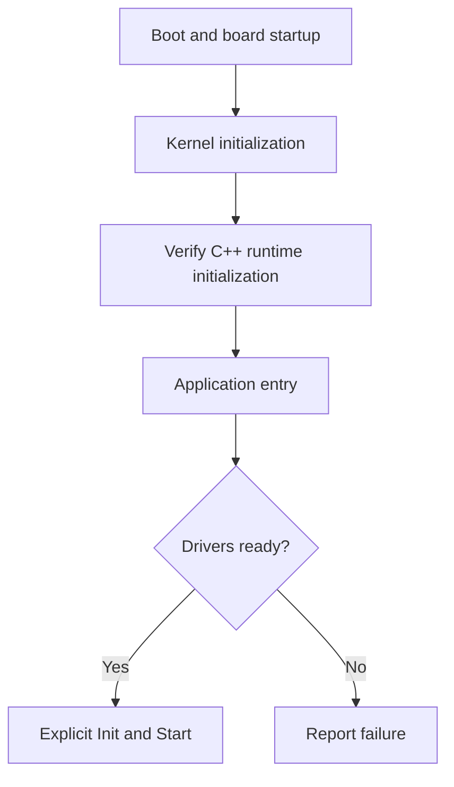
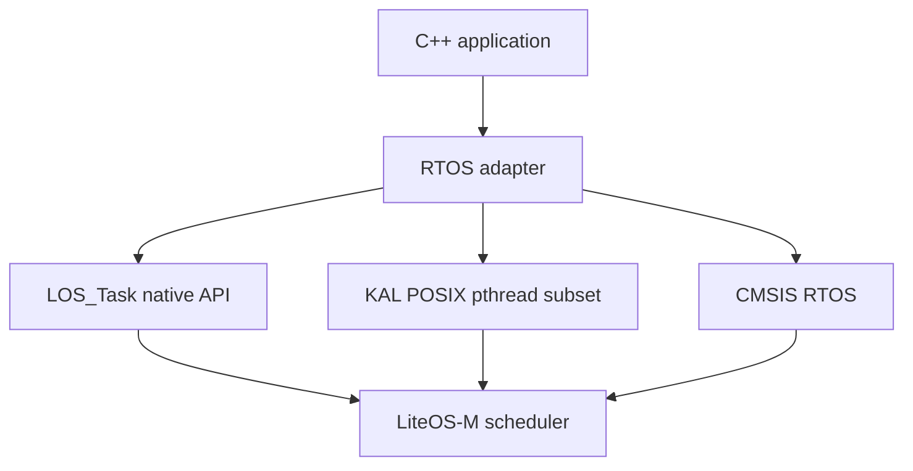
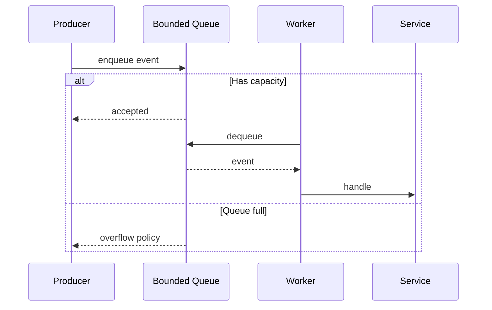

# HarmonyOS Mini / LiteOS-M：C++11 兼容性与异步架构

> 来源：[HarmonyOS Mini C++11 Compatibility](https://docs.google.com/document/d/1qjkYzdBRwUWaIXXA4Mo5zRwbTGQn3y_ffu7B67NSgSY/edit)。2026-10-19 整理。注意：不同 OpenHarmony 版本、板级配置及标准库实现的支持程度可能不同；以下涉及具体 API 的内容应在目标源码和硬件上核实。

## 核心认识

编译器能够解析 C++11 语法，不代表固件具有完整的 C++ 运行时、STL 和并发库。需要分别检查编译器、链接器、全局构造初始化、堆分配、POSIX/CMSIS 适配和任务栈。

| 类别 | 推荐策略 | 验证重点 |
| --- | --- | --- |
| auto、constexpr、enum class、Lambda、移动语义 | 优先使用 | 交叉编译器及 -std=c++11 |
| RAII、局部对象 | 推荐 | 锁失败、异常关闭后的错误处理 |
| 全局对象 | 延迟硬件初始化 | cppsupport、.init_array、启动顺序 |
| vector、map、string、shared_ptr | 有条件使用 | 堆容量、碎片、引用计数成本 |
| std::thread / condition_variable | 先验证后使用 | pthread 子集、栈、join、同步语义 |
| std::async / future / promise | 避免作为硬实时基础 | 隐式线程、共享状态分配、异常 |
| exceptions / RTTI | 按产品约束决定 | 编译标志、代码体积、链接结果 |

## 1. C++ 运行时与启动时序

来源文档重点分析 LiteOS-M 的 cppsupport、LOSCFG_KERNEL_CPPSUPPORT、LOS_CppSystemInit 和链接器 .init_array 段。其核心是**构造函数执行时，内核服务与硬件是否已经就绪**。



建议全局对象的构造函数仅保存配置；将 GPIO、SPI、网络、线程等实际初始化放在明确的 Init/Start 阶段。**不要直接照搬文档中 LOS_CppSystemInit 的参数和调用时机**，应检查当前内核版本声明、链接器脚本及启动代码，避免重复执行全局构造。

## 2. 三种线程抽象及其边界



- **原生 LOS_Task**：适合严格控制优先级、栈和内存的实时任务。
- **POSIX pthread**：适合已有跨平台依赖，但其生命周期和附加控制结构可能与原生任务不同。
- **CMSIS-RTOS**：适合跨 MCU/RTOS 的组件移植。
- **std::thread**：是否可用由实际 C++ 标准库及线程适配决定，不可仅凭头文件存在判断。

在 LOS_Task 创建的任务里调用 pthread_self、pthread_exit 等接口可能存在兼容性风险。请在目标版本检查 kal/posix/src/pthread.c，不要假设不同任务模型的上下文完全等价。

## 3. 异步架构：固定工作线程与有界队列

在资源受限设备上，优先选择固定数量 worker + 预分配队列，避免每次业务事件都新建线程。



必须定义队列满载时的丢弃、覆盖或背压策略，避免 ISR 使用非 ISR-safe 阻塞 API，并确保异步消息中的指针不会悬空。框架层 TaskExecutor 思路可供借鉴，但不应假定所有 ACE 框架组件均可直接运行在 Mini 设备上。

## 4. C++11 RAII 封装示例

```cpp
// 平台无关的设计示意；KernelMutex 为待实现的适配接口。
struct KernelMutex {
    bool lock() noexcept;
    void unlock() noexcept;
};

class ScopedMutex {
public:
    explicit ScopedMutex(KernelMutex& m) noexcept : mutex_(m), locked_(m.lock()) {}
    ~ScopedMutex() noexcept { if (locked_) mutex_.unlock(); }
    bool owns_lock() const noexcept { return locked_; }
    ScopedMutex(const ScopedMutex&) = delete;
    ScopedMutex& operator=(const ScopedMutex&) = delete;
private:
    KernelMutex& mutex_;
    bool locked_;
};
```

注意此类允许获取锁失败，使用者必须检查 owns_lock()，不能将其当作标准 lock_guard 的完全等价替代。

## 5. C/C++ ABI、内存和诊断

- C 接口头文件在 C++ 编译单元中通过 extern "C" 保持 C 链接约定。
- 使用 securec 等边界检查函数时核对接口版本、容量和返回值。
- 在 map 文件和符号表中核对 Flash、RAM、全局构造段与异常展开段。
- 记录任务栈水位、队列峰值、堆使用、错误码和 backtrace，符号表须与固件版本一致。
- 不要把“零开销抽象”当成无需验证的保证；需要用汇编、内存映射和运行时测量确认。

## 6. 与 Zephyr / ZPP 的联系

两者共同强调：C API 的轻量 C++ 封装、静态资源、显式生命周期、RAII 和可预测内存开销。参阅仓库现有 [Zephyr C++20 / ZPP 专题](zephyr-cpp20-zpp.md)。

## 7. 学习任务和验收标准

1. 固定 OpenHarmony 分支、编译器版本和目标开发板。
2. 编译验证 auto、Lambda、constexpr、移动语义、RAII。
3. 跟踪 .init_array 与全局构造调用，确认初始化只发生一次。
4. 对 native task、pthread 和 CMSIS 分别测试创建、退出、同步、栈限制。
5. 实现固定容量消息队列和 worker，验证满载、超时、关闭与资源释放。
6. 测量 RAM、Flash、堆峰值、栈峰值和最坏事件处理时延。
7. 对比启用/禁用 exceptions、RTTI 的构建差异。

## 参考资料

- [Google Drive 原始文档](https://docs.google.com/document/d/1qjkYzdBRwUWaIXXA4Mo5zRwbTGQn3y_ffu7B67NSgSY/edit)
- [OpenHarmony kernel_liteos_m](https://github.com/openharmony/kernel_liteos_m)
- [OpenHarmony LiteOS-M overview](https://gitee.com/openharmony/docs/blob/9c5954d6491ee755e5f2c5d4ffbc707056ef0141/en/device-dev/kernel/kernel-mini-overview.md)
