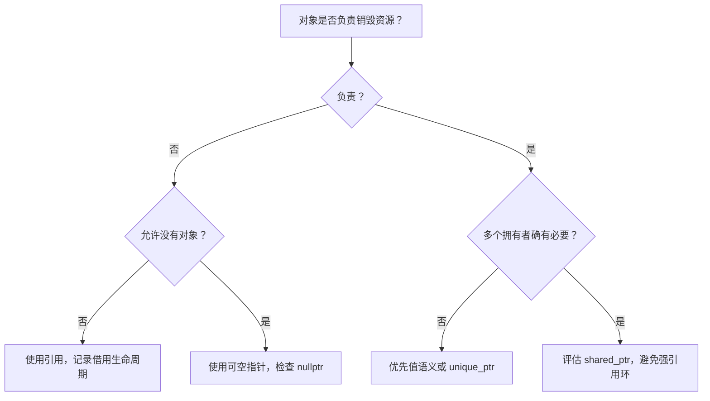
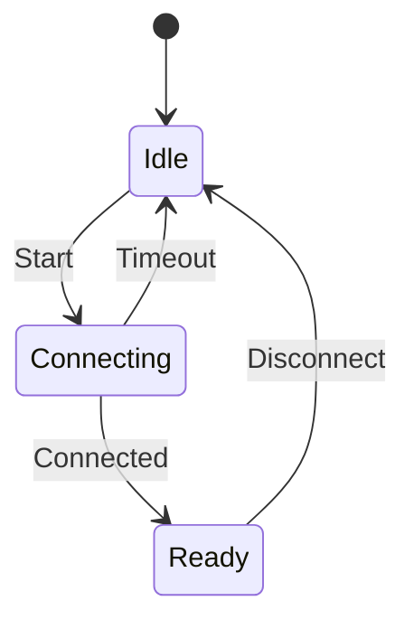
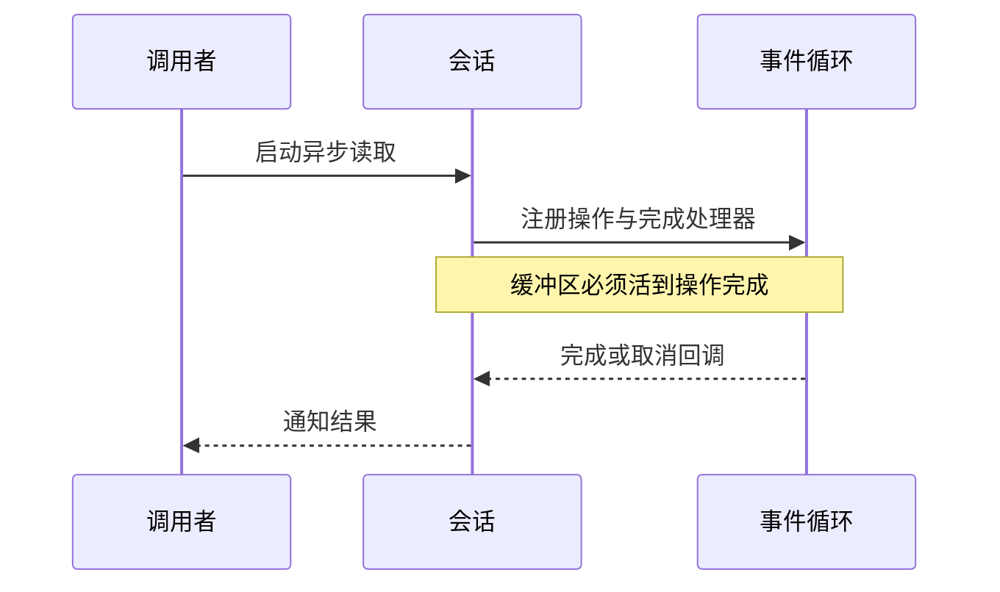
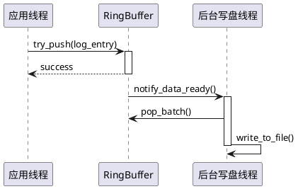

# Mermaid 图表学习与编写

课程里的图表用于解释控制流、所有权和异步时序。GitHub 可直接显示 Mermaid 代码块，Learning Console 的课程阅读器和“专题”使用相同渲染方式。

## 阅读与操作

- 图表宽于阅读栏时，可以聚焦图表并横向滚动。
- 点击“查看 Mermaid 源码”对照节点、边和代码行为。
- 语法错误或加载失败时保留源码；修复语法后重新构建，加载失败可点击“重试绘制”或刷新页面。
- 普通 C++、Shell 和文本代码块仍按代码显示。

## 流程图：借用还是拥有

把下面内容放在标记为 `mermaid` 的代码块中即可渲染。节点名使用短英文标识符，中文标签放在引号内。



引用和裸指针不会自动延长被借用对象的生命周期。共享所有权也不提供线程安全的数据访问。

## 状态图：连接状态



图里没有的事件不一定可忽略，代码应定义其拒绝或处理行为。可对照 Day 27 的状态迁移实验。

## 时序图：异步资源生命周期



取消请求不等于回调已经结束。释放缓冲区之前仍需确认操作的完成契约。

## PlantUML 架构与时序图

除 Mermaid 之外，文档系统还支持 PlantUML 流程图与时序图，使用 ```` ```plantuml ````（或 ```` ```puml ````、包含 `@startuml`）代码块编写：



在阅读器中，PlantUML 会自动渲染为矢量图，支持横向滚动、在“流程图”与“源码”之间切换、一键复制代码及打开外部 SVG。

## 编写检查

1. 一张图只解释一个决策、状态机或调用关系，避免把整个章节塞进单图。
2. 分支条件和代码一致，说明失败、超时与取消的去向。
3. 有效示例与故意错误示例分开：错误语法放在 `text` 代码块内，避免破坏阅读。
4. 不在图内嵌入 HTML、点击执行脚本或依赖外部图片；阅读器使用 strict 安全模式。
5. 修改图表后运行 `npm run test:e2e`；其中的图表检查会验证仓库所有 Mermaid 代码块的语法。

## 继续学习

- [所有权与智能指针](../patterns/ownership-and-smart-pointers.md)
- [Asio 异步架构](../frameworks/asio/ARCHITECTURE.md)
- [会话生命周期](../frameworks/asio/SESSION_LIFECYCLE.md)
