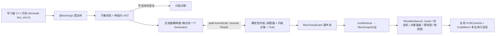
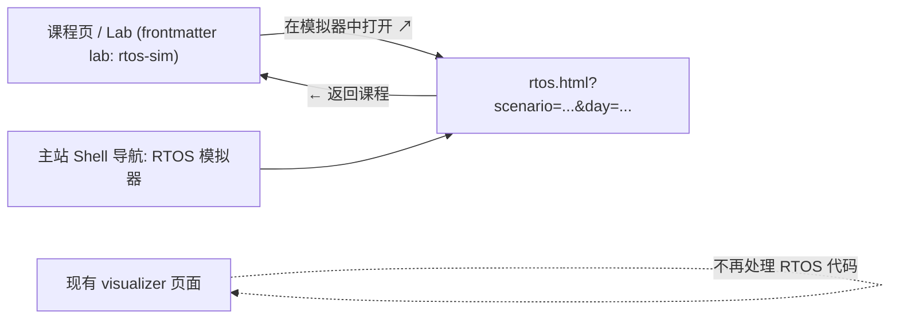
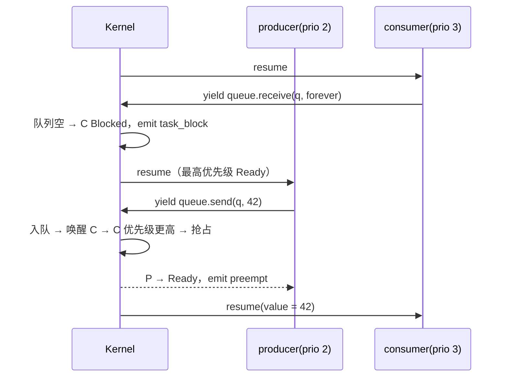

# RTOS 并发可视化模拟器 · 实施方案

## 目标

给现有的 C++ 可视化器加一条**RTOS 模拟器链路**，让学习者能逐步回放并观察：线程（任务）的创建、调度、销毁，以及锁、信号量、条件变量、消息队列、事件组、任务通知、软件定时器和中断这些异步通信机制。

已经确定的约束：

| 决策 | 结论 |
|---|---|
| 运行方式 | RTOS 章节**只走模拟器**，不调用 Clang/WASM 编译运行 |
| 输入形式 | **受限 C++ 子集**，由 TS 解释执行，不支持任意 C++ |
| API 风格 | **C++ 标准库风格**（`std::thread / std::mutex / std::condition_variable / std::counting_semaphore`），映射到 RTOS 调度语义；标准库里没有的能力放在 `rtos::` 扩展命名空间 |
| 内核能力 | 全部 8 项：任务生命周期 + 抢占/时间片、Mutex（优先级继承）、信号量、条件变量（虚假唤醒）、消息队列、事件组/任务通知、软件定时器 + ISR、死锁检测 |
| 可视化 | 全部 5 项：Gantt 时间轴、任务状态机、内核对象面板、等待关系图、按任务的栈视图 |

### 为什么要“确定性模拟”，而不是真线程

- WASM 沙箱里没有可靠的 pthread（需要 COOP/COEP + SharedArrayBuffer，GitHub Pages 不支持）。
- 真线程的调度不确定，**同一段代码每次跑出来的结果都不一样**，没法逐步回放，也就没法教学。
- 模拟器用离散的 tick 时钟 + 确定性调度，所以**同样的输入一定得到同样的轨迹**，可以 VCR 回放、导出 JSON、写断言测试。

---

## 总体架构



### 独立全屏页面

RTOS 可视化同时要显示 5 个视图和一个编辑器，信息量很大，所以**做成独立页面，不嵌入现有 Shell**：

- 使用 **Vite 多页面入口**：新增 `rtos.html` → `src/rtos-sim/main.tsx`。打包产物会单独拆分，主站不会加载解释器、内核和 RTOS UI 的代码；RTOS 页面也不会加载 Clang/WASM（从根源上保证“只走模拟器”）。
- 页面占满整个视口（`100vw × 100vh`），没有侧边栏，只有一个精简顶栏：场景选择、内核配置、返回课程。
- URL 参数：`rtos.html?scenario=priority-inversion&day=60&layout=timeline-first`，可以分享，也可以刷新后恢复。
- 和主站的入口关系：



- 页面内部的代码和现有 visualizer **共用纯组件**（`VCRControls`、`CodeMirrorEditor`、`MemoryCanvas`、`useSplitPane`），但会话状态独立（`useRtosSession`），**不修改**现有 `useTraceSession` 的 Clang 路由。
- 在主站 Lab 里，RTOS 章节的“运行”按钮换成“在模拟器中打开 ↗”，并说明“本章只支持模拟执行”。

---

## 一、C++ 子集与 API 规范

### 1.1 支持的语言子集（v1）

| 类别 | 支持 | 不支持（会给出行级诊断） |
|---|---|---|
| 类型 | `int` `unsigned` `bool` `std::size_t` `auto`（推导为 int/bool）、`std::array<int,N>` | 指针、引用、用户定义 class/struct、模板、`std::string` 运算（字符串字面量只能用于输出） |
| 声明 | 全局变量、局部变量、全局的同步对象 | 静态局部、命名空间定义 |
| 函数 | `void f()`、`void f(int)`、`int f(int)`，以及 `int main()` | 重载、递归深度 > 64 |
| Lambda | `[&]{}`、`[=]{}`、`[]{}`、`[&](int x){}`（用于线程入口和谓词） | 泛型 lambda、`mutable` |
| 语句 | `if/else` `while` `for` `do-while` `break` `continue` `return`、块作用域、`++ -- += -=` 等 | `goto` `switch`（v2 再支持）、异常 |
| 输出 | `std::cout << ... << std::endl / '\n'`、`std::printf("%d")`（基础格式） | iomanip |
| 时间 | `100ms` 字面量、`std::chrono::milliseconds(n)`、`std::this_thread::sleep_for` | 实时时钟 |

> [!NOTE]
> 语句本身**不消耗 tick**（瞬时执行）。时间只在这几种情况下推进：`sleep_for`、`rtos::busy_for(ms)`（模拟占用 CPU 的计算）、带超时的阻塞调用。为了防止死循环，每个 tick 内最多执行 10 000 条语句，超出就报 “疑似忙等/死循环” 并停止。

### 1.2 标准库风格 API → RTOS 语义映射

| C++ 写法 | RTOS 语义（参考 FreeRTOS） |
|---|---|
| `std::thread t(fn, args...)` | `xTaskCreate`，使用默认优先级 `rtos::kDefaultPriority` |
| `t.join()` / `t.detach()` | 阻塞到目标任务 Deleted / 解除关联 |
| 线程函数 return | 任务进入 Deleted，回收栈 |
| `std::this_thread::sleep_for(d)` | `vTaskDelay` → Blocked(Delay) |
| `std::this_thread::yield()` | `taskYIELD`，同优先级轮转 |
| `std::mutex m;` `lock/unlock/try_lock` | 带**优先级继承**的 Mutex（FreeRTOS mutex 语义） |
| `std::timed_mutex::try_lock_for(d)` | 带超时的获取 |
| `std::recursive_mutex` | 递归 Mutex（记录持有计数） |
| `std::lock_guard / std::unique_lock / std::scoped_lock` | RAII：离开作用域时自动 unlock；`scoped_lock` 按地址顺序加锁 |
| `std::condition_variable cv;` `wait(lk)` / `wait(lk, pred)` / `wait_for` | 原子地释放锁 → Blocked(CondVar) → 被唤醒后重新竞争锁 |
| `notify_one / notify_all` | 唤醒最高优先级的等待者 / 全部等待者 |
| `std::counting_semaphore<N> s(init)` / `std::binary_semaphore` | 计数/二值信号量；`acquire / release / try_acquire_for` |

### 1.3 `rtos::` 扩展（标准库里没有的能力）

```cpp
#include "rtos_sim.h"   // 只用于 IDE 补全和文档；模拟器根据它识别路由

// 任务属性：优先级越大越高（与 FreeRTOS 一致）
rtos::thread producer({.name = "producer", .priority = 3, .stack_words = 256}, ProducerTask);
rtos::suspend(producer);  rtos::resume(producer);  rtos::terminate(producer); // vTaskDelete
rtos::this_task::set_priority(2);
rtos::busy_for(5ms);      // 模拟占用 CPU 的计算，期间可以被抢占

rtos::mutex m{rtos::no_priority_inheritance};   // 用于演示优先级反转

rtos::message_queue<int, 4> q;                  // 定长环形缓冲
bool ok = q.send(42, 10ms);                     // 队列满时阻塞，超时返回 false
int v;  q.receive(v, rtos::kWaitForever);

rtos::event_group eg;
eg.set(0b01);
auto bits = eg.wait(0b11, {.wait_all = true, .clear_on_exit = true}, 100ms);

rtos::notify(consumer, 1);                      // 任务通知
auto n = rtos::this_task::notify_take(rtos::kWaitForever);

rtos::timer blink("blink", 100ms, rtos::periodic, []{ /* 在 timer service 任务中运行 */ });
blink.start();

rtos::isr uart("UART_RX", []{ q.send_from_isr(7); sem.release_from_isr(); });
uart.trigger_at(50ms);  uart.trigger_every(200ms);

rtos::config({.tick_ms = 1, .time_slice_ticks = 5, .spurious_wakeup_every = 0, .max_ticks = 2000});
```

如果在 ISR 里调用阻塞 API（`lock`、`acquire`、`sleep_for`、不带 `_from_isr` 的 `send`），会产生**错误诊断**，并在时间轴上打红色标记。这本身就是一个教学点。

---

## 二、内核设计

### 2.1 任务状态机

```mermaid
stateDiagram-v2
    [*] --> Ready: thread 构造
    Ready --> Running: 调度器选中
    Running --> Ready: 被抢占 / yield / 时间片到
    Running --> Blocked: sleep / lock / acquire / wait / receive
    Blocked --> Ready: 资源可用 / 超时 / notify / 虚假唤醒
    Running --> Suspended: rtos::suspend(self)
    Ready --> Suspended: rtos::suspend
    Blocked --> Suspended: rtos::suspend
    Suspended --> Ready: rtos::resume
    Running --> Deleted: 函数 return / terminate
    Ready --> Deleted: terminate
    Blocked --> Deleted: terminate
    Deleted --> [*]: join 完成 / 回收
```

### 2.2 解释器与内核的协作（生成器模型）

每个任务对应一个 `Generator<KernelCall, void, KernelResult>`。解释器执行到内核 API 时就 `yield` 一个请求，由内核决定什么时候 `resume`。

```ts
// src/rtos-sim/interpreter/exec.ts（示意）
function* execCall(node: CallExpr, env: Env): Generator<KernelCall, Value, KernelResult> {
  const api = resolveKernelApi(node);          // 如 "mutex.lock"
  if (api) {
    const result = yield { kind: api.kind, objectId: api.target(env), args: evalArgs(node, env), line: node.line };
    return result.value;                        // 内核在资源可用 / 超时后才 resume
  }
  return yield* callUserFunction(node, env);
}
```



### 2.3 调度规则（全部确定性）

1. **固定优先级抢占**：总是运行优先级最高的 Ready 任务；有更高优先级的任务变为 Ready 时，立即抢占。
2. **同优先级时间片轮转**：每 `time_slice_ticks` 个 tick（且只在 `busy_for` 期间）轮转一次；FIFO 顺序就是 Ready 队列的入队顺序。
3. **等待队列唤醒顺序**：先按优先级，同优先级再按 FIFO。
4. **Idle 任务**：优先级 0，没有其他任务可运行时运行；时间轴上显示为灰色。
5. **ISR**：tick 边界检查是否有触发的中断，ISR 抢占所有任务并一次跑完；ISR 返回时如果有更高优先级任务被唤醒，触发 `portYIELD_FROM_ISR` 语义的切换。
6. **Timer service 任务**：优先级可配置（默认最高 - 1），定时器回调在这个任务的上下文里运行。
7. **Main 任务**：`main()` 作为优先级 `kDefaultPriority` 的任务运行；main 返回后，如果还有非 detach 的线程没有 join，按 `std::terminate` 语义报错。

### 2.4 内核对象模型

```ts
// src/rtos-sim/kernel/types.ts（示意）
type KernelObject =
  | { kind: "mutex"; id: string; name: string; owner: TaskId | null; recursion: number; inherit: boolean; waiters: TaskId[] }
  | { kind: "semaphore"; id: string; name: string; count: number; max: number; waiters: TaskId[] }
  | { kind: "condvar"; id: string; name: string; waiters: TaskId[] }
  | { kind: "queue"; id: string; name: string; capacity: number; buffer: string[]; head: number; senders: TaskId[]; receivers: TaskId[] }
  | { kind: "event_group"; id: string; name: string; bits: number; waiters: { task: TaskId; mask: number; all: boolean }[] }
  | { kind: "timer"; id: string; name: string; periodMs: number; periodic: boolean; nextFireTick: number | null }
  | { kind: "isr"; id: string; name: string; schedule: number[] };
```

**优先级继承**：任务 H 阻塞在 Mutex 上、而 owner L 的优先级更低时，把 L 的有效优先级临时提升到 H 的优先级，并发出 `prio_inherit` 事件；L 释放锁后恢复为“仍持有的其它 Mutex 等待者中的最高优先级”或基础优先级。

**条件变量**：`wait(lk)` 等于 `unlock(m)` → Blocked(CondVar) → 唤醒后 `lock(m)`（可能再次阻塞在 Mutex 上，时间轴会显示这两段不同的阻塞原因）。`wait(lk, pred)` 被解释成 `while(!pred()) wait(lk);`。打开 `spurious_wakeup_every = N` 后，内核每 N 个 tick 给一个 CondVar 等待者注入一次虚假唤醒，用 `if` 代替 `while` 的错误写法就会暴露出来。

### 2.5 死锁与系统卡死检测

- **等待图（Wait-For Graph）**：每次产生阻塞事件时增量构建。规则：任务 → 它等待的 Mutex 的 owner；任务 → join 的目标任务。用 DFS 检测环，有环就发出 `deadlock_detected` 事件，事件里带上环路径（例如 `T1 → m2 → T2 → m1 → T1`）。
- **全局卡死**：所有用户任务都 Blocked/Suspended，且没有超时、定时器或 ISR 能把它们唤醒 → `system_stall` 告警。信号量和队列没有 owner，所以靠这条规则覆盖“永远等不到”的情况。
- **其他教学告警**：对没有持有的 Mutex 调用 unlock、非 owner 调用 unlock、不持锁调用 `cv.wait`、线程对象析构时还是 joinable、在 ISR 里调用阻塞 API、优先级反转持续超过 N 个 tick。

---

## 三、事件协议与快照

### 3.1 `RtosTraceEvent`（新增，跟现有 `TraceEvent` 平行）

```ts
// src/rtos-sim/types.ts
export type RtosTraceEvent =
  | { op: "task_create"; tick: number; task: TaskId; name: string; priority: number; line: number }
  | { op: "task_delete"; tick: number; task: TaskId; reason: "return" | "terminate" }
  | { op: "task_state"; tick: number; task: TaskId; from: TaskState; to: TaskState; reason: BlockReason | null; objectId?: string; line: number }
  | { op: "context_switch"; tick: number; from: TaskId | null; to: TaskId; cause: "preempt" | "block" | "yield" | "timeslice" | "isr_return" | "exit" }
  | { op: "prio_inherit" | "prio_restore"; tick: number; task: TaskId; from: number; to: number; objectId: string }
  | { op: "obj_create"; tick: number; object: KernelObjectInit; line: number }
  | { op: "obj_op"; tick: number; task: TaskId | "isr"; objectId: string; action: string; value?: string; ok: boolean; line: number }
  | { op: "isr_enter" | "isr_exit"; tick: number; isr: string }
  | { op: "timer_fire"; tick: number; timer: string }
  | { op: "spurious_wakeup"; tick: number; task: TaskId; objectId: string }
  | { op: "var_update"; tick: number; task: TaskId; scope: string; name: string; value: string; line: number }
  | { op: "stdout"; tick: number; task: TaskId; text: string; line: number }
  | { op: "deadlock_detected"; tick: number; cycle: string[] }
  | { op: "system_stall"; tick: number }
  | { op: "diagnostic"; tick: number; level: "warning" | "error"; message: string; line?: number; task?: TaskId };
```

### 3.2 `RtosSnapshot`

```ts
export interface RtosSnapshot {
  stepIndex: number;
  tick: number;
  description: string;                    // 例如 "consumer 阻塞在 q.receive()（队列空）"
  running: TaskId | "isr" | null;
  tasks: TaskView[];                      // 状态、基础/有效优先级、当前行、阻塞原因、栈帧（复用 StackFrame）
  objects: KernelObjectView[];
  waitFor: { from: TaskId; to: TaskId | string; via: string }[];
  timelineUntilTick: number;              // Gantt 只渲染到这个 tick，时间轴数据整体只算一次
  stdout: string;
  warnings: string[];
  activeLines: Record<TaskId, number>;    // 编辑器里按任务着色的多行高亮
}

export interface VisualizerTraceV3 {      // 导出/预置轨迹
  schemaVersion: 3; mode: "rtos-sim"; accuracy: "exact";
  sourceCode: string; config: RtosConfig; events: RtosTraceEvent[];
  timeline: TimelineSegment[];            // {task, start, end, state}
}
```

**快照粒度**：默认“内核事件级”（上下文切换、阻塞/唤醒、对象操作、输出）；可以切到“语句级”方便单步调试。上限 `MAX_RTOS_TICKS = 5000`、`MAX_RTOS_SNAPSHOTS = 3000`，超出就截断并给出诊断。Gantt 时间段数据只算一次，快照里只存 `timelineUntilTick`，避免每帧都深拷贝。

---

## 四、UI 设计

```text
┌──────────────────────────────┬───────────────────────────────────────────────┐
│ CodeMirror（多任务彩色行高亮）│ [时间轴] [状态机] [内核对象] [等待图] [栈]  ← Tabs│
│                              │ ┌───────────────────────────────────────────┐ │
│  T1 ▶ 12: q.send(i, 10ms);   │ │ ISR   ▮        ▮                          │ │
│  T2 ▶ 27: q.receive(v, ...); │ │ cons  ███░░░░░░███░░░░░░███   ░ Blocked   │ │
│                              │ │ prod  ░░░███████░░░███████░   █ Running   │ │
│                              │ │ idle  ░░░░░░░░░░░░░░░░░░░░░   ▒ Ready     │ │
│                              │ │       0    5    10   15  20 tick  ▲当前     │ │
│                              │ └───────────────────────────────────────────┘ │
│                              │  队列 q [42][  ][  ][  ] head=0  等待: —       │
├──────────────────────────────┴───────────────────────────────────────────────┤
│ VCR: ⏮ ◀ ▶ ⏭  | 下一次切换 ⇥ | 下一 tick | 速度 | 粒度: 事件/语句 | ⚙ 内核配置 │
│ stdout / warnings（死锁告警会展示环路径并高亮相关代码行）                         │
└──────────────────────────────────────────────────────────────────────────────┘
```

| 视图 | 实现要点 |
|---|---|
| **TaskTimeline（Gantt）** | SVG 绘制，每个任务一行，颜色代表 Running/Ready/Blocked/Suspended；ISR 单独一行；上下文切换用竖线；优先级继承区间加条纹；可以点击某个 tick 直接跳到对应快照 |
| **TaskStateMachine** | 固定布局的 SVG 状态图，当前步骤里发生的转移边会高亮动画；可以选择看哪个任务 |
| **KernelObjectsPanel** | 队列：环形槽位 + head/tail；信号量：令牌圆点；Mutex：owner 徽标 + 等待队列 chips；CondVar/事件组：位图；定时器：倒计时 |
| **WaitForGraph** | 任务和对象作为节点、等待关系作为边，环用红色高亮；节点少（一般 < 12），用简单的分层布局，不引入新依赖 |
| **栈视图** | 解释器的作用域按任务转换成 `StackFrame[]`，复用 [MemoryCanvas](file:///home/lujingjing/Project/professional-cpp-learning/src/visualizer/MemoryCanvas.tsx)，每个任务一列 |
| **编辑器** | 给 [CodeMirrorEditor](file:///home/lujingjing/Project/professional-cpp-learning/src/visualizer/CodeMirrorEditor.tsx) 加 `activeLines` 多色装饰，每个任务固定一种颜色 |

---

## 五、文件改动清单

### 内核与解释器（纯 TS，不依赖 React，可以直接单测）

#### [NEW] `src/rtos-sim/types.ts`
事件、快照、任务、对象、配置类型，以及 `VisualizerTraceV3`。

#### [NEW] `src/rtos-sim/frontend/parse.ts`
用 `@lezer/cpp` 解析成语法树 → 子集校验（遇到 ⚠ 错误节点或不支持的节点时给出行级诊断）→ 降级为精简 AST。

#### [NEW] `src/rtos-sim/frontend/ast.ts`
子集 AST 节点定义。

#### [NEW] `src/rtos-sim/frontend/apiCatalog.ts`
`std::` / `rtos::` API 签名表：名称 → 内核调用种类、参数校验、是否允许在 ISR 中调用。这个表是唯一事实来源，parser、解释器和文档都从这里读。

#### [NEW] `src/rtos-sim/interpreter/{env,exec,values}.ts`
生成器解释器：作用域/RAII 析构（lock_guard 自动解锁）、lambda 闭包、表达式求值、`cout` 格式化。

#### [NEW] `src/rtos-sim/kernel/scheduler.ts`
Ready 队列、抢占、时间片、tick 推进、Idle/Timer service/Main 任务、ISR 分发。

#### [NEW] `src/rtos-sim/kernel/objects/{mutex,semaphore,condvar,queue,eventGroup,notify,timer,isr}.ts`
每种对象一个文件，统一接口 `request(task, action, args) → Granted | Blocked | Error`、`onTimeout`、`wakeOrder`。

#### [NEW] `src/rtos-sim/kernel/waitFor.ts`
等待图增量维护、环检测、全局卡死判定。

#### [NEW] `src/rtos-sim/simulate.ts`
对外入口 `simulateRtos(code, config) → { events, timeline, diagnostics }`，跑在 Web Worker 里（`src/workers/rtos.worker.ts`），防止卡住 UI 线程；超时就终止 worker。

#### [NEW] `src/rtos-sim/rtosReducer.ts`
`computeRtosSnapshots(events) → RtosSnapshot[]` 纯函数（结构上对齐现有的 `computeSnapshotsWithDiagnostics`）。

#### [NEW] `src/workers/rtos.worker.ts`

---

### 独立页面入口

#### [NEW] `rtos.html`
第二个 HTML 入口，挂载 `src/rtos-sim/main.tsx`；标题为“RTOS 并发模拟器 · Professional C++”。

#### [MODIFY] [vite.config.ts](file:///home/lujingjing/Project/professional-cpp-learning/vite.config.ts)
```diff
     build: {
       target: "es2022",
       sourcemap: !isGitHubPages,
+      rollupOptions: {
+        input: {
+          main: resolve(__dirname, "index.html"),
+          rtos: resolve(__dirname, "rtos.html"),
+        },
+      },
     },
```
GitHub Pages 的 `base` 对两个入口同样生效。`dist/404.html` 的 SPA 回退逻辑不影响 `rtos.html`，因为它是真实存在的文件。

#### [NEW] `src/rtos-sim/main.tsx`
独立的 React root，只引入 `rtos.css` 和共用的设计 token（从 `styles.css` 抽出 CSS 变量到 `src/tokens.css`，两个入口都引用）。

#### [NEW] `src/rtos-sim/RtosApp.tsx`
全屏布局：顶栏（场景选择、内核配置、返回课程）+ `RtosWorkbench`；解析 URL 参数 `scenario / day / layout / code`（code 用 base64url 编码，用于分享自定义代码）。

#### [NEW] `src/rtos-sim/useRtosSession.ts`
独立的会话状态：编辑代码 → 交给 worker 模拟 → 归约快照 → 记录当前步骤；把代码草稿存在 localStorage（key 带场景 id）。

### UI

#### [NEW] `src/rtos-sim/ui/RtosWorkbench.tsx`
左边编辑器，右边视图区。视图区默认是**上下两块**：上面是 Gantt 时间轴（常驻），下面是 Tab（状态机 / 内核对象 / 等待图 / 栈）；宽屏（≥ 1600px）时内核对象面板固定在右侧。分栏可以拖拽，比例存在 localStorage。

#### [NEW] `src/rtos-sim/ui/{TaskTimeline,TaskStateMachine,KernelObjectsPanel,WaitForGraph,TaskStacksView,RtosConfigPopover,ScenarioPicker}.tsx` + `rtos.css`

#### [NEW] `src/visualizer/useSplitPane.ts`
从 [VisualizerWorkbench.tsx](file:///home/lujingjing/Project/professional-cpp-learning/src/visualizer/VisualizerWorkbench.tsx) 抽出拖拽分栏逻辑，两个工作台共用（只做重构，现有行为不变）。

#### [MODIFY] [VCRControls.tsx](file:///home/lujingjing/Project/professional-cpp-learning/src/visualizer/VCRControls.tsx)
改为泛型（只依赖 `length / current / onStep`），新增可选按钮“下一次切换 / 下一 tick”。

#### [MODIFY] [CodeMirrorEditor.tsx](file:///home/lujingjing/Project/professional-cpp-learning/src/visualizer/CodeMirrorEditor.tsx)
新增可选属性 `activeLines?: Record<string, {line:number; color:string}>`。

### 主站集成（改动最小）

#### [MODIFY] [Shell.tsx](file:///home/lujingjing/Project/professional-cpp-learning/src/components/Shell.tsx)
导航里加一个外链项“RTOS 模拟器 ↗”，指向 `${BASE_URL}rtos.html`。

#### [MODIFY] [LabView.tsx](file:///home/lujingjing/Project/professional-cpp-learning/src/components/views/LabView.tsx)
lesson frontmatter 写了 `lab: rtos-sim` 时，隐藏 Clang 的“编译运行”，改为显示“在模拟器中打开 ↗”（带上 `scenario` 和 `day`），并提示“本章只支持模拟执行”。

#### [MODIFY] [course.ts](file:///home/lujingjing/Project/professional-cpp-learning/src/lib/course.ts)
frontmatter 解析新增可选字段 `lab: rtos-sim`、`rtos_scenario: <id>`。

> [!NOTE]
> 现有的 [useTraceSession.ts](file:///home/lujingjing/Project/professional-cpp-learning/src/visualizer/useTraceSession.ts)、[types.ts](file:///home/lujingjing/Project/professional-cpp-learning/src/visualizer/types.ts)、[VisualizerView.tsx](file:///home/lujingjing/Project/professional-cpp-learning/src/components/views/VisualizerView.tsx) **保持不变**。RTOS 的类型和导入导出（`VisualizerTraceV3`）都放在 `src/rtos-sim/` 里，两条链路互相隔离。

### 预置场景

#### [NEW] `src/rtos-sim/scenarios.ts`
用 `import.meta.glob("/examples/rtos/*.cpp", { query: "?raw" })` 懒加载场景源码，再加上元数据（id、标题、教学点、默认配置）。场景只保存源码和配置，打开时现场模拟。

---

### 头文件、示例与课程

#### [NEW] `include/rtos_sim.h`
**只有声明**（给 IDE 补全和 API 文档用），注释里写明“本头文件仅供模拟器识别，不可链接运行”。

#### [NEW] `examples/rtos/*.cpp` —— 8 个预置场景

| 场景 | 教学点 |
|---|---|
| `01_round_robin.cpp` | 同优先级时间片轮转 vs 不同优先级抢占 |
| `02_thread_lifecycle.cpp` | 创建 / suspend / resume / terminate / join |
| `03_producer_consumer_queue.cpp` | 消息队列阻塞收发 + 超时 |
| `04_priority_inversion.cpp` | `rtos::no_priority_inheritance` 和默认 `std::mutex` 对比 |
| `05_condvar_spurious.cpp` | `if` vs `while` + 虚假唤醒注入 |
| `06_dining_philosophers.cpp` | 死锁环检测；用 `std::scoped_lock` 修复 |
| `07_isr_deferred.cpp` | ISR → `release_from_isr` → 处理任务（延迟中断处理） |
| `08_timer_eventgroup.cpp` | 软件定时器 + 事件组多条件同步 |

#### [MODIFY] [tools/check-course.py](file:///home/lujingjing/Project/professional-cpp-learning/tools/check-course.py)
`lab: rtos-sim` 章节的示例跳过原生编译检查，改为调用 `node tools/check-rtos-examples.ts`，确认能模拟成功且没有 error 诊断。

---

## 六、分期交付

| 阶段 | 内容 | 产出 |
|---|---|---|
| **P1 内核骨架** | parser 子集 + 解释器 + 调度器（线程生命周期、sleep、抢占、时间片）+ Mutex/lock_guard + 事件/快照 + 单测 | 可以用 CLI 跑出确定性事件流 |
| **P2 同步原语** | 信号量、条件变量（虚假唤醒）、消息队列、优先级继承、等待图死锁检测 | 场景 01–06 模拟正确 |
| **P3 UI** | RtosWorkbench + Gantt + 内核对象面板 + 多任务行高亮 + VCR 扩展 | 页面上可以交互回放 |
| **P4 高级** | 事件组、任务通知、软件定时器、ISR、状态机图、等待图视图、按任务栈视图 | 场景 07–08 |
| **P5 集成** | 预置场景、Lab 路由、导出 V3 JSON、课程检查、E2E | 端到端验收 |

---

## 待确认问题

> [!IMPORTANT]
> 1. **`std::mutex` 是否默认开启优先级继承？** 建议开启（贴近 FreeRTOS mutex 和嵌入式实践），反转演示改用 `rtos::mutex{rtos::no_priority_inheritance}`。另一种做法是默认关闭（更贴近 POSIX 默认 `PTHREAD_PRIO_NONE`）。
> 2. **`rtos_sim.h` 只保留声明，还是也提供一份基于 `std::thread` 的宿主实现**，让示例能在本机原生编译运行（行为非确定，只用于对照）？按你说的“只支持模拟器”，方案默认**只保留声明**。
> 3. **分期**：要先只做 P1–P3 拿到可用版本，再做 P4–P5 吗？还是一次全部完成？

> [!WARNING]
> 子集解释器不是完整的 C++。出现不支持的语法（指针、用户类、模板等）时，会**拒绝运行并给出行级提示**，不会悄悄退回 regex 推断。这一点需要在 RTOS 章节的 Lab 页面上明确告知读者。

---

## 验证计划

### 自动化测试（`node --test`，与现有 `tests/*.test.ts` 一致）

```bash
node --test tests/rtos-parser.test.ts      # 子集识别；不支持语法给出正确行号诊断
node --test tests/rtos-kernel.test.ts      # 调度确定性：同一输入两次运行，事件流 deepEqual
node --test tests/rtos-objects.test.ts     # 各原语语义：
#   - 高优先级 Ready 立即抢占；同优先级 5 tick 轮转
#   - 优先级继承：H 阻塞时 L 的有效优先级 == H；释放后恢复
#   - 关闭继承时 M 任务饿死 H（反转持续 tick 数可断言）
#   - cv.wait(lk) 释放锁；notify_one 唤醒最高优先级；if 写法在虚假唤醒下产生错误输出，while 写法不会
#   - 队列满时 send 阻塞，超时返回 false；FIFO 顺序
#   - ISR 中调用 lock() → error 诊断
#   - 哲学家就餐场景检测出环 [P0→f1→P1→…→P0]；scoped_lock 版本无死锁
node --test tests/rtos-reducer.test.ts     # 快照数、timelineUntilTick 单调、截断上限
node tools/check-rtos-examples.ts          # 8 个预置场景全部模拟成功，0 个 error
npm run lint && npm run build              # 类型检查 + 构建
```

### E2E（Playwright）

```bash
npm run build && npx playwright test tests/rtos-visualizer.spec.ts
```

- 打开 `/rtos.html?scenario=priority-inversion`（独立全屏页面）：Gantt 能渲染，点击 “下一次切换” 后 tick 前进，编辑器出现两种颜色的行高亮。
- 切换优先级继承配置后重新运行，时间轴上出现条纹的继承区间。
- 哲学家场景：显示死锁告警，等待图出现红色环。
- 断言整个流程**没有发出** clang worker 请求（监听 `clang.worker` 的加载）。

### 手动验证

- 在 `npm run dev` 下访问 `http://localhost:3000/rtos.html`，逐个打开 8 个场景，检查各视图联动（拖动 VCR 时 Gantt 游标、对象面板、栈视图同步更新）。
- 故意写不支持的语法（例如 `int* p`），确认会给出清晰的行级提示。
