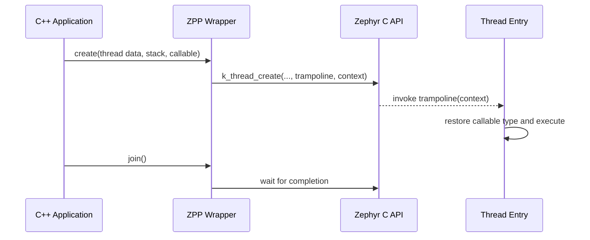
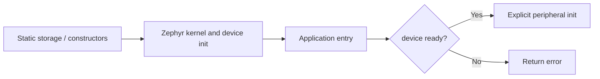
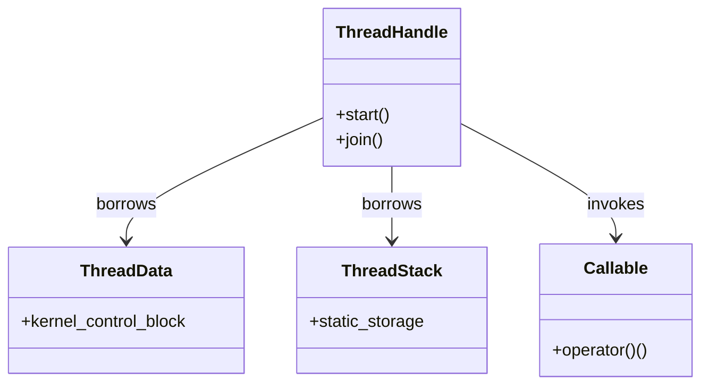

# Zephyr C++20 / ZPP：嵌入式现代 C++ 工程专题

> 来源：[Google Drive《Zephyr C++20 关键实现原理》](https://docs.google.com/document/d/1T-KqZooKAnd82QNdLXVNrhyVKOUR9dM8MpLnerZZuMw/edit)，整理日期：2026-10-19。本文是学习摘要，具体 API 与 Kconfig 选项须以所用 Zephyr / ZPP 版本源码验证。

## 学习目标
理解如何在无异常、受限堆内存的 RTOS 中利用 C++20 封装 C API，同时保留内存、线程与实时性的可预测性。

## 1. ZPP 的架构定位
ZPP（[lowlander/zpp](https://github.com/lowlander/zpp)）是面向 Zephyr 的 C++ 包装层，不是新的 RTOS。重点是薄封装、静态资源、RAII、类型安全及 Lambda 线程入口。不要将其与教学用 zpp_lib 混淆。框架版本和 API 可能变化。

## 2. 关键设计决策
| 主题 | C API 常见做法 | 现代 C++ 改进 | 工程约束 |
|---|---|---|---|
| 互斥锁 | 手动 lock/unlock | RAII lock_guard | 临界区不能阻塞过久 |
| 线程 | 栈与控制块显式传入 | 强类型 thread wrapper | 栈和 TCB 生命周期必须覆盖线程 |
| 回调 | 函数指针 + void* | 模板 / Lambda trampoline | 捕获对象不可悬垂 |
| 配置 | 整数宏与位掩码 | enum class / 属性对象 | 核对底层 ABI |
| 错误 | int 错误码 | 显式结果类型 | 无异常构建下不可依赖 throw |
| 硬件 | 全局初始化时调用驱动 | 构造仅保存描述，main 中 init | 驱动 ready 后才操作硬件 |

## 3. 生命周期与所有权
优先使用值对象；不能复制的 RTOS 资源使用明确的所有者；只借用底层句柄时使用引用或非拥有指针。不要因为跨模块使用就默认 shared_ptr。线程入口捕获的局部引用在 join 前必须保持有效；异步线程更应使用静态上下文或明确的生命周期管理。

```cpp
// 纯 C++ 演示 RAII 思路，不是 ZPP API 示例
template <class Mutex>
class ScopedLock {
public:
  explicit ScopedLock(Mutex& m) noexcept : m_(m) {
    m_.lock();
  }
  ~ScopedLock() noexcept {
    m_.unlock();
  }
  ScopedLock(const ScopedLock&) = delete;
  ScopedLock& operator=(const ScopedLock&) = delete;

private:
  Mutex& m_;
};
```

## 4. 静态线程资源与 C ABI 桥接
Zephyr 的线程栈和控制块可以静态分配，包装层通过引用借用它们。模板 trampoline 将已知的 C++ 可调用类型转换为 C 线程入口可接受的函数指针及 void* 上下文。需验证具体实现是否复制闭包、是否仅借用地址，不能笼统宣称所有捕获 Lambda 都零开销。



## 5. 启动时序
全局 C++ 对象的构造时间与 Zephyr 驱动初始化顺序不能想当然。建议全局构造只保存设备树描述，进入应用阶段检查 device_is_ready 后显式 init，失败则返回状态码。不要在全局构造函数中直接访问尚未就绪的 GPIO / SPI / 网络驱动。



## 6. 编译与验证
- 根据 Zephyr 版本检查 `CONFIG_CPP`、C++20 标准选项、异常及 RTTI 设置；不要照抄跨版本 Kconfig 名称。
- 核查构建输出的实际 `-std=`、`-fno-exceptions`、ABI 与链接脚本。
- 比较封装前后 Flash、RAM、栈峰值、线程切换时延；“零开销”必须有编译产物和测量支持。
- 通过 west / Zephyr 模块系统集成外部组件，锁定版本。

## 7. UML：资源与借用关系


## 8. 实战练习
1. 用 Zephyr C API 创建静态线程，记录 TCB、栈与线程句柄的地址和生命周期。
2. 用 RAII 包装 mutex，对早返回路径进行死锁回归测试。
3. 用 C trampoline 转接一个捕获上下文的 Lambda，验证上下文生命周期。
4. 在全局构造中仅存储 GPIO 描述，在 main 中检查 ready 并初始化。
5. 分别以 -O0/-Os 构建，对比符号表、map 文件、栈使用与生成汇编。
6. 分析异常禁用时的错误传播方式，设计状态码或 expected 风格接口。

## 与现有知识体系的连接
- 智能指针：先明确所有权，再选择值、引用、unique_ptr；实时路径谨慎使用共享引用计数。
- 设计模式：RAII 是资源边界，Adapter 是 C/C++ API 边界，Facade 是设备/线程封装边界。
- 异步架构：与 Handler/Runner、事件循环、线程池比较调度成本及生命周期。
- OpenHarmony Mini：可对比 samgr_lite 的共享任务池与 Zephyr 线程资源模型。

## 延伸阅读
- [Zephyr 官方文档](https://docs.zephyrproject.org/)
- [ZPP 源码](https://github.com/lowlander/zpp)
- [鸿蒙 Mini 服务与通信机制（同一 Drive）](https://docs.google.com/document/d/1DBdnkJ_jHSz1ACFSMk9Ya9XHjTHeq9pk8bGYw31_3a0/edit)

## 适配与验证记录

选择 Zephyr、ZPP revision、板卡、工具链与 Kconfig 后，再按 [环境卡](lab-environments.md) 记录实际支持。可用 [主机通道](engineering-learning-path.md) 作为业务契约基线；目标线程、栈、时钟、取消与析构上下文须重新验证。本文仍为资料整理与学习任务，未声明该移植已完成。
