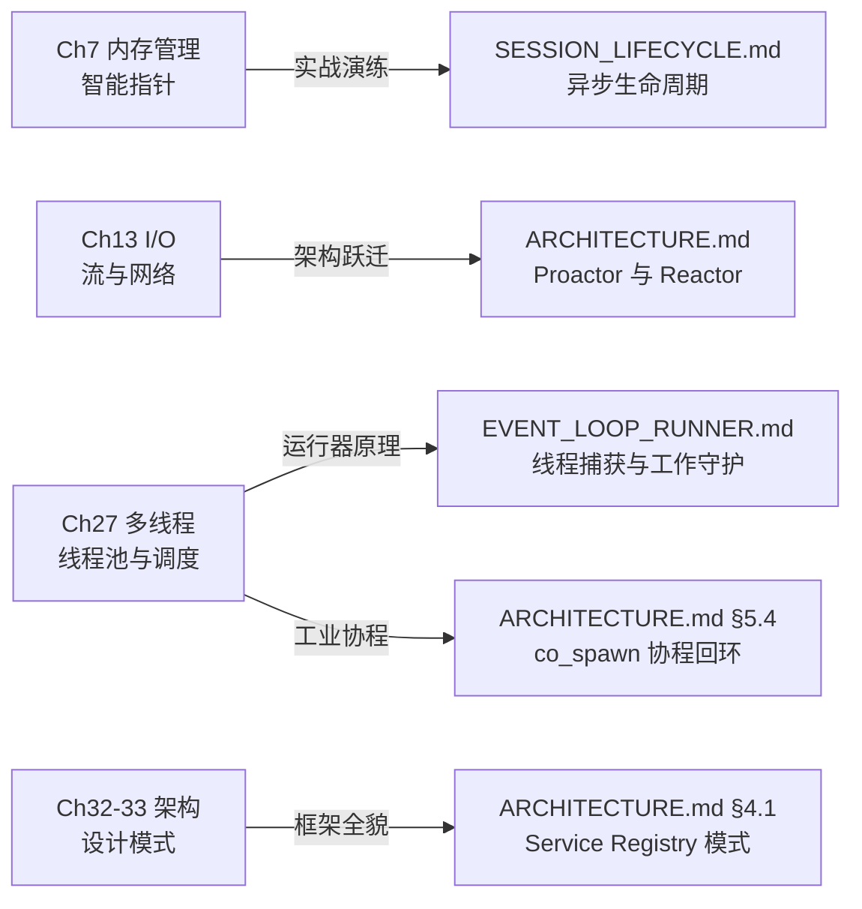

# 经典工业级框架源码解构 · Asio

> 本专题为 **Professional C++ Learning** 的工业级框架进阶拓展模块。
> 示例采用 Standalone Asio 1.30.2、C++20，与 examples/CMakeLists.txt 一致。旧版文章的 1.38.2 标记未经统一复核，现不将其作为验证结论；内部源码名称和扩展 API 需依据实际版本再次核对。

---

## 1. 为什么选择 Asio 作为首选解构对象？

在 C++ 工程生态中，**Asio**（Boost.Asio 的独立无 Boost 依赖版本）是极为关键的网络与异步 C++ 基础库：

1. **C++ 网络与异步的事实标准**：ISO C++ Networking TS（网络技术规范）与 P0443 执行器模型的核心提案原型均源于 Asio。
2. **Proactor 架构模式的典型实现**：封装了各平台底层的异步 I/O 复用技术（Linux `epoll` / `io_uring`、Windows `IOCP`、macOS `kqueue`）。
3. **现代 C++ 语言特性的典型应用**：
   - **智能指针与所有权（Ch7）**：用 `std::enable_shared_from_this` 解决异步 use-after-free 的常见范例。
   - **泛型完成模型（Ch12）**：`async_result` 定制点机制，一套 API 无缝适配回调、`std::future`、协程与惰性执行对象。
   - **C++20 协程落地（Ch27）**：`co_spawn` 与 `use_awaitable` 是目前生产环境最为成熟的协程事件循环基础设施。
   - **框架与设计模式（Ch32-33）**：Service Registry（单例服务模式）、Strand（Handler 串行化适配器）、Executor 抽象。

---

## 2. 专题文档导航

| 核心文档 | 核心内容 | 推荐阅读阶段 |
|---|---|---|
| [📘 总体分层架构与底层机制 (ARCHITECTURE.md)](ARCHITECTURE.md) | 总体分层架构、核心运行时类层次、Proactor 机制、异步完成模型、SSL 装饰器模式、Reactor 驱动流程（含 13 幅标准 Mermaid 架构图与时序图） | **Ch13 I/O 篇**<br/>**Ch27 协程篇**<br/>**Ch32-33 架构篇** |
| [📗 智能指针与异步生命周期实践 (SESSION_LIFECYCLE.md)](SESSION_LIFECYCLE.md) | 异步操作与栈帧生命周期错配、`shared_from_this` 绑定三要素、`make_shared session start` 单行拆解、Lambda 捕获原则（含 7 幅完整引用计数演变时序图） | **Ch7 智能指针篇** |
| [📙 运行器与事件循环深度解析 (EVENT_LOOP_RUNNER.md)](EVENT_LOOP_RUNNER.md) | 线程捕获机制（Thread Capture）、`io_service::work` / `work_guard` 常驻守护、多线程池事件调度（Thread Pool Runner）、`strand` Handler 串行化边界 | **Ch27 多线程并发篇** |
| [💻 核心实战代码示例 (https://github.com/luckyJimLu/professional-cpp-learning/tree/main/frameworks/asio/examples)](https://github.com/luckyJimLu/professional-cpp-learning/tree/main/frameworks/asio/examples) | 阻塞式 Echo、标准 `shared_from_this` 异步 Echo、C++20 协程 Echo 服务器，配有一键构建脚本 | 随读随练 |

---

## 3. 课程体系双向锚定指南

在研读本书主线课程时，建议在以下时间节点结合本专题拓展学习：



### 锚点 1：Ch7 内存管理（智能指针与生命周期）
- **教材痛点**：教科书常以玩具类演示 `std::enable_shared_from_this`，初学者难以体会为什么必须有它、什么时候必须捕获。
- **Asio 对照**：精读 [SESSION_LIFECYCLE.md](SESSION_LIFECYCLE.md)。异步操作的完成通常晚于发起函数返回，因此对象和 buffer 必须活到完成处理结束。捕获 `self = shared_from_this()` 是一种延长 Session 生命周期的方式；外部 owner、会话管理器或协程帧也可承担相应责任，须分别说明取消和排空协议。

### 锚点 2：Ch13 I/O（标准流 vs 异步网络）
- **教材痛点**：标准库仅提供阻塞式 `iostream`，现代高性能服务器需要基于事件的多路复用机制。
- **Asio 对照**：精读 [ARCHITECTURE.md](ARCHITECTURE.md) 的第 1-3 节。理解非阻塞 I/O、Scatter/Gather 内存连续/离散缓冲区（`mutable_buffer` / `const_buffer`）以及跨平台 Reactor 后端抽象。

### 锚点 3：Ch27 多线程与并发（事件循环捕获与工作线程池）
- **教材痛点**：多线程编程教科书往往只讲 `std::thread`、`std::mutex`、条件变量，缺乏工业级事件调度线程池的设计范式。
- **Asio 对照**：精读 [EVENT_LOOP_RUNNER.md](EVENT_LOOP_RUNNER.md)。学习 `io_context::run()` 的线程捕获机制、`make_work_guard` 防止空闲退出的守护原理、多原生线程共享事件池模型，以及利用 `asio::strand` 规避并发数据竞争的 Handler 串行化边界。

### 锚点 4：Ch27 多线程与并发（C++20 协程实战）
- **教材痛点**：C++20 协程（`co_await` / `co_return` / `std::coroutine_handle`）底层概念繁杂，缺乏完整的事件循环运行时驱动。
- **Asio 对照**：精读 [ARCHITECTURE.md](ARCHITECTURE.md) 的第 4.4 节与第 5.4 节。体验 Asio 如何通过 `async_result<use_awaitable_t>` 优雅地将协程挂起点桥接到 `io_context` 事件循环中。

### 锚点 5：Ch32–33 框架设计与设计模式
- **教材痛点**：设计模式往往停留于 UML 理论图。
- **Asio 对照**：精读 [ARCHITECTURE.md](ARCHITECTURE.md) 的第 4.1 节。学习 Asio 的**服务注册中心（Service Registry）**模式：前端句柄对象（`tcp::socket`）零状态极轻，后端服务（`reactive_socket_service`）单例集中持有系统调用与状态机。

---

## 4. 示例快速编译与运行

本模块提供的示例均基于纯 Standalone 模式编写，无需本地安装几百兆的 Boost 完整库。

```bash
# 1. 进入 examples 目录
cd frameworks/asio/examples

# 2. 生成并构建（自动拉取轻量 standalone asio 头文件）
cmake -B build
cmake --build build

# 3. 运行测试（例如异步 TCP Echo 服务器）
./build/02_async_tcp_echo 8080

# 4. 在另一终端使用 netcat 测试
nc 127.0.0.1 8080
```


## 5. 版本、实验与验证边界

- [异步契约工作坊](ASYNC_WORKSHOP.md)：超时／取消、背压、关闭及故障注入的步骤和答案。
- [实验环境矩阵](../../docs/lab-environments.md)：Standalone 与 Boost.Asio 的版本、异常和网络约束。
- 本地头文件必须显式通过 `-DASIO_ROOT=/path/to/asio` 提供，构建入口检查 `ASIO_VERSION`；不再搜索作者机器上的目录。
- `shared_ptr` 管理共享生命周期，不保证被指对象线程安全；引用计数安全与数据同步是两个问题。`strand` 不承诺内部实现无锁，也不保护绕过它的访问。
- `io_context::stop()` 不等于优雅关闭：待处理完成通知、取消、写队列与所有者释放须有单独协议。
- `cancel_after` / `cancel_at` 等适配器在本专题中作为扩展概念；不能假定基线版本具备。基线实验使用 `steady_timer` 配合显式取消。
