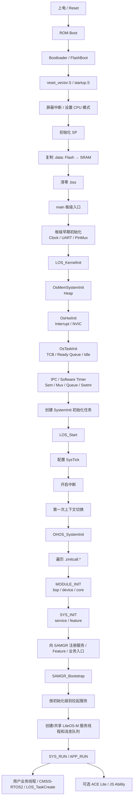
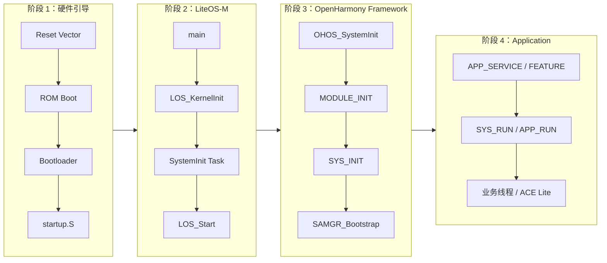
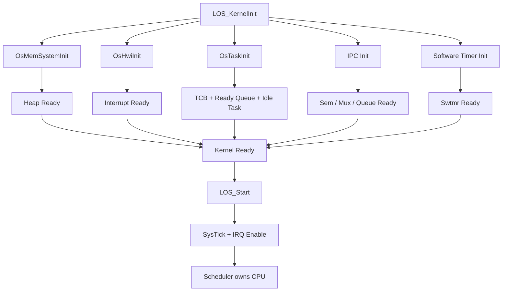
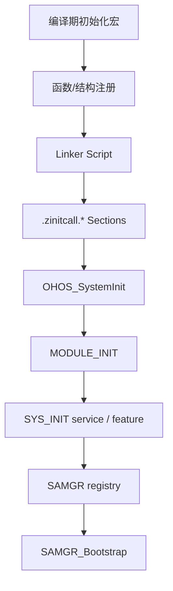
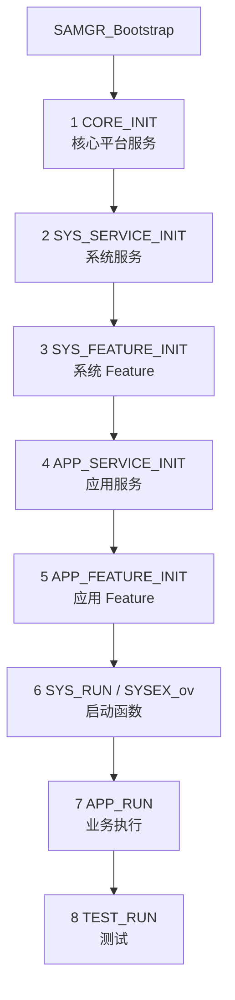
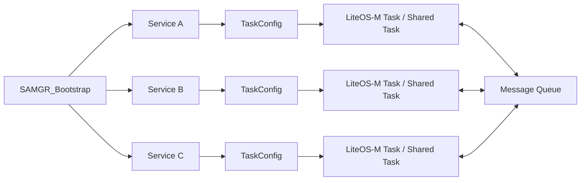

# OpenHarmony Mini System 启动流程

> 从 MCU 上电到 LiteOS-M 调度、`OHOS_SystemInit()`、SAMGR 服务启动以及业务线程运行的完整路径。

OpenHarmony Mini（L0）面向 MCU 类处理器。与小型/标准系统不同，Mini 采用单进程多线程模型，内核、系统服务和应用通常静态链接到同一镜像中。启动过程可以理解为四层接力：**硬件引导 → RTOS 内核 → OpenHarmony 框架 → 应用业务**。

## 1. 全景启动流程



## 2. 四层职责图



## 3. LiteOS-M 内核初始化

`LOS_KernelInit()` 建立调度器运行所需的核心数据结构，但真正开始执行任务是在 `LOS_Start()` 之后。



关键边界：`LOS_KernelInit()` 是**初始化内核对象**；`LOS_Start()` 是**把 CPU 控制权交给调度器**。此后 `main()` 不再作为普通顺序程序继续承担系统控制职责。

## 4. OHOS_SystemInit 与链接段机制

Mini 没有依赖动态加载器去发现服务，而是在编译/链接阶段把初始化入口组织进 `.zinitcall.*` 等链接段。启动时 `OHOS_SystemInit()` 按既定阶段遍历这些函数指针。



这是一种很值得 C/C++ 工程学习的模式：**宏 + section attribute + linker script + function pointer table**，把“模块发现”从运行期动态加载转化为链接期静态注册。

## 5. SAMGR 启动优先级



| Level | 初始化入口 | 主要职责 |
|---|---|---|
| 1 | `CORE_INIT` | 底层核心基础设施 |
| 2 | `SYS_SERVICE_INIT` | 核心系统服务 |
| 3 | `SYS_FEATURE_INIT` | 系统服务下的 Feature |
| 4 | `APP_SERVICE_INIT` | 外围/用户服务 |
| 5 | `APP_FEATURE_INIT` | 应用 Feature |
| 6 | `SYS_RUN()` | 常见 C 原生业务入口 |
| 7 | `APP_RUN` | 高层业务执行 |
| 8 | `TEST_RUN` | 测试套件 |

## 6. Service 的线程与消息模型

SAMGR 不只是按顺序调用初始化函数。Service 可以依据 `TaskConfig` 获得独立 LiteOS-M 线程，或共享线程资源，并通过消息队列进行异步通信。



## 7. 从启动流程理解嵌入式 C/C++

这条启动链可以映射到几个重要工程知识点：

- `startup.S → main()`：理解 ABI、栈、`.data/.bss` 与 C/C++ runtime 前置条件。
- `LOS_KernelInit → LOS_Start`：区分“构造调度器状态”和“真正进入并发执行”。
- `.zinitcall.*`：理解链接脚本、ELF section、静态注册和函数指针表。
- `SAMGR_Bootstrap`：理解 Service/Feature 生命周期和依赖顺序。
- `TaskConfig + Queue`：理解线程所有权、异步消息、共享线程和资源约束。
- `SYS_RUN → osThreadNew / LOS_TaskCreate`：理解框架入口与业务线程之间的边界。

## 8. 一句话记忆

```text
Reset
  → ROM/Bootloader
  → startup.S 建立 C 运行环境
  → main
  → LOS_KernelInit 建立 RTOS 内核
  → LOS_Start 开始调度
  → OHOS_SystemInit 扫描静态初始化表
  → SAMGR_Bootstrap 拉起 Service/Feature
  → SYS_RUN / APP_RUN
  → 用户业务线程持续运行
```

> 学习重点不是只记函数名，而是抓住控制权转移：**硬件 → C runtime → RTOS scheduler → OpenHarmony framework → application tasks**。
