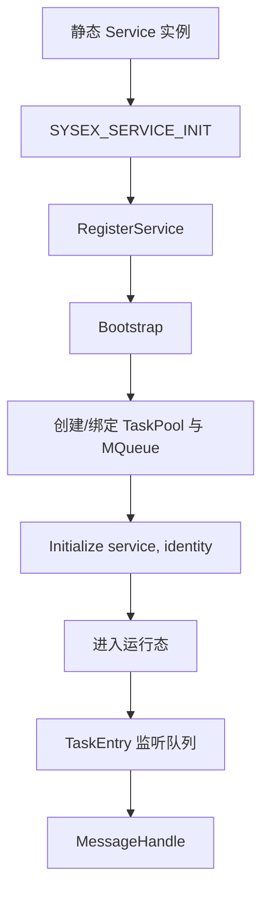
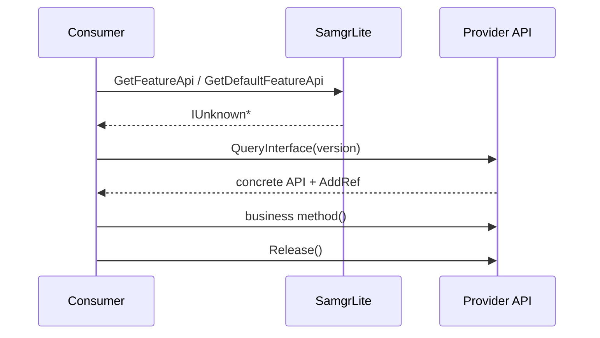
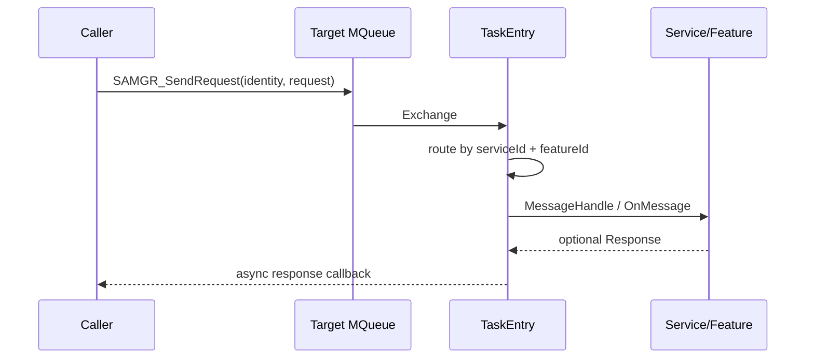
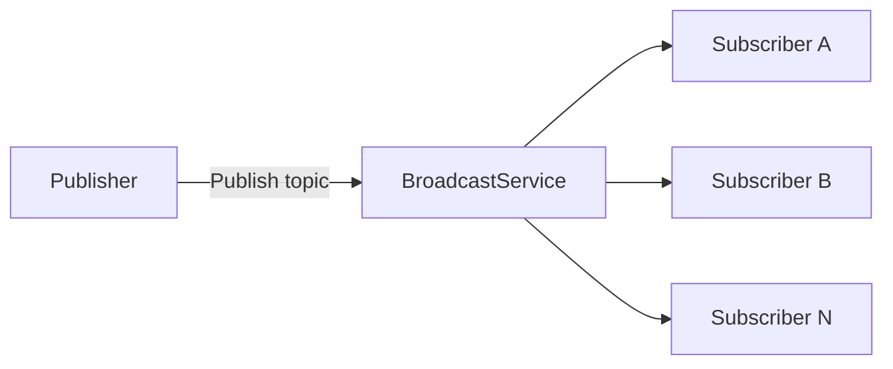
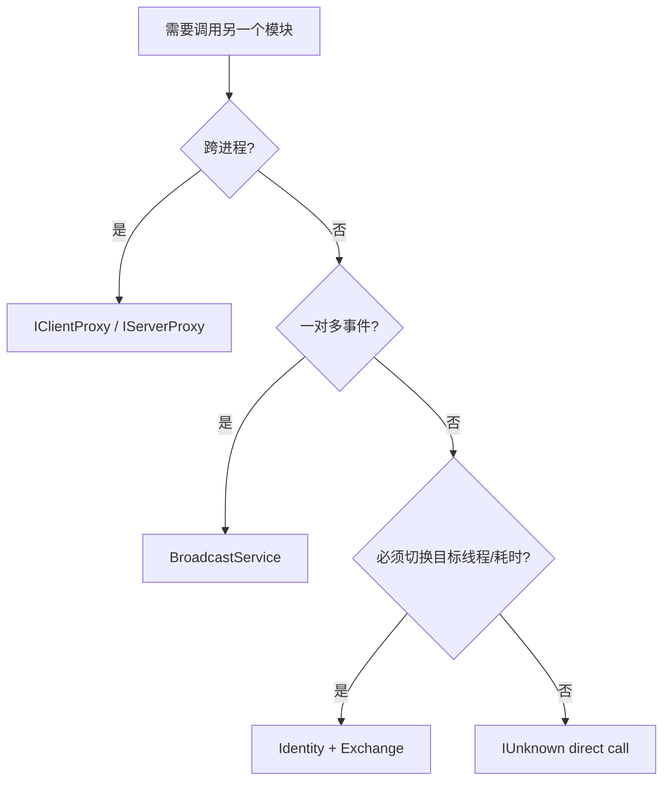
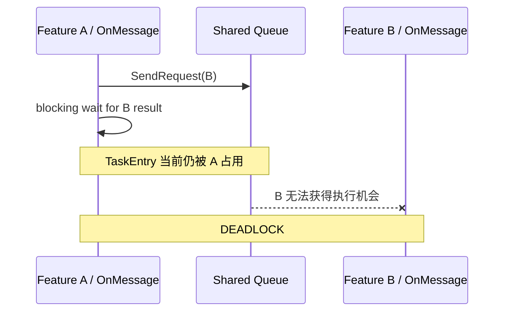

# 06 · samgr_lite：Mini 系统服务、通信与 Feature 协同

> 来源整理：用户提供的《鸿蒙 Mini 服务与通信机制》PDF。本文作为 Embedded / Systems Engineering 扩展专题，不占用 Daily Day 编号。
>
> 注意：本文保留源材料的术语与架构表述。仓库当前 OpenHarmony 研究基线为 `OpenHarmony-v5.0.0-Release`；涉及具体符号、目录和行为时，后续仍应结合该固定版本源码再次核对。

## 1. 为什么 Mini 系统需要 samgr_lite

在面向 MCU、资源受限 IoT 设备的 Mini / Lightweight System 中，RAM/ROM、线程栈、上下文切换和动态运行时成本都必须严格控制。`samgr_lite` 使用 C 语言构建轻量系统服务管理框架，把以下三个维度解耦：

- **并发调度单元**：Service / TaskPool / MQueue
- **业务功能模块**：Feature
- **对外调用契约**：IUnknown

核心抽象为：

| 抽象 | 运行时包装 | 主要职责 |
| --- | --- | --- |
| `SamgrLite` | `SamgrLiteImpl` | 全局服务中介、注册、发现、生命周期引导、共享任务池管理 |
| `Service` | `ServiceImpl` | 调度和资源宿主，定义任务、栈、队列，并处理服务本体异步消息 |
| `Feature` | `FeatureImpl` | Service 内业务子模块，复用宿主线程和队列 |
| `IUnknown` | `IUnknownEntry` | 标准化接口契约、版本查询和引用计数 |
| `IServerProxy/IClientProxy` | IPC proxy | LiteOS-A 跨进程代理扩展 |

关键设计思想不是“每个模块一个线程”，而是：**以线程/调度边界划分 Service，以业务内聚划分 Feature，以 IUnknown 定义稳定调用契约。**

## 2. C 语言中的接口与“继承”

samgr_lite 使用结构体首部宏展开模拟接口继承：

```c
INHERIT_SERVICE
INHERIT_FEATURE
INHERIT_IUNKNOWN
```

派生结构体把基类函数指针布局放在结构体起始位置，使派生结构体和基接口首地址对齐，从而允许在 C 中进行类似面向对象的接口复用和多态调用。

这和 Modern C++ 的一个重要对照是：

- C/samgr_lite：结构体布局 + 函数指针 + 宏约定；
- C++：抽象基类、virtual interface、RAII、显式 ownership；
- 两者共同目标：**稳定接口与实现细节解耦**。

## 3. Service 生命周期

自定义 Service 通过 `INHERIT_SERVICE` 提供四个核心入口：

```text
GetName
Initialize
MessageHandle
GetTaskConfig
```

典型初始化流程：



`Identity` 用来保存消息寻址信息，核心由 `serviceId`、`featureId` 和 `queueId` 组成。Service 本体的 `featureId` 为 `-1`。

源材料特别强调服务名和 Feature 名使用常量字符串，并受轻量实现中的长度约束；实际工程应以锁定版本头文件/实现为准。

## 4. TaskPool：线程资源是架构决策

`GetTaskConfig()` 决定服务的实时性和内存成本。源材料归纳四种 TaskType：

| TaskType | 调度语义 | 适用场景 |
| --- | --- | --- |
| `SHARED_TASK` | 多服务共享任务池/队列 | 低频、非阻塞服务，节省线程栈 |
| `SINGLE_TASK` | 服务独占线程与队列 | 高频、强实时、阻塞 I/O、耗时操作 |
| `SPECIFIED_TASK` | 指定一组服务共享任务池 | 强协同服务集群，减少线程/锁切换 |
| `NO_TASK` | 不创建任务和消息队列 | 纯同步工具/配置组件 |

### 4.1 SHARED_TASK 的关键风险

共享任务池意味着消息处理串行。如果其中一个 Service 的 `MessageHandle` / Feature `OnMessage` 阻塞，可能造成同池其他服务发生 queue starvation。

因此可以形成一个非常实用的设计规则：

```text
短小 + 非阻塞 + 可串行
        ↓
    SHARED_TASK

阻塞 I/O / 长耗时 / 强实时
        ↓
    SINGLE_TASK
```

## 5. Bootstrap

源材料区分两类引导方式：

- LiteOS-M：`SYSEX_SERVICE_INIT()` 将初始化函数注入初始化段，启动时由系统 Bootstrap 流程统一完成注册、任务池创建、线程启动和 `Initialize` 回调；
- LiteOS-A 独立进程：通过显式 bootstrap 流程完成服务引导。

架构上可把它理解为 **静态注册 + 启动阶段依赖注入**。

## 6. 三类核心通信路径 + IPC 扩展

### 6.1 IUnknown：同地址空间直接调用



特点：

- 1:1；
- 直接函数指针调用；
- 默认运行在 **调用者线程上下文**；
- 没有消息队列切换；
- 适合轻量查询、非阻塞控制和高频短调用。

如果接口表面上是同步 API，但内部工作耗时，可在 API 实现中封装 `SAMGR_SendRequest`，把真正执行卸载到 Provider 的 TaskPool。

### 6.2 Identity + Exchange：异步消息队列



核心路径：

```text
Request
  ↓
SAMGR_SendRequest
  ↓
Exchange { Identity, Request, Response, callback }
  ↓
Identity.queueId
  ↓
TaskEntry
  ↓
serviceId + featureId 路由
  ├─ featureId == -1 → Service::MessageHandle
  └─ featureId >= 0  → Feature::OnMessage
```

适合耗时硬件操作、状态机事件、线程上下文切换和异步响应。

### 6.3 BroadcastService：发布/订阅

当调用者不应知道具体 Provider 时，使用 Topic 进行一对多事件分发：



适合系统状态变化、传感器事件、多模块联动等场景。

### 6.4 LiteOS-A IPC Proxy

跨进程时，本地 `IUnknown` 函数指针模型扩展为 `IClientProxy / IServerProxy`，通过 `IpcIo` 序列化参数并由服务端 `Invoke()` 分发。

## 7. 通信机制选型

| 需求 | 首选 |
| --- | --- |
| 高频、短小、同步查询 | `IUnknown` |
| 需要切换到 Provider 线程 | `Identity + Exchange` |
| 耗时硬件操作 | `SAMGR_SendRequest` |
| 一对多状态通知 | `BroadcastService` |
| LiteOS-A 跨进程 | `IClientProxy / IServerProxy` |

一个简单判断流程：



## 8. Feature：模块化，但不额外付线程成本

Feature 挂载在 Service 下，典型生命周期为：

```text
GetName
OnInitialize(feature, parent, identity)
OnStop
OnMessage
```

与 Service 最大区别是：**Feature 没有 `GetTaskConfig`，因此没有独立 TaskPool。**

同一个 Service 下的 Feature：

- `serviceId` 相同；
- `queueId` 相同；
- `featureId` 不同；
- 共用同一个 TaskEntry；
- 通过 `featureId` 完成消息多路复用。

## 9. Service 内部协同的三条路径

### 9.1 parent 指针共享上下文

`OnInitialize` 获得 `Service *parent`。Feature 可以保存 parent，在同一业务域内访问宿主维护的配置、硬件句柄或状态机。

### 9.2 同队列异步路由

Feature A 可使用 Feature B 的 `Identity` 调用 `SAMGR_SendRequest`。消息仍进入同一个 Service 的 queue，最终由 `featureId` 路由到目标 Feature。

### 9.3 GetFeatureApi 同步调用

需要立即结果时，可通过 `GetFeatureApi()` + `QueryInterface()` 获得兄弟 Feature API 并同步直调。

## 10. 最重要的并发性质：天然串行 + 自死锁风险

同 Service 的 `MessageHandle` 和所有 Feature `OnMessage` 由同一个 TaskEntry 从同一队列顺序执行，因此共享状态常可避免额外 mutex。

但这同时产生最危险的陷阱：



### 强制规则

**同一个 Service / 同一 TaskEntry 内：**

- 立即需要结果 → 使用 IUnknown 同步直调；
- 队列消息 → 使用纯异步状态机或异步 response callback；
- 禁止在 `MessageHandle` / `OnMessage` 中发送同队列消息后同步阻塞等待。

## 11. 与 Professional C++ 的映射

这套 C 框架非常适合用来理解 C++ 架构概念背后的真实成本：

| samgr_lite | Modern C++ / System Design 对照 |
| --- | --- |
| `IUnknown` | abstract interface / type-erased contract |
| `AddRef/Release` | intrusive reference counting / lifetime contract |
| `Service` | execution context / active object boundary |
| `Feature` | composition / cohesive component |
| `Identity` | logical address / handle |
| `Exchange` | message envelope |
| `TaskEntry` | event loop / executor |
| `SHARED_TASK` | shared executor |
| `SINGLE_TASK` | dedicated executor/thread |
| Broadcast | event bus / pub-sub |

特别值得记住的是：**ownership、execution context、communication topology 是三个不同的问题。** 智能指针只能解决 lifetime/ownership，不能自动解决线程归属、阻塞、队列饥饿或死锁。

## 12. 工程设计检查清单

1. 先按线程/阻塞/实时性边界决定 Service，而不是按文件或功能数量决定。
2. 同业务域的细粒度能力优先拆为 Feature。
3. 阻塞 I/O 不进入共享 TaskPool。
4. 高频短调用优先 IUnknown。
5. 耗时工作通过消息投递切换执行上下文。
6. 一对多通知使用 Pub/Sub，避免发布者依赖消费者名字。
7. 同 TaskEntry 内禁止“发消息 + 同步等待”。
8. 共享状态只有在确认执行上下文串行时才能省略锁。
9. API 必须明确：同步还是异步、在哪个线程执行、谁拥有参数/响应生命周期。
10. 版本、板卡、内核、头文件和实现必须固定后再做最终工程结论。

## 13. 推荐源码阅读顺序

```text
service.h / feature.h / iunknown.h
            ↓
samgr_lite.h
            ↓
ServiceImpl / FeatureImpl / SamgrLiteImpl
            ↓
message.h / message_inner.h
            ↓
TaskPool / TaskEntry / MQueue
            ↓
BroadcastService / PubSubInterface
            ↓
LiteOS-A IClientProxy / IServerProxy
```

阅读时持续回答四个问题：

> 谁拥有对象？谁拥有线程？消息进入哪个队列？回调最终在哪个上下文执行？

这四个问题也是从 C 系统框架迁移到 Modern C++ 异步架构时最值得保留的分析方法。
