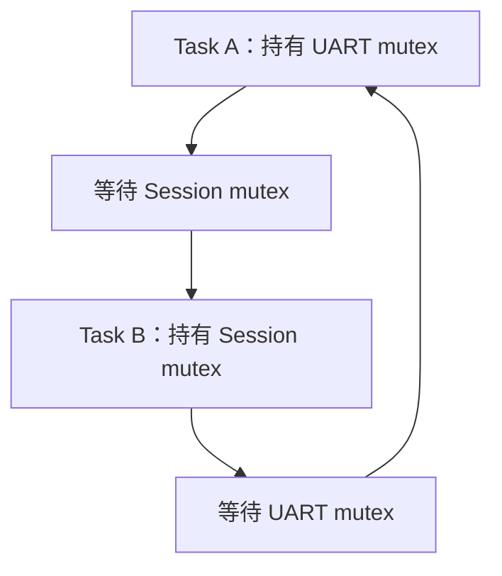

# 02 · HardFault 与软死机定位

[上一单元](01-setup-and-coredump.md) · [专题首页](README.md) · [下一单元：内存与 Trace](03-memory-and-trace.md)

## 1. 先分清三个 PC

| 地址 | 含义 | 可以回答 |
|---|---|---|
| 当前 PC | 调试器停机处，可能在 handler / 日志函数 | 现在执行到了哪里？ |
| stacked PC | 异常入栈保存的返回位置 | 异常打断了哪里？ |
| 首次破坏内存的 PC | 真正错误写入发生处 | 谁最先破坏了状态？ |

精确故障中 stacked PC 往往直接有用；非精确故障、栈损坏、延迟使用悬空指针时，它只是调查起点。不得看到 `malloc` / `free` / `memcpy` 就直接认定库有问题。

## 2. Cortex-M3/M4：保全异常入口信息

前置条件：异常发生后没有复位；知道具体核心与 FPU 配置；已保存上一单元的现场。

1. 保存故障 handler 入口的 **LR / EXC_RETURN**、MSP、PSP、xPSR、CONTROL 与故障状态。
2. 若已经执行了 C handler 的 prologue 或嵌套调用，当前 LR 可能已成为普通返回地址，MSP 也可能移动。必须找入口保存值或结合反汇编恢复，不能直接按当前 LR 解释 EXC_RETURN。
3. 检查 CFSR 中 stacking / unstacking / lazy FP preservation 错误位；有错误时先标记栈帧可疑，再做人工验证。
4. 根据入口 EXC_RETURN 判定使用 MSP 还是 PSP、基本帧还是浮点扩展帧。

以下规则针对 Armv7-M；Armv8-M 安全域与扩展上下文另查核心手册：

| EXC_RETURN 条件 | 含义 | 检查 |
|---|---|---|
| bit 2 = 0 | 异常前上下文使用 MSP | 使用入口 MSP，不是已移动的当前 SP |
| bit 2 = 1 | 异常前上下文使用 PSP | 使用入口 PSP |
| bit 4 = 1 | 基本帧 | 核心寄存器帧基址等于入栈后 SP |
| bit 4 = 0 | 扩展 FP 帧 | 常见 Armv7-M FP 布局核心帧位于 SP + `0x48`；核对 lazy stacking 状态 |

常见 `0xFFFFFFFD` 表示返回 Thread / PSP / 基本帧。不能把这个单一值作为所有合法 EXC_RETURN 的判断。

### 2.1 基本帧读取

设 `frame_base` 为**硬件核心寄存器帧**起点：

| 字节偏移 | 内容 |
|---|---|
| `+0x00` / `+0x04` / `+0x08` / `+0x0C` | R0 / R1 / R2 / R3 |
| `+0x10` / `+0x14` | R12 / stacked LR |
| `+0x18` / `+0x1C` | stacked PC / stacked xPSR |

```text
; 假设已核实 frame_base = 0x20001000
Data.dump D:0x20001000--0x2000101F
PRINT Data.Long(D:0x20001018)
PRINT Data.Long(D:0x2000101C)
; 替换为上一步读到的真实 stacked PC
Data.List 0x08001234
```

验证顺序：帧全部落在已采集栈区间 → xPSR Thumb 位合理 → stacked PC 落在实际可执行区 → 附近反汇编与函数调用吻合。stacked PC 的最低位不要求为 1，不能照搬函数指针的 Thumb 位检查。

基本帧的故障前 SP 通常为 `frame_base + 0x20`；stacked xPSR bit 9 表明额外对齐字时再加 4。扩展帧还要计入 FP 区；嵌套异常或 RTOS 软件保存区必须另外识别。只有硬件帧不能恢复 R4-R11，这些需从入口采集或 RTOS 上下文取得。

## 3. 故障状态寄存器解码

Armv7-M 常用地址：

| 寄存器 | 地址 | 使用方式 |
|---|---|---|
| CFSR | `0xE000ED28` | 合并 MMFSR / BFSR / UFSR |
| HFSR | `0xE000ED2C` | `FORCED` 表示可配置故障升级 |
| MMFAR | `0xE000ED34` | 仅 MMARVALID 有效时解释 |
| BFAR | `0xE000ED38` | 仅 BFARVALID 有效时解释 |

| CFSR 掩码 | 含义 | 下一步 |
|---|---|---|
| `0x00000080` | MMARVALID | MMFAR 可作为有效地址证据 |
| `0x00000200` | PRECISERR | 联合 stacked PC 与指令操作数分析 |
| `0x00000400` | IMPRECISERR | 保留历史，不将当前 PC 定为非法写入处 |
| `0x00008000` | BFARVALID | BFAR 可作为有效地址证据 |
| `0x00010000` | UNDEFINSTR | 核对代码镜像、跳转目标与返回地址 |
| `0x00020000` | INVSTATE | 检查 xPSR / Thumb 状态、间接跳转 |
| `0x00040000` | INVPC | 检查异常返回值与栈帧 |
| `0x01000000` | UNALIGNED | 检查访问宽度、对齐与指令限制 |
| `0x02000000` | DIVBYZERO | 核对 trap 配置与除数来源 |

状态可累积，多个位可以同时置位；故障处理代码可能已修改寄存器。读取后先存档，不先清位。CFSR 为 0 不足以认定“只是看门狗”，还需检查是否读错域、已复位或记录被清除。

### 3.1 手工案例：精确总线错误

输入：`CFSR=0x00008200`、`BFAR=0x60000010`，有效基本帧的 stacked PC 为 `0x08001234`。

1. `0x8200 & 0x200 != 0`：PRECISERR。
2. `0x8200 & 0x8000 != 0`：BFARVALID，故障地址可信。
3. 反汇编若为 `LDR r2,[r0,#0x10]`，核对 stacked R0 是否为 `0x60000000`。
4. 对照内存映射，判断该区域是否存在、已上电、已配置访问权限。
5. 再追踪 r0 来自哪个对象、驱动或生命周期阶段。

**验收：** 有“状态位 → 指令 → 有效地址 → 对象来源”的证据链。只把 BFAR 抄进报告还不算定位根因。

### 3.2 非精确错误

输入：`CFSR=0x400`，无 BFARVALID。不要把 BFAR 的旧值或 stacked PC 附近的第一条 store 当作结论。缩小出错路径，增设受支持的数据观察点或 Trace，再对可疑写入做对照实验。

部分 Cortex-M3/M4 实现支持写缓冲相关控制位，但这不适用于所有 Cortex-M，更不能向 M7 照搬 ACTLR 固定位；关闭缓冲会改变时序，仅可按核心手册作为受控实验。

## 4. 软死机：从任务状态建立等待关系

前置条件：没有足够异常证据；业务停滞或看门狗复位；已在复位前取得现场或目标端保留记录。

### 4.1 三次采样

在实验固件以相同采样间隔观察三次任务表与调用栈，或使用目标端心跳 / 调度 Trace。每次记录任务名、magic、优先级、状态、PC、等待对象、timeout、对象持有者与进度计数。

```text
TASK.TaskList
TASK.Queue
TASK.Semaphore
```

FreeRTOS 队列 / 信号量的无参数枚举依赖 registry；没有登记时按扩展手册传入真实 handle。对象没显示不代表对象不存在。

| 证据 | 假设 | 反证方法 |
|---|---|---|
| 高优先级任务持续 running，进度不变 | busy loop / 饿死 | 查看 PC 分布，增加受控让出或修复循环条件 |
| A 等 B 持有的锁，B 等 A 持有的锁 | 死锁 | 更正锁顺序后相同负载回归 |
| 高优先级等低优先级锁，中优先级占 CPU | 优先级反转 | 核查 mutex 优先级继承与持锁期间行为 |
| 反复在 ISR，任务几乎不切换 | 中断风暴 | 核对 pending / 清除顺序与触发源计数 |
| 所有任务 waiting，外设完成永不发生 | 丢事件 / 驱动失效 | 检查 IRQ、通知目标、timeout 与错误路径 |

### 4.2 死锁示例



CPU 占用高不等于死锁；任务 blocked 也可能只是正常等待。死锁报告必须写清楚每条等待边与当前持有者。仅缩短 timeout 会把永久阻塞变成失败重试，不能消除错误锁顺序。

## 5. 故障采集器的设计边界

异常入口应尽早保存 EXC_RETURN、原始栈指针与必需寄存器，复杂 C++ 代码放在正常上下文处理。异常路径不使用动态分配、iostream、普通互斥锁或可能再次依赖坏栈的复杂日志。

采用预留 RAM 时，启动代码必须保留区域，记录版本、长度、有效标志、校验与写入完成状态；多核各有独立槽。Flash 写入要考虑时延、掉电、重入、擦写限制。看门狗冻结或继续喂狗按产品策略决定，不能把“异常时一律禁用看门狗”当通用规则。

## 6. 检查题

1. 为什么 handler 当前 LR 不一定是 EXC_RETURN？
2. `CFSR=0x400` 时 BFAR 为 `0xDEADBEEF`，能否将它认定为故障地址？
3. A、B 都 blocked，如何补充证据才能判断它们死锁？

参考答案：1. C 函数调用或 prologue 已改变 LR；需入口值。2. 不能，缺少 BFARVALID，且是非精确故障。3. 记录等待对象、对象持有者与无可达超时 / 外部解除路径，再确认等待环。
