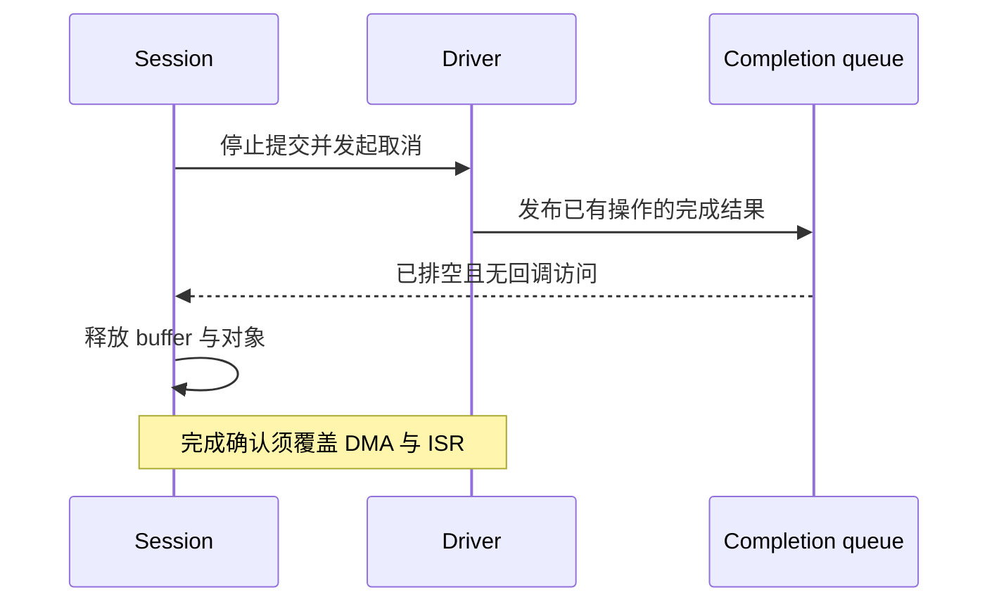

# 04 · 自动采集、C++ 修复与实验

[上一单元](03-memory-and-trace.md) · [专题首页](README.md) · [下一单元：速查与勘误](05-reference-and-corrections.md)

## 1. 自动化之前先手工跑通

目标：当目标停机时自动保存现场，减少漏采与手工操作。**脚本是模板，尚未在真实 TRACE32 与开发板上执行验收。** 主机端 C++ 解码实验与硬件脚本的验证状态分别记录。

随章节提供：

- [capture-stopped.cmm](scripts/capture-stopped.cmm)：只接受已停机目标，保存当前寄存器与单段 SRAM。
- [wait-for-stop.cmm](scripts/wait-for-stop.cmm)：最多观察约一小时，目标停机后调用采集模板。
- [fault-decode.cpp](fault-decode.cpp)：可在普通电脑运行的 CFSR 解码实验。

从 GitHub 克隆仓库后使用这些文件。若从学习控制台下载，先将 `.cmm` 保存到本机，再用 TRACE32 `DO` 执行；不能在浏览器 C++ Lab 中运行 `.cmm`。

### 1.1 参数表

| 参数 | 要求 | 示例 |
|---|---|---|
| capture script | 本机采集脚本绝对路径 | `C:/work/professional-cpp-learning/frameworks/trace32/scripts/capture-stopped.cmm` |
| prefix | 已存在、可写目录下唯一文件前缀 | `C:/cases/run01/fault` |
| start | map 已确认的 SRAM 起始地址 | `0x20000000` |
| end | SRAM 最后一个字节地址，闭区间 | `0x2003FFFF` |

模板不创建目录；相同前缀会覆盖同名文件，必须每次换目录 / 前缀。它不修改断点、不自动启动目标、不自动复位，也不把“停机”自动分类为 HardFault。

### 1.2 最小采集

先选择真实当前核心、退出虚拟任务视图，并在实验板停机：

```text
Frame.TASK
DO "C:/work/professional-cpp-learning/frameworks/trace32/scripts/capture-stopped.cmm" "C:/cases/run01/fault" 0x20000000 0x2003FFFF
```

预期：生成 `fault-registers.txt` 与 `fault-sram.bin`。寄存器文件写的是**当前停机上下文**，没有虚构异常入口 EXC_RETURN，也没有自动解析不可信的异常栈帧。

验证：

```bash
wc -c fault-sram.bin
sha256sum fault-registers.txt fault-sram.bin
```

例中 SRAM 应为 262144 字节。Windows 可用 PowerShell 的 `(Get-Item .\fault-sram.bin).Length` 与 `Get-FileHash`。

若安装版不接受 `Register(MSP)` / `Register(XPSR)` 等名称，从 `Register.view` 与本机 Help 确认后适配；发生脚本错误、磁盘写入失败或 RAM 读取失败时，本次采集记为 **incomplete**，不能把已生成的一半文件当作成功。模板没有全面实现错误恢复和断线重连。

### 1.3 等待异常停机

前置条件：已经在实验板验证 `HardFault_Handler` 为实际 handler 入口，且硬件断点容量足够。复位后故障记录会丢失的平台还需目标端 retention 记录。

```text
; 仅配置已确认的故障入口；不要 Break.RESet 清除团队已有断点
Break.Set HardFault_Handler /Program /Onchip
Break.List
; 由操作者按本次实验方案启动目标后，再开始观察
DO "C:/work/professional-cpp-learning/frameworks/trace32/scripts/wait-for-stop.cmm" "C:/work/professional-cpp-learning/frameworks/trace32/scripts/capture-stopped.cmm" "C:/cases/run02/fault" 0x20000000 0x2003FFFF
```

脚本仅轮询调试器 run state，不会定时停核。目标因其他断点、人工停止或外部条件停住，也会触发采集；检查 PC 与 stop cause 后再分类。观察超时只说明没观察到停机，不能输出“稳定性测试通过”。意外看门狗复位后继续运行可能被漏掉，需额外复位捕获 / retention 与目标端心跳。

### 1.4 真机验收顺序

1. 在测试固件手工停机，执行 capture，核对寄存器与 RAM 大小。
2. 在运行态执行 capture，应拒绝且不改变运行状态。
3. 单独运行 wait，人工停机，确认可采集。
4. 用产品批准的实验故障注入方式进入 handler，确认断点位于入口并保留原始 EXC_RETURN。
5. 模拟错误路径：目录不可写、断连、RAM 空洞；确认这些运行不会被标记为完整证据包。
6. 补入板级看门狗、Trace 停止联动和多核同步策略后，再投入夜间测试。

## 2. Host Lab：类型化故障解码

本实验无硬件依赖，不触碰真实寄存器，也不执行未定义行为。使用值类型快照与 `std::optional` 表达“故障地址未必有效”，避免把无效 BFAR 当成可用地址。

在仓库根目录：

```bash
c++ -std=c++23 -Wall -Wextra -Wconversion -Wpedantic frameworks/trace32/fault-decode.cpp -o /tmp/trace32-fault-decode
/tmp/trace32-fault-decode
```

预期输出：

```text
precise: valid BFAR=0x60000010
imprecise: BFAR unavailable
all decoder checks passed
```

源码包含有效 / 无效 BFAR、MMFAR、状态位并存及 stacking 错误检查；它不解析完整异常帧，不替代芯片架构手册。

### C 写法与 Modern C++ 的映射

| 传统接口 | 风险 | 本实验选择 |
|---|---|---|
| 返回地址，无额外有效状态 | `0` 与无效地址混淆 | `std::optional<std::uint32_t>` |
| 输出参数依赖调用者初始化 | 未赋值字段被继续使用 | 返回完整值对象 |
| 全局读取硬件寄存器 | Host 上难以复现 | 传入 `FaultSnapshot` 快照 |
| magic mask 散落各处 | 位号与移位出错 | 命名 `constexpr` 掩码 |

练习：给 `FaultSummary` 增加 UNALIGNED 与 INVPC 字段，先加入已知输入的期望结果，再修改实现。保持解码与采集分离，板级采集器只负责产生快照。

## 3. 三个板上实验

实验只在实验固件中进行，按 BSP 提供的可控方式注入，不在真实业务设备上随意写非法地址。

| 实验 | 操作 | 预期证据 | 失败时检查 |
|---|---|---|---|
| 精确 Fault | 使用已验证的无效地址访问 / BSP fault trigger | 栈帧 PC、有效位、地址与反汇编吻合 | 地址是否有效、trap / handler 是否启用 |
| 栈预算 | 逐级增加受控调用深度或局部 buffer，设定终止条件 | 水位变化、边界保护或 overflow hook | 优化消除、填充模式、MSP 是否遗漏 |
| 业务泄漏 | 测试分支漏释放一个带 site ID 的块，运行固定轮数 | 每轮未释放量按注入量增长 | 延迟释放、缓存、账本丢失 |

提交实验记录时给出版本、命令、结果、失败现象与下一步，不以截图代替可重现步骤。

## 4. C++ 修复：从证据回到边界

### 4.1 RAII 能保证什么

RAII 保证对象正常销毁时释放其拥有的资源，但不保证越界访问、跨线程借用、异步回调和 DMA 都正确。`unique_ptr` 无法阻止别人持有的悬空 `T*`；`shared_ptr` 不能自动解决数据竞争；`std::span` 表达长度但其下标访问不自动进行所有边界检查。

### 4.2 生命周期时序



外部对象持续引用时，使用明确完成协议、稳定句柄或受约束的所有权；不为消除 crash 盲目把所有裸指针改成 `shared_ptr`。析构函数无法等待的实时上下文，应使用显式 `Stop(timeout)` / 完成状态机，再允许销毁。

## 5. 回归记录模板

以下可直接复制到 issue / PR：

```markdown
### 稳定性问题记录
- 设备 / 核心 / RTOS / 工具版本：
- 故障固件身份与 ELF SHA-256：
- 症状、触发步骤、出现频率：
- 原始证据包与采集时间：
- 完整性：完整 / incomplete；缺失项：
- 当前 PC / stacked PC / 首次错误写入 PC（未知则写未知）：
- 故障地址与有效位：
- 根因假设及其证据：
- 排除的假设与反证实验：
- 代码修复及 ownership / boundary 变化：
- 修复前复现：次数 / 负载 / 时长：
- 修复后回归：相同负载、时长、次数：
- 栈峰值 / 未释放堆 / 最大空闲块 / 日志丢失数：
- 尚未覆盖的硬件与场景：
```

## 6. 完成标准

- [ ] Host 解码实验通过，能够解释无效地址为何用 optional 表达。
- [ ] 真机模板每一步都完成验收，或明确记录尚未验证。
- [ ] 采集不会覆盖上一次输出，失败不会计为通过。
- [ ] 修复前可复现，修复后相同条件下未复现，并写清样本和时间边界。
