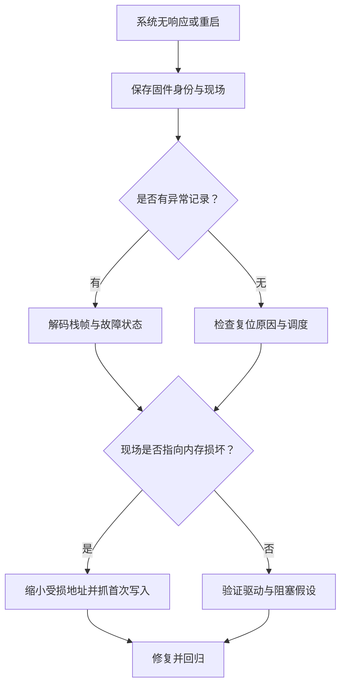

# TRACE32 · RTOS 稳定性分析工程实战

> 面向已有 C / Embedded 基础的 C++ 开发者。
>
> 核心目标：**先保存可信现场，再从故障症状追到首次非法操作，最后通过回归证明修复有效。**

本专题根据附件《Trace32 RTOS稳定性分析手册》（23 页）重新组织并细化，作为 Embedded / Systems Engineering 扩展章节，不占用每日 Day 编号。正文以 **单核 Armv7-M Cortex-M3/M4 + FreeRTOS** 为基础路线；Cortex-M7、NuttX、多核、TrustZone、MMU 和硬件 Trace 单列适用条件。命令以目标机安装版 Help 为最终依据；未经过真实探头与开发板验证的脚本均标为模板。

## 1. 章节与学习路线

| 单元 | 阅读 / 操作时间 | 解决的问题 | 交付证据 |
|---|---|---|---|
| [01 · 接入、现场保全与离线重建](01-setup-and-coredump.md) | 20 / 40 分钟 | 如何连接却不破坏故障现场？ | 固件身份、寄存器、内存与清单 |
| [02 · HardFault 与软死机定位](02-fault-and-scheduler.md) | 25 / 45 分钟 | 如何找到出错指令或阻塞关系？ | 栈帧解释、反汇编或等待环 |
| [03 · 栈、堆、踩内存与硬件追踪](03-memory-and-trace.md) | 30 / 60 分钟 | 谁最先破坏了内存？ | 栈边界、分配账本、首次异常写入 |
| [04 · 自动采集、C++ 修复与实验](04-automation-and-labs.md) | 25 / 60 分钟 | 如何稳定复现并验证修复？ | 自动采集包、实验记录、回归报告 |
| [05 · 命令速查、勘误与参考资料](05-reference-and-corrections.md) | 按需 | 哪些附件结论不能直接照搬？ | 版本与硬件能力核对表 |
| [06 · PowerView 界面操作与常用命令](06-powerview-operations.md) | 15 / 30 分钟 | 窗口怎么打开、字段怎么看？ | 窗口练习与命令记录 |
| [07 · 官方用户手册与离线阅读索引](07-official-manuals.md) | 按需 | 如何查手册与离线阅读？ | 9 份官方 PDF 与来源清单 |

每个单元均按“前置条件 → 操作 → 预期结果 → 失败分支 → 验收”阅读。首次学习先用 06 熟悉界面，再按 01–04 完成操作；故障处理中按下面决策图跳转。

## 2. 故障现场的前 10 分钟

1. 记录现象、触发动作、上电时间、板卡编号、固件 build ID 与复现频率。
2. 已连接时先观察目标状态；未连接时使用板级 **attach / no-reset** 流程。确认连接脚本不含复位、下载、RAM 初始化。
3. 保留当前 PC、LR、MSP、PSP、xPSR、故障寄存器和复位原因；多核逐核记录状态。
4. 保存链接脚本确认的 SRAM 区间，记录不可读区间，不擅自遍历外设地址空间。
5. 用同一构建的 ELF **仅加载符号**；核对代码、栈与链接地址是否一致。
6. 确认是否已进入 Fault handler、普通任务、ISR 或复位入口，再选择下一单元。

**成功标准：** 另一位工程师无需接触故障设备，也能知道“运行了什么版本、采集了什么、缺失了什么”。仅有截图或最后一条串口日志不算完整现场。

## 3. 能力分级：没有 Trace 探头也可以开始

| 层级 | 所需资源 | 可以完成 | 不能据此保证 |
|---|---|---|---|
| A · 离线分析 | 同版本 ELF、Dump、CPU 类型 | 解码有效栈帧、检查内存与任务结构 | 找回未采集寄存器或完整历史 |
| B · 停机调试 | SWD/JTAG 与调试授权 | 异常断点、调用栈、有限写观察点 | 保持运行时序不变 |
| C · 后台访问 | 芯片支持的 DAP 等运行期访问 | 心跳、计数器、低频快照 | Cache 一致、原子多字段快照或零开销 |
| D · 硬件追踪 | 对应 Trace IP、路由、许可与接收端 | 在支持范围内还原指令 / 数据历史 | 任意核 / DMA 的所有写访问均可见 |

## 4. 与 C++ 主线的关系

| 观察到的现象 | 首先验证 | C++ 修复方向 |
|---|---|---|
| 析构后回调仍访问对象 | callback 捕获、取消与排空时序 | 明确 owner、借用、取消协议 |
| `free` 中死机 | 堆元数据是否早已损坏 | 先修越界 / 重复释放，再用 RAII 固化所有权 |
| 栈持续逼近边界 | 大数组、递归、格式化、ISR 嵌套 | 固定容量存储、控制调用深度 |
| 内存缓慢下降 | 同阶段未释放对象是否增长 | 配对释放、约束缓存、处理循环引用 |
| 任务等待无法解除 | 锁顺序、外部调用、完成通知 | RAII 锁、统一顺序、显式 timeout |

配合阅读：[所有权与智能指针](../../patterns/ownership-and-smart-pointers.md)、[Asio 异步生命周期](../asio/README.md)。

## 5. 学习完成检查

- [ ] 能说明为什么在线现场不能直接重新下载 ELF。
- [ ] 能区分当前 handler PC、异常栈帧 PC 与首次破坏内存的 PC。
- [ ] 能判断 BFAR、异常栈帧和栈水位什么时候不可信。
- [ ] 能解释数据观察点没有命中为什么不能排除 DMA。
- [ ] 能为每一条根因结论附上证据与反证实验。

下一步：[01 · 接入与现场保全](01-setup-and-coredump.md)。
