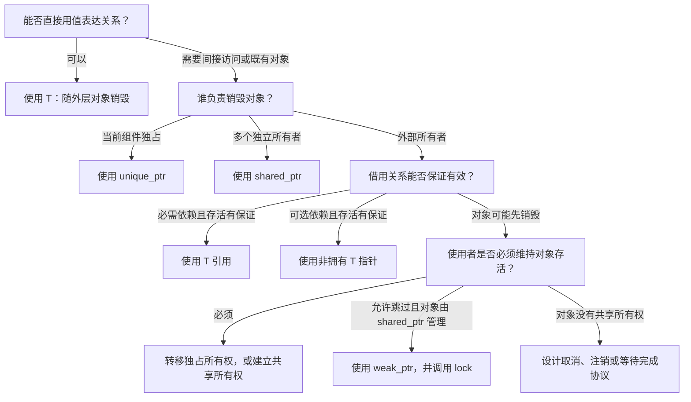
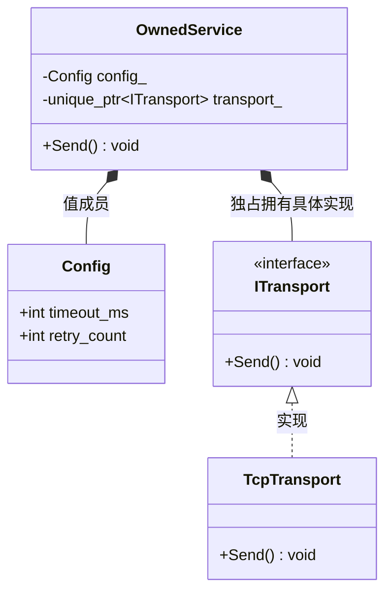
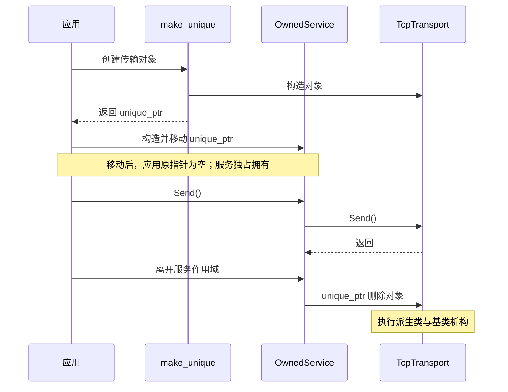
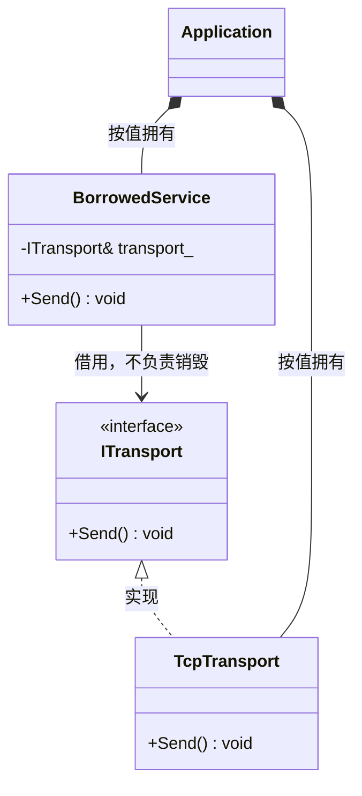
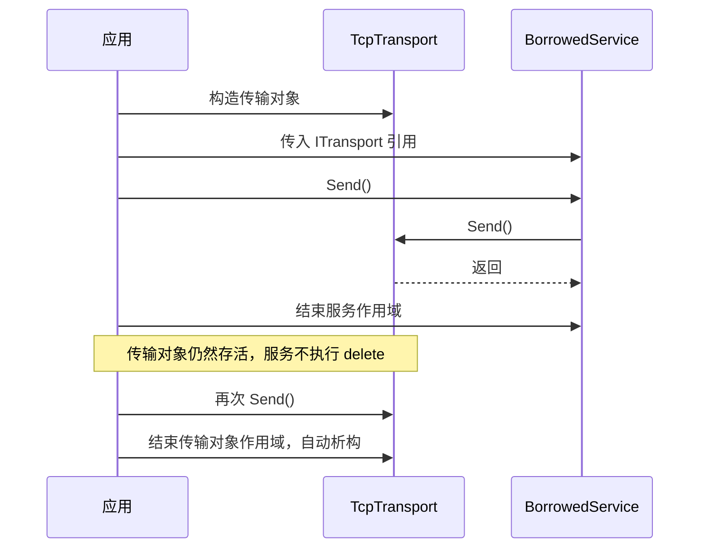
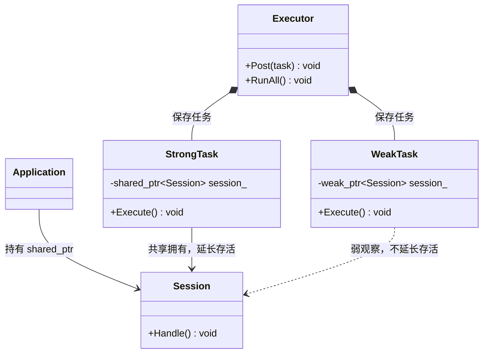
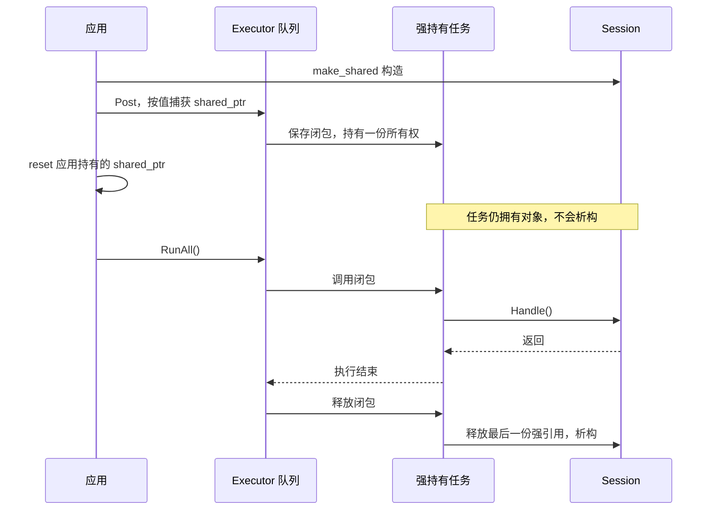
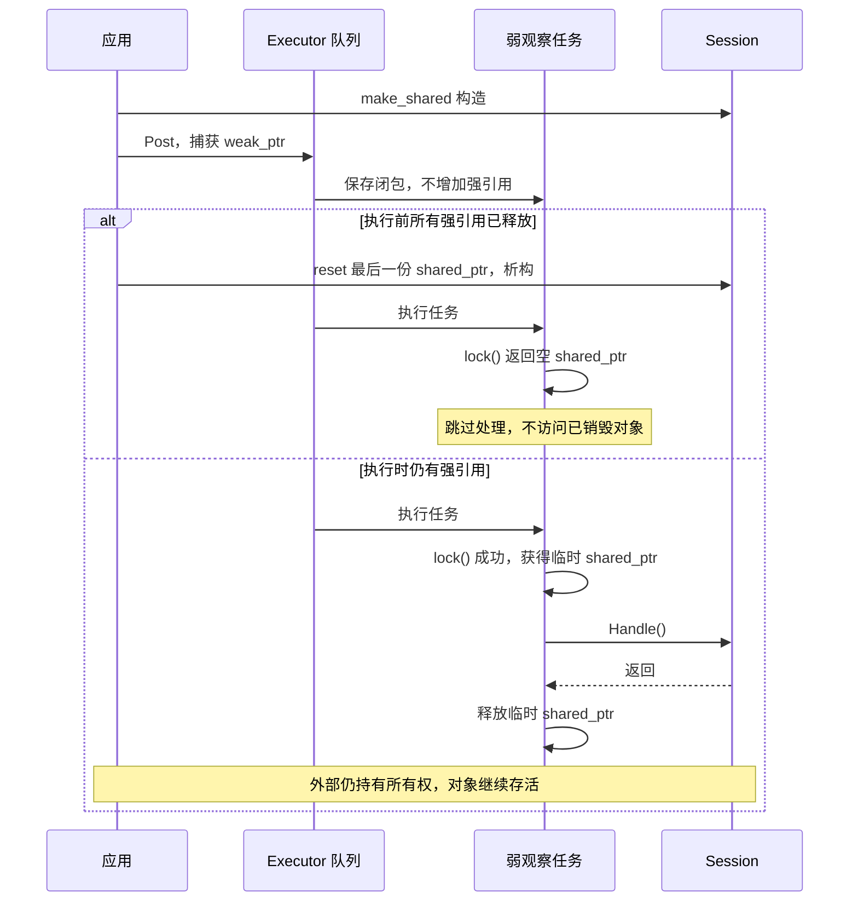

# Design Patterns 下的 Ownership 与 Smart Pointers

> 设计模式解决“对象如何协作”，智能指针解决“对象由谁负责活着”。
>
> 在 C++ 中，这两个问题必须一起设计。

## 本次学习：三个判断问题与 UML

- [三个问题与 Mermaid 决策流程图](#24-三个问题从存放方式到生命周期)
- [独占拥有与借用：类图和时序图](#25-第二问同一个策略接口两种所有权)
- [异步强持有与弱观察：类图和时序图](#26-第三问排队任务需要对象活到什么时候)
- [可编译实验与学习检查](#27-可编译实验与学习检查)

---

# 1. 为什么 C++ 设计模式必须讨论指针

在 Java / C# 的经典模式图中，经常只看到：

```text
A ----> B
```

但在 C++ 中，这条箭头远远不够。

还必须明确：

```text
A owns B ?
A borrows B ?
B can be null ?
B can outlive A ?
A transfers B ?
A shares B ?
```

因此 C++ 中最重要的不是“用哪个智能指针”，而是先回答：

> **对象关系的所有权语义是什么？**

智能指针只是把这个语义写进类型系统。

---

# 2. 四种最常见关系

## 2.1 必需借用（Required Borrow）

调用者必须提供对象，但当前对象不拥有它。

优先：

```cpp
T&
```

例如：

```cpp
class ModemSession {
public:
  explicit ModemSession(ITransport& transport) : transport_(transport) {}

private:
  ITransport& transport_;
};
```

语义：

```text
ModemSession borrows Transport
Transport 必须比 ModemSession 活得更久
```

---

## 2.2 可选借用（Optional Borrow）

依赖可以不存在，但仍不拥有。

常见：

```cpp
T*
```

例如：

```cpp
class Driver {
public:
  explicit Driver(ILogger* logger) : logger_(logger) {}

private:
  ILogger* logger_;  // nullable, non-owning
};
```

必须明确：

```text
nullptr = logging disabled
```

此处的裸指针并不意味着不安全。

当其明确表示非拥有属性的可选引用（non-owning optional reference）时，即为合理用途。

---

## 2.3 独占所有权（Exclusive Ownership）

一个对象独占负责另一个对象生命周期。

使用：

```cpp
std::unique_ptr<T>
```

例如 Factory：

```cpp
std::unique_ptr<ITransport> CreateTransport();
```

语义：

```text
caller becomes owner
```

`unique_ptr` 应该是动态 ownership 的默认选择。

---

## 2.4 共享所有权（Shared Ownership）

多个对象共同决定某个对象何时销毁。

使用：

```cpp
std::shared_ptr<T>
```

这不是：

```text
“我不知道谁拥有，所以大家一起拥有”
```

而应该是：

```text
业务模型本身确实存在多个共同 owner
```

例如：

```text
一个异步 Session
同时被 operation A / B / C 持有
最后一个 operation 完成后 Session 才能销毁
```

这类场景 shared ownership 才有明确意义。

---

# 3. weak_ptr 的真实作用

`weak_ptr` 不拥有对象。

它解决的问题是：

```text
我需要观察一个 shared-owned object
但不应该延长它生命周期
```

例如 Observer：

```cpp
std::vector<std::weak_ptr<IObserver>> observers_;
```

通知：

```cpp
for (auto& weak_observer : observers_) {
  if (auto observer = weak_observer.lock()) {
    observer->OnEvent();
  }
}
```

同时避免：

```text
Publisher → Observer → Publisher
```

形成 `shared_ptr` cycle。

---

# 4. 智能指针不是“更现代的裸指针”

不要机械转换：

```cpp
T*
```

变成：

```cpp
std::shared_ptr<T>
```

这实际上修改了系统的生命周期模型。

正确顺序：

```text
先画 ownership
    ↓
再选择类型
```

常用决策：

| 语义 | C++ 表达 |
|---|---|
| 值 | `T` |
| 必须存在的借用 | `T&` |
| 可空借用 | `T*` |
| 独占 owner | `std::unique_ptr<T>` |
| 共享 owner | `std::shared_ptr<T>` |
| 不延长共享对象生命周期的观察者 | `std::weak_ptr<T>` |

---

# 5. 策略模式（Strategy Pattern）中怎么用指针

## 借用式策略（Borrowed Strategy）

如果策略由外部长期管理：

```cpp
class Sender {
public:
  explicit Sender(IRetryStrategy& strategy) : strategy_(strategy) {}

private:
  IRetryStrategy& strategy_;
};
```

适合：

- static object graph；
- stack/static allocation；
- Embedded firmware；
- strategy 生命周期明确。

## 拥有式策略（Owned Strategy）

如果 Sender 独占策略：

```cpp
class Sender {
public:
  explicit Sender(std::unique_ptr<IRetryStrategy> strategy) : strategy_(std::move(strategy)) {}

private:
  std::unique_ptr<IRetryStrategy> strategy_;
};
```

适合 runtime factory/config creation。

## 不推荐默认 shared_ptr

如果不存在真实 shared ownership：

```cpp
std::shared_ptr<IRetryStrategy>
```

只会增加：

- ref count；
- 生命周期复杂度；
- atomic cost（实现相关）；
- reasoning cost。

---

# 6. 工厂模式（Factory Pattern）中怎么用指针

Factory 是 `unique_ptr` 最经典的使用场景。

```cpp
std::unique_ptr<ITransport> CreateTransport(const TransportConfig& config);
```

它明确表达：

```text
Factory 创建
   ↓
ownership transfer
   ↓
Caller 拥有
```

如果对象不需要动态多态，也可以直接返回值：

```cpp
Transport CreateTransport();
```

优先级通常是：

```text
Value
↓
unique_ptr
↓
shared_ptr（只有真实共享 ownership 才用）
```

---

# 7. 抽象工厂（Abstract Factory）中的所有权（Ownership）

```cpp
class IPlatformFactory {
public:
  virtual ~IPlatformFactory() = default;

  virtual std::unique_ptr<ITransport> CreateTransport() = 0;
  virtual std::unique_ptr<ITimer> CreateTimer() = 0;
};
```

此时 factory 本身通常不保留创建对象的 ownership。

但如果产品对象必须共享某个底层 service：

```text
Transport ─┐
           ├──> EventLoop
Timer ─────┘
```

不要直接得出：

```text
EventLoop 一定 shared_ptr
```

更常见的静态系统可以：

```cpp
EventLoop&
```

由 Application Root 管理所有 lifetime。

---

# 8. 适配器模式（Adapter Pattern）中怎么用指针

Adapter 经常只是 borrow 被适配对象：

```cpp
class VendorUartAdapter final : public ITransport {
public:
  explicit VendorUartAdapter(VendorUart& uart) : uart_(uart) {}

private:
  VendorUart& uart_;
};
```

关系：

```text
Adapter borrows Adaptee
```

如果 Adapter 负责创建和销毁底层对象，则可拥有：

```cpp
std::unique_ptr<VendorUart>
```

不要只因为 Adapter “包了一层”就默认 owns。

---

# 9. 装饰器模式（Decorator Pattern）中怎么用指针

Decorator 有两种典型 ownership 模式。

## 借用式装饰器（Borrowing Decorator）

```cpp
class TracingTransport final : public ITransport {
public:
  explicit TracingTransport(ITransport& inner) : inner_(inner) {}

private:
  ITransport& inner_;
};
```

适合固定 object graph：

```text
main()
 ├── UartTransport
 ├── TracingTransport(uart)
 └── ModemSession(tracing)
```

无 heap，非常适合 Embedded。

## 拥有式装饰器（Owning Decorator）

```cpp
class TracingTransport final : public ITransport {
public:
  explicit TracingTransport(std::unique_ptr<ITransport> inner) : inner_(std::move(inner)) {}

private:
  std::unique_ptr<ITransport> inner_;
};
```

可以动态拼接：

```text
Retry
  owns
Tracing
  owns
UART
```

这是一个明确的 ownership chain。

---

# 10. 代理模式（Proxy Pattern）中怎么用指针

Proxy 不代表固定 ownership。

### 代理借用远程/服务客户端（Proxy borrows remote/service client）

```cpp
class SensorProxy {
public:
  explicit SensorProxy(IRpcClient& client) : client_(client) {}

private:
  IRpcClient& client_;
};
```

### 代理拥有具体实现（Proxy owns implementation）

```cpp
std::unique_ptr<IBackend>
```

### 异步代理（Async Proxy）

如果 operation 必须保证 proxy/session 在 callback 前一直活着，才可能出现：

```cpp
std::shared_ptr<Session>
```

此时 shared ownership 来自**异步生命周期**，不是 Proxy 模式本身。

---

# 11. 观察者模式（Observer Pattern）是生命周期高风险区

Observer 的典型错误：

```cpp
class Publisher {
private:
  std::vector<IObserver*> observers_;
};
```

它不一定错。

但必须保证：

```text
Observer unregister before destruction
```

常用方案有三类。

## 方案 A：严格 borrow + registration token

```text
Publisher 不拥有 Observer
Observer 析构前必须 unsubscribe
```

优点：

- 无 ref count；
- 无 shared ownership；
- deterministic。

适合 Embedded。

## 方案 B：weak_ptr observer

前提：Observer 本来就存在 shared ownership。

```cpp
std::weak_ptr<IObserver>
```

Publisher 不延长其生命周期。

## 方案 C：callback token

注册 lambda：

```cpp
Subscription Subscribe(Callback callback);
```

`Subscription` 使用 RAII，在析构时自动 unregister。

这通常比暴露 Observer 指针更现代。

---

# 12. 职责链模式（Chain of Responsibility）中怎么用指针

动态链：

```cpp
class Handler {
public:
  void SetNext(std::unique_ptr<Handler> next) {
    next_ = std::move(next);
  }

private:
  std::unique_ptr<Handler> next_;
};
```

形成：

```text
A owns B owns C owns D
```

销毁方向天然清晰。

Embedded 更推荐固定拓扑：

```cpp
Handler& next_;
```

或者：

```cpp
std::array<Handler*, N>
```

避免运行时 heap allocation。

---

# 13. 迭代器（Iterator）不应该拥有容器（Container）

通常：

```text
Container owns data
Iterator borrows container/data
```

因此 iterator 内部常见的是：

```cpp
T*
```

而不是：

```cpp
std::shared_ptr<Container>
```

Iterator 的生命周期契约通常是：

> container / underlying storage 必须仍然有效。

这也是 iterator invalidation 的本质。

---

# 14. 单例（Singleton）与智能指针

Singleton 通常根本不需要智能指针。

推荐形式：

```cpp
Logger& Logger::Instance() {
  static Logger logger;
  return logger;
}
```

不要为了 Singleton 写：

```cpp
static std::shared_ptr<Logger> instance;
```

除非生命周期模型真的需要它。

Singleton 已经隐含：

```text
process lifetime
```

再加入 shared ownership 通常只会增加复杂度。

---

# 15. PImpl：unique_ptr 的另一个经典场景

PImpl 严格说不属于 Chapter 33 的模式清单，但在 C++ 稳定接口设计中非常重要。

```cpp
class Modem {
public:
  Modem();
  ~Modem();

private:
  class Impl;
  std::unique_ptr<Impl> impl_;
};
```

语义非常自然：

```text
Modem exclusively owns Impl
```

同时：

- public header 不暴露实现；
- 降低编译依赖；
- ABI 边界更稳定。

---

# 16. RAII：所有模式的生命周期底座

设计模式经常描述：

```text
register
lock
open
subscribe
start
```

真正专业的 C++ 还必须回答：

```text
什么时候 unregister？
什么时候 unlock？
什么时候 close？
什么时候 unsubscribe？
什么时候 stop？
```

优先让对象析构承担 cleanup：

```text
Constructor / Acquire
        ↓
Object Lifetime
        ↓
Destructor / Release
```

这就是 RAII。

典型：

```cpp
std::unique_ptr std::lock_guard std::jthread fstream SubscriptionToken SessionGuard
```

因此：

> **设计模式决定对象协作结构，RAII 决定这些结构是否有可靠生命周期。**

---

# 17. shared_ptr 常见误区

## 误区 1：多态必须 shared_ptr

错误。

```cpp
ITransport&
```

同样支持 virtual dispatch。

## 误区 2：异步必须 shared_ptr

错误。

只有当 operation 确实需要延长 object lifetime 时才需要 shared ownership。

也可以使用：

- owner task；
- static lifetime；
- cancellation + join；
- externally guaranteed lifetime。

## 误区 3：shared_ptr 自动线程安全

`shared_ptr` 的引用计数管理具有相应线程安全保证，但：

```text
它不会自动保护 T 的内部 mutable state
```

## 误区 4：shared_ptr 可以解决 ownership 不清晰

恰恰相反。

如果不知道谁应该 owner，先修复设计，不要用 shared ownership 掩盖问题。

---

# 18. cyclic ownership

危险：

```text
A shared_ptr → B
B shared_ptr → A
```

reference count 永远不归零。

解决：

```text
一个方向 owner
另一个方向 observer
```

例如：

```text
Parent shared_ptr → Child
Child weak_ptr   → Parent
```

但再次强调：

> 如果系统并不需要 shared ownership，最好的解决方案可能是根本不用 shared_ptr。

---

# 19. 嵌入式 C++（Embedded C++）推荐所有权（Ownership）顺序

在 MCU / RTOS / Driver 代码里，推荐优先级通常是：

```text
Value / static object
        ↓
Reference borrow
        ↓
Raw pointer optional borrow
        ↓
unique_ptr（需要动态 ownership 时）
        ↓
shared_ptr（真实共享生命周期时）
```

原因：

- 生命周期更确定；
- RAM/heap 更可控；
- 实时行为更可预测；
- 调试更简单；
- failure mode 更少。

---

# 20. 应用根节点（Application Root）：最值得掌握的所有权（Ownership）技巧

很多系统根本不需要复杂智能指针。

可以在 Application Root 一次性构建对象图：

```cpp
int main() {
  UartTransport uart{115200U};
  TracingTransport traced{uart};
  RetryPolicy retry;
  ModemSession modem{traced, retry};

  Run(modem);
}
```

这里 ownership 非常简单：

```text
main owns everything by value
components borrow dependencies by reference
```

这是 Embedded C++ 最值得优先采用的方式之一。

---

# 21. 模式与所有权（Pattern × Ownership）快速表

| Pattern | 常见 ownership |
|---|---|
| Strategy | `T&` / value / `unique_ptr<T>` |
| Factory Method | return value / `unique_ptr<T>` |
| Abstract Factory | `unique_ptr<T>` 最常见 |
| Adapter | borrow `T&` 或 own `unique_ptr<T>` |
| Proxy | 取决于 backend 生命周期 |
| Iterator | non-owning pointer/reference |
| Observer | non-owning + unsubscribe；必要时 `weak_ptr` |
| Decorator | borrow `T&` 或 own `unique_ptr<T>` |
| Chain | fixed borrow chain / `unique_ptr` ownership chain |
| Singleton | function-local static，通常不用智能指针 |

---

# 22. 代码评审检查清单（Code Review Checklist）

看到智能指针时，不要只问“会不会内存泄漏”。

应该问：

## 所有权（Ownership）

- [ ] 为什么这里需要动态 ownership？
- [ ] 为什么不是 value？
- [ ] 为什么不是 reference borrow？
- [ ] `shared_ptr` 的 shared owners 是谁？
- [ ] ownership transfer 是否明确？

## 生命周期（Lifetime）

- [ ] callback 执行时对象是否还活着？
- [ ] Observer 是否可能 dangling？
- [ ] 是否存在 cycle？
- [ ] destructor 是否执行必要 cleanup？

## 实时性（Realtime）

- [ ] 是否在实时路径 `make_shared/make_unique`？
- [ ] 是否存在不可控 heap fragmentation？
- [ ] shared ref-count 操作是否位于热点路径？

## 接口设计（API）

- [ ] API 参数用智能指针是否真的表示 ownership transfer？
- [ ] 如果只是 borrow，为什么不用 `T&` / `T*`？
- [ ] 返回 `shared_ptr` 是否把生命周期决策强加给调用者？

---

# 23. 一句话原则

```text
T              = 我就是这个对象
T&             = 我借用，而且必须存在
T*             = 我借用，而且可以不存在
unique_ptr<T>  = 我拥有它
shared_ptr<T>  = 我们共同拥有它
weak_ptr<T>    = 我观察共享对象，但不让它多活
```

最重要的一句：

> **先设计 lifetime，再选择 pointer；不要先选 smart pointer，再让生命周期去适配它。**

---

# 24. 三个问题：从存放方式到生命周期

> 接口规定“可以做什么”；所有权类型规定“谁负责对象、对象需要活多久”。
>
> 不要从模式名字推导指针类型。Strategy、Adapter、Decorator 都可能拥有对象，也可能只借用对象。

按顺序问：

1. **能否直接用值？** 类型和存放方式是否合适，是否需要使用同一个既有对象？
2. **谁负责销毁对象？** 当前组件独占拥有、多个参与者共享拥有，还是外部拥有而当前组件借用？
3. **使用者是否需要延长对象的生命周期？** 尤其要检查排队任务、回调、订阅是否可能晚于调用方销毁时执行。

这三个问题是思考顺序，不是“每问一次只能走一条分支”的机械算法。第三问可能促使你重新设计第二问的所有权关系。

## 24.1 Mermaid 决策流程图



说明：

- 运行时多态不必然要求堆分配：引用同样支持虚函数调用；有限类型集合也可以考虑 `std::variant`。
- `weak_ptr` 只能观察共享所有权体系中的对象，不能观察任意栈对象或 `unique_ptr`。
- 延长生命周期可以通过转移 `unique_ptr` 实现；并非所有异步任务都需要 `shared_ptr`。
- `T&` 不可为空的约定不等于生命周期自动安全。对象销毁后，引用同样悬空。
- 裸指针在此文中约定为非拥有；C++ 语言本身不强制这一约定。

## 24.2 第一问：配置直接用值

```cpp
struct Config {
  int timeout_ms = 1000;
  int retry_count = 3;
};

class Service {
private:
  Config config_;
};
```

配置类型固定、可以作为成员存放、生命周期随服务结束。这里使用值不需要额外分配，也不会引入空指针状态。

如果只是因为“类成员习惯用指针”而改成 `unique_ptr<Config>`，就增加了复杂度。只有隐藏实现、地址稳定性等具体需求成立时，才进一步考虑间接存放。

# 25. 第二问：同一个策略接口，两种所有权

统一使用 `ITransport` 表达发送能力；`TcpTransport` 是具体实现。下面三张图描述独占拥有与借用之间的差异。

## 25.1 UML 类图：独占拥有的策略



组合关系 `*--` 表示这里的生命周期由服务管理。图中的接口端代表实际派生对象，并非实例化抽象类。

```cpp
class OwnedService {
public:
  [[nodiscard]] static std::optional<OwnedService> Create(std::unique_ptr<ITransport> transport) {
    if (!transport) return std::nullopt;
    return OwnedService(std::move(transport));
  }

  void Send() {
    transport_->Send();
  }

private:
  explicit OwnedService(std::unique_ptr<ITransport> transport) : transport_(std::move(transport)) {}

  Config config_{};
  std::unique_ptr<ITransport> transport_;
};
```

工厂返回 `std::optional<OwnedService>`：传入空指针时返回 `std::nullopt`，调用者检查成功后使用 `service->Send()`。需要包含 `<optional>`、`<memory>` 和 `<utility>`；该写法也适用于禁用异常的浏览器编译环境。

`ITransport` 的定义必须包含虚析构函数：

```cpp
struct ITransport {
  virtual ~ITransport() = default;
  virtual void Send() = 0;
};
```

通过 `unique_ptr<ITransport>` 删除派生对象时，虚析构确保执行正确的派生析构逻辑。

## 25.2 UML 时序图：所有权转移与销毁



`std::move` 本身只是允许移动；真正转移所有权的是 `unique_ptr` 的移动操作。

## 25.3 UML 类图：应用拥有，服务借用



借用使用普通关联 `-->`，不要画成组合关系。

```cpp
class BorrowedService {
public:
  explicit BorrowedService(ITransport& transport) : transport_(transport) {}

  void Send() {
    transport_.Send();
  }

private:
  ITransport& transport_;
};
```

对于应用根对象，成员声明顺序必须体现依赖：

```cpp
class Application {
private:
  TcpTransport transport_;               // 先构造，后销毁
  BorrowedService service_{transport_};  // 后构造，先销毁
};
```

这是结构示意；下方完整实验的 TcpTransport 还接收一个析构计数器。真实成员按照声明顺序构造，按照相反顺序销毁，不能只依赖构造函数初始化列表的书写顺序。

## 25.4 UML 时序图：借用者销毁不会销毁依赖



如果依赖允许不存在，可以改成 `ITransport*`，并定义 `nullptr` 的业务含义；这不会改变“不拥有”的约定。

# 26. 第三问：排队任务需要对象活到什么时候？

本节使用单线程延迟执行队列，刻意把“提交”与“执行”分开，方便观察生命周期。它不是生产线程池。

## 26.1 UML 类图：任务强持有或弱观察



`StrongTask`、`WeakTask` 是两类 lambda 闭包的概念名称，实验代码并未单独定义这两个类。共享拥有用带标签的关联表示，避免误画成独占组合。

## 26.2 强持有：任务释放前对象必须存活

```cpp
auto session = std::make_shared<Session>();

executor.Post([session] { session->Handle(); });

session.reset();
executor.RunAll();
```

上面是概念片段；完整实验中的 Session 还接收处理与析构计数器。



关键细节：**任务执行完不一定立即释放对象；闭包释放时才释放其中的 shared_ptr。** 本实验的 RunAll 在返回前释放执行批次，因此观察到会话随后销毁。如果生产队列保留已执行任务，生命周期会更长。

`shared_ptr` 只保证对象存活，不保证业务状态仍然“打开”，也不保护 Session 内部数据的并发访问。

## 26.3 弱观察：对象已销毁则跳过

```cpp
std::weak_ptr<Session> weak = session;
executor.Post([weak] {
  if (auto alive = weak.lock()) {
    alive->Handle();
  }
});
```



不要先检查 `expired()` 再解引用裸指针，应直接使用 `lock()` 的结果。成功获得的强引用只覆盖本次处理；如果 Handle 又启动新的异步任务，新任务的生命周期必须继续设计。

## 26.4 智能指针不等于关闭协议

“对象尚未析构”和“业务允许继续执行”不同：

- `reset()` 只是释放当前指针的所有权，不等于主动关闭会话。
- 若对象被其他强引用持有，weak_ptr 仍能 lock 成功。
- 业务关闭通常还需要 Close、取消标记、停止接收新任务、等待在途任务等约定。
- `weak_ptr` 解决销毁后的访问问题，不能代替取消与状态同步。

# 27. 可编译实验与学习检查

完整示例：[pointer-choice.cpp](../examples/pointer-choice.cpp)。

在仓库根目录执行：

```bash
g++ -std=c++20 -Wall -Wextra -Wconversion -Wpedantic \
  examples/pointer-choice.cpp -o /tmp/pointer-choice
/tmp/pointer-choice
```

最后一行预期：

```text
All ownership checks passed
```

示例用断言验证五种行为：

| 场景 | 验证结果 |
|---|---|
| 独占传输对象 | 原 unique_ptr 移动后为空；服务析构时对象恰好销毁一次 |
| 借用传输对象 | 服务析构后传输对象仍可调用；外层作用域结束才销毁 |
| shared_ptr 强捕获 | 应用 reset 后仍存活；任务处理一次；闭包释放后析构 |
| weak_ptr 失效分支 | 应用 reset 后析构；任务跳过，不执行处理 |
| weak_ptr 存活分支 | lock 成功后处理一次；外部所有者释放后才析构 |

另验证必需依赖为空时构造函数拒绝接收。不要加 `-DNDEBUG`，否则这些 assert 检查会被禁用。

## 27.1 参数类型也在说明所有权

| 签名 | 契约 |
|---|---|
| `void Inspect(const T& object)` | 同步只读借用，不延长生命周期 |
| `void Update(T& object)` | 同步可写借用，不延长生命周期 |
| `void Inspect(const T* object)` | 可空借用，调用前检查并定义空值含义 |
| `void Install(std::unique_ptr<T> object)` | 接收独占所有权 |
| `void Retain(std::shared_ptr<T> object)` | 接收一份共享所有权，可保存或转交 |
| `void Watch(std::weak_ptr<T> object)` | 观察共享对象，使用时 lock |

异步接口即使参数是引用，也必须另行约定引用是否逃逸、谁保证存活。不要因为函数签名里有引用，就默认它只同步使用。

## 27.2 自检题

1. 三个服务使用同一个 Transport，是否必须用 shared_ptr？
2. 队列中的任务是对象唯一的后续所有者，可以怎么保存对象？
3. 为什么弱观察者不能直接改成裸指针？
4. 为什么 task 已执行，Session 却可能仍没有析构？

参考答案：

1. 不必须。Application Root 可唯一拥有，三个服务借用，前提是依赖存活及关闭顺序可靠。
2. 可以移动 unique_ptr 到任务中；队列须支持只可移动的闭包。本文使用 std::function，不支持这样的闭包；C++23 可考虑 std::move_only_function。
3. 裸指针无法检查对象是否已销毁。只有外部能保证存活，或有可靠注销/取消协议时，才可作为借用关系。
4. 队列或其他组件可能仍持有闭包，闭包中的 shared_ptr 仍维持强引用。

## 27.3 设计模式落点

- Strategy：接口隔离行为变化；拥有或借用由生命周期决定。
- Factory：返回 unique_ptr 表达把新对象所有权交给调用方。
- Decorator：独占包装用 unique_ptr；固定对象图中的借用包装用引用。
- Observer：共享管理的订阅者可弱观察；固定生命周期系统可使用注销 token。
- Command：队列拥有命令，不代表命令必然拥有其接收者；接收者的存活需要单独约定。

**先判断是否需要间接访问，再确认谁拥有，最后检查延迟使用能否跨越对象生命周期。**
