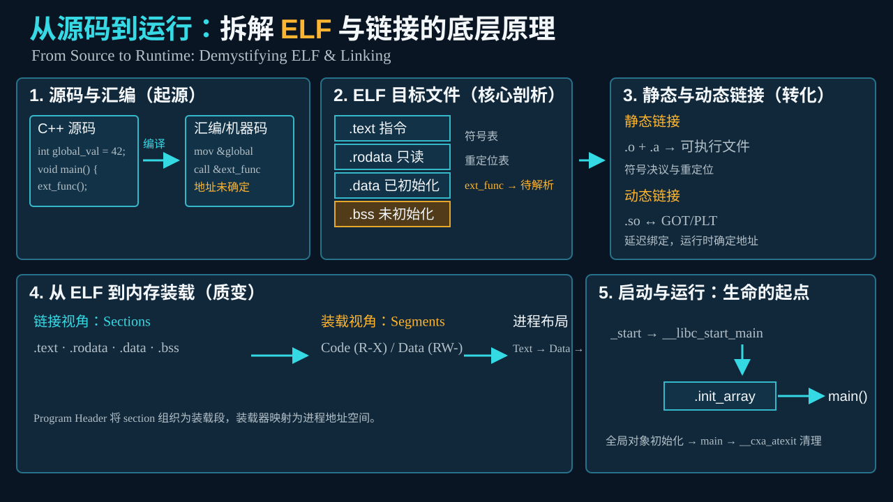

# C++ 底层机制进阶书单：从二进制到编译器与 ABI

先看懂编译器的输出，再理解语言机制，最后进入实现源码。每阶段只围绕几个可验证的问题阅读，完成检查点后再前进。本文是按学习目标组织的参考书导读，书籍章节请以手中版本目录为准。

## 路线总览与准备

| 阶段 | 前置知识 | 主要问题 | 阶段产出 |
| --- | --- | --- | --- |
| 1 · 破除黑盒 | 会写和编译小型 C/C++ 程序 | 源码如何成为 .o、库和可执行文件？ | 带注释的符号表、重定位与汇编记录 |
| 2 · 核心基石 | 能区分编译、链接、装载与调用约定 | 对象、继承、虚调用和库包装怎样落到存储？ | 类布局图和资源生命周期图 |
| 3 · 现代进阶 | 理解构造、析构、引用、模板与对象寿命 | 推导、闭包、约束和常量求值在哪一步发生？ | 源码、类型/AST、优化结果三栏对照 |
| 4 · 工业实现 | 能解释语义与常见降低过程的区别 | ABI 如何规定跨模块契约，编译器如何实施？ | 一个最小程序贯穿前端、优化与后端的追踪记录 |

推荐使用 Linux + GCC/binutils 建立 ELF 实验基线，记录 `g++ --version`、`g++ -dumpmachine`、标准库版本和编译选项。Windows PE/MSVC ABI、macOS Mach-O 与此基线不同；先固定一个环境，之后再比较。

已有练习可参考仓库 `booklets/implementation-lab.md`。每次只改变一个因素，例如继承方式、优化等级或异常说明。保留未经优化和优化后的产物；不要由一段汇编反推所有平台的标准行为。

## 第一阶段：破除黑盒

**目标：** 看懂编译器产出的汇编与 ELF，建立源码到目标文件、链接产物的具象映射。此阶段先不读 GCC 解析器。



这张图先建立一条主线：源码经编译形成带重定位信息的目标文件，链接器完成符号决议，装载器把 ELF 的装载段映射到进程地址空间，启动代码再进入全局对象初始化和 `main`。阅读本阶段的每本书时，都把新概念放回这五步中定位。

### 《程序员的自我修养：链接、装载与库》

俞甲子、石凡、潘爱民著。作为第一阶段主线，按常见版本重点读第 3、4、7、11 章：目标文件、静态链接、动态链接与运行库；装载知识不足时补读对应装载章节。

- 看 `.text`、`.rodata`、`.data`、`.bss`、符号表和重定位项，区分链接视角的 **section** 与装载视角的 **segment**。
- 比较 C++ 符号修饰前后名称，解释未定义符号、强弱符号及库搜索顺序。不要把某 ELF 链接器的决议规则直接当成 C++ ODR 的完整定义。
- 跟踪全局对象初始化与退出清理，查 `.init_array`、启动代码及 `__cxa_atexit` 等路径。`__libc_csu_init` 是特定 glibc/工具链历史实现中的入口，现代产物不一定保留同名路径；初始化也不宜概括为所有对象都在 main 前动态构造。

**阅读问题：** `.o` 中为什么已经有指令却仍不能直接运行？调用一个外部函数时，地址在什么时候确定？

### 《高级 C/C++ 编译技术》

英文名 *Advanced C and C++ Compiling*，Milan Stevanovic 著。配合 `nm`、`objdump`、`readelf`、`ar` 阅读静态库、动态库与二进制接口。

关注静态库作为目标文件归档的成员提取、共享库的动态符号与重定位，以及 PIC、PLT/GOT 的适用情况。ABI 兼容要分别检查名字、参数传递、对象布局、异常机制及运行库约定；“接口源码没改”不能证明二进制兼容。

### 《C++ 反汇编与逆向分析技术揭秘》

钱林松、赵海旭著。作为随查工具书，不必顺序读完。优先看函数栈帧、成员函数调用、虚调用及异常控制流。

书中处理器、位数和调用约定需要与实验对应：this 不固定在某一个寄存器，优化器也可能省略帧指针、内联函数或去虚化。try/catch 常依靠异常表和展开运行库，不能只寻找显式跳转来理解整个机制。

### 实验与进入下一阶段的条件

将一个带外部函数调用的程序拆成两个翻译单元，执行：

```bash
g++ -std=c++20 -O0 -g -c main.cpp -o main.o
g++ -std=c++20 -O0 -g -c helper.cpp -o helper.o
nm main.o
nm -C main.o
readelf -SW main.o
readelf -rW main.o
objdump -drC main.o
g++ main.o helper.o -o demo
readelf -lW demo
```

命令中的 main.cpp/helper.cpp 由你编写，helper.cpp 定义 main.cpp 调用的函数。完成后再用 `ar` 创建静态库、用 `-fPIC -shared` 创建共享库，对比链接与装载。

**检查点：** 能指出一个未定义符号、一处重定位、一个代码段，并解释为什么 `.bss` 在文件中的存储与运行时占用不同。还说不清这些时，回到目标文件章节，不急着进入对象模型。

## 第二阶段：核心基石

**承接：** 第一阶段认识了指令和符号；这一阶段解释同一段 C++ 源码为什么产生这些隐藏数据与调用。把“类变成 C 结构”当作辅助理解的模型，不假设编译器必须先生成 C 源码。

### 《深度探索 C++ 对象模型》

英文名 *Inside the C++ Object Model*，Stanley B. Lippman 著。它是连接汇编观察与语言机制的主线书。

重点读默认构造/拷贝构造、成员布局、单继承、多重继承、虚继承、虚表与成员函数指针。书中对需要生成非平凡默认构造行为的四类情形——相关成员对象、基类、虚函数、虚基类——有经典讨论；拷贝构造也有对应机制分析。不要把这些历史分类当成现代标准隐式声明、默认化、删除及平凡性规则的完整替代。

现代对照重点：用户声明的特殊成员如何影响移动生成；默认构造不保证所有标量成员清零；空基类优化、对齐与尾部填充可能影响偏移；成员函数指针不一定是单个代码地址。

配合 GCC 类信息转储：

```bash
g++ -std=c++20 -O0 -fdump-lang-class -c layout.cpp -o layout.o
```

先写单继承，再加入第二基类，最后加入虚基类。结合 `sizeof`、`alignof`、调试器和转储记录变化。该选项展示 GCC 的类/虚表信息，不等于可移植的完整逐成员偏移规范；非标准布局类也不能随意套用 `offsetof`。

### 《STL 源码剖析》

侯捷著。重点学习二级空间配置器的池化思路、迭代器分类与 traits 萃取，再理解容器如何分离存储分配和对象构造。

书中以历史 SGI STL 为主要背景；二级配置器不是今天所有 `std::allocator` 的规定实现。读完后选择**与本机版本一致**的 GCC libstdc++ 源码，对照：

- `libstdc++-v3/include/bits/shared_ptr_base.h`：对象与控制块、强弱计数、删除器、make_shared 的常见合并分配。
- `libstdc++-v3/include/bits/std_function.h`：类型擦除、管理函数、调用分派和小对象优化（SBO，也常称 SOO）。缓冲大小与容纳条件是实现细节。

### 实验与进入下一阶段的条件

为一个带虚析构的基类增加两个派生类，比较直接调用与通过基类指针调用的汇编。再分别观察 unique_ptr、shared_ptr、weak_ptr 的释放时机，画出对象和控制块的生命周期。

**检查点：** 能解释虚调用何时需要间接寻址、移动为何不必深拷贝、弱引用为何不延长对象寿命却可能延长控制块寿命。若仍将所有对象都视作“指针加若干字段”，先补构造/析构及布局实验。

## 第三阶段：现代进阶

**承接：** 已能解释对象布局与生命周期，再研究语法如何建立类型、生成闭包并筛选模板。区分语言语义、示意脱糖与实际代码生成。

### 《Effective Modern C++》

Scott Meyers 著，主要面向 C++11/14。重点读第 1–5 章涉及的类型推导、auto、现代声明、智能指针、移动与完美转发；**lambda 专题在第 6 章**，需补读。

把每条建议转成编译器问题：模板参数怎样推导？auto 怎样丢弃顶层限定？引用如何折叠？重载决议为何选择复制或移动？std::move/forward 是转换工具，资源转移由选中的函数实现，不能把整个移动操作统一称作零开销。

书中 “universal reference” 常对应今天所称的 **forwarding reference（转发引用）**，并非所有 T&& 都满足其条件。Lambda 的按值捕获形成闭包状态，按引用捕获的物理表示由实现决定。

### 《Programming with C++20》

Andreas Fertig 著，配合 [C++ Insights](https://cppinsights.io/) 及其[源码](https://github.com/andreasfertig/cppinsights)阅读。书以 C++20 为中心，工具可以帮助观察更早版本的结构化绑定（C++17）、范围 for（C++11）及 constexpr（C++11 起演进）。

观察源码中的隐式对象、范围变量、调用运算符与实例化结果。C++ Insights 提供基于 Clang 的教育性转换，不是标准强制的等价源代码，也不代表优化后的汇编；常量求值与协程降低还需要结合编译器文档。

协程重点追踪 promise、挂起点、跨挂起点存活的局部对象、resume/destroy 责任。编译器通常形成可恢复状态机与协程帧；帧**不保证在堆上**，满足条件可消除分配，状态机也**不保证以源码级 switch-case 表示**。协程语言支持本身不提供执行器或线程切换。

### 《C++ Templates: The Complete Guide》第 2 版

David Vandevoorde、Nicolai M. Josuttis、Douglas Gregor 著。接在推导与类型萃取之后读，不必一开始通读。

原书单的“1016”“2128”在此理解为 **10–16、21–28 章**，并按第二版主题细化：

- 第 10 章基础术语、第 12–16 章模板细节、名称查找、实例化、推导、特化与重载，构成机制主线；第 11 章补泛型库实践。
- 第 19 章 traits 与 policy、第 21 章模板与继承、第 23–25 章元编程、typelist 与 tuple，适合继续深入；第 22、26–28 章按桥接、判别联合、表达式模板和调试需求选读。
- 第二版以 C++17 时代内容为基础，不能当作 C++20 Concepts 最终规范。约束规范化、满足性与偏序另读 C++20 资料及[工作草案的约束章节](https://eel.is/c++draft/temp.constr)。

理解依赖名称与两阶段查找、SFINAE 的立即上下文边界、变参展开。traits 并非都靠编译器内建：有的可用模板组合表达，有的依赖实现提供的类型信息。Concepts 改善约束表达与候选选择，不会证明业务语义公理。

### 实验与进入下一阶段的条件

为同一功能写普通函数、lambda 与模板版本；用 static_assert 验证推导结果，再比较 AST 和 `-O0/-O2`。为一个模板分别加入 SFINAE 与 requires，记录合法调用和失败诊断。最后画出一个最小协程的帧中哪些对象必须跨挂起点保存。

**检查点：** 能区分编译期拒绝、编译期求值、优化期折叠和运行时执行；能解释优化后看不见闭包为何不代表源语言没有闭包对象。达到这里再进入工业源码。

## 第四阶段：工业级编译器与 ABI

**承接：** 先拿第三阶段的小程序提出一个明确问题，再去规范与源码定位。不要从 gcc/cp/ 第一行开始逐文件阅读。

### Itanium C++ ABI 官方规范

[主规范](https://itanium-cxx-abi.github.io/cxx-abi/abi.html)是 ABI 规范，不是 ISO C++ 语言标准。GCC/Clang 在许多平台采用该 ABI 家族；Windows MSVC ABI 等目标不同，不能说两者所有目标共同遵循它。

- 第 2 节数据布局：重点 2.3 成员指针、2.4 非 POD 类布局、2.5 虚表、2.6 构造期间虚表与 VTT。
- 第 3 节调用与运行时接口：重点 3.3.2 一次性构造 API，观察 `__cxa_guard_acquire/release/abort`。守卫协议要求正确同步，但不规定所有实现都使用同一种锁。
- 第 5.1 节符号修饰：把第一阶段 nm 的输出与文法对照。
- [独立异常处理 ABI](https://itanium-cxx-abi.github.io/cxx-abi/abi-eh.html)：了解展开器、personality、handler 搜索和清理阶段。ELF/DWARF 实现常用 `.eh_frame` 和语言相关数据，但不能把某段名当作全部目标平台的统一要求。

“零开销异常”通常指正常路径避免某些动态注册成本，不代表代码体积、元数据或抛出路径没有成本。

### 《深入分析 GCC》与 GCC 官方内部手册

王亚刚著的《深入分析 GCC》用于建立结构认知；实现年代与当前 GCC 可能差异很大。配合 [GNU Compiler Collection Internals](https://gcc.gnu.org/onlinedocs/gccint/) 和 [GCC 源码](https://gcc.gnu.org/git.html)，选择同一个发布标签阅读。GCC 当前是编译器集合，官方手册不宜只称为 GNU C Compiler Internals。

从 `gcc/cp/` 的 C++ 前端切入，认识 cc1plus 这个前端可执行程序。解析与语义分析使用 tree 及 C++ 专有节点，经相应转换形成 GENERIC/GIMPLE 等表示；GIMPLE 常进入 SSA 形式，经过 pass 优化后向 RTL 等后端表示推进。它不是每条语句恰好“一行 AST → 一行三地址码”的固定直线。

按问题定位解析、模板、类布局或协程代码，再查 pass 的输入输出、前置条件与不变量。不要混用某本旧书的函数名和当前分支行号。

### 《编译器设计》（Engineering a Compiler）

Keith D. Cooper、Linda Torczon 著。可用第 2 或第 3 版，按主题而非跨版章号定位：控制流图、支配关系、数据流分析、SSA、优化与寄存器分配。

先理解 phi 节点如何合并不同前驱的值，再看死代码消除、常量传播与循环变换；最后理解指令选择、活跃性、寄存器分配和溢出到栈。把理论与 GCC pass 对齐时，区分教材算法与实现为目标平台、编译时间作出的折中。

### 实验与最终检查点

对第三阶段保留的小程序生成 GCC 转储：

```bash
g++ -std=c++20 -O2 -fdump-tree-original -fdump-tree-gimple -fdump-tree-ssa -fdump-tree-optimized -fdump-rtl-expand -c probe.cpp -o probe.o
```

`probe.cpp` 可从只含一个条件分支和整数运算的函数开始；转储名称、内容和 pass 随 GCC 版本变化。先追踪一个变量经过分支合并、常量传播及代码生成的过程，再加入模板或对象。

**检查点：** 能提交一份简短说明：源语言保证是什么，ABI 约束是什么，编译器在哪个表示上作了什么变换，以及换一个优化等级或目标架构后哪些结论需要重验。无法解释某个 pass 时，退回对应 CFG/SSA 理论和最小程序，而不是扩大源码阅读范围。

## 软件设计补充路线

完成对象模型阶段后，可并行阅读[C++ 入门与软件设计：四阶段参考书导读](cpp-software-design.md)。它补充 Iglberger、Pikus 与 Nesteruk 的设计原则和模式实践，并直接链接资料库中的 Google Drive 文件；不打断本页四阶段的机制学习顺序。

## 阅读记录与资料边界

每次记录六项：书名及版次、问题、标准/ABI 依据、最小源码、工具链与选项、观察结果。书里的实现描述用实验核对；实验不能替代标准的合法性判断。

本路线保留所给书单的全部书目，并修正章节范围、作者补全和实现适用范围。这里收录导读与官方公开链接，不提供未获许可的原书全文。本文的编译命令是练习步骤，不声称已经验证所有书籍版本、处理器或运行库。
